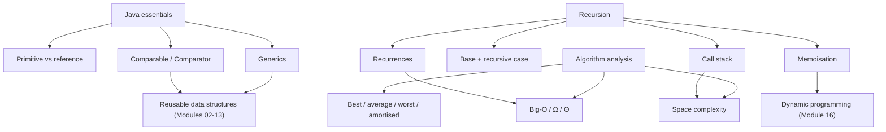

# Module 01 · Java Refresher and Complexity

Prepared by **Hamna Zahid Khan**, Junior Lecturer

[🏠 Course home](../README.md)

> ⏱ 9 contact hours · 3 sessions · 🟢 Foundation

Before we build data structures we need two tools: **fluent Java** (references, generics, comparators) and a way to **measure** algorithms (Big-O). This module also introduces **recursion**, which powers trees, sorting, backtracking and dynamic programming later in the course.

## 🎯 Module objectives

After this module you can:

- predict what Java methods can change when given primitives vs objects;
- write generic classes/methods and order objects with `Comparable` / `Comparator`;
- derive the time and space complexity of iterative and recursive code;
- design, trace and analyse recursive methods and fix exponential recursion with memoisation.

## 📚 Sessions

| # | Session | Key ideas | Code |
|---|---|---|---|
| 1 | [Java Refresher for Data Structures](session-01-java-refresher-for-dsa.md) | references, generics, Comparable/Comparator, ArrayList | [`JavaRefresher.java`](src/JavaRefresher.java) |
| 2 | [Asymptotic Analysis and Big-O](session-02-asymptotic-analysis-big-o.md) | O/Ω/Θ, loop analysis, best/worst case, space | [`OperationCounter.java`](src/OperationCounter.java) |
| 3 | [Recursion Fundamentals](session-03-recursion-fundamentals.md) | base case, call stack, recurrences, memoisation | [`RecursionBasics.java`](src/RecursionBasics.java) |
| ✍️ | [Practice test](practice-test.md) | 20 MCQs + 3 coding scenarios | [`Labs01.java`](src/Labs01.java), [`SelfCheck.java`](src/SelfCheck.java) |

## 🗺️ Concept map



## 📄 One-page cheat sheet

**Java**

| Topic | Remember |
|---|---|
| Parameter passing | always by value; for objects the value is a reference |
| Equality | `==` identity, `equals()` content |
| Generic method | `static <T extends Comparable<T>> T max(T[] a)` |
| Natural order | `class X implements Comparable<X>` + `compareTo` |
| Custom order | `Comparator.comparing(...).reversed().thenComparing(...)` |
| Safe comparison | `Integer.compare(a, b)`, never `a - b` |
| `List<Integer>.remove` | `remove(int)` = index, `remove(Integer.valueOf(v))` = value |

**Big-O rules:** drop constants · drop lower terms · sequential ⇒ add · nested ⇒ multiply · halving ⇒ log n · state space too.

| Class | Name | Example |
|---|---|---|
| O(1) | constant | array index, HashMap get (expected) |
| O(log n) | logarithmic | binary search, fast power |
| O(n) | linear | linear search, one pass |
| O(n log n) | linearithmic | merge sort, heap sort |
| O(n²) | quadratic | bubble sort, all pairs |
| O(2ⁿ) | exponential | all subsets, naive Fibonacci |
| O(n!) | factorial | all permutations |

**Standard recurrences**

| Recurrence | Result |
|---|---|
| T(n) = T(n−1) + 1 | O(n) |
| T(n) = T(n/2) + 1 | O(log n) |
| T(n) = 2T(n/2) + n | O(n log n) |
| T(n) = 2T(n−1) + 1 | O(2ⁿ) |

**Recursion checklist:** base case first · each call shrinks the input · trust the smaller call · combine · memoise repeated sub-problems · iterate if depth > ~10⁴.

## ▶️ Run the code

```bash
cd 01-java-refresher-and-complexity/src
javac -d out *.java
java -ea -cp out SelfCheck
java -cp out RecursionBasics
```

See [`src/README.md`](src/README.md) for every file.
