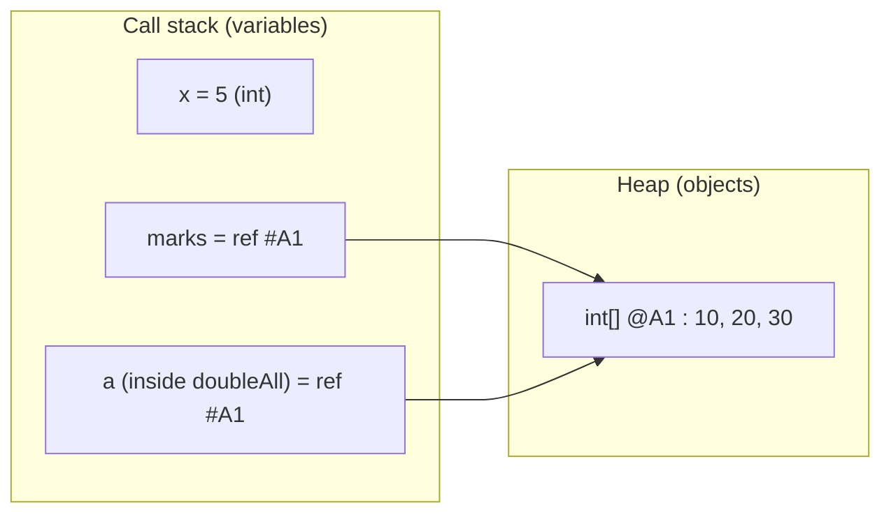
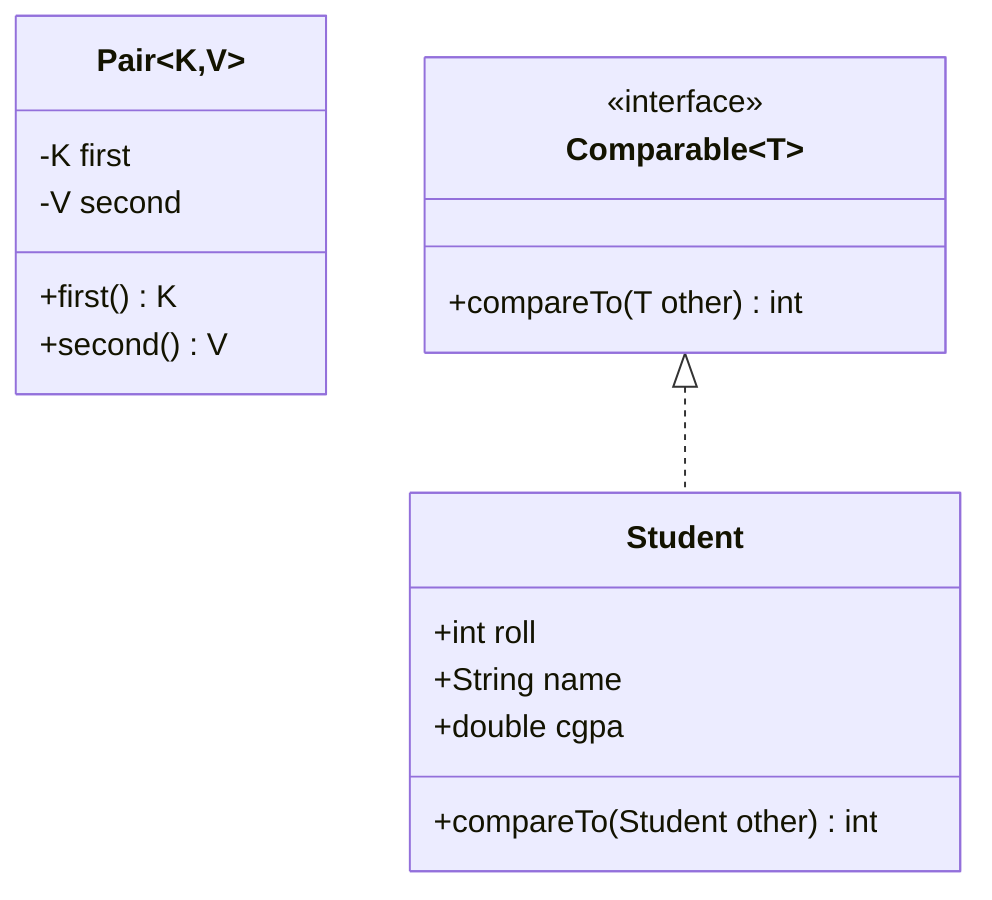

# Session 1 · Java Refresher for Data Structures

Prepared by **Hamna Zahid Khan**, Junior Lecturer

[🏠 Course home](../README.md) · [📘 Module overview](./README.md) · [⬅ Module overview](./README.md) · [Next ➡](./session-02-asymptotic-analysis-big-o.md)

> **Module 01 · Java Refresher and Complexity** · ⏱ 3 hours (90 min lecture + 90 min lab)

## 🎯 Learning objectives

By the end of this session you will be able to:

1. Explain the difference between **primitive** and **reference** types and predict what a method call can and cannot change.
2. Use **arrays** and **`ArrayList`** confidently, including autoboxing and the `remove(int)` vs `remove(Object)` trap.
3. Write **generic classes and generic methods** with bounded type parameters (`<T extends Comparable<T>>`).
4. Order objects with **`Comparable`** (natural order) and **`Comparator`** (any custom order).
5. Read the Java code style used for the rest of this course.

---

## 1. Why a refresher before Data Structures?

Every data structure in this course (linked lists, trees, heaps, graphs) is a **Java class that holds references to other objects**. If the difference between "a variable that holds a value" and "a variable that holds an address" is fuzzy, linked lists will feel like magic and bugs will feel random.

> 🏠 **Analogy: a house vs its address.** A primitive variable (`int x = 5`) is like a box with the value *inside* it. A reference variable (`int[] marks`) is like a slip of paper with a **house address** written on it. Photocopying the slip (passing it to a method) gives the method the *same address*, so it can walk into the same house and rearrange the furniture. But if the method scribbles a new address on *its copy*, your slip does not change.

Java is always **pass-by-value**. For objects, the *value* that is copied is the reference.



Both `marks` (in `main`) and `a` (inside `doubleAll`) point to the **same** array object, so changes made through `a` are visible through `marks`.

---

## 2. Primitive vs reference: a trace table

Consider this sequence from `JavaRefresher.main`:

```java
int x = 5;
tryToChange(x);          // inside: x = 999
int[] marks = {10, 20, 30};
doubleAll(marks);        // inside: a[i] *= 2
```

| Step | Statement | `x` in main | `marks` in main | Array object @A1 |
|---|---|---|---|---|
| 1 | `int x = 5` | 5 | – | – |
| 2 | enter `tryToChange(5)`, local copy set to 999 | **5** (unchanged) | – | – |
| 3 | `int[] marks = {10,20,30}` | 5 | ref @A1 | 10, 20, 30 |
| 4 | `doubleAll(marks)`, i = 0 | 5 | ref @A1 | **20**, 20, 30 |
| 5 | i = 1 | 5 | ref @A1 | 20, **40**, 30 |
| 6 | i = 2 | 5 | ref @A1 | 20, 40, **60** |

**Rule to remember:** a method can *mutate* an object you pass in, but it can never make *your variable* point somewhere else.

### `==` vs `equals()`

| Expression | Compares | Typical use |
|---|---|---|
| `a == b` on primitives | values | `if (count == 0)` |
| `a == b` on objects | **addresses** (same object?) | identity checks, `null` checks |
| `a.equals(b)` | contents (as defined by the class) | Strings, Integers, your own classes |

`Integer` caches the values −128…127, so `Integer a = 100, b = 100; a == b` happens to be `true`, while the same test with `1000` is `false`. Never rely on this: use `equals()`.

---

## 3. Generics: one container, many types

> 📦 **Analogy: a labelled storage box.** A box labelled "Books" only accepts books, and whatever you take out is guaranteed to be a book: no checking needed. A generic class `Box<T>` is a box whose label (`T`) is chosen when you create it.

Without generics we would write one `IntStack`, one `StringStack`, one `StudentStack`... With generics we write `Stack<T>` once.



### Bounded type parameters

`static <T extends Comparable<T>> T maxOf(T[] items)` reads as: *"for any type `T` that knows how to compare itself with another `T`..."*. The bound is what lets us call `item.compareTo(best)` inside the method. `Integer`, `String`, `Double` and our `Student` all satisfy it.

**Dry run: `maxOf({42, 7, 99, 15})`**

| Iteration | `item` | `item.compareTo(best)` | `best` after |
|---|---|---|---|
| start | – | – | 42 |
| 1 | 42 | 0 | 42 |
| 2 | 7 | negative | 42 |
| 3 | 99 | positive | **99** |
| 4 | 15 | negative | 99 |

---

## 4. Comparable vs Comparator

| | `Comparable<T>` | `Comparator<T>` |
|---|---|---|
| Lives in | the class itself | a separate object / lambda |
| Method | `compareTo(T o)` | `compare(T a, T b)` |
| How many orders | exactly one ("natural") | as many as you like |
| Used by | `Collections.sort(list)`, `TreeMap`, `PriorityQueue` default | `list.sort(cmp)`, `new PriorityQueue<>(cmp)` |
| Example | students by roll number | students by CGPA descending, then name |

The **contract**: return a negative number if the first object should come first, zero if they tie, positive otherwise. Use `Integer.compare(a, b)` instead of `a - b`; subtraction overflows for large values (e.g. `Integer.MIN_VALUE - 1`).

---

## 5. Complexity of the operations we used

| Operation | Time | Extra space | Note |
|---|---|---|---|
| `arr[i]` read/write | O(1) | O(1) | direct address arithmetic |
| `ArrayList.get(i)` / `set` | O(1) | O(1) | backed by an array |
| `ArrayList.add(x)` at end | O(1) amortised | O(1) | occasional O(n) resize |
| `ArrayList.add(0, x)` / `remove(0)` | O(n) | O(1) | shifts every element |
| `ArrayList.remove(Object)` | O(n) | O(1) | linear search + shift |
| `list.sort(cmp)` | O(n log n) | O(n) | TimSort, stable |
| `maxOf` / `minMax` | O(n) | O(1) | one pass |

---

## 6. Worked examples (basic → advanced)

**Example 1 (basic): `minMax` in a single pass.** Instead of two loops (one for min, one for max) we update both in the same iteration and return them together in a `Pair<Integer, Integer>`. Same O(n), half the passes.

**Example 2 (intermediate): `remove(int)` vs `remove(Object)`.** On `List<Integer> list = [1, 4, 9, 16, 25]`:

| Call | Which overload? | Result |
|---|---|---|
| `list.remove(Integer.valueOf(9))` | `remove(Object)`: removes the *value* 9 | `[1, 4, 16, 25]` |
| `list.remove(0)` | `remove(int index)`: removes *position* 0 | `[4, 16, 25]` |

**Example 3 (advanced): a multi-key comparator.** Sort students by CGPA (highest first), breaking ties alphabetically:

```java
Comparator.comparingDouble((Student st) -> st.cgpa).reversed()
          .thenComparing(st -> st.name);
```

Bilal and Sana both have 3.9; `thenComparing` puts Bilal first.

---

## 7. Complete program

📄 **[`src/JavaRefresher.java`](src/JavaRefresher.java)**

```java
import java.util.ArrayList;
import java.util.Arrays;
import java.util.Comparator;
import java.util.List;

/**
 * Module 01 · Session 01 — Java refresher for Data Structures.
 *
 * Demonstrates the Java features we lean on for the rest of the course:
 *   1. primitive vs reference types (and why "==" can surprise you)
 *   2. arrays and their fixed size
 *   3. generic classes (Pair<K, V>) and generic methods (maxOf)
 *   4. interfaces: Comparable (natural order) and Comparator (custom order)
 *   5. ArrayList, autoboxing and the enhanced for-loop
 *
 * Compile:  javac -d out JavaRefresher.java
 * Run:      java -cp out JavaRefresher
 *
 * Prepared by Hamna Zahid Khan, Junior Lecturer
 */
public class JavaRefresher {

    /** A tiny immutable generic pair: the "two-slot box" we use for (key, value) results. */
    static final class Pair<K, V> {
        private final K first;
        private final V second;

        Pair(K first, V second) {
            this.first = first;
            this.second = second;
        }

        K first() { return first; }
        V second() { return second; }

        @Override
        public String toString() { return "(" + first + ", " + second + ")"; }
    }

    /** A student record with a natural ordering by roll number. */
    static final class Student implements Comparable<Student> {
        final int roll;
        final String name;
        final double cgpa;

        Student(int roll, String name, double cgpa) {
            this.roll = roll;
            this.name = name;
            this.cgpa = cgpa;
        }

        /** Natural order: ascending roll number. Negative = this comes first. */
        @Override
        public int compareTo(Student other) {
            return Integer.compare(this.roll, other.roll);
        }

        @Override
        public String toString() { return roll + ":" + name + "(" + cgpa + ")"; }
    }

    /**
     * Generic method: returns the largest element of a non-empty array.
     * The bound <T extends Comparable<T>> guarantees compareTo exists.
     */
    static <T extends Comparable<T>> T maxOf(T[] items) {
        if (items.length == 0) throw new IllegalArgumentException("empty array");
        T best = items[0];
        for (T item : items) {
            if (item.compareTo(best) > 0) best = item;
        }
        return best;
    }

    /** Returns (min, max) of an int array in ONE pass, packed in a Pair. */
    static Pair<Integer, Integer> minMax(int[] a) {
        int min = a[0], max = a[0];
        for (int i = 1; i < a.length; i++) {
            if (a[i] < min) min = a[i];
            if (a[i] > max) max = a[i];
        }
        return new Pair<>(min, max);
    }

    /** Arrays are objects: a method receiving an array can change the caller's data. */
    static void doubleAll(int[] a) {
        for (int i = 0; i < a.length; i++) a[i] *= 2;
    }

    /** Primitives are copied: the caller's variable is NOT changed. */
    static void tryToChange(int x) {
        x = 999;
    }

    public static void main(String[] args) {
        System.out.println("=== 1. Primitive vs reference ===");
        int x = 5;
        tryToChange(x);
        System.out.println("x after tryToChange(x): " + x);
        int[] marks = {10, 20, 30};
        doubleAll(marks);
        System.out.println("marks after doubleAll: " + Arrays.toString(marks));

        String s1 = new String("dsa");
        String s2 = new String("dsa");
        System.out.println("s1 == s2      -> " + (s1 == s2) + "   (different objects)");
        System.out.println("s1.equals(s2) -> " + s1.equals(s2) + "    (same content)");

        System.out.println("\n=== 2. Generics ===");
        Integer[] nums = {42, 7, 99, 15};
        String[] words = {"queue", "array", "tree", "stack"};
        System.out.println("maxOf(nums)  = " + maxOf(nums));
        System.out.println("maxOf(words) = " + maxOf(words));
        System.out.println("minMax({8,3,11,-2,6}) = " + minMax(new int[]{8, 3, 11, -2, 6}));

        System.out.println("\n=== 3. Comparable and Comparator ===");
        List<Student> cls = new ArrayList<>();
        cls.add(new Student(103, "Ayesha", 3.4));
        cls.add(new Student(101, "Bilal", 3.9));
        cls.add(new Student(104, "Sana", 3.9));
        cls.add(new Student(102, "Danish", 2.8));

        List<Student> byRoll = new ArrayList<>(cls);
        byRoll.sort(null); // null comparator = natural order (compareTo)
        System.out.println("by roll           : " + byRoll);

        List<Student> byCgpa = new ArrayList<>(cls);
        byCgpa.sort(Comparator.comparingDouble((Student st) -> st.cgpa).reversed()
                .thenComparing(st -> st.name));
        System.out.println("by cgpa desc, name: " + byCgpa);
        System.out.println("top student       : " + maxOf(cls.toArray(new Student[0])) + " (max by natural order = highest roll)");

        System.out.println("\n=== 4. ArrayList and autoboxing ===");
        List<Integer> list = new ArrayList<>();
        for (int i = 1; i <= 5; i++) list.add(i * i); // int -> Integer (autoboxing)
        int sum = 0;
        for (int v : list) sum += v;                  // Integer -> int (unboxing)
        System.out.println("squares = " + list + ", sum = " + sum);
        list.remove(Integer.valueOf(9)); // remove the VALUE 9
        list.remove(0);                  // remove the element at INDEX 0
        System.out.println("after remove(value 9) and remove(index 0): " + list);

        Integer big1 = 1000, big2 = 1000;
        System.out.println("Integer 1000 == 1000 ? " + (big1 == big2) + "  -> always use equals() for objects");
    }
}
```

**Real output:**

```text
$ java -cp out JavaRefresher
=== 1. Primitive vs reference ===
x after tryToChange(x): 5
marks after doubleAll: [20, 40, 60]
s1 == s2      -> false   (different objects)
s1.equals(s2) -> true    (same content)

=== 2. Generics ===
maxOf(nums)  = 99
maxOf(words) = tree
minMax({8,3,11,-2,6}) = (-2, 11)

=== 3. Comparable and Comparator ===
by roll           : [101:Bilal(3.9), 102:Danish(2.8), 103:Ayesha(3.4), 104:Sana(3.9)]
by cgpa desc, name: [101:Bilal(3.9), 104:Sana(3.9), 103:Ayesha(3.4), 102:Danish(2.8)]
top student       : 104:Sana(3.9) (max by natural order = highest roll)

=== 4. ArrayList and autoboxing ===
squares = [1, 4, 9, 16, 25], sum = 55
after remove(value 9) and remove(index 0): [4, 16, 25]
Integer 1000 == 1000 ? false  -> always use equals() for objects
```

---

## 8. Real-life problem: a class result board

**Problem.** The examination office sends you a list of `(roll, name, CGPA)` records. Produce (a) the list by roll number for attendance, (b) a merit list by CGPA (highest first, ties alphabetical), and (c) the topper.

**Solution design.**

1. Make `Student implements Comparable<Student>` with natural order = roll number, because attendance is the "default" view.
2. For the merit list, do **not** change the class; pass a `Comparator` instead.
3. Copy the list before sorting (`new ArrayList<>(cls)`) so each view is independent.

The program above does exactly this (section 3 of its output). Note how `maxOf(...)` returned the student with the **highest roll**, not the topper: natural order decides what "max" means. To get the topper, use the merit comparator: `Collections.max(cls, Comparator.comparingDouble(s -> s.cgpa))`.

---

## 9. Common mistakes

| Mistake | Symptom | Fix |
|---|---|---|
| Comparing strings with `==` | "equal" strings compare `false` | `s1.equals(s2)` |
| `compareTo` written as `a.roll - b.roll` | wrong order for very large/negative values | `Integer.compare(a.roll, b.roll)` |
| `list.remove(5)` on `List<Integer>` meaning "value 5" | removes index 5 / `IndexOutOfBoundsException` | `list.remove(Integer.valueOf(5))` |
| Creating a generic array `new T[n]` | compile error | `(T[]) new Object[n]` with `@SuppressWarnings("unchecked")`, or use `ArrayList<T>` |
| Modifying a list inside a for-each over it | `ConcurrentModificationException` | use an `Iterator` and `it.remove()`, or `removeIf` |
| Forgetting arrays are fixed size | `ArrayIndexOutOfBoundsException` | use `ArrayList` or resize manually (Module 02) |

## 10. Best practices

- Prefer **interfaces as declared types**: `List<Integer> list = new ArrayList<>();`.
- Make small value classes **`final` with `final` fields**; immutable objects are safe to share.
- Always override `toString()` in your data classes; debugging becomes printing.
- Keep methods **short and single-purpose** (`minMax`, `maxOf`), which also makes them testable.
- Write a `main` demo *and* a self-check (see [`SelfCheck.java`](src/SelfCheck.java)) for every structure you build.

---

## 11. Lab tasks

**Lab 1.1: Generic swap.** Write `static <T> void swap(T[] arr, int i, int j)` and use it to reverse an array of names.

<details>
<summary>💡 Hint</summary>

You need one temporary variable of type `T`. Reversing = swapping `i` with `n-1-i` for `i < n/2`.

</details>

<details>
<summary>✅ Solution</summary>

```java
/** Generic swap: works for an array of ANY reference type. */
static <T> void swap(T[] arr, int i, int j) {
    T tmp = arr[i];
    arr[i] = arr[j];
    arr[j] = tmp;
}
```
<sub>Full, compiled version: [`src/Labs01.java`](src/Labs01.java)</sub>

</details>

**Lab 1.2: Custom ordering.** Sort `{"stack","map","queue","heap","set","graph"}` so shorter words come first and equal lengths are alphabetical.

<details>
<summary>💡 Hint</summary>

`Comparator.comparingInt(String::length)` handles the first key; chain `.thenComparing(...)` for the second.

</details>

<details>
<summary>✅ Solution</summary>

```java
/** Shorter words first; ties broken alphabetically. */
static final Comparator<String> BY_LENGTH_THEN_ALPHA =
        Comparator.comparingInt(String::length).thenComparing(Comparator.naturalOrder());
```
<sub>Full, compiled version: [`src/Labs01.java`](src/Labs01.java)</sub>

Expected order: `[map, set, heap, graph, queue, stack]`.

</details>

**Lab 1.3: Second largest.** Return the second largest **distinct** value of an `int[]` in one pass, e.g. `{4, 9, 9, 7, 1}` → `7`.

<details>
<summary>💡 Hint</summary>

Track two variables, `first` and `second`. When a new maximum arrives, the old maximum becomes `second`. Ignore values equal to `first`.

</details>

<details>
<summary>✅ Solution</summary>

```java
/** Second largest DISTINCT value in one pass; throws if it does not exist. */
static int secondLargest(int[] a) {
    Integer first = null, second = null;
    for (int v : a) {
        if (first == null || v > first) {
            second = first;
            first = v;
        } else if (v != first && (second == null || v > second)) {
            second = v;
        }
    }
    if (second == null) throw new IllegalArgumentException("no second largest");
    return second;
}
```
<sub>Full, compiled version: [`src/Labs01.java`](src/Labs01.java)</sub>

</details>

Run all lab solutions:

```text
$ java -cp out Labs01
swap -> [Zara, Omar, Hina]
by length then alpha -> [map, set, heap, graph, queue, stack]
secondLargest({4, 9, 9, 7, 1}) = 7
duplicates? brute=true sorted=true hash=true
pairWithSum({1,3,4,6,8,11}, 10) -> indices [2, 3]
arraySum({3,1,4,1,5}) = 14
reverse("recursion") = noisrucer
gridPaths(2,2) = 6, gridPaths(5,5) = 252
5 4 3 2 1 Go!
```

---

## 12. Quiz

**Q1.** What does `doubleAll(marks)` do to the caller's array `marks`?

- **A.** Nothing, Java is pass-by-value
- **B.** It doubles every element, because the method receives a copy of the reference to the same array
- **C.** It throws an exception
- **D.** It creates a new doubled array and makes `marks` point to it

**Q2.** Which declaration allows calling `compareTo` on elements of type `T`?

- **A.** `<T> T maxOf(T[] a)`
- **B.** `<T extends Object> T maxOf(T[] a)`
- **C.** `<T extends Comparable<T>> T maxOf(T[] a)`
- **D.** `<T super Comparable> T maxOf(T[] a)`

**Q3.** On `List<Integer> list = [10, 20, 30]`, what does `list.remove(1)` do?

- **A.** Removes the value 1 (not found, no change)
- **B.** Removes the element at index 1, leaving `[10, 30]`
- **C.** Removes the first element
- **D.** Compile error

**Q4.** Why is `Integer.compare(a, b)` preferred over `a - b` in `compareTo`?

- **A.** It is faster
- **B.** Subtraction can overflow and give the wrong sign
- **C.** `a - b` does not compile
- **D.** It sorts in descending order

**Q5.** You need students sorted by CGPA in one screen and by name in another, without changing the `Student` class. Use:

- **A.** Two `compareTo` methods
- **B.** Two `Comparator` objects
- **C.** `equals()`
- **D.** `hashCode()`

<details>
<summary><b>Show answers</b></summary>

1. **B**: The reference is copied, but both copies point to the same array object.
2. **C**: The bound guarantees every `T` has a `compareTo(T)` method.
3. **B**: An `int` argument selects the `remove(int index)` overload.
4. **B**: For example `Integer.MIN_VALUE - 1` overflows to a large positive number.
5. **B**: A class has one natural order; any number of `Comparator`s can be defined outside it.

</details>

---

## 13. Summary

- Java passes **copies of values**; for objects that value is a **reference**, so methods can mutate shared objects but not rebind your variables.
- Use `equals()` for content equality; `==` on objects checks identity.
- **Generics** let one data structure serve every type with compile-time safety; **bounds** (`extends Comparable<T>`) unlock the methods you need.
- **`Comparable`** = one natural order inside the class; **`Comparator`** = any number of external orders, easily chained.
- `ArrayList` gives O(1) indexed access and amortised O(1) append, but O(n) insert/remove at the front.

## 14. Viva / interview questions

1. Is Java pass-by-reference? Explain with an array example.
2. What is type erasure, and why can't you write `new T[10]`?
3. What is the difference between `Comparable` and `Comparator`? When would a class implement `Comparable`?
4. Why should `compareTo` be consistent with `equals`?
5. What happens internally when an `ArrayList` runs out of capacity?
6. Explain autoboxing. Name one performance and one correctness pitfall it can cause.
7. Why does `Integer a = 127, b = 127; a == b` print `true` but the same with `128` print `false`?
8. What is a `ConcurrentModificationException` and how do you avoid it?

---

[⬅ Module overview](./README.md) · [📘 Module overview](./README.md) · [Next ➡](./session-02-asymptotic-analysis-big-o.md)
