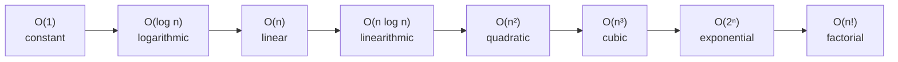
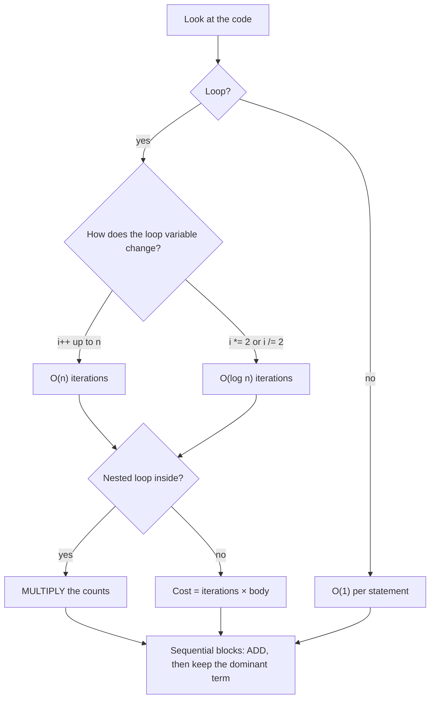

# Session 2 · Asymptotic Analysis and Big-O

Prepared by **Hamna Zahid Khan**, Junior Lecturer

[🏠 Course home](../README.md) · [📘 Module overview](./README.md) · [⬅ Previous](./session-01-java-refresher-for-dsa.md) · [Next ➡](./session-03-recursion-fundamentals.md)

> **Module 01 · Java Refresher and Complexity** · ⏱ 3 hours (90 min lecture + 90 min lab)

## 🎯 Learning objectives

1. Explain why we measure algorithms by **growth rate** rather than seconds.
2. Define **Big-O, Big-Ω and Big-Θ** and use them correctly.
3. Derive the complexity of loops, nested loops, halving loops and sequential blocks.
4. Distinguish **best, average and worst case**, and **time vs space** complexity.
5. Recognise the common growth classes O(1) → O(log n) → O(n) → O(n log n) → O(n²) → O(2ⁿ) → O(n!).

---

## 1. Why not just use a stopwatch?

Timing a program tells you how fast *this* code ran on *this* laptop with *this* input. Change the CPU, the JVM, or the input size and the number changes. We want a measure that is a property of the **algorithm**.

> 🚗 **Analogy: two routes from Saddar to Clifton.** Route A has a fixed 10-minute toll queue but then the road is clear. Route B has no queue but one traffic light *per kilometre*. For a short trip B wins; for a long trip A wins. What matters for long trips is **how the time grows with distance**, not the fixed 10 minutes. Big-O describes that growth.

So we count **basic operations** (comparisons, assignments, array accesses) as a function of the input size `n`, then keep only the fastest-growing term.

## 2. The three notations

| Notation | Meaning | Informal reading | Formal definition |
|---|---|---|---|
| **O(g(n))** | upper bound | "grows **no faster** than g" | ∃ c > 0, n₀: f(n) ≤ c·g(n) for all n ≥ n₀ |
| **Ω(g(n))** | lower bound | "grows **at least as fast** as g" | ∃ c > 0, n₀: f(n) ≥ c·g(n) for all n ≥ n₀ |
| **Θ(g(n))** | tight bound | "grows **exactly like** g" | f is both O(g) and Ω(g) |

**Worked proof.** Show f(n) = 3n² + 5n + 20 is O(n²).
For n ≥ 1: 5n ≤ 5n² and 20 ≤ 20n², so f(n) ≤ 3n² + 5n² + 20n² = 28n². Choose c = 28, n₀ = 1. ∎
It is also Ω(n²) (since f(n) ≥ 3n²), hence **Θ(n²)**.

> In everyday speech (and in interviews) people say "O(n²)" when they mean the tight bound Θ(n²). In this course we do the same, but you must know the difference for exams.

## 3. The growth ladder



| n | log₂ n | n log₂ n | n² | 2ⁿ |
|---|---|---|---|---|
| 10 | 3.3 | 33 | 100 | 1,024 |
| 100 | 6.6 | 664 | 10,000 | 1.27 × 10³⁰ |
| 1,000 | 10 | 9,966 | 1,000,000 | astronomically large |
| 1,000,000 | 20 | 2 × 10⁷ | 10¹² | unusable |

Rule of thumb: a modern machine does roughly **10⁸ simple operations per second**. An O(n²) algorithm on n = 10⁶ needs ~10¹² operations ≈ 3 hours; an O(n log n) one needs ~2 × 10⁷ ≈ 0.2 s.

## 4. Rules for deriving Big-O



1. **Drop constants:** O(3n) = O(n), O(n/2) = O(n).
2. **Drop lower-order terms:** O(n² + n + 100) = O(n²).
3. **Sequential code adds:** O(n) followed by O(n²) is O(n²).
4. **Nested code multiplies:** an O(n) loop inside an O(n) loop is O(n²).
5. **Halving/doubling gives logs:** `for (i = n; i > 1; i /= 2)` runs ⌊log₂ n⌋ times.
6. **Different inputs, different letters:** looping over array `a` then array `b` is O(a + b), not O(n).

## 5. Dry run: counting the triangular loop

```java
for (int i = 0; i < n; i++)
    for (int j = i + 1; j < n; j++)
        ops++;
```

For n = 5:

| i | j runs over | inner iterations | running total |
|---|---|---|---|
| 0 | 1, 2, 3, 4 | 4 | 4 |
| 1 | 2, 3, 4 | 3 | 7 |
| 2 | 3, 4 | 2 | 9 |
| 3 | 4 | 1 | 10 |
| 4 | – | 0 | 10 |

Total = 4 + 3 + 2 + 1 = n(n−1)/2 = 10. Since n(n−1)/2 = ½n² − ½n, the complexity is **O(n²)**. This is exactly the shape of "compare every pair": bubble sort, brute-force duplicate detection, and so on.

## 6. Best, average and worst case

Take **linear search** for key `k` in an array of n elements:

| Case | When it happens | Comparisons | Bound |
|---|---|---|---|
| Best | `k` is at index 0 | 1 | O(1) |
| Average | `k` equally likely anywhere | (n+1)/2 | O(n) |
| Worst | `k` is last or absent | n | O(n) |

Unless stated otherwise, "the complexity" means the **worst case**, since that is the guarantee you can promise a user.

**Amortised** cost is different: it is the average over a *sequence* of operations, with no probability involved. `ArrayList.add` is usually O(1) but occasionally O(n) when it resizes; averaged over n adds, each costs O(1) amortised (proved in Module 02).

## 7. Space complexity

Space complexity counts **extra** memory the algorithm needs beyond the input (auxiliary space):

| Algorithm | Extra space | Why |
|---|---|---|
| Find max in an array | O(1) | a few variables |
| Copy an array | O(n) | new array of size n |
| Recursive factorial(n) | O(n) | n stack frames |
| Merge sort | O(n) | temporary merge buffer |
| Build an n × n distance matrix | O(n²) | n² cells |

Time and space often **trade off**: the hash-set duplicate check (lab 2.1) buys O(n) time with O(n) memory.

---

## 8. Complete program: counting operations

📄 **[`src/OperationCounter.java`](src/OperationCounter.java)**

```java
/**
 * Module 01 · Session 02 — Measuring growth by counting basic operations.
 *
 * Instead of timing (which depends on the machine), we count how many times the
 * innermost statement executes for different loop shapes. The counts reveal the
 * growth rate: O(1), O(log n), O(n), O(n log n), O(n^2) and O(2^n).
 *
 * Compile:  javac -d out OperationCounter.java
 * Run:      java -cp out OperationCounter
 *
 * Prepared by Hamna Zahid Khan, Junior Lecturer
 */
public class OperationCounter {

    /** O(1): the work does not depend on n. */
    static long constant(int n) {
        long ops = 0;
        ops++; // e.g. read arr[0]
        ops++; // e.g. compare with arr[n-1]
        return ops;
    }

    /** O(log n): the problem size halves every step (like binary search). */
    static long logarithmic(int n) {
        long ops = 0;
        for (int i = n; i > 1; i /= 2) ops++;
        return ops;
    }

    /** O(n): one pass over the input. */
    static long linear(int n) {
        long ops = 0;
        for (int i = 0; i < n; i++) ops++;
        return ops;
    }

    /** O(n log n): n passes, each of length log n (like merge sort levels). */
    static long linearithmic(int n) {
        long ops = 0;
        for (int i = 0; i < n; i++)
            for (int j = n; j > 1; j /= 2) ops++;
        return ops;
    }

    /** O(n^2): nested loop over all pairs (like bubble sort). */
    static long quadratic(int n) {
        long ops = 0;
        for (int i = 0; i < n; i++)
            for (int j = 0; j < n; j++) ops++;
        return ops;
    }

    /** Still O(n^2): the triangular loop does n(n-1)/2 steps; constants are dropped. */
    static long triangular(int n) {
        long ops = 0;
        for (int i = 0; i < n; i++)
            for (int j = i + 1; j < n; j++) ops++;
        return ops;
    }

    /** O(2^n): every call makes two more calls (naive subsets). */
    static long exponential(int n) {
        if (n == 0) return 1;
        return 1 + exponential(n - 1) + exponential(n - 1);
    }

    /** Sequential blocks ADD: O(n) + O(n^2) = O(n^2). */
    static long sequential(int n) {
        return linear(n) + quadratic(n);
    }

    public static void main(String[] args) {
        int[] sizes = {8, 16, 32, 64, 128, 1024};
        System.out.printf("%6s %6s %8s %8s %10s %10s %10s%n",
                "n", "O(1)", "O(logn)", "O(n)", "O(nlogn)", "O(n^2)", "n(n-1)/2");
        for (int n : sizes) {
            System.out.printf("%6d %6d %8d %8d %10d %10d %10d%n", n, constant(n), logarithmic(n),
                    linear(n), linearithmic(n), quadratic(n), triangular(n));
        }

        System.out.println("\nDoubling test (ratio = ops(2n) / ops(n)):");
        int n = 512;
        System.out.printf("  O(n)      ratio = %.2f  (expect ~2)%n", (double) linear(2 * n) / linear(n));
        System.out.printf("  O(n log n) ratio = %.2f  (expect a bit above 2)%n",
                (double) linearithmic(2 * n) / linearithmic(n));
        System.out.printf("  O(n^2)    ratio = %.2f  (expect ~4)%n", (double) quadratic(2 * n) / quadratic(n));

        System.out.println("\nExponential growth (calls made by exponential(n)):");
        for (int k = 1; k <= 20; k += 4) {
            System.out.printf("  n=%2d -> %,d calls%n", k, exponential(k));
        }
        System.out.println("\nSequential O(n) + O(n^2) for n=100: " + sequential(100) + " ops (dominated by n^2 = 10000)");
    }
}
```

**Real output:**

```text
$ java -cp out OperationCounter
     n   O(1)  O(logn)     O(n)   O(nlogn)     O(n^2)   n(n-1)/2
     8      2        3        8         24         64         28
    16      2        4       16         64        256        120
    32      2        5       32        160       1024        496
    64      2        6       64        384       4096       2016
   128      2        7      128        896      16384       8128
  1024      2       10     1024      10240    1048576     523776

Doubling test (ratio = ops(2n) / ops(n)):
  O(n)      ratio = 2.00  (expect ~2)
  O(n log n) ratio = 2.22  (expect a bit above 2)
  O(n^2)    ratio = 4.00  (expect ~4)

Exponential growth (calls made by exponential(n)):
  n= 1 -> 3 calls
  n= 5 -> 63 calls
  n= 9 -> 1,023 calls
  n=13 -> 16,383 calls
  n=17 -> 262,143 calls

Sequential O(n) + O(n^2) for n=100: 10100 ops (dominated by n^2 = 10000)
```

**Reading the output.** Doubling n doubles the O(n) count (ratio 2.00) and quadruples the O(n²) count (ratio 4.00). The O(n log n) ratio is slightly above 2 because log(2n) = log n + 1. The exponential column shows why O(2ⁿ) is hopeless beyond n ≈ 40.

---

## 9. Worked examples (basic → advanced)

**Example 1 (basic).**
```java
int total = 0;
for (int i = 0; i < n; i++) total += a[i];
for (int i = 0; i < n; i++) if (a[i] > max) max = a[i];
```
Two sequential O(n) loops → O(n) + O(n) = **O(n)**.

**Example 2 (intermediate).**
```java
for (int i = 1; i < n; i *= 2)
    for (int j = 0; j < n; j++)
        work();
```
Outer loop: log n iterations; inner: n. Multiply → **O(n log n)**.

**Example 3 (tricky).**
```java
for (int i = 1; i <= n; i *= 2)
    for (int j = 0; j < i; j++)
        work();
```
The inner loop runs 1 + 2 + 4 + … + n ≈ 2n times in total (a geometric series), so this is **O(n)**, not O(n log n). Always sum the actual iterations when the inner bound depends on the outer variable.

**Example 4 (advanced: recursion).**
```java
int f(int n) { if (n <= 1) return 1; return f(n / 2) + f(n / 2); }
```
Recurrence T(n) = 2T(n/2) + O(1). The call tree has 1 + 2 + 4 + … + n ≈ 2n nodes → **O(n)**. Compare with `return f(n-1) + f(n-1)`, which gives T(n) = 2T(n−1) + 1 = **O(2ⁿ)**. Same code shape, wildly different growth.

## 10. Real-life problem: choosing an algorithm for a university portal

**Problem.** The admissions portal must check whether any CNIC number appears twice in a list of n applicants. Last year n = 2,000; this year the portal will merge the records of several campuses (n ≈ 500,000). The current code compares every pair. Will it survive?

**Analysis.**

| Approach | Time | Space | n = 500,000 operations (approx.) |
|---|---|---|---|
| Compare every pair | O(n²) | O(1) | 1.25 × 10¹¹ → minutes |
| Sort, then check neighbours | O(n log n) | O(n) copy | 9.5 × 10⁶ → milliseconds |
| HashSet of seen CNICs | O(n) expected | O(n) | 5 × 10⁵ → milliseconds |

**Recommendation.** Switch to the HashSet version (or the sort version if memory is tight). All three are implemented and tested below in Lab 2.1.

## 11. Common mistakes

| Mistake | Correct thinking |
|---|---|
| "Two loops = O(n²)" | Only **nested** loops multiply; sequential loops add. |
| Writing O(2n) or O(n² + n) as a final answer | Drop constants and lower terms: O(n), O(n²). |
| Treating every inner loop as O(n) | Sum the real iteration counts (Example 3 is O(n)). |
| Calling `list.contains()` inside a loop and calling it O(n) | `contains` on a list is O(n) itself → total O(n²). |
| Ignoring hidden costs: `s1 + s2` in a loop, `substring`, `Arrays.copyOf` | Each is O(length); in a loop they can turn O(n) into O(n²). |
| Confusing amortised with average case | Amortised = averaged over a sequence of operations, no probability. |

## 12. Best practices

- State complexity in terms of **named input sizes**: O(V + E) for graphs, O(m·n) for an m × n grid.
- Always give **both time and space**.
- Before coding, check the input limit: n ≤ 10⁵ usually means O(n log n) or better is required.
- Validate an analysis empirically with a **doubling test**, as `OperationCounter` does.

---

## 13. Lab tasks

**Lab 2.1: Duplicate detection three ways.** Implement brute-force, sort-based and hash-based duplicate checks. State each one's time and space complexity.

<details>
<summary>💡 Hint</summary>

After sorting, equal values sit next to each other. `HashSet.add` returns `false` if the element was already present.

</details>

<details>
<summary>✅ Solution</summary>

```java
/** O(n^2) time, O(1) extra space: compare every pair. */
static boolean hasDuplicateBrute(int[] a) {
    for (int i = 0; i < a.length; i++)
        for (int j = i + 1; j < a.length; j++)
            if (a[i] == a[j]) return true;
    return false;
}

/** O(n log n) time: after sorting, duplicates are neighbours. */
static boolean hasDuplicateSorted(int[] a) {
    int[] c = a.clone();          // do not disturb the caller's array
    Arrays.sort(c);
    for (int i = 1; i < c.length; i++)
        if (c[i] == c[i - 1]) return true;
    return false;
}

/** O(n) expected time, O(n) space: remember what we have seen. */
static boolean hasDuplicateHash(int[] a) {
    Set<Integer> seen = new HashSet<>();
    for (int v : a)
        if (!seen.add(v)) return true; // add() returns false if already present
    return false;
}
```
<sub>Full, compiled version: [`src/Labs01.java`](src/Labs01.java)</sub>

Brute force: O(n²) time, O(1) space. Sorted: O(n log n) time, O(n) space (clone). Hash: O(n) expected time, O(n) space.

</details>

**Lab 2.2: Pair with a target sum.** Given a **sorted** array, return the indices of two numbers adding to `target` in O(n) time and O(1) space.

<details>
<summary>💡 Hint</summary>

Start one pointer at each end. If the sum is too small, the only way to increase it is to move the left pointer right.

</details>

<details>
<summary>✅ Solution</summary>

```java
/** Sorted input: two pointers walk inward -> O(n) time, O(1) space. */
static int[] pairWithSum(int[] sorted, int target) {
    int lo = 0, hi = sorted.length - 1;
    while (lo < hi) {
        int s = sorted[lo] + sorted[hi];
        if (s == target) return new int[]{lo, hi};
        if (s < target) lo++;   // need a bigger sum
        else hi--;              // need a smaller sum
    }
    return new int[0];
}
```
<sub>Full, compiled version: [`src/Labs01.java`](src/Labs01.java)</sub>

Each step moves one pointer inward, so there are at most n − 1 steps: O(n).

</details>

**Lab 2.3: Analyse without running.** Give the Big-O of each fragment, then verify by adding a counter.

```java
// (a)
for (int i = 0; i < n; i++) for (int j = 0; j < 100; j++) x++;
// (b)
for (int i = n; i > 0; i /= 3) x++;
// (c)
for (int i = 0; i < n; i++) for (int j = 1; j < n; j *= 2) x++;
// (d)
for (int i = 0; i < n * n; i++) for (int j = 0; j < i; j++) x++;
```

<details>
<summary>✅ Solution</summary>

(a) O(n): the inner 100 is a constant. (b) O(log n): base-3 logarithm, and bases differ only by a constant factor. (c) O(n log n). (d) The inner loop sums 0 + 1 + … + (n² − 1) ≈ n⁴/2 → O(n⁴).

</details>

**Real output of the Session 2 lab solutions:**

```text
$ java -cp out Labs01 2
-- Session 2 labs --
duplicates? brute=true sorted=true hash=true
pairWithSum({1,3,4,6,8,11}, 10) -> indices [2, 3]
```

---

## 14. Quiz

**Q1.** What is the time complexity of `for (int i = 1; i < n; i *= 2) sum++;`?

- **A.** O(n)
- **B.** O(log n)
- **C.** O(n log n)
- **D.** O(1)

**Q2.** f(n) = 7n³ + 100n² + 5. Which statement is correct?

- **A.** f(n) = O(n²)
- **B.** f(n) = Θ(n³)
- **C.** f(n) = Ω(n⁴)
- **D.** f(n) = O(log n)

**Q3.** An O(n) loop is followed (not nested) by an O(n log n) sort. The total is:

- **A.** O(n² log n)
- **B.** O(n)
- **C.** O(n log n)
- **D.** O(n + log n)

**Q4.** Linear search's best case is O(1). This means:

- **A.** It always takes constant time
- **B.** When the key is at the first position only one comparison is made
- **C.** Average case is also O(1)
- **D.** It is faster than binary search

**Q5.** Recursive factorial(n) uses how much auxiliary space?

- **A.** O(1)
- **B.** O(log n)
- **C.** O(n), one stack frame per pending call
- **D.** O(n²)

<details>
<summary><b>Show answers</b></summary>

1. **B**: The loop variable doubles each time, so it reaches n after about log₂ n steps.
2. **B**: The dominant term is 7n³, so f grows exactly like n³.
3. **C**: Sequential costs add and the dominant term wins.
4. **B**: Best case describes the luckiest input, not the typical one.
5. **C**: n frames are on the call stack at the deepest point.

</details>

---

## 15. Summary

- Big-O measures **growth**, independent of hardware; drop constants and lower-order terms.
- **O** = upper bound, **Ω** = lower bound, **Θ** = tight bound.
- Sequential blocks **add**, nested blocks **multiply**, halving gives **log n**.
- Report **worst-case** time unless told otherwise, and always mention **space**.
- Know the ladder: 1 < log n < n < n log n < n² < 2ⁿ < n!.

## 16. Viva / interview questions

1. Define Big-O formally and prove that 5n + 3 = O(n).
2. Why is the base of a logarithm irrelevant inside Big-O?
3. What is the difference between average-case and amortised complexity?
4. Is an O(n) algorithm always faster than an O(n²) one? When might it not be?
5. What is the complexity of building a string with `+=` inside a loop of n iterations? How does `StringBuilder` fix it?
6. Give an algorithm that is O(n log n) and one that is O(2ⁿ).
7. Your input size is 10⁵. Which complexities are acceptable within one second?
8. Explain the space complexity of a recursive algorithm.

---

[⬅ Previous](./session-01-java-refresher-for-dsa.md) · [📘 Module overview](./README.md) · [Next ➡](./session-03-recursion-fundamentals.md)
