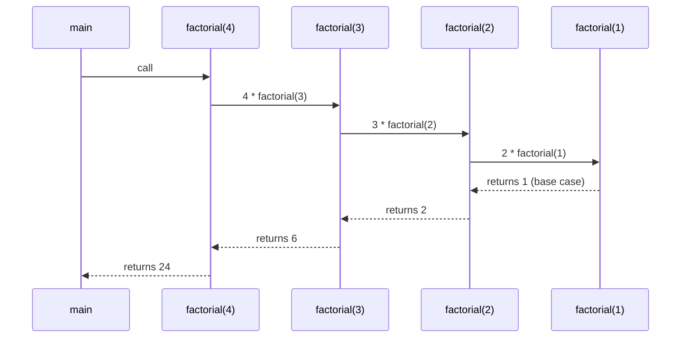
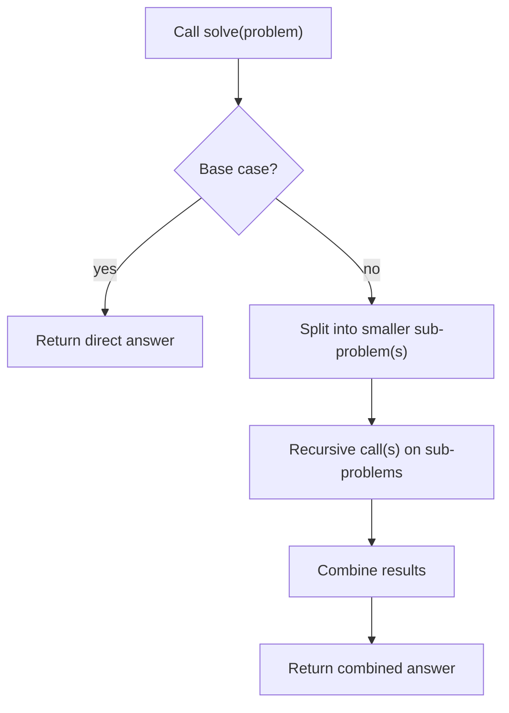
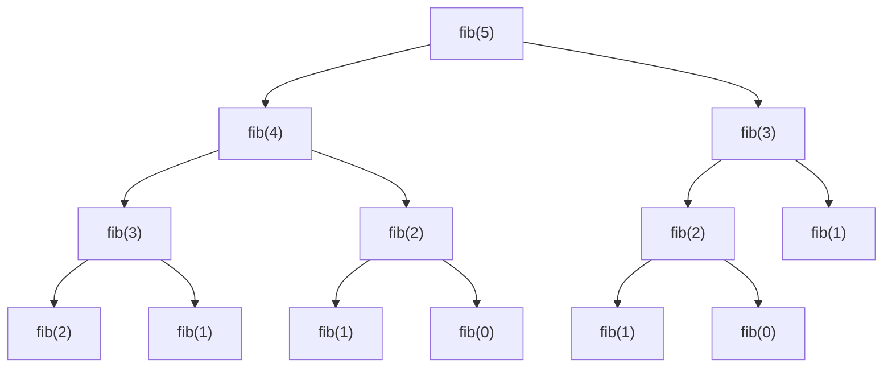

# Session 3 · Recursion Fundamentals

Prepared by **Hamna Zahid Khan**, Junior Lecturer

[🏠 Course home](../README.md) · [📘 Module overview](./README.md) · [⬅ Previous](./session-02-asymptotic-analysis-big-o.md) · [Practice test ➡](./practice-test.md)

> **Module 01 · Java Refresher and Complexity** · ⏱ 3 hours (90 min lecture + 90 min lab)

## 🎯 Learning objectives

1. Identify the **base case** and **recursive case** of a recursive definition.
2. Trace recursive calls using a **call stack diagram** and a **recursion tree**.
3. Write recursive solutions for numbers, strings and arrays.
4. Analyse recursive algorithms with **recurrence relations**.
5. Recognise when recursion is wasteful (overlapping sub-problems) and fix it with **memoisation**.

---

## 1. What is recursion?

A method is **recursive** when it solves a problem by calling itself on a **smaller instance** of the same problem.

> 🪆 **Analogy: Russian nesting dolls.** To find the tiniest doll you open the outer doll and are left with the *same problem*, a smaller doll. You stop when a doll does not open (the **base case**). Then you put everything back together on the way out (the **return phase**).

Every correct recursive method has two parts:

| Part | Purpose | `factorial` example |
|---|---|---|
| **Base case** | stops the recursion; answered directly | `if (n <= 1) return 1;` |
| **Recursive case** | reduces the problem and combines the result | `return n * factorial(n - 1);` |

Missing or unreachable base case ⇒ infinite recursion ⇒ `StackOverflowError`.

## 2. The call stack

Each call gets its own **stack frame** holding its parameters and local variables. Frames are pushed on the way *down* and popped on the way *up*.



**Trace table: `factorial(4)`**

| Phase | Stack (top on right) | Action |
|---|---|---|
| winding | f(4) | needs f(3) |
| winding | f(4) f(3) | needs f(2) |
| winding | f(4) f(3) f(2) | needs f(1) |
| base | f(4) f(3) f(2) f(1) | returns 1 |
| unwinding | f(4) f(3) f(2) | 2 × 1 = 2 |
| unwinding | f(4) f(3) | 3 × 2 = 6 |
| unwinding | f(4) | 4 × 6 = 24 |

Maximum stack depth = 4 frames ⇒ space **O(n)**.

## 3. How to design a recursive solution (the "leap of faith")

1. **Define** precisely what the method returns, e.g. `sumDigits(n)` = sum of the decimal digits of n.
2. **Base case:** the smallest input you can answer immediately (n < 10 ⇒ n).
3. **Trust** that the method already works for smaller inputs.
4. **Combine:** express the answer for n using the answer for a smaller input: `n % 10 + sumDigits(n / 10)`.
5. **Check progress:** every recursive call must move toward the base case.



## 4. Kinds of recursion

| Kind | Shape | Example | Calls per frame |
|---|---|---|---|
| Linear | one call | factorial, sumDigits | 1 |
| Tail | the call is the **last** action | `countDown(n-1)` | 1 |
| Binary / tree | two calls | Fibonacci, Hanoi | 2 |
| Divide & conquer | split in halves | fast power, merge sort | 1–2 on n/2 |
| Mutual | A calls B, B calls A | isEven / isOdd | – |

> Java does **not** optimise tail calls, so even tail-recursive methods use O(n) stack. For very deep recursion (n > ~10,000) prefer a loop.

## 5. Recursion trees and recurrences

**Naive Fibonacci:** `fib(n) = fib(n-1) + fib(n-2)`.



`fib(3)` is computed twice and `fib(2)` three times. The number of calls grows like φⁿ ≈ 1.618ⁿ, i.e. exponential. **Memoisation** stores each answer the first time, so each `fib(k)` is computed once: O(n) time, O(n) space. (This is the gateway to Dynamic Programming in Module 16.)

| Recurrence | Example | Solution |
|---|---|---|
| T(n) = T(n−1) + O(1) | factorial, sumDigits on n digits | O(n) |
| T(n) = T(n/2) + O(1) | fast power, binary search | O(log n) |
| T(n) = 2T(n−1) + O(1) | Tower of Hanoi | O(2ⁿ) |
| T(n) = T(n−1) + T(n−2) + O(1) | naive Fibonacci | O(φⁿ) |
| T(n) = 2T(n/2) + O(n) | merge sort | O(n log n) |

**Solving Hanoi's recurrence by expansion.** T(n) = 2T(n−1) + 1 = 4T(n−2) + 2 + 1 = … = 2ⁿT(0) + (2ⁿ⁻¹ + … + 1) = 2ⁿ − 1 moves.

## 6. Complexity summary of this session's methods

| Method | Time | Space (stack) |
|---|---|---|
| `factorial(n)` | O(n) | O(n) |
| `sumDigits(n)` | O(d), d = number of digits | O(d) |
| `fibNaive(n)` | O(φⁿ) | O(n) |
| `fibMemo(n)` | O(n) | O(n) |
| `power(b, e)` | O(log e) | O(log e) |
| `isPalindrome(s)` | O(n) | O(n) |
| `toBinary(n)` | O(log n) calls (plus string building) | O(log n) |
| `hanoi(n)` | O(2ⁿ) | O(n) |

---

## 7. Complete program

📄 **[`src/RecursionBasics.java`](src/RecursionBasics.java)**

```java
/**
 * Module 01 · Session 03 — Recursion fundamentals.
 *
 * Every recursive method needs:
 *   (1) a BASE CASE that stops the recursion, and
 *   (2) a RECURSIVE CASE that moves strictly closer to the base case.
 *
 * Compile:  javac -d out RecursionBasics.java
 * Run:      java -cp out RecursionBasics
 *
 * Prepared by Hamna Zahid Khan, Junior Lecturer
 */
public class RecursionBasics {

    static long fibCalls = 0; // counts calls made by the naive Fibonacci

    /** n! with a visible call trace; depth controls indentation. */
    static long factorial(int n, int depth) {
        String pad = "  ".repeat(depth);
        System.out.println(pad + "factorial(" + n + ") called");
        if (n <= 1) {                       // base case
            System.out.println(pad + "base case -> 1");
            return 1;
        }
        long result = n * factorial(n - 1, depth + 1); // recursive case
        System.out.println(pad + "factorial(" + n + ") returns " + result);
        return result;
    }

    /** Sum of digits: 4096 -> 4 + 0 + 9 + 6 = 19. */
    static int sumDigits(int n) {
        if (n < 10) return n;
        return n % 10 + sumDigits(n / 10);
    }

    /** Naive Fibonacci: O(2^n) calls because sub-problems are recomputed. */
    static long fibNaive(int n) {
        fibCalls++;
        if (n < 2) return n;
        return fibNaive(n - 1) + fibNaive(n - 2);
    }

    /** Memoised Fibonacci: each value computed once -> O(n). */
    static long fibMemo(int n, long[] memo) {
        if (n < 2) return n;
        if (memo[n] != 0) return memo[n];
        return memo[n] = fibMemo(n - 1, memo) + fibMemo(n - 2, memo);
    }

    /** Fast power by squaring: O(log e) multiplications instead of O(e). */
    static long power(long base, int exp) {
        if (exp == 0) return 1;
        long half = power(base, exp / 2);
        return (exp % 2 == 0) ? half * half : half * half * base;
    }

    /** Checks a palindrome by comparing the two ends and recursing inward. */
    static boolean isPalindrome(String s, int lo, int hi) {
        if (lo >= hi) return true;
        if (s.charAt(lo) != s.charAt(hi)) return false;
        return isPalindrome(s, lo + 1, hi - 1);
    }

    /** Binary representation built recursively: 13 -> "1101". */
    static String toBinary(int n) {
        if (n < 2) return Integer.toString(n);
        return toBinary(n / 2) + (n % 2);
    }

    /** Tower of Hanoi: moves n disks from 'from' to 'to' using 'via'. Returns the move count. */
    static int hanoi(int n, char from, char to, char via, boolean print) {
        if (n == 0) return 0;
        int moves = hanoi(n - 1, from, via, to, print);
        if (print) System.out.println("  move disk " + n + " : " + from + " -> " + to);
        moves++;
        moves += hanoi(n - 1, via, to, from, print);
        return moves;
    }

    /** Depth of recursion we can reach before the JVM stack overflows (illustration only). */
    static int depthProbe(int d) {
        try {
            return depthProbe(d + 1);
        } catch (StackOverflowError e) {
            return d;
        }
    }

    public static void main(String[] args) {
        System.out.println("=== factorial(4) call trace ===");
        System.out.println("answer = " + factorial(4, 0));

        System.out.println("\n=== small recursive functions ===");
        System.out.println("sumDigits(4096)       = " + sumDigits(4096));
        System.out.println("power(3, 13)          = " + power(3, 13));
        System.out.println("isPalindrome(racecar) = " + isPalindrome("racecar", 0, 6));
        System.out.println("isPalindrome(karachi) = " + isPalindrome("karachi", 0, 6));
        System.out.println("toBinary(13)          = " + toBinary(13));

        System.out.println("\n=== naive vs memoised Fibonacci ===");
        for (int n : new int[]{10, 20, 30}) {
            fibCalls = 0;
            long v = fibNaive(n);
            System.out.printf("fib(%d) = %d  naive calls = %,d  memo value = %d%n",
                    n, v, fibCalls, fibMemo(n, new long[n + 1]));
        }
        System.out.println("fibMemo(90) = " + fibMemo(90, new long[91]) + " (naive would need ~10^18 calls)");

        System.out.println("\n=== Tower of Hanoi, 3 disks ===");
        int m = hanoi(3, 'A', 'C', 'B', true);
        System.out.println("total moves = " + m + " (2^3 - 1)");
        for (int n = 5; n <= 20; n += 5) {
            System.out.println("hanoi(" + n + ") needs " + hanoi(n, 'A', 'C', 'B', false) + " moves");
        }
        int depth = depthProbe(0);
        System.out.println("\nStack depth reached before StackOverflowError: " + (depth > 1000 ? "more than 1000 frames" : depth));
    }
}
```

**Real output:**

```text
$ java -cp out RecursionBasics
=== factorial(4) call trace ===
factorial(4) called
  factorial(3) called
    factorial(2) called
      factorial(1) called
      base case -> 1
    factorial(2) returns 2
  factorial(3) returns 6
factorial(4) returns 24
answer = 24

=== small recursive functions ===
sumDigits(4096)       = 19
power(3, 13)          = 1594323
isPalindrome(racecar) = true
isPalindrome(karachi) = false
toBinary(13)          = 1101

=== naive vs memoised Fibonacci ===
fib(10) = 55  naive calls = 177  memo value = 55
fib(20) = 6765  naive calls = 21,891  memo value = 6765
fib(30) = 832040  naive calls = 2,692,537  memo value = 832040
fibMemo(90) = 2880067194370816120 (naive would need ~10^18 calls)

=== Tower of Hanoi, 3 disks ===
  move disk 1 : A -> C
  move disk 2 : A -> B
  move disk 1 : C -> B
  move disk 3 : A -> C
  move disk 1 : B -> A
  move disk 2 : B -> C
  move disk 1 : A -> C
total moves = 7 (2^3 - 1)
hanoi(5) needs 31 moves
hanoi(10) needs 1023 moves
hanoi(15) needs 32767 moves
hanoi(20) needs 1048575 moves

Stack depth reached before StackOverflowError: more than 1000 frames
```

---

## 8. Worked examples (basic → advanced)

**Example 1 (basic): `sumDigits(4096)`.**

| Call | n % 10 | returns |
|---|---|---|
| sumDigits(4096) | 6 | 6 + sumDigits(409) = 6 + 13 = **19** |
| sumDigits(409) | 9 | 9 + sumDigits(40) = 9 + 4 = 13 |
| sumDigits(40) | 0 | 0 + sumDigits(4) = 0 + 4 = 4 |
| sumDigits(4) | base | 4 |

**Example 2 (intermediate): fast power `power(3, 13)`.** 13 is odd ⇒ half = power(3, 6), answer = half² × 3.

| Call | exp | half | result |
|---|---|---|---|
| power(3,13) | 13 (odd) | 729 | 729² × 3 = 1,594,323 |
| power(3,6) | 6 (even) | 27 | 27² = 729 |
| power(3,3) | 3 (odd) | 3 | 3² × 3 = 27 |
| power(3,1) | 1 (odd) | 1 | 1² × 3 = 3 |
| power(3,0) | base | – | 1 |

Five calls instead of thirteen multiplications: O(log e).

**Example 3 (advanced): Tower of Hanoi.** To move n disks from A to C: move the top n−1 to B (using C), move the biggest to C, move the n−1 from B to C (using A). The leap of faith is trusting that "move n−1 disks" already works. The output above lists all 7 moves for 3 disks.

## 9. Real-life problem: counting routes in a city grid

**Problem.** A delivery rider starts at the top-left corner of a block grid and must reach a customer `r` blocks down and `c` blocks right, moving only **down** or **right**. How many shortest routes exist?

**Recursive thinking.** The last move into (r, c) came either from above (r−1, c) or from the left (r, c−1). So `paths(r, c) = paths(r−1, c) + paths(r, c−1)`, and when either coordinate is 0 there is exactly one straight route.

```java
/** Number of right/down paths from (0,0) to (r,c). */
static long gridPaths(int r, int c) {
    if (r == 0 || c == 0) return 1;        // only one straight path left
    return gridPaths(r - 1, c) + gridPaths(r, c - 1);
}
```
<sub>Full, compiled version: [`src/Labs01.java`](src/Labs01.java)</sub>

`gridPaths(2,2) = 6` and `gridPaths(5,5) = 252` (see the lab output below). This naive version is exponential, the same overlapping-sub-problem issue as Fibonacci; memoising it on (r, c) makes it O(r·c). We return to it in Module 16.

## 10. Common mistakes

| Mistake | Symptom | Fix |
|---|---|---|
| No base case, or one that is never reached (`n == 0` when n can be negative) | `StackOverflowError` | Base case covers all terminating inputs (`n <= 0`) |
| Recursive call does not shrink the problem (`f(n)` calls `f(n)`) | infinite recursion | Ensure each call moves toward the base case |
| Forgetting to `return` the recursive result | method returns wrong/default value | `return a[i] + sum(a, i + 1);` |
| Recomputing overlapping sub-problems | exponential time (naive fib) | memoise or use bottom-up DP |
| Creating substrings in every call | hidden O(n²) time/space | pass indices (`lo`, `hi`) instead |
| Very deep recursion on large inputs | stack overflow at ~10⁴–10⁵ frames | convert to iteration |

## 11. Best practices

- Write the **base case first**, at the top of the method.
- Pass **indices** rather than copying arrays or substrings.
- Use a **helper method** to hide extra parameters: `public boolean isPalindrome(String s) { return isPalindrome(s, 0, s.length() - 1); }`.
- Draw the recursion tree before analysing complexity.
- If the tree has repeated nodes, think **memoisation**.

---

## 12. Lab tasks

**Lab 3.1: Countdown.** Print `5 4 3 2 1 Go!` recursively.

<details>
<summary>✅ Solution</summary>

```java
/** Prints n, n-1, ..., 1 then "Go!" — the simplest possible recursion. */
static void countDown(int n) {
    if (n == 0) {
        System.out.println("Go!");
        return;
    }
    System.out.print(n + " ");
    countDown(n - 1);
}
```
<sub>Full, compiled version: [`src/Labs01.java`](src/Labs01.java)</sub>

</details>

**Lab 3.2: Recursive array sum.** Return the sum of `a[i..n-1]` without loops.

<details>
<summary>💡 Hint</summary>

The sum of an empty suffix (i == a.length) is 0.

</details>

<details>
<summary>✅ Solution</summary>

```java
/** Sum of a[i..end] recursively. Call arraySum(a, 0). */
static int arraySum(int[] a, int i) {
    if (i == a.length) return 0;          // base case: empty suffix
    return a[i] + arraySum(a, i + 1);     // first element + rest
}
```
<sub>Full, compiled version: [`src/Labs01.java`](src/Labs01.java)</sub>

</details>

**Lab 3.3: Reverse a string.** `reverse("recursion")` → `"noisrucer"`.

<details>
<summary>💡 Hint</summary>

The reverse of a string is its last character followed by the reverse of everything before it.

</details>

<details>
<summary>✅ Solution</summary>

```java
/** Reverse a string: last char + reverse of the rest. */
static String reverse(String s) {
    if (s.length() <= 1) return s;
    return s.charAt(s.length() - 1) + reverse(s.substring(0, s.length() - 1));
}
```
<sub>Full, compiled version: [`src/Labs01.java`](src/Labs01.java)</sub>

This version is O(n²) because of `substring`; an index-based version that swaps characters in a `char[]` is O(n).

</details>

**Lab 3.4 (challenge).** Write `gridPaths(r, c)` (section 9), then add a `long[][] memo` so `gridPaths(16, 16)` returns instantly. Print the call count before and after memoisation.

<details>
<summary>💡 Hint</summary>

`if (memo[r][c] != 0) return memo[r][c];` before recursing; store the result before returning.

</details>

```text
$ java -cp out Labs01
swap -> [Zara, Omar, Hina]
by length then alpha -> [map, set, heap, graph, queue, stack]
secondLargest({4, 9, 9, 7, 1}) = 7
duplicates? brute=true sorted=true hash=true
pairWithSum({1,3,4,6,8,11}, 10) -> indices [2, 3]
arraySum({3,1,4,1,5}) = 14
reverse("recursion") = noisrucer
gridPaths(2,2) = 6, gridPaths(5,5) = 252
5 4 3 2 1 Go!
```

---

## 13. Quiz

**Q1.** What happens if a recursive method has no reachable base case?

- **A.** It returns 0
- **B.** It runs forever without error
- **C.** The JVM throws `StackOverflowError`
- **D.** The compiler rejects it

**Q2.** The recurrence T(n) = T(n/2) + O(1) solves to:

- **A.** O(n)
- **B.** O(log n)
- **C.** O(n log n)
- **D.** O(1)

**Q3.** Why is naive recursive Fibonacci slow?

- **A.** Java recursion is slow in general
- **B.** It recomputes the same sub-problems many times
- **C.** It uses too much heap memory
- **D.** Its base case is wrong

**Q4.** How many moves does Tower of Hanoi need for 6 disks?

- **A.** 36
- **B.** 63
- **C.** 64
- **D.** 12

**Q5.** What is the maximum call-stack depth of `power(b, e)` (fast power)?

- **A.** O(e)
- **B.** O(log e)
- **C.** O(1)
- **D.** O(e²)

<details>
<summary><b>Show answers</b></summary>

1. **C**: Frames keep being pushed until the thread's stack is exhausted.
2. **B**: The problem halves each call, so there are log n levels of constant work.
3. **B**: Overlapping sub-problems cause exponential calls; memoisation fixes it.
4. **B**: 2⁶ − 1 = 63.
5. **B**: Each call halves the exponent.

</details>

---

## 14. Summary

- Recursion = **base case** + **recursive case that shrinks the problem**.
- Calls form a **stack**: wind down to the base case, then unwind combining answers.
- Analyse with **recursion trees** and **recurrences**; know the five standard recurrences in section 5.
- Overlapping sub-problems ⇒ **memoise**; very deep recursion ⇒ **iterate**.
- Recursion is the backbone of trees, divide-and-conquer sorting, backtracking and DP later in this course.

## 15. Viva / interview questions

1. What are the two essential parts of a recursive method?
2. Explain what is stored in a stack frame.
3. Convert recursive factorial to an iterative version. Which uses less memory?
4. What is tail recursion? Does Java optimise it?
5. Derive the number of moves for Tower of Hanoi.
6. How does memoisation change the complexity of Fibonacci?
7. Give an example of mutual recursion.
8. When is recursion a better choice than iteration, and when is it worse?

---

[⬅ Previous](./session-02-asymptotic-analysis-big-o.md) · [📘 Module overview](./README.md) · [Practice test ➡](./practice-test.md)
