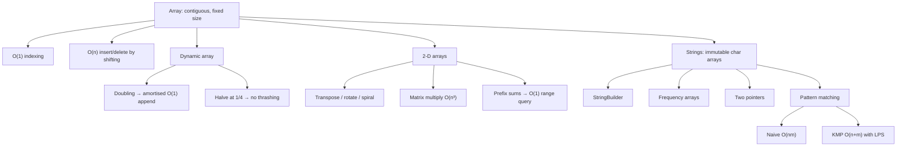

# Module 02 · Arrays and Strings

Prepared by **Hamna Zahid Khan**, Junior Lecturer

[🏠 Course home](../README.md)

> ⏱ 9 contact hours · 3 sessions · 🟢 Foundation

Arrays are the most fundamental data structure: contiguous memory with O(1) indexing. Almost every other structure (dynamic arrays, heaps, hash tables, matrices) is built on top of them. Strings are arrays of characters with special rules, and pattern matching is one of the oldest problems in computer science.

## 🎯 Module objectives

- Explain array memory layout and analyse array operations.
- Implement a generic dynamic array and prove amortised O(1) append.
- Manipulate 2-D arrays: transpose, rotation, spiral order, multiplication, prefix sums.
- Solve string problems with frequency arrays and two pointers; implement KMP.

## 📚 Sessions

| # | Session | Key ideas | Code |
|---|---|---|---|
| 1 | [Arrays and Dynamic Arrays](session-01-arrays-and-dynamic-arrays.md) | memory layout, shifting, doubling, amortised analysis | [`DynamicArray.java`](src/DynamicArray.java) |
| 2 | [Two-Dimensional Arrays and Matrices](session-02-two-dimensional-arrays-and-matrices.md) | row-major, rotate, spiral, multiply, 2-D prefix sums | [`MatrixOps.java`](src/MatrixOps.java) |
| 3 | [Strings and Pattern Matching](session-03-strings-and-pattern-matching.md) | immutability, StringBuilder, anagrams, naive search, KMP | [`StringAlgorithms.java`](src/StringAlgorithms.java) |
| ✍️ | [Practice test](practice-test.md) | 20 MCQs + 3 coding scenarios | [`Labs02.java`](src/Labs02.java), [`SelfCheck.java`](src/SelfCheck.java) |

## 🗺️ Concept map



## 📄 One-page cheat sheet

| Structure / algorithm | Key fact | Time |
|---|---|---|
| `a[i]` | base + i × size | O(1) |
| insert/delete at k | shift n − k elements | O(n) |
| dynamic array append | double when full | O(1) amortised |
| dynamic array shrink | halve at ¼ full | – |
| reverse / rotate in place | two pointers / three reversals | O(n), O(1) space |
| transpose | `t[j][i] = m[i][j]` | O(RC) |
| rotate 90° clockwise | transpose + reverse rows | O(n²), O(1) space |
| spiral | four shrinking boundaries | O(RC) |
| matrix multiply | `P[i][j] += A[i][t]·B[t][j]` | O(n³) |
| 2-D prefix query | `P[r2+1][c2+1] − P[r1][c2+1] − P[r2+1][c1] + P[r1][c1]` | O(1) |
| sorted-matrix search | start top-right | O(R + C) |
| string building | `StringBuilder` | O(n) total |
| anagram | `int[26]` counts | O(n) |
| naive search | all shifts | O(nm) worst |
| KMP | LPS fall-back | O(n + m) |

**Java snippets:** `Arrays.copyOf(a, n)` · `System.arraycopy(src, s, dst, d, len)` · `Arrays.deepToString(m)` · `s.toCharArray()` · `String.valueOf(chars)` · `s.trim().split("\\s+")`.

## ▶️ Run the code

```bash
cd 02-arrays-and-strings/src
javac -d out *.java
java -ea -cp out SelfCheck
java -cp out DynamicArray
```

See [`src/README.md`](src/README.md) for every file.
