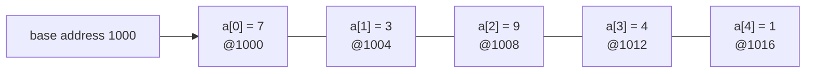
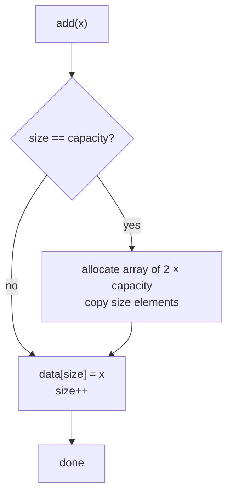

# Session 1 · Arrays and Dynamic Arrays

Prepared by **Hamna Zahid Khan**, Junior Lecturer

[🏠 Course home](../README.md) · [📘 Module overview](./README.md) · [⬅ Module overview](./README.md) · [Next ➡](./session-02-two-dimensional-arrays-and-matrices.md)

> **Module 02 · Arrays and Strings** · ⏱ 3 hours (90 min lecture + 90 min lab)

## 🎯 Learning objectives

1. Explain how an array is laid out in memory and why indexing is O(1).
2. Analyse the cost of insert, delete and search in a static array.
3. Build a **generic dynamic array** that grows by doubling, and prove that append is **amortised O(1)**.
4. Apply in-place array techniques: reversal, rotation, de-duplication.

---

## 1. What is an array?

An **array** is a fixed-size block of **contiguous** memory cells, all of the same type, addressed by an integer index starting at 0.

> 🏫 **Analogy: lockers in a corridor.** Lockers are numbered 0, 1, 2… and all have the same width. To reach locker 57 you do not open lockers 0–56; you compute "start of corridor + 57 × locker width" and walk straight there. That arithmetic is why `a[i]` is **O(1)**.

**Address formula:** `address(a[i]) = base + i × elementSize`. For an `int[]` (4 bytes), `a[10]` lives at `base + 40`.



In Java, an array is an **object** on the heap: it knows its `length`, is zero-initialised (`0`, `false`, `null`), and every access is **bounds-checked** (`ArrayIndexOutOfBoundsException`).

## 2. Operations on a static array

| Operation | How | Time | Why |
|---|---|---|---|
| Read / write `a[i]` | address arithmetic | O(1) | no searching |
| Search unsorted | scan | O(n) | may check every cell |
| Search sorted | binary search | O(log n) | Module 03 |
| Insert at end (if space) | `a[size++] = x` | O(1) | nothing moves |
| Insert at index k | shift `a[k..size-1]` right | O(n) | up to n moves |
| Delete at index k | shift `a[k+1..size-1]` left | O(n) | up to n moves |
| Grow beyond capacity | impossible | – | size fixed at creation |

### Dry run: inserting 25 at index 2

Array `[10, 20, 30, 40, _]`, size 4, capacity 5. We shift **from the back** so nothing is overwritten.

| Step | Action | Array |
|---|---|---|
| 0 | start | 10, 20, 30, 40, _ |
| 1 | a[4] = a[3] | 10, 20, 30, 40, **40** |
| 2 | a[3] = a[2] | 10, 20, 30, **30**, 40 |
| 3 | a[2] = 25 | 10, 20, **25**, 30, 40 |

Shifting from the front instead (`a[3] = a[2]` first) would copy 30 everywhere: a classic bug.

## 3. Dynamic arrays: growing on demand

A **dynamic array** (Java's `ArrayList`, C++'s `vector`, Python's `list`) wraps a static array plus a `size` counter. When `size == capacity` it allocates a **bigger** array, copies everything across, and continues.

> 🚌 **Analogy: hiring a bigger bus.** A tour company starts with a 2-seat car. When it fills up they hire a 4-seat van, then an 8-seat minibus, then a 16-seat coach, each time moving all passengers over. Moving passengers is expensive, but because the vehicle **doubles**, moves become rarer and rarer.



### Why doubling gives amortised O(1)

Starting from capacity 1 and appending n = 2ᵏ elements, copies happen at sizes 1, 2, 4, …, 2ᵏ⁻¹:

> total copies = 1 + 2 + 4 + … + 2ᵏ⁻¹ = 2ᵏ − 1 < n

So n appends cost < n writes + n copies = **O(n) total ⇒ O(1) amortised per append**. The program's last section confirms it: copies/n stays near 1, whether n is a thousand or a million.

**What if we grew by a constant (+10) instead?** Copies = 10 + 20 + 30 + … + n ≈ n²/20 ⇒ **O(n) per append**. Growth must be *multiplicative*.

**Shrinking.** If we halved the array as soon as it was half full, an add/remove sequence at the boundary would resize every time ("thrashing"). Halving at **one quarter** full avoids that.

### Trace: adding 10…90 to capacity 2

| add | size | capacity | copies so far | event |
|---|---|---|---|---|
| 10 | 1 | 2 | 0 | |
| 20 | 2 | 2 | 0 | now full |
| 30 | 3 | 4 | 2 | resize 2→4 |
| 40 | 4 | 4 | 2 | |
| 50 | 5 | 8 | 6 | resize 4→8 |
| 90 | 9 | 16 | 14 | resize 8→16 |

## 4. Complexity table: `DynamicArray<T>`

| Operation | Best | Average | Worst | Space |
|---|---|---|---|---|
| `get(i)` / `set(i, x)` | O(1) | O(1) | O(1) | O(1) |
| `add(x)` (append) | O(1) | O(1) amortised | O(n) (resize) | O(n) during resize |
| `insert(i, x)` | O(1) (at end) | O(n) | O(n) | O(1) |
| `removeAt(i)` | O(1) (last) | O(n) | O(n) | O(1) |
| `indexOf(x)` | O(1) | O(n) | O(n) | O(1) |
| Whole structure | – | – | – | O(n), at most 4× size |

---

## 5. Complete implementation

📄 **[`src/DynamicArray.java`](src/DynamicArray.java)**

```java
import java.util.Iterator;
import java.util.NoSuchElementException;

/**
 * Module 02 · Session 01 — A resizable array (our own mini ArrayList).
 *
 * Stores elements in a plain Object[] and DOUBLES its capacity when full, giving
 * amortised O(1) append. It also halves when only a quarter is used, so memory
 * stays proportional to size. Supports get/set/add/insert/remove/indexOf and for-each.
 *
 * Compile:  javac -d out DynamicArray.java
 * Run:      java -cp out DynamicArray
 *
 * Prepared by Hamna Zahid Khan, Junior Lecturer
 */
public class DynamicArray<T> implements Iterable<T> {

    private Object[] data;
    private int size;
    private long copies; // total element copies caused by resizing (for analysis)

    public DynamicArray() {
        this(2);
    }

    public DynamicArray(int initialCapacity) {
        if (initialCapacity < 1) throw new IllegalArgumentException("capacity must be >= 1");
        data = new Object[initialCapacity];
    }

    public int size() { return size; }
    public boolean isEmpty() { return size == 0; }
    public int capacity() { return data.length; }
    public long copies() { return copies; }

    /** O(1): direct index. */
    @SuppressWarnings("unchecked")
    public T get(int index) {
        checkIndex(index);
        return (T) data[index];
    }

    /** O(1): overwrite, returns the old value. */
    public T set(int index, T value) {
        T old = get(index);
        data[index] = value;
        return old;
    }

    /** Amortised O(1): append at the end, doubling capacity when full. */
    public void add(T value) {
        if (size == data.length) resize(2 * data.length);
        data[size++] = value;
    }

    /** O(n): insert at index, shifting elements right. */
    public void insert(int index, T value) {
        if (index < 0 || index > size) throw new IndexOutOfBoundsException("index " + index + ", size " + size);
        if (size == data.length) resize(2 * data.length);
        for (int i = size; i > index; i--) data[i] = data[i - 1]; // shift right, from the back
        data[index] = value;
        size++;
    }

    /** O(n): remove at index, shifting elements left; shrinks when 1/4 full. */
    public T removeAt(int index) {
        T old = get(index);
        for (int i = index; i < size - 1; i++) data[i] = data[i + 1]; // shift left
        data[--size] = null;            // avoid loitering (lets GC reclaim the object)
        if (size > 0 && size == data.length / 4) resize(data.length / 2);
        return old;
    }

    /** O(n): linear search using equals(). Returns -1 if absent. */
    public int indexOf(T value) {
        for (int i = 0; i < size; i++) {
            if (value == null ? data[i] == null : value.equals(data[i])) return i;
        }
        return -1;
    }

    private void resize(int newCapacity) {
        Object[] bigger = new Object[newCapacity];
        for (int i = 0; i < size; i++) {
            bigger[i] = data[i];
            copies++;
        }
        data = bigger;
    }

    private void checkIndex(int index) {
        if (index < 0 || index >= size) throw new IndexOutOfBoundsException("index " + index + ", size " + size);
    }

    @Override
    public Iterator<T> iterator() {
        return new Iterator<T>() {
            private int i = 0;
            @Override public boolean hasNext() { return i < size; }
            @Override public T next() {
                if (!hasNext()) throw new NoSuchElementException();
                return get(i++);
            }
        };
    }

    @Override
    public String toString() {
        StringBuilder sb = new StringBuilder("[");
        for (int i = 0; i < size; i++) {
            if (i > 0) sb.append(", ");
            sb.append(data[i]);
        }
        return sb.append("]").toString();
    }

    public static void main(String[] args) {
        System.out.println("=== growth trace (initial capacity 2) ===");
        DynamicArray<Integer> arr = new DynamicArray<>();
        System.out.printf("%-6s %-6s %-9s %-7s%n", "add", "size", "capacity", "copies");
        for (int v = 1; v <= 9; v++) {
            arr.add(v * 10);
            System.out.printf("%-6d %-6d %-9d %-7d%n", v * 10, arr.size(), arr.capacity(), arr.copies());
        }
        System.out.println("contents: " + arr);

        System.out.println("\n=== insert / remove / search ===");
        arr.insert(0, 5);
        System.out.println("insert(0, 5)   -> " + arr);
        arr.insert(5, 45);
        System.out.println("insert(5, 45)  -> " + arr);
        System.out.println("removeAt(2)    -> removed " + arr.removeAt(2) + ", now " + arr);
        System.out.println("indexOf(70)    -> " + arr.indexOf(70));
        System.out.println("indexOf(999)   -> " + arr.indexOf(999));
        arr.set(0, 1);
        int sum = 0;
        for (int v : arr) sum += v;  // uses our iterator
        System.out.println("after set(0,1), sum via for-each = " + sum);

        System.out.println("\n=== shrinking ===");
        while (arr.size() > 1) {
            arr.removeAt(arr.size() - 1);
            if (arr.size() <= 4) System.out.println("size " + arr.size() + " capacity " + arr.capacity());
        }

        System.out.println("\n=== amortised cost of n appends ===");
        for (int n : new int[]{1_000, 100_000, 1_000_000}) {
            DynamicArray<Integer> big = new DynamicArray<>(1);
            for (int i = 0; i < n; i++) big.add(i);
            System.out.printf("n = %,9d  copies = %,9d  copies/n = %.2f%n", n, big.copies(), (double) big.copies() / n);
        }
        try {
            arr.get(5);
        } catch (IndexOutOfBoundsException e) {
            System.out.println("\nget(5) on size " + arr.size() + " -> " + e.getMessage());
        }
    }
}
```

**Real output:**

```text
$ java -cp out DynamicArray
=== growth trace (initial capacity 2) ===
add    size   capacity  copies
10     1      2         0
20     2      2         0
30     3      4         2
40     4      4         2
50     5      8         6
60     6      8         6
70     7      8         6
80     8      8         6
90     9      16        14
contents: [10, 20, 30, 40, 50, 60, 70, 80, 90]

=== insert / remove / search ===
insert(0, 5)   -> [5, 10, 20, 30, 40, 50, 60, 70, 80, 90]
insert(5, 45)  -> [5, 10, 20, 30, 40, 45, 50, 60, 70, 80, 90]
removeAt(2)    -> removed 20, now [5, 10, 30, 40, 45, 50, 60, 70, 80, 90]
indexOf(70)    -> 7
indexOf(999)   -> -1
after set(0,1), sum via for-each = 476

=== shrinking ===
size 4 capacity 8
size 3 capacity 8
size 2 capacity 4
size 1 capacity 2

=== amortised cost of n appends ===
n =     1,000  copies =     1,023  copies/n = 1.02
n =   100,000  copies =   131,071  copies/n = 1.31
n = 1,000,000  copies = 1,048,575  copies/n = 1.05

get(5) on size 1 -> index 5, size 1
```

Notice `data[--size] = null` in `removeAt`. Without it the array would keep a reference to the removed object ("loitering") and the garbage collector could not free it.

---

## 6. Worked examples (basic → advanced)

**Example 1 (basic): reverse in place.** Swap `a[lo]` and `a[hi]`, move both inward. n/2 swaps ⇒ O(n) time, O(1) space.

```java
/** Two indices walk toward each other swapping: O(n) time, O(1) space. */
static void reverse(int[] a, int lo, int hi) {
    while (lo < hi) {
        int t = a[lo]; a[lo] = a[hi]; a[hi] = t;
        lo++; hi--;
    }
}
```
<sub>Full, compiled version: [`src/Labs02.java`](src/Labs02.java)</sub>

**Example 2 (intermediate): rotate right by k with three reversals.** Rotating `[1,2,3,4,5,6,7]` right by 3:

| Step | Operation | Array |
|---|---|---|
| 0 | start | 1 2 3 4 5 6 7 |
| 1 | reverse all | 7 6 5 4 3 2 1 |
| 2 | reverse first k = 3 | **5 6 7** 4 3 2 1 |
| 3 | reverse the rest | 5 6 7 **1 2 3 4** |

O(n) time and O(1) extra space, versus O(n·k) if we rotated one step at a time.

**Example 3 (advanced): de-duplicate a sorted array in place (read/write pointers).** `read` scans every element; `write` marks the end of the unique prefix. Elements are copied only when a new value appears.

| read | a[read] | a[write-1] | action | write |
|---|---|---|---|---|
| 1 | 1 | 1 | skip | 1 |
| 2 | 2 | 1 | a[1] = 2 | 2 |
| 3 | 3 | 2 | a[2] = 3 | 3 |
| 4, 5 | 3 | 3 | skip | 3 |
| 6 | 7 | 3 | a[3] = 7 | 4 |
| 7 | 9 | 7 | a[4] = 9 | 5 |
| 8 | 9 | 9 | skip | 5 |

## 7. Real-life problem: a live attendance register

**Problem.** A lab attendance app records student IDs as students tap their cards. The number of students is unknown in advance (walk-ins), the teacher often asks "who arrived 5th?", and late entries are occasionally inserted in order by time.

**Solution.** A dynamic array is the right fit:

- unknown size ⇒ automatic doubling;
- "who arrived k-th?" ⇒ `get(k-1)` in O(1);
- appends dominate ⇒ amortised O(1);
- rare insertions in the middle ⇒ O(n) is acceptable at classroom scale.

```java
DynamicArray<String> register = new DynamicArray<>();
register.add("FA24-001");
register.add("FA24-017");
register.insert(1, "FA24-009");   // late-recorded tap that happened earlier
System.out.println("2nd arrival: " + register.get(1));   // FA24-009
```

If insertions in the middle became frequent (thousands per second), we would switch to a **linked list** (Module 05) or a balanced tree (Module 10).

## 8. Common mistakes

| Mistake | Consequence | Fix |
|---|---|---|
| Loop `i <= a.length` | `ArrayIndexOutOfBoundsException` | `i < a.length` |
| Shifting right from the front | values overwritten | shift from the back |
| Growing capacity by +1 or +10 | O(n²) total appends | multiply (×2 or ×1.5) |
| Not nulling removed slots | memory leak in long-running apps | `data[--size] = null` |
| Confusing `size` with `capacity` | reading garbage/null slots | only `0..size-1` are valid |
| `int[] b = a;` meant as a copy | both names share one array | `a.clone()` or `Arrays.copyOf` |

## 9. Best practices

- Prefer `ArrayList<T>` in production; write your own only to learn or for primitives where boxing hurts (`int[]`).
- If you know the final size, pre-size: `new ArrayList<>(expected)`.
- Use `System.arraycopy` / `Arrays.copyOf` for bulk copies; they are highly optimised.
- Validate indices once in a private helper (`checkIndex`) to keep methods clean.
- Implement `Iterable<T>` so your structure works in for-each loops.

---

## 10. Lab tasks

**Lab 1.1: Rotate right by k.** Implement `rotateRight(int[] a, int k)` in O(n) time and O(1) space; it must handle k > n.

<details>
<summary>💡 Hint</summary>

Reduce `k %= n` first, then use three reversals (Example 2).

</details>

<details>
<summary>✅ Solution</summary>

```java
/** Rotate right by k using three reversals: [1..7], k=3 -> [5,6,7,1,2,3,4]. */
static void rotateRight(int[] a, int k) {
    int n = a.length;
    if (n == 0) return;
    k %= n;                 // rotating by n is a no-op
    reverse(a, 0, n - 1);   // whole array
    reverse(a, 0, k - 1);   // first k
    reverse(a, k, n - 1);   // the rest
}
```
<sub>Full, compiled version: [`src/Labs02.java`](src/Labs02.java)</sub>

</details>

**Lab 1.2: De-duplicate a sorted array** in place and return the new length.

<details>
<summary>💡 Hint</summary>

Keep a `write` index for the next free slot of the unique prefix; compare each element with `a[write - 1]`.

</details>

<details>
<summary>✅ Solution</summary>

```java
/** Removes duplicates from a SORTED array in place; returns the new logical length. */
static int dedupSorted(int[] a) {
    if (a.length == 0) return 0;
    int write = 1;                       // a[0..write-1] holds the unique prefix
    for (int read = 1; read < a.length; read++) {
        if (a[read] != a[write - 1]) a[write++] = a[read];
    }
    return write;
}
```
<sub>Full, compiled version: [`src/Labs02.java`](src/Labs02.java)</sub>

</details>

**Lab 1.3: Extend `DynamicArray`.** Add `contains(T x)`, `clear()` and `trimToSize()` (shrink capacity to exactly `size`). State the complexity of each.

<details>
<summary>✅ Solution</summary>

`contains` = `indexOf(x) != -1` → O(n). `clear` → set the first `size` slots to `null`, `size = 0` → O(n) (O(1) if you just allocate a new small array). `trimToSize` → `resize(Math.max(1, size))` → O(n).

</details>

```text
$ java -cp out Labs02
rotateRight([1..7], 3) = [5, 6, 7, 1, 2, 3, 4]
dedupSorted -> length 5: [1, 2, 3, 7, 9]
search 9 in sorted matrix -> [2, 2]
search 15 in sorted matrix -> [-1, -1]
row sums [245, 215], column sums [130, 160, 170]
firstUnique("statistics") = 2
longestCommonPrefix = "inter"
isCleanPalindrome("A man, a plan, a canal: Panama") = true
```

---

## 11. Quiz

**Q1.** Why is `a[i]` an O(1) operation?

- **A.** Java caches every element
- **B.** The address is computed as base + i × size, with no scanning
- **C.** Arrays are sorted
- **D.** Because i is small

**Q2.** A dynamic array doubles when full. The amortised cost of `add` is:

- **A.** O(log n)
- **B.** O(n)
- **C.** O(1)
- **D.** O(n log n)

**Q3.** Inserting at index 0 of an n-element array costs:

- **A.** O(1)
- **B.** O(log n)
- **C.** O(n)
- **D.** O(n²)

**Q4.** Why shrink at one quarter full rather than one half?

- **A.** It uses less memory
- **B.** It avoids repeated grow/shrink cycles (thrashing) at the boundary
- **C.** Java requires it
- **D.** It makes get() faster

**Q5.** After `int[] b = a; b[0] = 99;` what is `a[0]`?

- **A.** unchanged
- **B.** 99
- **C.** 0
- **D.** compile error

<details>
<summary><b>Show answers</b></summary>

1. **B**: Contiguous, equal-sized cells allow direct address arithmetic.
2. **C**: Total copies over n appends are less than n.
3. **C**: Every element shifts one position right.
4. **B**: After halving at 1/4 the array is half full, so it needs many operations before the next resize.
5. **B**: Both variables refer to the same array object.

</details>

---

## 12. Summary

- Arrays give **O(1) random access** thanks to contiguous memory, but have a **fixed size** and O(n) middle insert/delete.
- A dynamic array **doubles** when full and **halves at ¼**, giving amortised O(1) append and O(n) space.
- In-place techniques (two pointers, reversals, read/write indices) solve many array problems in O(n) time and O(1) space.

## 13. Viva / interview questions

1. Derive the address of `a[i][j]` in a row-major 2-D array.
2. Prove that doubling gives amortised O(1) append. What goes wrong with "grow by 100"?
3. Why does `ArrayList` grow by 1.5× rather than 2×? What is the trade-off?
4. What is the difference between `size` and `capacity`?
5. How would you rotate an array by k positions in O(1) extra space?
6. What is "loitering" and how do you prevent it?
7. When would you prefer an array over an `ArrayList`?

---

[⬅ Module overview](./README.md) · [📘 Module overview](./README.md) · [Next ➡](./session-02-two-dimensional-arrays-and-matrices.md)
