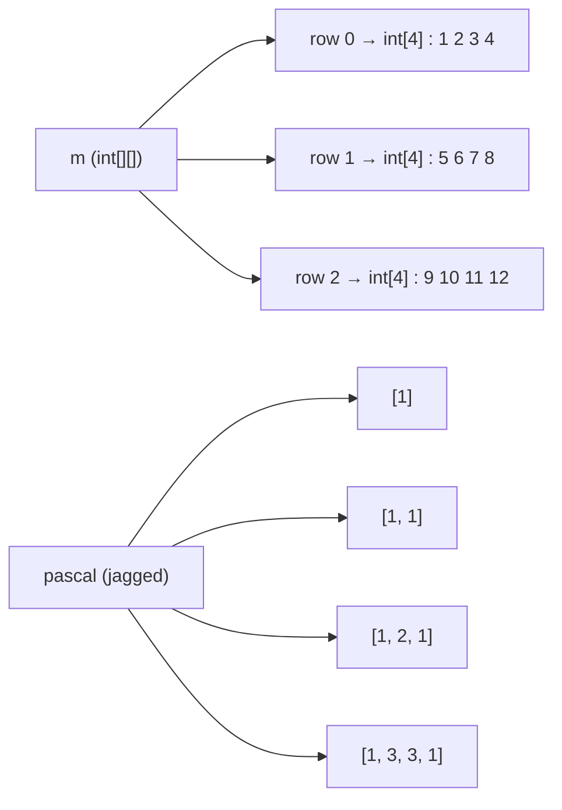
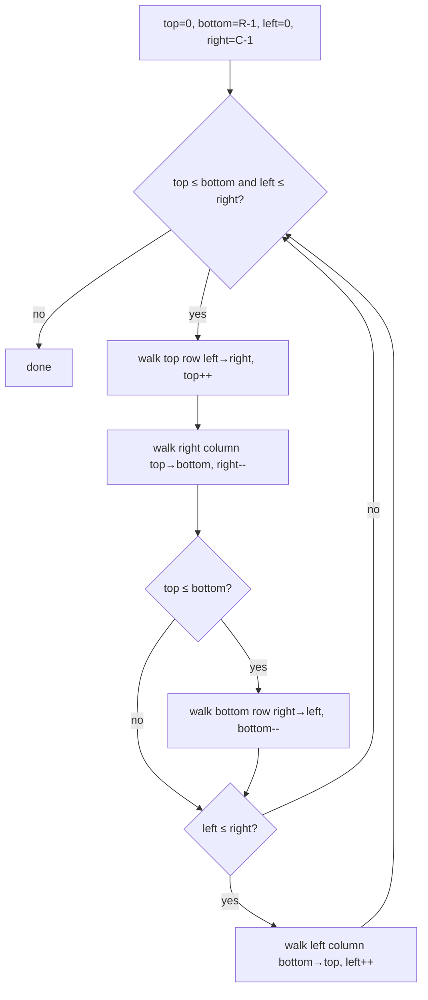
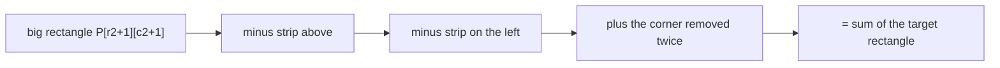

# Session 2 · Two-Dimensional Arrays and Matrices

Prepared by **Hamna Zahid Khan**, Junior Lecturer

[🏠 Course home](../README.md) · [📘 Module overview](./README.md) · [⬅ Previous](./session-01-arrays-and-dynamic-arrays.md) · [Next ➡](./session-03-strings-and-pattern-matching.md)

> **Module 02 · Arrays and Strings** · ⏱ 3 hours (90 min lecture + 90 min lab)

## 🎯 Learning objectives

1. Declare, initialise and traverse 2-D and **jagged** arrays in Java.
2. Explain row-major layout and why loop order affects speed.
3. Implement transpose, in-place rotation, spiral traversal and matrix multiplication.
4. Use a **2-D prefix-sum table** to answer rectangle-sum queries in O(1).

---

## 1. Grids everywhere

Seating plans, spreadsheets, images (pixels), game boards, timetables and distance tables are all **grids**: data indexed by a *row* and a *column*.

> 🎭 **Analogy: cinema seats.** A seat is identified by (row, seat number). To find seat (5, 12) you go to row 5, then walk to seat 12. A 2-D array works exactly like that: `m[row][col]`.

## 2. 2-D arrays in Java are arrays of arrays

```java
int[][] m = new int[3][4];          // 3 rows, 4 columns, all zeros
int[][] grid = {{1, 2, 3}, {4, 5, 6}};
int rows = grid.length;             // 2
int cols = grid[0].length;          // 3
```

Java stores `m` as an array of 3 **references**, each pointing to its own `int[4]` row. Rows may even have different lengths: a **jagged array**.



**Row-major order.** Inside each row, cells are contiguous. In languages with true 2-D blocks (C), the address of `m[i][j]` in an R × C matrix is `base + (i × C + j) × size`. Looping **row by row** (outer `i`, inner `j`) walks memory sequentially, which is cache friendly; looping column by column jumps between rows and can be several times slower on large matrices.

## 3. Core matrix algorithms

### 3.1 Transpose

`t[j][i] = m[i][j]`. An R × C matrix becomes C × R. O(R·C) time and space.

### 3.2 Rotate 90° clockwise in place (square matrix)

Two steps: **transpose**, then **reverse each row**.

| Step | Matrix |
|---|---|
| Original | `1 2 3 / 4 5 6 / 7 8 9` |
| Transpose (swap across diagonal) | `1 4 7 / 2 5 8 / 3 6 9` |
| Reverse each row | `7 4 1 / 8 5 2 / 9 6 3` ✅ |

O(n²) time, O(1) extra space. (Counter-clockwise: transpose, then reverse each **column**.)

### 3.3 Spiral traversal

Keep four boundaries `top`, `bottom`, `left`, `right` and peel the matrix layer by layer.



**Trace on the 3 × 4 matrix `1..12`:**

| Pass | Direction | Cells added | Boundaries after |
|---|---|---|---|
| 1 | top row → | 1 2 3 4 | top = 1 |
| 1 | right col ↓ | 8 12 | right = 2 |
| 1 | bottom row ← | 11 10 9 | bottom = 1 |
| 1 | left col ↑ | 5 | left = 1 |
| 2 | top row → | 6 7 | top = 2 |
| 2 | right col ↓ | (none: top > bottom) | right = 1 |

Result: `1 2 3 4 8 12 11 10 9 5 6 7`. The two `if` checks prevent double-counting when a single row or column remains.

### 3.4 Matrix multiplication

For A (r × k) and B (k × c): `P[i][j] = Σₜ A[i][t] × B[t][j]`. The inner dimensions must match. Triple loop ⇒ **O(r·k·c)**, i.e. O(n³) for square matrices. Ordering the loops `i, t, j` makes the innermost loop walk rows of both `B` and `P` contiguously.

### 3.5 2-D prefix sums

`P[i][j]` = sum of the sub-matrix from (0,0) to (i−1, j−1). Build with inclusion–exclusion:

> P[i][j] = m[i−1][j−1] + P[i−1][j] + P[i][j−1] − P[i−1][j−1]

Query the rectangle (r1,c1)…(r2,c2):

> sum = P[r2+1][c2+1] − P[r1][c2+1] − P[r2+1][c1] + P[r1][c1]



## 4. Complexity table

| Operation | Time | Extra space |
|---|---|---|
| Access `m[i][j]` | O(1) | O(1) |
| Full traversal | O(R·C) | O(1) |
| Transpose (new matrix) | O(R·C) | O(R·C) |
| Rotate square in place | O(n²) | O(1) |
| Spiral order | O(R·C) | O(R·C) for output |
| Multiply r×k by k×c | O(r·k·c) | O(r·c) |
| Build prefix table | O(R·C) | O(R·C) |
| Rectangle-sum query | **O(1)** | O(1) |
| Staircase search in row/col-sorted matrix | O(R + C) | O(1) |

---

## 5. Complete program

📄 **[`src/MatrixOps.java`](src/MatrixOps.java)**

```java
import java.util.ArrayList;
import java.util.Arrays;
import java.util.List;

/**
 * Module 02 · Session 02 — Two-dimensional arrays and matrix algorithms.
 *
 * Row-major traversal, transpose, 90-degree rotation in place, spiral order,
 * matrix multiplication, jagged arrays and a 2-D prefix-sum table for O(1)
 * rectangle-sum queries.
 *
 * Compile:  javac -d out MatrixOps.java
 * Run:      java -cp out MatrixOps
 *
 * Prepared by Hamna Zahid Khan, Junior Lecturer
 */
public class MatrixOps {

    static void print(String title, int[][] m) {
        System.out.println(title);
        for (int[] row : m) {
            StringBuilder sb = new StringBuilder("  ");
            for (int v : row) sb.append(String.format("%4d", v));
            System.out.println(sb);
        }
    }

    /** Returns a new matrix whose rows are the columns of m. O(r*c). */
    static int[][] transpose(int[][] m) {
        int r = m.length, c = m[0].length;
        int[][] t = new int[c][r];
        for (int i = 0; i < r; i++)
            for (int j = 0; j < c; j++)
                t[j][i] = m[i][j];
        return t;
    }

    /** Rotates a square matrix 90 degrees clockwise IN PLACE: transpose, then reverse each row. */
    static void rotateClockwise(int[][] m) {
        int n = m.length;
        for (int i = 0; i < n; i++)
            for (int j = i + 1; j < n; j++) {        // swap across the main diagonal
                int tmp = m[i][j]; m[i][j] = m[j][i]; m[j][i] = tmp;
            }
        for (int[] row : m)
            for (int l = 0, r = n - 1; l < r; l++, r--) {
                int tmp = row[l]; row[l] = row[r]; row[r] = tmp;
            }
    }

    /** Spiral (clockwise) order using four shrinking boundaries. O(r*c). */
    static List<Integer> spiral(int[][] m) {
        List<Integer> out = new ArrayList<>();
        int top = 0, bottom = m.length - 1, left = 0, right = m[0].length - 1;
        while (top <= bottom && left <= right) {
            for (int j = left; j <= right; j++) out.add(m[top][j]);
            top++;
            for (int i = top; i <= bottom; i++) out.add(m[i][right]);
            right--;
            if (top <= bottom) {
                for (int j = right; j >= left; j--) out.add(m[bottom][j]);
                bottom--;
            }
            if (left <= right) {
                for (int i = bottom; i >= top; i--) out.add(m[i][left]);
                left++;
            }
        }
        return out;
    }

    /** Classic triple loop: (r x k) * (k x c). O(r*k*c). */
    static int[][] multiply(int[][] a, int[][] b) {
        if (a[0].length != b.length) throw new IllegalArgumentException("inner dimensions differ");
        int r = a.length, k = b.length, c = b[0].length;
        int[][] p = new int[r][c];
        for (int i = 0; i < r; i++)
            for (int t = 0; t < k; t++)          // i-t-j order is cache friendly
                for (int j = 0; j < c; j++)
                    p[i][j] += a[i][t] * b[t][j];
        return p;
    }

    /** prefix[i][j] = sum of m[0..i-1][0..j-1]; built in O(r*c). */
    static long[][] prefixSums(int[][] m) {
        int r = m.length, c = m[0].length;
        long[][] p = new long[r + 1][c + 1];
        for (int i = 1; i <= r; i++)
            for (int j = 1; j <= c; j++)
                p[i][j] = m[i - 1][j - 1] + p[i - 1][j] + p[i][j - 1] - p[i - 1][j - 1];
        return p;
    }

    /** Sum of the rectangle (r1,c1)..(r2,c2) inclusive in O(1) using inclusion-exclusion. */
    static long rectSum(long[][] p, int r1, int c1, int r2, int c2) {
        return p[r2 + 1][c2 + 1] - p[r1][c2 + 1] - p[r2 + 1][c1] + p[r1][c1];
    }

    public static void main(String[] args) {
        int[][] m = {
                {1, 2, 3, 4},
                {5, 6, 7, 8},
                {9, 10, 11, 12}
        };
        print("Original 3x4:", m);
        print("Transpose 4x3:", transpose(m));
        System.out.println("Spiral order: " + spiral(m));

        int[][] sq = {{1, 2, 3}, {4, 5, 6}, {7, 8, 9}};
        rotateClockwise(sq);
        print("3x3 rotated 90 degrees clockwise:", sq);

        int[][] a = {{1, 2}, {3, 4}, {5, 6}};       // 3x2
        int[][] b = {{7, 8, 9}, {10, 11, 12}};       // 2x3
        print("A(3x2) * B(2x3):", multiply(a, b));

        int[][] jagged = new int[4][];
        for (int i = 0; i < jagged.length; i++) {
            jagged[i] = new int[i + 1];               // Pascal's triangle rows have i+1 cells
            jagged[i][0] = jagged[i][i] = 1;
            for (int j = 1; j < i; j++) jagged[i][j] = jagged[i - 1][j - 1] + jagged[i - 1][j];
        }
        System.out.println("Jagged array (Pascal's triangle): " + Arrays.deepToString(jagged));

        int[][] sales = {        // rows = branches, columns = months
                {12, 15, 9, 20},
                {8, 11, 14, 6},
                {17, 4, 10, 13}
        };
        long[][] p = prefixSums(sales);
        System.out.println("Total sales, branches 0-1, months 1-2 = " + rectSum(p, 0, 1, 1, 2));
        System.out.println("Total sales, whole table            = " + rectSum(p, 0, 0, 2, 3));
        System.out.println("Row-major address of m[2][1] in a 3x4 int matrix = base + (2*4 + 1)*4 bytes = base + "
                + ((2 * 4 + 1) * 4));
    }
}
```

**Real output:**

```text
$ java -cp out MatrixOps
Original 3x4:
     1   2   3   4
     5   6   7   8
     9  10  11  12
Transpose 4x3:
     1   5   9
     2   6  10
     3   7  11
     4   8  12
Spiral order: [1, 2, 3, 4, 8, 12, 11, 10, 9, 5, 6, 7]
3x3 rotated 90 degrees clockwise:
     7   4   1
     8   5   2
     9   6   3
A(3x2) * B(2x3):
    27  30  33
    61  68  75
    95 106 117
Jagged array (Pascal's triangle): [[1], [1, 1], [1, 2, 1], [1, 3, 3, 1]]
Total sales, branches 0-1, months 1-2 = 49
Total sales, whole table            = 139
Row-major address of m[2][1] in a 3x4 int matrix = base + (2*4 + 1)*4 bytes = base + 36
```

---

## 6. Worked examples (basic → advanced)

**Example 1 (basic): row and column totals.** A marks sheet with students as rows and subjects as columns. One pass fills both arrays.

```java
/** Totals per row and per column, e.g. marks per student and per subject. */
static int[][] rowColSums(int[][] m) {
    int[] rows = new int[m.length], cols = new int[m[0].length];
    for (int i = 0; i < m.length; i++)
        for (int j = 0; j < m[0].length; j++) {
            rows[i] += m[i][j];
            cols[j] += m[i][j];
        }
    return new int[][]{rows, cols};
}
```
<sub>Full, compiled version: [`src/Labs02.java`](src/Labs02.java)</sub>

**Example 2 (intermediate): verifying one product cell.** In `A(3×2) × B(2×3)`, `P[1][2] = A[1][0]·B[0][2] + A[1][1]·B[1][2] = 3·9 + 4·12 = 27 + 48 = 75`, matching the output.

**Example 3 (advanced): staircase search.** In a matrix whose rows *and* columns are sorted, start at the **top-right** corner. If the value is too big, the whole column below is too big ⇒ move left; if too small, the whole row to the left is too small ⇒ move down. Each step discards a row or a column: O(R + C).

| Position | Value | Target 9 | Move |
|---|---|---|---|
| (0,3) | 11 | 11 > 9 | left |
| (0,2) | 7 | 7 < 9 | down |
| (1,2) | 8 | 8 < 9 | down |
| (2,2) | 9 | found ✅ | – |

## 7. Real-life problem: branch sales dashboard

**Problem.** A retail chain has a table `sales[branch][month]`. Managers repeatedly ask "total sales of branches 0–1 for months 1–2" with different ranges, thousands of times a day.

**Naive approach:** sum the rectangle each time ⇒ O(R·C) per query.
**Better:** build the prefix table once (O(R·C)), then answer each query in **O(1)**.

For the program's data, branches 0–1 and months 1–2 cover `15 + 9 + 11 + 14 = 49`, and `rectSum` returns 49 using just four look-ups. This is the same idea used by image-processing "integral images" for fast face detection.

## 8. Common mistakes

| Mistake | Fix |
|---|---|
| Using `m.length` for the number of columns | columns = `m[0].length` (or `m[i].length` for jagged rows) |
| Swapping the whole matrix during in-place transpose (`j` from 0) | start `j` at `i + 1`, otherwise each pair is swapped twice |
| Off-by-one in prefix sums | use a table of size (R+1) × (C+1) with a zero border |
| Multiplying incompatible matrices | check `a[0].length == b.length` first |
| Spiral without the inner `if` checks | duplicates when one row/column remains |
| `new int[3][]` then accessing `m[0][0]` | rows are `null` until allocated |

## 9. Best practices

- Name loop variables after their meaning (`row`, `col`) in complex code.
- Use helper methods (`inBounds(r, c)`) for grid problems such as flood fill.
- Prefer row-major loops for performance.
- Use `Arrays.deepToString` to print 2-D arrays during debugging.

---

## 10. Lab tasks

**Lab 2.1: Staircase search.** Implement search in a row- and column-sorted matrix in O(R + C).

<details>
<summary>💡 Hint</summary>

Start at the top-right corner. Each comparison eliminates one row or one column.

</details>

<details>
<summary>✅ Solution</summary>

```java
/** Rows and columns both sorted ascending: start top-right, move left or down. O(r + c). */
static int[] searchSortedMatrix(int[][] m, int target) {
    int i = 0, j = m[0].length - 1;
    while (i < m.length && j >= 0) {
        if (m[i][j] == target) return new int[]{i, j};
        if (m[i][j] > target) j--;   // everything below in this column is bigger too
        else i++;                    // everything left in this row is smaller too
    }
    return new int[]{-1, -1};
}
```
<sub>Full, compiled version: [`src/Labs02.java`](src/Labs02.java)</sub>

</details>

**Lab 2.2: Counter-clockwise rotation.** Rotate a square matrix 90° counter-clockwise in place.

<details>
<summary>✅ Solution</summary>

Transpose, then reverse each **column** (swap `m[top][j]` with `m[bottom][j]` moving inward). Equivalently: reverse each row, then transpose.

</details>

**Lab 2.3: Diagonal sums.** Return the sum of the main diagonal and the anti-diagonal of an n × n matrix without counting the centre twice.

<details>
<summary>✅ Solution</summary>

`for (i = 0; i < n; i++) sum += m[i][i] + m[i][n-1-i];` then, if `n` is odd, subtract `m[n/2][n/2]`. O(n).

</details>

**Real output of the Session 2 lab solutions:**

```text
$ java -cp out Labs02 2
-- Session 2 labs --
search 9 in sorted matrix -> [2, 2]
search 15 in sorted matrix -> [-1, -1]
row sums [245, 215], column sums [130, 160, 170]
```

---

## 11. Quiz

**Q1.** For `int[][] m = new int[4][7];`, what is `m[0].length`?

- **A.** 4
- **B.** 7
- **C.** 28
- **D.** 0

**Q2.** Rotating an n×n matrix 90° clockwise in place can be done by:

- **A.** reversing rows then reversing columns
- **B.** transposing then reversing each row
- **C.** transposing twice
- **D.** sorting each row

**Q3.** Multiplying two n×n matrices with the standard algorithm costs:

- **A.** O(n)
- **B.** O(n²)
- **C.** O(n³)
- **D.** O(n² log n)

**Q4.** After O(R·C) preprocessing, a 2-D prefix table answers a rectangle sum in:

- **A.** O(1)
- **B.** O(R)
- **C.** O(R + C)
- **D.** O(R·C)

**Q5.** A jagged array is:

- **A.** an array with negative indices
- **B.** a 2-D array whose rows can have different lengths
- **C.** an unsorted array
- **D.** a sparse matrix format

<details>
<summary><b>Show answers</b></summary>

1. **B**: The first index selects a row; each row has 7 columns.
2. **B**: Transpose + horizontal flip = clockwise rotation.
3. **C**: n² cells, each a dot product of length n.
4. **A**: Four table look-ups with inclusion–exclusion.
5. **B**: Java 2-D arrays are arrays of row arrays, which need not be equal in length.

</details>

---

## 12. Summary

- Java 2-D arrays are **arrays of row arrays**; rows can differ in length (jagged).
- Loop **row by row** for cache-friendly access.
- Key algorithms: transpose, rotate (transpose + reverse), spiral (four boundaries), multiply (O(n³)).
- **Prefix sums** trade O(R·C) preprocessing for O(1) range queries.

## 13. Viva / interview questions

1. How is a Java `int[3][4]` stored differently from a C `int[3][4]`?
2. Why can the order of nested loops change performance but not the result?
3. Explain the inclusion–exclusion formula for 2-D prefix sums.
4. How would you rotate a non-square matrix?
5. What is a sparse matrix and how might you store one efficiently?
6. Describe the staircase search and prove it is O(R + C).

---

[⬅ Previous](./session-01-arrays-and-dynamic-arrays.md) · [📘 Module overview](./README.md) · [Next ➡](./session-03-strings-and-pattern-matching.md)
