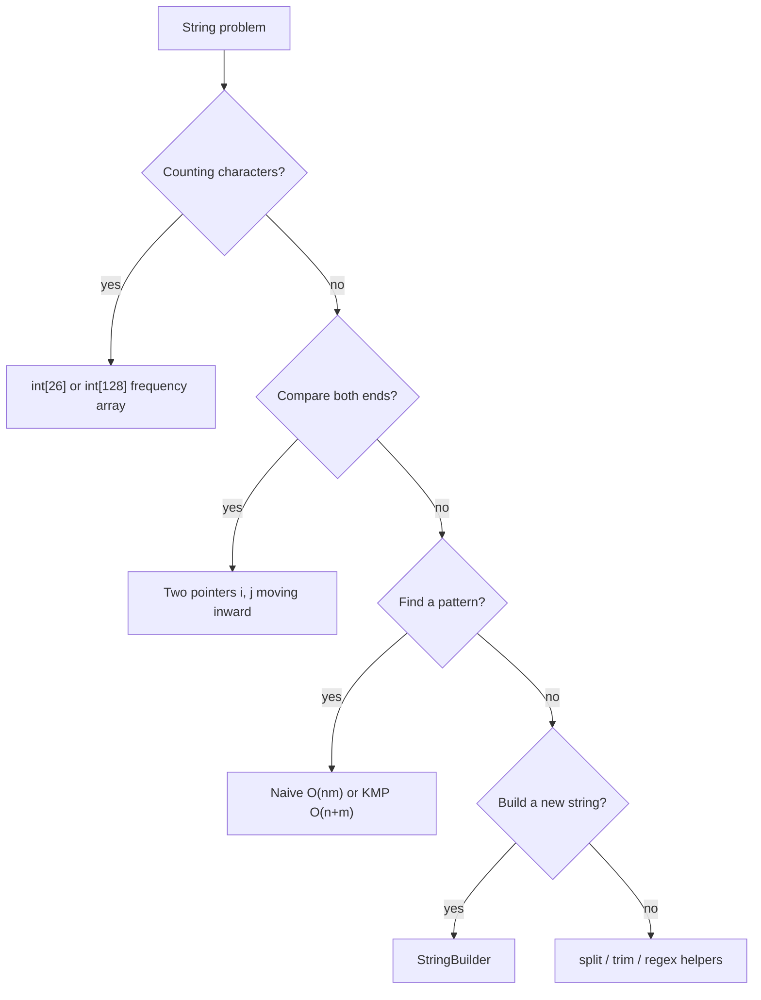
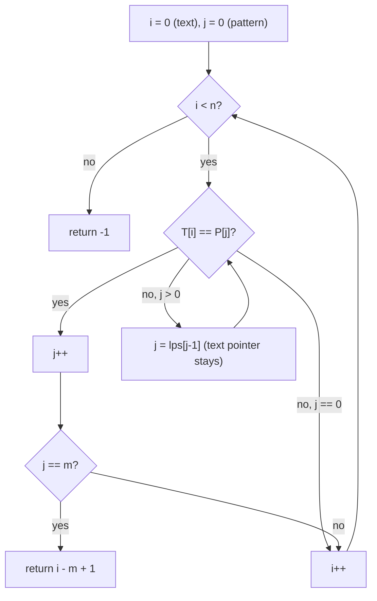

# Session 3 · Strings and Pattern Matching

Prepared by **Hamna Zahid Khan**, Junior Lecturer

[🏠 Course home](../README.md) · [📘 Module overview](./README.md) · [⬅ Previous](./session-02-two-dimensional-arrays-and-matrices.md) · [Practice test ➡](./practice-test.md)

> **Module 02 · Arrays and Strings** · ⏱ 3 hours (90 min lecture + 90 min lab)

## 🎯 Learning objectives

1. Explain **string immutability** in Java and use `StringBuilder` correctly.
2. Solve classic string problems with **frequency arrays** and **two pointers**.
3. Implement the **naive** substring search and analyse its worst case.
4. Build the **LPS table** and implement **Knuth–Morris–Pratt (KMP)** in O(n + m).

---

## 1. Strings are character arrays with rules

A Java `String` is an **immutable** sequence of characters. Every "modifying" method (`toUpperCase`, `replace`, `substring`, `+`) returns a **new** object.

> 🪨 **Analogy: an engraved stone plaque.** You cannot change a letter on an engraved plaque; you must order a new one with the corrected text. `StringBuilder` is a **whiteboard**: write, erase and append freely, then "engrave" once with `toString()`.

Why immutable? Strings can be safely shared between threads, cached in the **string pool**, and used as `HashMap` keys (their hash never changes).

| Operation | `String` | `StringBuilder` |
|---|---|---|
| `charAt(i)` | O(1) | O(1) |
| append one char | O(n), copies everything | O(1) amortised |
| n appends in a loop | **O(n²)** | **O(n)** |
| insert/delete in middle | O(n) new string | O(n) shift |
| `substring(a, b)` | O(b − a) copy | – |
| thread-safe | yes (immutable) | no (`StringBuffer` is) |

## 2. Toolbox for string problems



**Frequency array trick.** For lowercase letters, `ch - 'a'` maps `'a'..'z'` to `0..25`. Anagram check: increment for one string, decrement for the other; all counts must end at zero. O(n) time, O(1) space (26 is a constant).

## 3. Pattern matching

**Problem:** find the first index where pattern `P` (length m) occurs in text `T` (length n).

### 3.1 Naive search

Try every shift `s = 0..n−m` and compare character by character. Worst case (T = `AAAA…AB`, P = `AA…AB`): each shift matches m−1 characters before failing ⇒ **O(n·m)**.

### 3.2 KMP: never look back

> 🧠 **Analogy: reading a phone number twice.** If you were matching "ABABC" and saw "ABAB" before a mismatch, you already *know* the last two characters you read were "AB", which is also the start of the pattern. KMP uses that knowledge instead of re-reading the text.

The **LPS array** (Longest proper Prefix which is also a Suffix) tells us how far we can "fall back" in the pattern after a mismatch.

**LPS for `ABABCABAB`:**

| i | 0 | 1 | 2 | 3 | 4 | 5 | 6 | 7 | 8 |
|---|---|---|---|---|---|---|---|---|---|
| P[i] | A | B | A | B | C | A | B | A | B |
| lps[i] | 0 | 0 | 1 | 2 | 0 | 1 | 2 | 3 | 4 |
| why | – | "A"≠"B" | "A" | "AB" | none | "A" | "AB" | "ABA" | "ABAB" |



**Dry run (short):** T = `ABABDABABC`, P = `ABABC` (lps = 0 0 1 2 0).

| i | T[i] | j before | compare | j after | note |
|---|---|---|---|---|---|
| 0–3 | ABAB | 0→3 | match ×4 | 4 | |
| 4 | D | 4 | D≠C | lps[3]=2 | fall back, i stays |
| 4 | D | 2 | D≠A | lps[1]=0 | fall back |
| 4 | D | 0 | D≠A | 0 | move on |
| 5–9 | ABABC | 0→5 | match ×5 | 5 = m | found at 9−5+1 = **5** |

The text pointer `i` never moves backwards, so the total work is at most 2n comparisons plus O(m) to build the LPS table: **O(n + m)**.

## 4. Complexity table

| Algorithm | Best | Average | Worst | Extra space |
|---|---|---|---|---|
| Anagram (frequency array) | O(n) | O(n) | O(n) | O(1) |
| Reverse words | O(n) | O(n) | O(n) | O(n) |
| Run-length compression | O(n) | O(n) | O(n) | O(n) |
| Naive search | O(m) | O(n) typical text | O(n·m) | O(1) |
| KMP search | O(n + m) | O(n + m) | O(n + m) | O(m) for LPS |

---

## 5. Complete program

📄 **[`src/StringAlgorithms.java`](src/StringAlgorithms.java)**

```java
import java.util.Arrays;

/**
 * Module 02 · Session 03 — Strings, StringBuilder and pattern matching.
 *
 * Immutability and StringBuilder, frequency-count anagram check, word reversal,
 * run-length compression, naive substring search and the Knuth-Morris-Pratt (KMP)
 * algorithm with its LPS (longest proper prefix that is also a suffix) table.
 *
 * Compile:  javac -d out StringAlgorithms.java
 * Run:      java -cp out StringAlgorithms
 *
 * Prepared by Hamna Zahid Khan, Junior Lecturer
 */
public class StringAlgorithms {

    static long comparisons; // counts character comparisons in the search algorithms

    /** Anagram check with a 26-slot frequency array: O(n) time, O(1) space. */
    static boolean isAnagram(String a, String b) {
        if (a.length() != b.length()) return false;
        int[] freq = new int[26];
        for (int i = 0; i < a.length(); i++) {
            freq[a.charAt(i) - 'a']++;
            freq[b.charAt(i) - 'a']--;
        }
        for (int f : freq) if (f != 0) return false;
        return true;
    }

    /** "data structures in java" -> "java in structures data". */
    static String reverseWords(String s) {
        String[] words = s.trim().split("\\s+");
        StringBuilder sb = new StringBuilder();
        for (int i = words.length - 1; i >= 0; i--) {
            sb.append(words[i]);
            if (i > 0) sb.append(' ');
        }
        return sb.toString();
    }

    /** Run-length encoding: "aaabccdddd" -> "a3b1c2d4". */
    static String compress(String s) {
        StringBuilder sb = new StringBuilder();
        for (int i = 0; i < s.length(); ) {
            int j = i;
            while (j < s.length() && s.charAt(j) == s.charAt(i)) j++;
            sb.append(s.charAt(i)).append(j - i);
            i = j;
        }
        return sb.toString();
    }

    /** Naive search: try every shift. Worst case O(n*m). Returns first index or -1. */
    static int naiveSearch(String text, String pat) {
        int n = text.length(), m = pat.length();
        for (int s = 0; s <= n - m; s++) {
            int j = 0;
            while (j < m) {
                comparisons++;
                if (text.charAt(s + j) != pat.charAt(j)) break;
                j++;
            }
            if (j == m) return s;
        }
        return -1;
    }

    /** lps[i] = length of the longest proper prefix of pat[0..i] that is also a suffix of it. */
    static int[] buildLps(String pat) {
        int[] lps = new int[pat.length()];
        int len = 0; // length of the current matched prefix
        for (int i = 1; i < pat.length(); ) {
            if (pat.charAt(i) == pat.charAt(len)) {
                lps[i++] = ++len;
            } else if (len > 0) {
                len = lps[len - 1]; // fall back, do not move i
            } else {
                lps[i++] = 0;
            }
        }
        return lps;
    }

    /** KMP search: never moves backwards in the text. O(n + m). */
    static int kmpSearch(String text, String pat) {
        int[] lps = buildLps(pat);
        int j = 0; // characters of pat matched so far
        for (int i = 0; i < text.length(); i++) {
            while (j > 0 && text.charAt(i) != pat.charAt(j)) {
                comparisons++;
                j = lps[j - 1];
            }
            comparisons++;
            if (text.charAt(i) == pat.charAt(j)) j++;
            if (j == pat.length()) return i - j + 1;
        }
        return -1;
    }

    public static void main(String[] args) {
        System.out.println("=== immutability ===");
        String s = "data";
        String t = s.toUpperCase();
        System.out.println("s = " + s + ", s.toUpperCase() = " + t + "  (s itself is unchanged)");

        int n = 20_000;
        long t0 = System.nanoTime();
        String slow = "";
        for (int i = 0; i < n; i++) slow += 'x';
        long t1 = System.nanoTime();
        StringBuilder sb = new StringBuilder();
        for (int i = 0; i < n; i++) sb.append('x');
        String fast = sb.toString();
        long t2 = System.nanoTime();
        System.out.println("+= built " + slow.length() + " chars; StringBuilder built " + fast.length() + " chars");
        System.out.println("StringBuilder faster? " + ((t2 - t1) < (t1 - t0)));

        System.out.println("\n=== classic string problems ===");
        System.out.println("isAnagram(listen, silent) = " + isAnagram("listen", "silent"));
        System.out.println("isAnagram(karachi, chakira) = " + isAnagram("karachi", "chakira"));
        System.out.println("isAnagram(lahore, hollow) = " + isAnagram("lahore", "hollow"));
        System.out.println("reverseWords = \"" + reverseWords("  data structures   in java ") + "\"");
        System.out.println("compress(aaabccdddd) = " + compress("aaabccdddd"));

        System.out.println("\n=== pattern matching ===");
        String pat = "ABABCABAB";
        System.out.println("LPS of " + pat + " = " + Arrays.toString(buildLps(pat)));
        String text = "ABABDABACDABABCABABCABAB";
        comparisons = 0;
        int a = naiveSearch(text, pat);
        long naiveCmp = comparisons;
        comparisons = 0;
        int b = kmpSearch(text, pat);
        System.out.println("text = " + text);
        System.out.println("naive -> index " + a + " with " + naiveCmp + " comparisons");
        System.out.println("KMP   -> index " + b + " with " + comparisons + " comparisons");

        String worstText = "A".repeat(5000) + "B";
        String worstPat = "A".repeat(50) + "B";
        comparisons = 0;
        naiveSearch(worstText, worstPat);
        long w1 = comparisons;
        comparisons = 0;
        kmpSearch(worstText, worstPat);
        System.out.printf("worst case (n=%d, m=%d): naive %,d vs KMP %,d comparisons%n",
                worstText.length(), worstPat.length(), w1, comparisons);
    }
}
```

**Real output:**

```text
$ java -cp out StringAlgorithms
=== immutability ===
s = data, s.toUpperCase() = DATA  (s itself is unchanged)
+= built 20000 chars; StringBuilder built 20000 chars
StringBuilder faster? true

=== classic string problems ===
isAnagram(listen, silent) = true
isAnagram(karachi, chakira) = true
isAnagram(lahore, hollow) = false
reverseWords = "java in structures data"
compress(aaabccdddd) = a3b1c2d4

=== pattern matching ===
LPS of ABABCABAB = [0, 0, 1, 2, 0, 1, 2, 3, 4]
text = ABABDABACDABABCABABCABAB
naive -> index 10 with 29 comparisons
KMP   -> index 10 with 23 comparisons
worst case (n=5001, m=51): naive 252,501 vs KMP 9,951 comparisons
```

The worst-case line shows the difference vividly: ~250,000 comparisons for naive search against ~10,000 for KMP on the same input.

---

## 6. Worked examples (basic → advanced)

**Example 1 (basic): run-length compression of `aaabccdddd`.** Pointer `i` marks the start of a run, `j` advances while characters match; append `char + (j − i)`. Runs: a×3, b×1, c×2, d×4 ⇒ `a3b1c2d4`.

**Example 2 (intermediate): palindrome ignoring punctuation.** Two pointers skip non-alphanumeric characters and compare case-insensitively without building a cleaned copy (O(1) space).

```java
/** Palindrome check ignoring case, spaces and punctuation, without building a new string. */
static boolean isCleanPalindrome(String s) {
    int i = 0, j = s.length() - 1;
    while (i < j) {
        if (!Character.isLetterOrDigit(s.charAt(i))) { i++; continue; }
        if (!Character.isLetterOrDigit(s.charAt(j))) { j--; continue; }
        if (Character.toLowerCase(s.charAt(i)) != Character.toLowerCase(s.charAt(j))) return false;
        i++; j--;
    }
    return true;
}
```
<sub>Full, compiled version: [`src/Labs02.java`](src/Labs02.java)</sub>

**Example 3 (advanced): building LPS for `AAACAAAA`.**

| i | P[i] | len before | action | lps[i] |
|---|---|---|---|---|
| 1 | A | 0 | match | 1 |
| 2 | A | 1 | match | 2 |
| 3 | C | 2 | mismatch → len = lps[1] = 1 → mismatch → len = lps[0] = 0 → mismatch | 0 |
| 4 | A | 0 | match | 1 |
| 5 | A | 1 | match | 2 |
| 6 | A | 2 | match | 3 |
| 7 | A | 3 | P[7]=A vs P[3]=C mismatch → len = lps[2] = 2 → match | 3 |

Final: `[0, 1, 2, 0, 1, 2, 3, 3]` (verified in `SelfCheck`).

## 7. Real-life problem: plagiarism keyword scanner

**Problem.** A lecturer wants to scan 300 submitted reports (each ~50,000 characters) for a set of suspicious phrases copied from a known source. Naive search on adversarial text can degrade to O(n·m) per phrase.

**Solution.** Pre-compute the LPS table of each phrase once (O(m)), then run KMP over each report (O(n)). Total: O(Σ reports × phrases × n) with no worst-case blow-up. Normalise text first (lowercase, collapse whitespace with `StringBuilder`) so formatting tricks do not hide matches.

```java
String report = normalise(rawText);              // lowercase, single spaces
for (String phrase : suspicious) {
    int at = StringAlgorithms.kmpSearch(report, phrase);
    if (at >= 0) System.out.println("Found \"" + phrase + "\" at " + at);
}
```

For many phrases at once, the **Aho–Corasick** automaton (a trie + KMP-style failure links, see Module 13) scans the text only once.

## 8. Common mistakes

| Mistake | Fix |
|---|---|
| Comparing strings with `==` | `equals` / `equalsIgnoreCase` |
| `s += x` inside a loop | `StringBuilder.append` |
| `split(" ")` on text with multiple spaces | `trim().split("\\s+")` |
| `ch - 'a'` on uppercase or digits | normalise first or use `int[128]` |
| In KMP, incrementing `i` after a fall-back | only `j` changes on fall-back; `i` advances after |
| Assuming `substring` is O(1) | it copies: O(length) |

## 9. Best practices

- Normalise input (case, whitespace) once at the start.
- Prefer `char[]` (`toCharArray()`) for heavy in-place manipulation.
- Use `String.join`, `String.repeat`, `chars()` for readable one-liners in non-critical code.
- For Unicode text beyond ASCII, use `Map<Character,Integer>` or `codePoints()`.

---

## 10. Lab tasks

**Lab 3.1: First unique character.** Return the index of the first non-repeating character (`"statistics"` → 2, the `a`).

<details>
<summary>💡 Hint</summary>

Two passes: count every character, then scan again for the first count of 1.

</details>

<details>
<summary>✅ Solution</summary>

```java
/** Index of the first non-repeating lowercase character, or -1. Two passes, O(n). */
static int firstUnique(String s) {
    int[] count = new int[26];
    for (char ch : s.toCharArray()) count[ch - 'a']++;
    for (int i = 0; i < s.length(); i++) if (count[s.charAt(i) - 'a'] == 1) return i;
    return -1;
}
```
<sub>Full, compiled version: [`src/Labs02.java`](src/Labs02.java)</sub>

</details>

**Lab 3.2: Longest common prefix** of `{"interview", "internet", "interval"}` → `"inter"`.

<details>
<summary>💡 Hint</summary>

Start with the first word as the candidate and shorten it until every word starts with it.

</details>

<details>
<summary>✅ Solution</summary>

```java
/** Longest common prefix of all words: shrink the candidate until every word starts with it. */
static String longestCommonPrefix(String[] words) {
    if (words.length == 0) return "";
    String prefix = words[0];
    for (String w : words)
        while (!w.startsWith(prefix)) prefix = prefix.substring(0, prefix.length() - 1);
    return prefix;
}
```
<sub>Full, compiled version: [`src/Labs02.java`](src/Labs02.java)</sub>

Worst case O(S) where S is the total number of characters.

</details>

**Lab 3.3: Count all occurrences.** Modify `kmpSearch` to return **every** starting index (overlaps allowed): `"AAAA"` with pattern `"AA"` → `[0, 1, 2]`.

<details>
<summary>✅ Solution</summary>

When `j == m`, record `i − m + 1`, then set `j = lps[j − 1]` and continue scanning instead of returning.

</details>

```text
$ java -cp out Labs02
rotateRight([1..7], 3) = [5, 6, 7, 1, 2, 3, 4]
dedupSorted -> length 5: [1, 2, 3, 7, 9]
search 9 in sorted matrix -> [2, 2]
search 15 in sorted matrix -> [-1, -1]
row sums [245, 215], column sums [130, 160, 170]
firstUnique("statistics") = 2
longestCommonPrefix = "inter"
isCleanPalindrome("A man, a plan, a canal: Panama") = true
```

---

## 11. Quiz

**Q1.** Why is building a string with `+=` in a loop of n iterations O(n²)?

- **A.** `+=` is a slow operator
- **B.** Each concatenation copies the entire string built so far
- **C.** Strings are stored in a linked list
- **D.** The garbage collector runs every iteration

**Q2.** What is the LPS array of `ABAB`?

- **A.** [0, 1, 2, 3]
- **B.** [0, 0, 1, 2]
- **C.** [0, 0, 0, 0]
- **D.** [1, 2, 1, 2]

**Q3.** The worst-case time of KMP for text length n and pattern length m is:

- **A.** O(n·m)
- **B.** O(n + m)
- **C.** O(n log m)
- **D.** O(m²)

**Q4.** Which data structure best checks if two lowercase words are anagrams in O(n) time and O(1) space?

- **A.** Sorting both words
- **B.** An int[26] frequency array
- **C.** A 2-D array
- **D.** Nested loops

**Q5.** `"  a  b ".trim().split("\\s+")` returns:

- **A.** ["", "a", "", "b", ""]
- **B.** ["a", "b"]
- **C.** ["a b"]
- **D.** ["  a", "b "]

<details>
<summary><b>Show answers</b></summary>

1. **B**: Immutability forces a new copy each time: 1 + 2 + … + n characters.
2. **B**: "A" and then "AB" are both prefixes and suffixes.
3. **B**: The text pointer never moves backwards.
4. **B**: Sorting is O(n log n); 26 counters are constant space.
5. **B**: trim removes the outer spaces; \s+ splits on runs of whitespace.

</details>

---

## 12. Summary

- Strings are **immutable**; use `StringBuilder` to build them in O(n).
- **Frequency arrays** and **two pointers** solve most beginner string problems in O(n).
- Naive search is simple but O(n·m) in the worst case.
- **KMP** pre-computes the LPS table and never re-reads the text: O(n + m).

## 13. Viva / interview questions

1. Why are Java strings immutable? List three benefits.
2. What is the string pool and how does `intern()` relate to it?
3. Difference between `StringBuilder` and `StringBuffer`?
4. Explain the LPS array with an example. Why is it called "proper" prefix?
5. Why does KMP never move the text pointer backwards?
6. How would you check whether one string is a rotation of another? (Hint: search in `s + s`.)
7. How would you find all anagrams of a pattern inside a text? (Preview of sliding window, Module 17.)

---

[⬅ Previous](./session-02-two-dimensional-arrays-and-matrices.md) · [📘 Module overview](./README.md) · [Practice test ➡](./practice-test.md)
