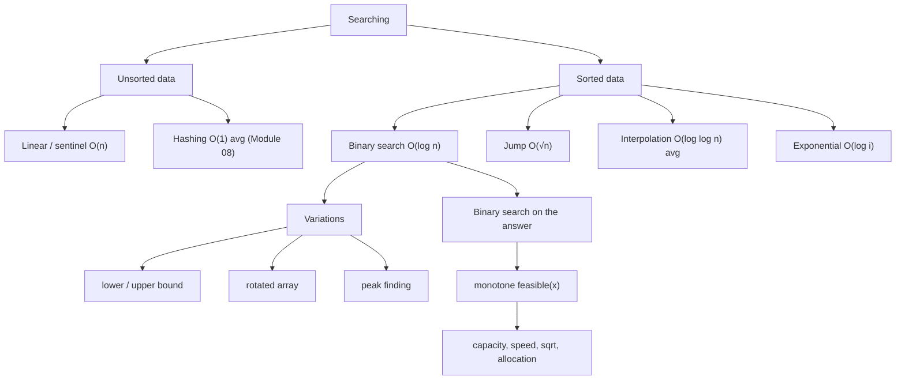

# Module 03 · Searching

Prepared by **Hamna Zahid Khan**, Junior Lecturer

[🏠 Course home](../README.md)

> ⏱ 6 contact hours · 2 sessions · 🟢 Foundation

Searching is the most common operation on data. This module moves from the brute-force linear scan to logarithmic binary search, and then generalises binary search into a powerful problem-solving technique: finding the boundary of any monotone yes/no question.

## 🎯 Module objectives

- Implement and analyse linear, sentinel, binary, jump, interpolation and exponential search.
- Prove binary search correct with a loop invariant and avoid its classic bugs.
- Use lower/upper bound for first/last/count/rank queries.
- Solve rotated-array, peak and "minimum feasible value" problems with binary search.

## 📚 Sessions

| # | Session | Key ideas | Code |
|---|---|---|---|
| 1 | [Linear and Binary Search](session-01-linear-and-binary-search.md) | linear, sentinel, binary (iterative/recursive), jump, interpolation, exponential | [`SearchAlgorithms.java`](src/SearchAlgorithms.java) |
| 2 | [Binary Search Variations](session-02-binary-search-variations.md) | lower/upper bound, rotated arrays, peaks, binary search on the answer | [`BinarySearchVariations.java`](src/BinarySearchVariations.java) |
| ✍️ | [Practice test](practice-test.md) | 20 MCQs + 3 coding scenarios | [`Labs03.java`](src/Labs03.java), [`SelfCheck.java`](src/SelfCheck.java) |

## 🗺️ Concept map



## 📄 One-page cheat sheet

**Closed-range binary search (find exact key)**

```java
int lo = 0, hi = n - 1;
while (lo <= hi) {
    int mid = lo + (hi - lo) / 2;
    if (a[mid] == key) return mid;
    if (a[mid] < key) lo = mid + 1; else hi = mid - 1;
}
return -1;
```

**Half-open "first true" template (bounds, answers)**

```java
int lo = LOW, hi = HIGH;               // answer is in [lo, hi]
while (lo < hi) {
    int mid = lo + (hi - lo) / 2;
    if (predicate(mid)) hi = mid;       // mid may be the answer
    else lo = mid + 1;
}
return lo;
```

| Query on sorted `a` | Answer |
|---|---|
| first index ≥ key | `lowerBound(key)` |
| first index > key | `upperBound(key)` |
| count of key | `upperBound − lowerBound` |
| elements < key | `lowerBound(key)` |
| `Arrays.binarySearch` absent | returns `−(insertionPoint) − 1` |

| Algorithm | Time | Requirement |
|---|---|---|
| Linear | O(n) | none |
| Binary | O(log n) | sorted, random access |
| Jump | O(√n) | sorted |
| Interpolation | O(log log n) avg, O(n) worst | sorted, uniform |
| Exponential | O(log i) | sorted, possibly unbounded |
| On the answer | O(log range × check) | monotone predicate |

**Bug checklist:** overflow-safe mid · range always shrinks · consistent range convention · test n = 0, 1, 2 · keys below/above all values.

## ▶️ Run the code

```bash
cd 03-searching/src
javac -d out *.java
java -ea -cp out SelfCheck
java -cp out BinarySearchVariations
```

See [`src/README.md`](src/README.md) for every file.
