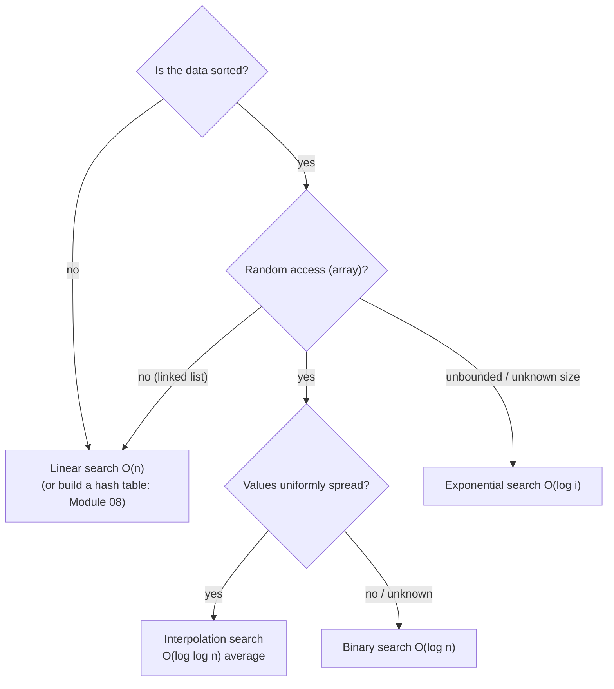
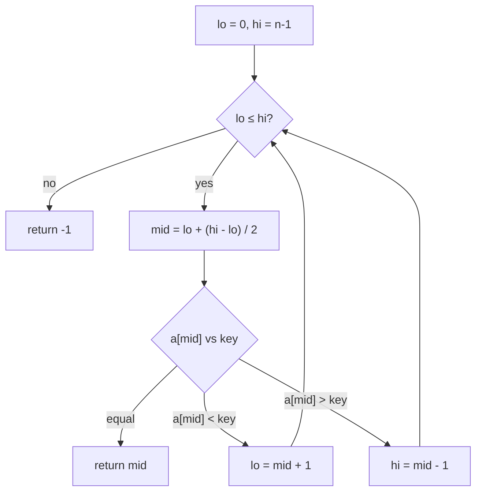

# Session 1 · Linear and Binary Search

Prepared by **Hamna Zahid Khan**, Junior Lecturer

[🏠 Course home](../README.md) · [📘 Module overview](./README.md) · [⬅ Module overview](./README.md) · [Next ➡](./session-02-binary-search-variations.md)

> **Module 03 · Searching** · ⏱ 3 hours (90 min lecture + 90 min lab)

## 🎯 Learning objectives

1. Implement **linear** and **sentinel** search and state when they are the only option.
2. Implement **binary search** iteratively and recursively, and trace it by hand.
3. Prove that binary search makes at most ⌊log₂ n⌋ + 1 comparisons.
4. Compare **jump**, **interpolation** and **exponential** search and know when each fits.
5. Use `Arrays.binarySearch` and interpret its negative return value.

---

## 1. The searching problem

Given a collection and a **key**, return the position of the key (or report it is absent). How fast we can do this depends entirely on what we know about the data's **order**.

> 📞 **Analogy: finding a name.** In a messy pile of business cards you must look at every card (linear search). In a phone directory sorted by name you open the middle, see "M", and immediately discard half the book (binary search). Sorting is the investment; fast searching is the return.



## 2. Linear search

Scan left to right; stop at the first match.

| Case | Comparisons |
|---|---|
| Best (key first) | 1 |
| Average (key present, uniform position) | (n + 1)/2 |
| Worst (key last or absent) | n |

**Sentinel search** removes the `i < n` test from the loop by temporarily writing the key into the last slot, which guarantees the loop stops. It halves the number of tests per iteration (one comparison instead of two); a micro-optimisation that matters in tight loops in C, less so in Java.

Linear search is the **only** choice when data is unsorted and we search just once, or when the structure gives no random access (a linked list). It is also often fastest for tiny arrays (n < ~16) because it is cache-friendly and branch-predictable.

## 3. Binary search

**Precondition:** the array is sorted. Keep a range `[lo, hi]` that *must* contain the key if it is present. Look at the middle element:

- equal ⇒ found;
- smaller than key ⇒ the key can only be to the right: `lo = mid + 1`;
- larger than key ⇒ the key can only be to the left: `hi = mid - 1`.

When `lo > hi` the range is empty ⇒ not found.



### Dry run: searching 71

Array (indices 0–12): `3 8 12 17 23 31 38 45 52 60 71 85 90`

| Step | lo | hi | mid | a[mid] | Decision |
|---|---|---|---|---|---|
| 1 | 0 | 12 | 6 | 38 | 38 < 71 → lo = 7 |
| 2 | 7 | 12 | 9 | 60 | 60 < 71 → lo = 10 |
| 3 | 10 | 12 | 11 | 85 | 85 > 71 → hi = 10 |
| 4 | 10 | 10 | 10 | 71 | **found at 10** |

Four comparisons for 13 elements; linear search would need 11.

### Why O(log n)?

After k comparisons at most n / 2ᵏ candidates remain. The search ends when fewer than 1 remain: n / 2ᵏ < 1 ⇒ k > log₂ n. So at most **⌊log₂ n⌋ + 1** comparisons. For n = 1,000,000 that is **20**. For n = 1,000,000,000 it is only 30.

### The overflow bug

`int mid = (lo + hi) / 2;` overflows when `lo + hi > 2³¹ − 1` (arrays of over a billion elements), producing a negative index. This bug survived in the JDK's own `Arrays.binarySearch` for nine years. Always write `lo + (hi - lo) / 2` (or `(lo + hi) >>> 1`).

### Loop invariant (how to *prove* it correct)

> If the key is in the array, it is in `a[lo..hi]`.

- **Initially** true: the range is the whole array.
- **Maintained:** we only discard halves that are provably smaller or larger than the key (sortedness).
- **Termination:** the range shrinks every iteration, so the loop ends; if it ends because `lo > hi`, the range is empty and the key is absent.

## 4. Three specialised searches

| Search | Idea | Time | Best for |
|---|---|---|---|
| **Jump** | jump ahead √n at a time, then linear scan in one block | O(√n) | systems where jumping back is expensive (e.g. tape, some linked storage) |
| **Interpolation** | guess `pos = lo + (key − a[lo]) · (hi − lo) / (a[hi] − a[lo])`, like opening a dictionary near "W" for "Wasim" | O(log log n) average, O(n) worst | large, uniformly distributed numeric keys |
| **Exponential** | check indices 1, 2, 4, 8 … until `a[bound] ≥ key`, then binary search in `[bound/2, bound]` | O(log i), i = key position | unbounded/infinite streams, keys near the front |

## 5. Complexity table

| Algorithm | Best | Average | Worst | Space | Needs sorted? |
|---|---|---|---|---|---|
| Linear | O(1) | O(n) | O(n) | O(1) | no |
| Sentinel | O(1) | O(n) | O(n) | O(1) | no |
| Binary (iterative) | O(1) | O(log n) | O(log n) | O(1) | yes |
| Binary (recursive) | O(1) | O(log n) | O(log n) | O(log n) stack | yes |
| Jump | O(1) | O(√n) | O(√n) | O(1) | yes |
| Interpolation | O(1) | O(log log n) | O(n) | O(1) | yes (+ uniform) |
| Exponential | O(1) | O(log i) | O(log n) | O(1)/O(log n) | yes |

---

## 6. Complete program

📄 **[`src/SearchAlgorithms.java`](src/SearchAlgorithms.java)**

```java
import java.util.Arrays;

/**
 * Module 03 · Session 01 — Linear search, binary search and friends.
 *
 * Linear and sentinel search, iterative and recursive binary search (with a
 * printed trace), jump search, interpolation search and exponential search.
 * Every method counts its comparisons so we can compare them on the same data.
 *
 * Compile:  javac -d out SearchAlgorithms.java
 * Run:      java -cp out SearchAlgorithms
 *
 * Prepared by Hamna Zahid Khan, Junior Lecturer
 */
public class SearchAlgorithms {

    static long comparisons;

    /** O(n): check every element left to right. Works on unsorted data. */
    static int linearSearch(int[] a, int key) {
        for (int i = 0; i < a.length; i++) {
            comparisons++;
            if (a[i] == key) return i;
        }
        return -1;
    }

    /** Sentinel search: place the key at the end so the loop needs no bounds test. */
    static int sentinelSearch(int[] a, int key) {
        int n = a.length;
        if (n == 0) return -1;
        int last = a[n - 1];
        a[n - 1] = key;                // sentinel guarantees the loop stops
        int i = 0;
        while (a[i] != key) { i++; comparisons++; }
        a[n - 1] = last;               // restore the array
        if (i < n - 1 || last == key) return i;
        return -1;
    }

    /** O(log n) iterative binary search on a sorted array. Prints each step if trace is true. */
    static int binarySearch(int[] a, int key, boolean trace) {
        int lo = 0, hi = a.length - 1;
        while (lo <= hi) {
            int mid = lo + (hi - lo) / 2;          // avoids int overflow of (lo + hi)
            comparisons++;
            if (trace) System.out.printf("  lo=%2d hi=%2d mid=%2d a[mid]=%3d%n", lo, hi, mid, a[mid]);
            if (a[mid] == key) return mid;
            if (a[mid] < key) lo = mid + 1;        // key is in the right half
            else hi = mid - 1;                     // key is in the left half
        }
        return -1;
    }

    /** Recursive binary search on a[lo..hi]. */
    static int binarySearchRec(int[] a, int key, int lo, int hi) {
        if (lo > hi) return -1;                    // empty range: not found
        int mid = lo + (hi - lo) / 2;
        comparisons++;
        if (a[mid] == key) return mid;
        return a[mid] < key ? binarySearchRec(a, key, mid + 1, hi)
                            : binarySearchRec(a, key, lo, mid - 1);
    }

    /** Jump search: jump sqrt(n) blocks, then scan linearly inside one block. O(sqrt n). */
    static int jumpSearch(int[] a, int key) {
        int n = a.length, step = (int) Math.sqrt(n), prev = 0, cur = step;
        while (cur < n && a[cur - 1] < key) {      // find the block that may contain key
            comparisons++;
            prev = cur;
            cur += step;
        }
        for (int i = prev; i < Math.min(cur, n); i++) {
            comparisons++;
            if (a[i] == key) return i;
        }
        return -1;
    }

    /** Interpolation search: guess the position from the value. O(log log n) on uniform data. */
    static int interpolationSearch(int[] a, int key) {
        int lo = 0, hi = a.length - 1;
        while (lo <= hi && key >= a[lo] && key <= a[hi]) {
            comparisons++;
            if (a[hi] == a[lo]) return a[lo] == key ? lo : -1;
            int pos = lo + (int) ((long) (key - a[lo]) * (hi - lo) / (a[hi] - a[lo]));
            if (a[pos] == key) return pos;
            if (a[pos] < key) lo = pos + 1;
            else hi = pos - 1;
        }
        return -1;
    }

    /** Exponential search: find a range [2^(k-1), 2^k] containing key, then binary search it. */
    static int exponentialSearch(int[] a, int key) {
        if (a.length == 0) return -1;
        comparisons++;
        if (a[0] == key) return 0;
        int bound = 1;
        while (bound < a.length && a[bound] < key) {
            comparisons++;
            bound *= 2;
        }
        int lo = bound / 2, hi = Math.min(bound, a.length - 1);
        return binarySearchRec(a, key, lo, hi);
    }

    public static void main(String[] args) {
        int[] unsorted = {42, 17, 8, 99, 23, 4, 15};
        comparisons = 0;
        System.out.println("linearSearch(unsorted, 23) = " + linearSearch(unsorted, 23) + " after " + comparisons + " comparisons");
        comparisons = 0;
        System.out.println("sentinelSearch(unsorted, 15) = " + sentinelSearch(unsorted, 15) + ", array intact: " + Arrays.toString(unsorted));

        int[] sorted = {3, 8, 12, 17, 23, 31, 38, 45, 52, 60, 71, 85, 90};
        System.out.println("\nsorted = " + Arrays.toString(sorted));
        System.out.println("Binary search trace for 71:");
        comparisons = 0;
        System.out.println("  -> index " + binarySearch(sorted, 71, true) + " in " + comparisons + " comparisons");
        System.out.println("Binary search trace for 20 (absent):");
        comparisons = 0;
        System.out.println("  -> index " + binarySearch(sorted, 20, true) + " in " + comparisons + " comparisons");
        System.out.println("recursive binarySearch(45) = " + binarySearchRec(sorted, 45, 0, sorted.length - 1));

        int n = 1_000_000;
        int[] big = new int[n];
        for (int i = 0; i < n; i++) big[i] = 3 * i;   // uniformly spaced values
        int key = 3 * 777_777;
        System.out.printf("%nSearching %,d sorted values for %,d:%n", n, key);
        String[] names = {"linear", "binary", "jump", "interpolation", "exponential"};
        for (String name : names) {
            comparisons = 0;
            int idx;
            switch (name) {
                case "linear": idx = linearSearch(big, key); break;
                case "binary": idx = binarySearch(big, key, false); break;
                case "jump": idx = jumpSearch(big, key); break;
                case "interpolation": idx = interpolationSearch(big, key); break;
                default: idx = exponentialSearch(big, key);
            }
            System.out.printf("  %-14s index %,8d  comparisons %,9d%n", name, idx, comparisons);
        }
        System.out.println("\nJava library: Arrays.binarySearch(sorted, 60) = " + Arrays.binarySearch(sorted, 60)
                + ", for absent 20 = " + Arrays.binarySearch(sorted, 20) + "  (-(insertion point) - 1)");
    }
}
```

**Real output:**

```text
$ java -cp out SearchAlgorithms
linearSearch(unsorted, 23) = 4 after 5 comparisons
sentinelSearch(unsorted, 15) = 6, array intact: [42, 17, 8, 99, 23, 4, 15]

sorted = [3, 8, 12, 17, 23, 31, 38, 45, 52, 60, 71, 85, 90]
Binary search trace for 71:
  lo= 0 hi=12 mid= 6 a[mid]= 38
  lo= 7 hi=12 mid= 9 a[mid]= 60
  lo=10 hi=12 mid=11 a[mid]= 85
  lo=10 hi=10 mid=10 a[mid]= 71
  -> index 10 in 4 comparisons
Binary search trace for 20 (absent):
  lo= 0 hi=12 mid= 6 a[mid]= 38
  lo= 0 hi= 5 mid= 2 a[mid]= 12
  lo= 3 hi= 5 mid= 4 a[mid]= 23
  lo= 3 hi= 3 mid= 3 a[mid]= 17
  -> index -1 in 4 comparisons
recursive binarySearch(45) = 7

Searching 1,000,000 sorted values for 2,333,331:
  linear         index  777,777  comparisons   777,778
  binary         index  777,777  comparisons        20
  jump           index  777,777  comparisons     1,555
  interpolation  index  777,777  comparisons         1
  exponential    index  777,777  comparisons        36

Java library: Arrays.binarySearch(sorted, 60) = 9, for absent 20 = -5  (-(insertion point) - 1)
```

**Reading the output.** On a million uniformly spaced values, binary search needs 20 comparisons, jump search about 2√n ≈ 1,555, and interpolation search lands on the key in **1** guess because the data is perfectly uniform. Exponential search needs ~log₂(777,777) ≈ 20 doublings plus ~19 binary steps. Note `Arrays.binarySearch` returns `-(insertionPoint) - 1` for absent keys: 20 would be inserted at index 4, so it returns −5.

---

## 7. Worked examples (basic → advanced)

**Example 1 (basic): unsuccessful binary search for 20.** The trace in the output shrinks the range `[0,12] → [0,5] → [3,5] → [3,3] → empty`. When the loop stops, `lo = 4` is exactly where 20 would be inserted. This observation leads to *lower bound* in Session 2.

**Example 2 (intermediate): binary search on strings.** `compareTo` replaces `<` and `>`:

```java
/** Binary search in a sorted String array using compareTo. */
static int searchName(String[] sorted, String name) {
    int lo = 0, hi = sorted.length - 1;
    while (lo <= hi) {
        int mid = lo + (hi - lo) / 2;
        int c = sorted[mid].compareTo(name);
        if (c == 0) return mid;
        if (c < 0) lo = mid + 1;
        else hi = mid - 1;
    }
    return -1;
}
```
<sub>Full, compiled version: [`src/Labs03.java`](src/Labs03.java)</sub>

**Example 3 (advanced): a 2-D matrix as one sorted array.** If each row is sorted and every row starts after the previous row ends, index `k` of the "virtual" array maps to `m[k / c][k % c]`, so one binary search covers all R·C cells in O(log(R·C)).

```java
/** Matrix where each row is sorted and each row starts after the previous row ends:
 *  treat it as one virtual sorted array of length r*c. O(log(r*c)). */
static boolean searchMatrix(int[][] m, int key) {
    int r = m.length, c = m[0].length, lo = 0, hi = r * c - 1;
    while (lo <= hi) {
        int mid = lo + (hi - lo) / 2;
        int v = m[mid / c][mid % c];          // map 1-D index to (row, col)
        if (v == key) return true;
        if (v < key) lo = mid + 1;
        else hi = mid - 1;
    }
    return false;
}
```
<sub>Full, compiled version: [`src/Labs03.java`](src/Labs03.java)</sub>

## 8. Real-life problem: student record lookup

**Problem.** The examination department keeps 40,000 student records sorted by roll number in an array. The result-checking kiosk receives ~5,000 look-ups per hour. Is linear search acceptable? What about sorting by name for a "search by name" feature?

**Analysis.**

| Approach | Comparisons per lookup (worst) | Per hour (5,000 lookups) |
|---|---|---|
| Linear | 40,000 | 200,000,000 |
| Binary | ⌊log₂ 40,000⌋ + 1 = 16 | 80,000 |

Binary search is ~2,500× less work. For name search, keep a **second array of indices sorted by name** (sort once, O(n log n)), then binary search it with `compareTo`; no need to duplicate the records themselves.

```java
Integer[] byName = new Integer[n];               // positions into the main array
for (int i = 0; i < n; i++) byName[i] = i;
Arrays.sort(byName, Comparator.comparing(i -> records[i].name));
// binary search over byName comparing records[byName[mid]].name with the query
```

## 9. Common mistakes

| Mistake | Symptom | Fix |
|---|---|---|
| Binary search on unsorted data | wrong answers, no error | sort first or use linear search |
| `while (lo < hi)` with `hi = mid - 1` | misses the last candidate | use `lo <= hi` for the closed-range version |
| `lo = mid` instead of `mid + 1` | infinite loop when `hi = lo + 1` | always shrink the range |
| `(lo + hi) / 2` | overflow on huge arrays | `lo + (hi - lo) / 2` |
| Comparing objects with `<` | compile error / reference comparison | `compareTo` |
| Ignoring the negative return of `Arrays.binarySearch` | treating −5 as "index 5" | test `< 0`, insertion point = `-(r) - 1` |

## 10. Best practices

- Decide the **range convention** (closed `[lo, hi]` or half-open `[lo, hi)`) and keep it consistent.
- Write down the **loop invariant** before coding.
- Test with arrays of size 0, 1, 2, and keys smaller than all, larger than all and in between: `SelfCheck` tests every key in 0..16.
- If you search many times, sort once; if you search once, a linear scan is cheaper than sorting.

---

## 11. Lab tasks

**Lab 1.1: Last occurrence (unsorted).** Return the last index of a key in an unsorted array, stopping as early as possible.

<details>
<summary>✅ Solution</summary>

```java
/** Last occurrence by scanning from the right: stops early on the first hit. */
static int lastIndexOf(int[] a, int key) {
    for (int i = a.length - 1; i >= 0; i--)
        if (a[i] == key) return i;
    return -1;
}
```
<sub>Full, compiled version: [`src/Labs03.java`](src/Labs03.java)</sub>

</details>

**Lab 1.2: Search a name list.** Binary search a sorted `String[]` of names.

<details>
<summary>💡 Hint</summary>

`int c = sorted[mid].compareTo(name);` then branch on the sign of `c`.

</details>

<details>
<summary>✅ Solution</summary>

See Example 2 above: it is the reference solution.

</details>

**Lab 1.3: Count comparisons.** Fill a sorted array of size n = 2ᵏ − 1 for k = 4…20, search for a key that is absent and larger than everything. Print the comparisons and compare with k. Explain the result.

<details>
<summary>✅ Solution</summary>

Each search makes exactly k comparisons, since n = 2ᵏ − 1 is a perfect binary search "tree" of height k. Use `SearchAlgorithms.binarySearch(a, Integer.MAX_VALUE, false)` and reset `comparisons` before each call.

</details>

**Real output of the Session 1 lab solutions:**

```text
$ java -cp out Labs03 1
-- Session 1 labs --
lastIndexOf({4,7,4,9,4}, 4) = 4
searchName(Mehwish) = 4, searchName(Kashif) = -1
searchMatrix(16) = true, searchMatrix(13) = false
```

---

## 12. Quiz

**Q1.** What is the main precondition for binary search?

- **A.** The array has no duplicates
- **B.** The array is sorted
- **C.** The array length is a power of two
- **D.** The key is present

**Q2.** Maximum comparisons binary search needs for n = 1,000:

- **A.** 9
- **B.** 10
- **C.** 100
- **D.** 500

**Q3.** Why write `mid = lo + (hi - lo) / 2`?

- **A.** It is faster
- **B.** It avoids integer overflow of `lo + hi`
- **C.** It rounds up
- **D.** It works on unsorted data

**Q4.** `Arrays.binarySearch(a, key)` returns −4. Where would key be inserted?

- **A.** index 4
- **B.** index 3
- **C.** index −4
- **D.** index 5

**Q5.** Which search is best for keys near the front of a huge or unbounded sorted list?

- **A.** Jump search
- **B.** Interpolation search
- **C.** Exponential search
- **D.** Linear search

<details>
<summary><b>Show answers</b></summary>

1. **B**: Discarding half the range is only valid if the data is ordered.
2. **B**: ⌊log₂ 1000⌋ + 1 = 9 + 1 = 10.
3. **B**: For very large indices `lo + hi` can exceed Integer.MAX_VALUE.
4. **B**: insertion point = −(−4) − 1 = 3.
5. **C**: It costs O(log i) where i is the key's position.

</details>

---

## 13. Summary

- **Linear search**: O(n), works on anything.
- **Binary search**: O(log n) on sorted random-access data; guard against overflow and off-by-one errors with a clear invariant.
- **Jump** O(√n), **interpolation** O(log log n) on uniform data, **exponential** O(log i) for unbounded data.
- Sorting once and searching many times is the classic space/time investment.

## 14. Viva / interview questions

1. State and prove the loop invariant of binary search.
2. Why is binary search not useful on a linked list?
3. What is the space complexity of recursive vs iterative binary search?
4. When does interpolation search degrade to O(n)? Give an input.
5. How does `Arrays.binarySearch` report an absent key? Why that encoding?
6. You search a sorted array 1 time vs 1,000,000 times. Would you sort an unsorted array first in each case?
7. Explain how exponential search can search an "infinite" sorted stream.

---

[⬅ Module overview](./README.md) · [📘 Module overview](./README.md) · [Next ➡](./session-02-binary-search-variations.md)
