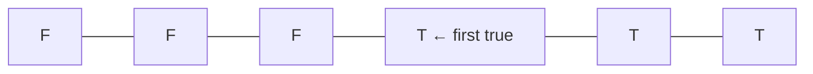
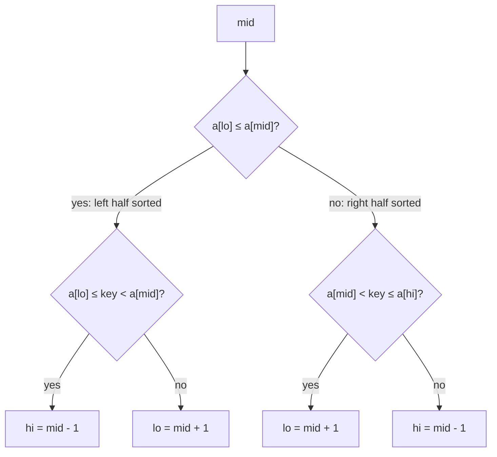

# Session 2 · Binary Search Variations and Searching the Answer

Prepared by **Hamna Zahid Khan**, Junior Lecturer

[🏠 Course home](../README.md) · [📘 Module overview](./README.md) · [⬅ Previous](./session-01-linear-and-binary-search.md) · [Practice test ➡](./practice-test.md)

> **Module 03 · Searching** · ⏱ 3 hours (90 min lecture + 90 min lab)

## 🎯 Learning objectives

1. Implement **lower bound** and **upper bound** with a half-open range and use them for first/last occurrence and counting.
2. Search a **rotated sorted array** and find its rotation point.
3. Find a **peak** element in O(log n).
4. Recognise **monotone predicates** and apply **binary search on the answer** to optimisation problems.

---

## 1. Beyond "is it there?"

Plain binary search answers *"where is the key?"*. Real problems ask richer questions:

- Where is the **first** student with 42 marks? How many scored exactly 42?
- How many students scored **at least 60**?
- What is the **smallest** truck capacity that delivers all parcels in 3 days?

All of these are binary searches for a **boundary** between "no" and "yes".

> 🚦 **Analogy: a row of traffic lights that switch from red to green at one point.** Lights 0…k−1 are red and k…n−1 are green. Binary search finds k, the first green light, in log n looks, regardless of whether the lights are numbers, matches, or "can we ship with this capacity?".



## 2. Lower bound and upper bound

Using a **half-open** range `[lo, hi)` (`hi = n` initially):

| Function | Predicate that becomes true | Returns |
|---|---|---|
| `lowerBound(key)` | `a[i] >= key` | first index with a value ≥ key (insertion point) |
| `upperBound(key)` | `a[i] > key` | first index with a value > key |

Consequences:

| Question | Formula |
|---|---|
| first occurrence | `i = lowerBound(key)`; valid if `i < n && a[i] == key` |
| last occurrence | `upperBound(key) − 1` (check it equals key) |
| count of key | `upperBound(key) − lowerBound(key)` |
| how many < key | `lowerBound(key)` |
| how many ≥ key | `n − lowerBound(key)` |

### Dry run: `lowerBound(42)` on `[35, 42, 42, 42, 58, 61, 61, 77, 90]`

| lo | hi | mid | a[mid] | a[mid] < 42? | update |
|---|---|---|---|---|---|
| 0 | 9 | 4 | 58 | no | hi = 4 |
| 0 | 4 | 2 | 42 | no | hi = 2 |
| 0 | 2 | 1 | 42 | no | hi = 1 |
| 0 | 1 | 0 | 35 | yes | lo = 1 |
| 1 | 1 | – | – | loop ends | return **1** |

Note `hi = mid` (not `mid − 1`) because `mid` itself may be the answer. The loop ends when `lo == hi`.

## 3. Rotated sorted arrays

`[40, 50, 60, 70, 10, 20, 30]` is a sorted array rotated by 4. At every `mid`, **at least one half is sorted**: compare `a[lo]` with `a[mid]` to find out which, then check whether the key lies inside the sorted half's range.



**Trace: search 20.**

| lo | hi | mid | a[mid] | sorted half | key in it? | move |
|---|---|---|---|---|---|---|
| 0 | 6 | 3 | 70 | left [40..70] | no | lo = 4 |
| 4 | 6 | 5 | 20 | – | found | return **5** |

**Rotation point** (index of the minimum): if `a[mid] > a[hi]`, the drop is to the right of mid; otherwise mid or something left of it is the minimum.

## 4. Peak finding

A **peak** is an element not smaller than its neighbours. If `a[mid] < a[mid+1]` we are on a rising slope, so a peak must exist to the right (the values cannot rise forever); otherwise a peak exists at mid or to its left. O(log n) even though the array is **not sorted**: binary search needs a *decision rule*, not necessarily sortedness.

## 5. Binary search on the answer

Many optimisation problems have this shape:

> "Find the **minimum** x such that `feasible(x)` is true", where feasible is **monotone**: once true, it stays true for every larger x.

Then binary search the range of possible x and call `feasible(mid)` at each step.

| Problem | Search space | feasible(x) |
|---|---|---|
| Integer √N | 0 … N | x·x ≤ N (find the **last** true) |
| Ship parcels in D days | max(weight) … sum(weights) | greedy loading needs ≤ D days |
| Eating speed for piles in H hours | 1 … max(pile) | Σ ⌈pile / x⌉ ≤ H |
| Allocate book pages to k students | max(pages) … sum(pages) | greedy split uses ≤ k students |

**Total cost** = O(log(range) × cost of feasible). For shipping: O(n log(sum)).

### Trace: minimum ship capacity, parcels `[10,25,15,30,20,5,35,40]`, D = 3

Range: lo = 40 (largest parcel), hi = 180 (all in one day).

| lo | hi | mid | days needed | feasible? | update |
|---|---|---|---|---|---|
| 40 | 180 | 110 | 2 | ✅ | hi = 110 |
| 40 | 110 | 75 | 3 | ✅ | hi = 75 |
| 40 | 75 | 57 | 4 | ❌ | lo = 58 |
| 58 | 75 | 66 | 4 | ❌ | lo = 67 |
| 67 | 75 | 71 | 4 | ❌ | lo = 72 |
| 72 | 75 | 73 | 4 | ❌ | lo = 74 |
| 74 | 75 | 74 | 4 | ❌ | lo = 75 |
| 75 | 75 | – | – | stop | answer **75** |

With capacity 75: day 1 = 10+25+15 = 50, day 2 = 30+20+5 = 55, day 3 = 35+40 = 75.

## 6. Complexity table

| Algorithm | Time | Space |
|---|---|---|
| lowerBound / upperBound / first / last / count | O(log n) | O(1) |
| Rotated search, rotation point | O(log n) (distinct values) | O(1) |
| Peak finding | O(log n) | O(1) |
| Integer square root | O(log N) | O(1) |
| Ship capacity / eating speed | O(n · log(range)) | O(1) |

> With **duplicates**, rotated-array search can degrade to O(n) (e.g. `[2,2,2,3,2,2,2]`): when `a[lo] == a[mid] == a[hi]` you cannot tell which half is sorted and must shrink by one.

---

## 7. Complete program

📄 **[`src/BinarySearchVariations.java`](src/BinarySearchVariations.java)**

```java
/**
 * Module 03 · Session 02 — Binary search variations and "binary search on the answer".
 *
 * lowerBound / upperBound, first and last occurrence, counting duplicates,
 * search in a rotated sorted array, peak finding, integer square root and the
 * minimum ship capacity problem (binary search over a monotone yes/no predicate).
 *
 * Compile:  javac -d out BinarySearchVariations.java
 * Run:      java -cp out BinarySearchVariations
 *
 * Prepared by Hamna Zahid Khan, Junior Lecturer
 */
public class BinarySearchVariations {

    /** First index i with a[i] >= key (a.length if none). The insertion point of key. */
    static int lowerBound(int[] a, int key) {
        int lo = 0, hi = a.length;            // half-open range [lo, hi)
        while (lo < hi) {
            int mid = lo + (hi - lo) / 2;
            if (a[mid] < key) lo = mid + 1;
            else hi = mid;                    // a[mid] >= key: mid might be the answer
        }
        return lo;
    }

    /** First index i with a[i] > key (a.length if none). */
    static int upperBound(int[] a, int key) {
        int lo = 0, hi = a.length;
        while (lo < hi) {
            int mid = lo + (hi - lo) / 2;
            if (a[mid] <= key) lo = mid + 1;
            else hi = mid;
        }
        return lo;
    }

    static int firstOccurrence(int[] a, int key) {
        int i = lowerBound(a, key);
        return (i < a.length && a[i] == key) ? i : -1;
    }

    static int lastOccurrence(int[] a, int key) {
        int i = upperBound(a, key) - 1;
        return (i >= 0 && a[i] == key) ? i : -1;
    }

    /** Number of copies of key in O(log n). */
    static int count(int[] a, int key) {
        return upperBound(a, key) - lowerBound(a, key);
    }

    /** Search in a sorted array rotated at an unknown pivot, e.g. {40,50,60,10,20,30}. Distinct values. */
    static int searchRotated(int[] a, int key) {
        int lo = 0, hi = a.length - 1;
        while (lo <= hi) {
            int mid = lo + (hi - lo) / 2;
            if (a[mid] == key) return mid;
            if (a[lo] <= a[mid]) {                        // left half is sorted
                if (key >= a[lo] && key < a[mid]) hi = mid - 1;
                else lo = mid + 1;
            } else {                                      // right half is sorted
                if (key > a[mid] && key <= a[hi]) lo = mid + 1;
                else hi = mid - 1;
            }
        }
        return -1;
    }

    /** Index of the minimum of a rotated sorted array = the rotation count. */
    static int rotationPoint(int[] a) {
        int lo = 0, hi = a.length - 1;
        while (lo < hi) {
            int mid = lo + (hi - lo) / 2;
            if (a[mid] > a[hi]) lo = mid + 1;             // minimum is right of mid
            else hi = mid;
        }
        return lo;
    }

    /** Any peak index (a[i] >= neighbours). Walk uphill: O(log n). */
    static int findPeak(int[] a) {
        int lo = 0, hi = a.length - 1;
        while (lo < hi) {
            int mid = lo + (hi - lo) / 2;
            if (a[mid] < a[mid + 1]) lo = mid + 1;        // rising: a peak lies to the right
            else hi = mid;
        }
        return lo;
    }

    /** floor(sqrt(x)) by searching the answer space [0, x]. */
    static long intSqrt(long x) {
        long lo = 0, hi = Math.min(x, 3_037_000_499L), ans = 0;   // hi*hi must not overflow
        while (lo <= hi) {
            long mid = lo + (hi - lo) / 2;
            if (mid * mid <= x) { ans = mid; lo = mid + 1; }
            else hi = mid - 1;
        }
        return ans;
    }

    /** Can all packages be shipped within 'days' if the truck carries at most 'cap' kg per day? */
    static boolean canShip(int[] weights, int days, int cap) {
        int used = 1, load = 0;
        for (int w : weights) {
            if (w > cap) return false;
            if (load + w > cap) { used++; load = 0; }
            load += w;
        }
        return used <= days;
    }

    /** Smallest capacity that ships everything in 'days' days (order must be kept). */
    static int minShipCapacity(int[] weights, int days) {
        int lo = 0, hi = 0;
        for (int w : weights) { lo = Math.max(lo, w); hi += w; }
        while (lo < hi) {
            int mid = lo + (hi - lo) / 2;
            if (canShip(weights, days, mid)) hi = mid;    // feasible: try smaller
            else lo = mid + 1;                            // infeasible: need more
        }
        return lo;
    }

    public static void main(String[] args) {
        int[] marks = {35, 42, 42, 42, 58, 61, 61, 77, 90};
        System.out.println("marks = [35, 42, 42, 42, 58, 61, 61, 77, 90]");
        System.out.println("lowerBound(42) = " + lowerBound(marks, 42) + ", upperBound(42) = " + upperBound(marks, 42));
        System.out.println("first(42) = " + firstOccurrence(marks, 42) + ", last(42) = " + lastOccurrence(marks, 42)
                + ", count(42) = " + count(marks, 42));
        System.out.println("count(50) = " + count(marks, 50) + ", insertion point of 50 = " + lowerBound(marks, 50));
        System.out.println("students scoring >= 60: " + (marks.length - lowerBound(marks, 60)));

        int[] rotated = {40, 50, 60, 70, 10, 20, 30};
        System.out.println("\nrotated = [40, 50, 60, 70, 10, 20, 30]");
        System.out.println("searchRotated(20) = " + searchRotated(rotated, 20) + ", searchRotated(55) = " + searchRotated(rotated, 55));
        System.out.println("rotationPoint = " + rotationPoint(rotated) + " (minimum value " + rotated[rotationPoint(rotated)] + ")");

        int[] hills = {1, 3, 8, 12, 9, 4, 2};
        System.out.println("\nfindPeak([1,3,8,12,9,4,2]) = index " + findPeak(hills) + " (value " + hills[findPeak(hills)] + ")");
        System.out.println("intSqrt(80) = " + intSqrt(80) + ", intSqrt(1_000_000_007) = " + intSqrt(1_000_000_007L));

        int[] parcels = {10, 25, 15, 30, 20, 5, 35, 40};
        for (int d : new int[]{1, 3, 5, 8}) {
            System.out.println("min truck capacity to ship in " + d + " day(s) = " + minShipCapacity(parcels, d) + " kg");
        }
    }
}
```

**Real output:**

```text
$ java -cp out BinarySearchVariations
marks = [35, 42, 42, 42, 58, 61, 61, 77, 90]
lowerBound(42) = 1, upperBound(42) = 4
first(42) = 1, last(42) = 3, count(42) = 3
count(50) = 0, insertion point of 50 = 4
students scoring >= 60: 4

rotated = [40, 50, 60, 70, 10, 20, 30]
searchRotated(20) = 5, searchRotated(55) = -1
rotationPoint = 4 (minimum value 10)

findPeak([1,3,8,12,9,4,2]) = index 3 (value 12)
intSqrt(80) = 8, intSqrt(1_000_000_007) = 31622
min truck capacity to ship in 1 day(s) = 180 kg
min truck capacity to ship in 3 day(s) = 75 kg
min truck capacity to ship in 5 day(s) = 45 kg
min truck capacity to ship in 8 day(s) = 40 kg
```

---

## 8. Worked examples (basic → advanced)

**Example 1 (basic): counting a grade.** `count(42) = upperBound(42) − lowerBound(42) = 4 − 1 = 3`, in two O(log n) searches instead of an O(n) scan.

**Example 2 (intermediate): closest value.** After `i = lowerBound(key)`, the closest element is either `a[i−1]` or `a[i]`:

```java
/** Element closest to key in a sorted array (ties -> smaller value). */
static int closest(int[] a, int key) {
    int i = BinarySearchVariations.lowerBound(a, key);
    if (i == 0) return a[0];
    if (i == a.length) return a[a.length - 1];
    return (key - a[i - 1] <= a[i] - key) ? a[i - 1] : a[i];
}
```
<sub>Full, compiled version: [`src/Labs03.java`](src/Labs03.java)</sub>

**Example 3 (advanced): minimum eating speed.** A student must read 4 piles of notes (3, 6, 7, 11 pages) in 8 hours, one pile at a time at speed k pages/hour (a pile shorter than k still takes a full hour). Hours needed at speed k = Σ ⌈pile/k⌉, which **decreases** as k grows: monotone ⇒ binary search on k.

```java
/** Minimum eating speed k so that all piles finish within h hours (each hour: one pile, up to k). */
static int minSpeed(int[] piles, int h) {
    int lo = 1, hi = 0;
    for (int p : piles) hi = Math.max(hi, p);
    while (lo < hi) {
        int k = lo + (hi - lo) / 2;
        long hours = 0;
        for (int p : piles) hours += (p + k - 1) / k;   // ceil(p / k)
        if (hours <= h) hi = k; else lo = k + 1;
    }
    return lo;
}
```
<sub>Full, compiled version: [`src/Labs03.java`](src/Labs03.java)</sub>

k = 4 gives 1 + 2 + 2 + 3 = 8 hours ✅, k = 3 gives 1 + 2 + 3 + 4 = 10 hours ❌, so the answer is 4.

## 9. Real-life problem: courier fleet planning

**Problem.** A courier company in Karachi must deliver parcels **in the given order** (they are loaded by route) over D days with a single van. Vans are rented by maximum capacity, so they want the **smallest capacity** that finishes on time.

**Solution.** Exactly the ship-capacity pattern (section 5): lower limit = heaviest parcel (otherwise it can never be loaded), upper limit = total weight (one trip), feasibility = greedy day-by-day loading. The program shows the trade-off: 1 day needs 180 kg, 3 days 75 kg, 5 days 45 kg, 8 days 40 kg (the heaviest parcel; more days cannot help). Management can now price each delivery deadline.

## 10. Common mistakes

| Mistake | Fix |
|---|---|
| Mixing `[lo, hi]` and `[lo, hi)` conventions | half-open: `hi = n`, `while (lo < hi)`, `hi = mid` |
| `lo = mid` in a `lo < hi` loop | infinite loop when hi = lo + 1; use `lo = mid + 1` |
| Wrong search range for "binary search on answer" | lower bound must be a feasible minimum candidate (e.g. max weight), upper bound must be surely feasible |
| Non-monotone predicate | binary search gives garbage; prove monotonicity first |
| `mid * mid` overflow in √ | use `long` and cap `hi` |
| Rotated search with `<` instead of `<=` in `a[lo] <= a[mid]` | fails when lo == mid |

## 11. Best practices

- Phrase every variation as **"first index where predicate is true"**: one template, many problems.
- Write `feasible()` as a **separate method** and test it on its own.
- When the answer is a real number, loop a fixed number of times (e.g. 100 iterations) instead of comparing doubles.
- Re-use library helpers when allowed: `Arrays.binarySearch`, `Collections.binarySearch`, `TreeMap.ceilingKey/floorKey`.

---

## 12. Lab tasks

**Lab 2.1: Closest price.** Given sorted product prices, return the one closest to a customer's budget (ties → cheaper).

<details>
<summary>✅ Solution</summary>

See Example 2. With prices `[120, 250, 400, 650, 999]`, budget 500 → 400 and 600 → 650.

</details>

**Lab 2.2: Eating speed.** Implement `minSpeed(int[] piles, int h)`.

<details>
<summary>💡 Hint</summary>

Search k in `[1, max(pile)]`. Use `(p + k - 1) / k` for ⌈p/k⌉ with integers.

</details>

<details>
<summary>✅ Solution</summary>

See Example 3 for the compiled reference solution.

</details>

**Lab 2.3: Search in a 2-D sorted matrix.** Each row is sorted and each row's first element is larger than the previous row's last. Search in O(log(R·C)).

<details>
<summary>✅ Solution</summary>

```java
/** Matrix where each row is sorted and each row starts after the previous row ends:
 *  treat it as one virtual sorted array of length r*c. O(log(r*c)). */
static boolean searchMatrix(int[][] m, int key) {
    int r = m.length, c = m[0].length, lo = 0, hi = r * c - 1;
    while (lo <= hi) {
        int mid = lo + (hi - lo) / 2;
        int v = m[mid / c][mid % c];          // map 1-D index to (row, col)
        if (v == key) return true;
        if (v < key) lo = mid + 1;
        else hi = mid - 1;
    }
    return false;
}
```
<sub>Full, compiled version: [`src/Labs03.java`](src/Labs03.java)</sub>

</details>

```text
$ java -cp out Labs03
lastIndexOf({4,7,4,9,4}, 4) = 4
searchName(Mehwish) = 4, searchName(Kashif) = -1
searchMatrix(16) = true, searchMatrix(13) = false
closest price to 500 = 400, to 600 = 650
minSpeed({3,6,7,11}, 8 hours) = 4
```

---

## 13. Quiz

**Q1.** For `[1, 3, 3, 3, 7]`, `upperBound(3) − lowerBound(3)` equals:

- **A.** 2
- **B.** 3
- **C.** 4
- **D.** 1

**Q2.** In the half-open template, why is the update `hi = mid` rather than `hi = mid − 1`?

- **A.** To avoid overflow
- **B.** Because mid itself may be the first true position
- **C.** Because the array is rotated
- **D.** It makes the loop faster

**Q3.** Which property makes "binary search on the answer" valid?

- **A.** The input array is sorted
- **B.** The feasibility predicate is monotone
- **C.** The answer is a power of two
- **D.** The input has no duplicates

**Q4.** In `[15, 18, 2, 3, 6, 12]`, the rotation point (index of the minimum) is:

- **A.** 0
- **B.** 1
- **C.** 2
- **D.** 5

**Q5.** Peak finding works in O(log n) on an unsorted array because:

- **A.** It sorts the array first
- **B.** On a rising slope a peak must exist to the right
- **C.** Peaks are always at the middle
- **D.** It uses hashing

<details>
<summary><b>Show answers</b></summary>

1. **B**: upperBound = 4, lowerBound = 1, so 3 copies.
2. **B**: The answer could be mid, so it must stay in the range.
3. **B**: Once feasible, every larger candidate must also be feasible.
4. **C**: The minimum 2 is at index 2.
5. **B**: The decision rule guarantees a peak in the half we keep.

</details>

---

## 14. Summary

- Think of binary search as finding the **first true** of a monotone predicate.
- `lowerBound` / `upperBound` answer first, last, count and rank queries in O(log n).
- **Rotated arrays**: one half is always sorted. **Peaks**: walk uphill.
- **Binary search on the answer** turns "minimise x subject to feasible(x)" into O(log range) feasibility checks.

## 15. Viva / interview questions

1. Write lower bound from memory and explain each line.
2. How would you count elements in the range [a, b] of a sorted array?
3. Why can rotated-array search become O(n) with duplicates?
4. Explain why peak finding is correct even though the array is not sorted.
5. What are the lower and upper limits of the search range in the ship-capacity problem, and why?
6. How would you compute √2 to 6 decimal places with binary search?
7. Name three Java library methods that perform binary search.

---

[⬅ Previous](./session-01-linear-and-binary-search.md) · [📘 Module overview](./README.md) · [Practice test ➡](./practice-test.md)
