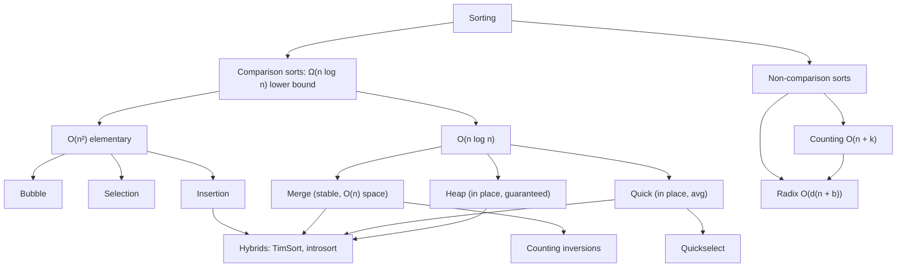

# Module 04 · Sorting

Prepared by **Hamna Zahid Khan**, Junior Lecturer

[🏠 Course home](../README.md)

> ⏱ 9 contact hours · 3 sessions · 🟡 Core

Sorting is the most studied problem in computer science and the best place to learn how algorithm design choices (divide and conquer, data structures, using key values directly) change performance. This module covers eight algorithms, from O(n²) teaching sorts to linear-time non-comparison sorts, and the theory that separates them.

## 🎯 Module objectives

- Implement and trace bubble, selection, insertion, merge, quick, heap, counting and radix sort.
- Classify algorithms by time, space, stability, adaptivity and in-place behaviour.
- Analyse divide-and-conquer recurrences and the Ω(n log n) comparison lower bound.
- Choose the right sort for a given data set and use sorting building blocks (merge, partition) for other problems.

## 📚 Sessions

| # | Session | Key ideas | Code |
|---|---|---|---|
| 1 | [Elementary Sorts](session-01-elementary-sorts.md) | bubble, selection, insertion, stability, inversions | [`ElementarySorts.java`](src/ElementarySorts.java) |
| 2 | [Merge Sort and Quick Sort](session-02-merge-sort-and-quick-sort.md) | divide and conquer, partitioning, random pivots, 3-way, quickselect | [`MergeQuickSort.java`](src/MergeQuickSort.java) |
| 3 | [Heap, Counting and Radix Sort](session-03-heap-counting-and-radix-sort.md) | array heaps, lower bound, linear-time sorting | [`HeapCountingRadix.java`](src/HeapCountingRadix.java) |
| ✍️ | [Practice test](practice-test.md) | 20 MCQs + 3 coding scenarios | [`Labs04.java`](src/Labs04.java), [`SelfCheck.java`](src/SelfCheck.java) |

## 🗺️ Concept map



## 📄 One-page cheat sheet

| Algorithm | Best | Average | Worst | Space | Stable | Key idea |
|---|---|---|---|---|---|---|
| Bubble | O(n) | O(n²) | O(n²) | O(1) | ✅ | swap neighbours, early exit |
| Selection | O(n²) | O(n²) | O(n²) | O(1) | ❌ | select min, ≤ n−1 swaps |
| Insertion | O(n) | O(n²) | O(n²) | O(1) | ✅ | shift and insert; O(n + inversions) |
| Merge | O(n log n) | O(n log n) | O(n log n) | O(n) | ✅ | split, merge |
| Quick | O(n log n) | O(n log n) | O(n²) | O(log n) | ❌ | partition around pivot |
| Heap | O(n log n) | O(n log n) | O(n log n) | O(1) | ❌ | build heap O(n), extract max |
| Counting | O(n + k) | O(n + k) | O(n + k) | O(n + k) | ✅ | tally keys, prefix sums |
| Radix | O(d(n + b)) | O(d(n + b)) | O(d(n + b)) | O(n + b) | ✅ | stable sort per digit, LSD first |

**Remember:** heap child = 2i+1, 2i+2, parent = (i−1)/2 · Lomuto keeps `a[lo..i] ≤ pivot` · merge ties take the left · 3-way partition for duplicates · random pivot defeats adversarial input · Java: `int[]` → dual-pivot quick sort, `Object[]` → TimSort (stable).

## ▶️ Run the code

```bash
cd 04-sorting/src
javac -d out *.java
java -ea -cp out SelfCheck        # 600+ randomised checks against Arrays.sort
java -cp out MergeQuickSort
```

See [`src/README.md`](src/README.md) for every file.
