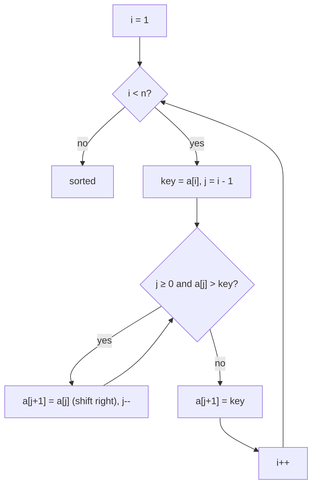
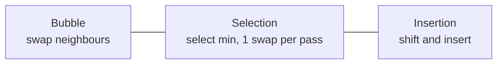

# Session 1 · Elementary Sorts: Bubble, Selection and Insertion

Prepared by **Hamna Zahid Khan**, Junior Lecturer

[🏠 Course home](../README.md) · [📘 Module overview](./README.md) · [⬅ Module overview](./README.md) · [Next ➡](./session-02-merge-sort-and-quick-sort.md)

> **Module 04 · Sorting** · ⏱ 3 hours (90 min lecture + 90 min lab)

## 🎯 Learning objectives

1. Implement bubble, selection and insertion sort and trace each pass by hand.
2. Count comparisons and swaps and derive best/average/worst-case complexity.
3. Define **stability**, **in-place** and **adaptive**, and classify each algorithm.
4. Connect swaps to **inversions** and explain why insertion sort is fast on nearly sorted data.

---

## 1. Why study simple sorts?

Sorted data makes searching (Module 03), de-duplication, merging and ranking easy. Java already gives us `Arrays.sort`, so why learn O(n²) algorithms?

- They are the **building blocks** of the fast algorithms (insertion sort finishes small sub-arrays inside TimSort and many quick sort implementations).
- They teach **loop invariants**, the core proof technique for algorithms.
- Insertion sort is genuinely the **best** choice for tiny or nearly sorted arrays.

## 2. Vocabulary

| Term | Meaning | Why it matters |
|---|---|---|
| **In-place** | O(1) extra memory | large arrays, embedded systems |
| **Stable** | equal keys keep their original relative order | multi-key sorting (sort by name, then by marks) |
| **Adaptive** | faster when input is already partly sorted | real data is often nearly sorted |
| **Inversion** | a pair i < j with a[i] > a[j] | measures "unsortedness": 0 for sorted, n(n−1)/2 for reversed |

## 3. Bubble sort

> 🫧 **Analogy: bubbles rising in a glass.** Compare neighbours and swap if they are out of order; the biggest value "bubbles up" to the end after each pass.

**Invariant:** after pass p, the last p positions hold the p largest values in final order.
**Early exit:** if a pass makes no swap, the array is sorted ⇒ stop (best case O(n)).

**Trace on `[29, 10, 14, 37, 13]`**

| Pass | Comparisons made (j) | Array after pass | Fixed at end |
|---|---|---|---|
| 1 | 0–3 (swaps: 29↔10, 29↔14, 37↔13) | 10 14 29 13 **37** | 37 |
| 2 | 0–2 (swap: 29↔13) | 10 14 13 **29 37** | 29 |
| 3 | 0–1 (swap: 14↔13) | 10 13 **14 29 37** | 14 |
| 4 | 0 (no swap) | 10 13 14 29 37 | done (early exit) |

## 4. Selection sort

> 🏏 **Analogy: picking a cricket team by height.** Look along the whole line for the shortest player and send them to position 1; then find the shortest of the rest for position 2, and so on.

**Invariant:** after iteration i, `a[0..i]` holds the i+1 smallest values in order. It **always** makes n(n−1)/2 comparisons but **at most n−1 swaps**, which is useful when writes are expensive (e.g. flash memory). It is **not stable**: swapping the minimum forward can jump over an equal key.

## 5. Insertion sort

> 🃏 **Analogy: sorting playing cards in your hand.** Pick up one card at a time and slide it left past bigger cards until it fits.

**Invariant:** before iteration i, `a[0..i−1]` is sorted (but not necessarily final).



**Trace on `[29, 10, 14, 37, 13]`** (sorted prefix in bold)

| i | key | shifts | Array after |
|---|---|---|---|
| 1 | 10 | 29 → right | **10 29** 14 37 13 |
| 2 | 14 | 29 → right | **10 14 29** 37 13 |
| 3 | 37 | none | **10 14 29 37** 13 |
| 4 | 13 | 37, 29, 14 → right | **10 13 14 29 37** |

Each shift removes exactly one inversion, so insertion sort does **n − 1 + (number of inversions)** comparisons at most: O(n) for nearly sorted data.

## 6. Comparison of the three



| Algorithm | Best | Average | Worst | Space | Stable | Adaptive | Swaps (worst) |
|---|---|---|---|---|---|---|---|
| Bubble (early exit) | O(n) | O(n²) | O(n²) | O(1) | ✅ | ✅ | O(n²) |
| Selection | O(n²) | O(n²) | O(n²) | O(1) | ❌ | ❌ | O(n) |
| Insertion | O(n) | O(n²) | O(n²) | O(1) | ✅ | ✅ | O(n²) shifts |

---

## 7. Complete program

📄 **[`src/ElementarySorts.java`](src/ElementarySorts.java)**

```java
import java.util.Arrays;

/**
 * Module 04 · Session 01 — Bubble, selection and insertion sort.
 *
 * Each sort prints the array after every pass (when trace is on) and counts
 * comparisons and writes/swaps so their behaviour on random, sorted and
 * reversed input can be compared side by side.
 *
 * Compile:  javac -d out ElementarySorts.java
 * Run:      java -cp out ElementarySorts
 *
 * Prepared by Hamna Zahid Khan, Junior Lecturer
 */
public class ElementarySorts {

    static long comparisons, moves;

    static void swap(int[] a, int i, int j) {
        int t = a[i]; a[i] = a[j]; a[j] = t;
        moves++;
    }

    /** Bubble sort: adjacent swaps push the largest remaining value to the end each pass.
     *  Stops early if a pass makes no swap (already sorted -> O(n)). */
    static void bubbleSort(int[] a, boolean trace) {
        int n = a.length;
        for (int pass = 1; pass < n; pass++) {
            boolean swapped = false;
            for (int j = 0; j < n - pass; j++) {      // last 'pass-1' items are already in place
                comparisons++;
                if (a[j] > a[j + 1]) { swap(a, j, j + 1); swapped = true; }
            }
            if (trace) System.out.println("  pass " + pass + ": " + Arrays.toString(a));
            if (!swapped) break;
        }
    }

    /** Selection sort: find the minimum of the unsorted part and swap it into place.
     *  Always n(n-1)/2 comparisons but at most n-1 swaps. */
    static void selectionSort(int[] a, boolean trace) {
        int n = a.length;
        for (int i = 0; i < n - 1; i++) {
            int min = i;
            for (int j = i + 1; j < n; j++) {
                comparisons++;
                if (a[j] < a[min]) min = j;
            }
            if (min != i) swap(a, i, min);
            if (trace) System.out.println("  i=" + i + " min->" + a[i] + ": " + Arrays.toString(a));
        }
    }

    /** Insertion sort: grow a sorted prefix; shift bigger items right and drop the key into the gap.
     *  O(n) on nearly sorted input, stable, in place. */
    static void insertionSort(int[] a, boolean trace) {
        for (int i = 1; i < a.length; i++) {
            int key = a[i];
            int j = i - 1;
            while (j >= 0) {
                comparisons++;
                if (a[j] <= key) break;   // '<=' keeps equal keys in order (stability)
                a[j + 1] = a[j];          // shift right
                moves++;
                j--;
            }
            a[j + 1] = key;
            if (trace) System.out.println("  insert " + key + ": " + Arrays.toString(a));
        }
    }

    interface Sorter { void sort(int[] a, boolean trace); }

    static void measure(String name, Sorter s, int[] input) {
        int[] a = input.clone();
        comparisons = moves = 0;
        s.sort(a, false);
        System.out.printf("  %-10s comparisons %,8d   swaps/shifts %,8d%n", name, comparisons, moves);
    }

    public static void main(String[] args) {
        int[] data = {29, 10, 14, 37, 13};
        System.out.println("Bubble sort " + Arrays.toString(data));
        bubbleSort(data.clone(), true);
        System.out.println("Selection sort " + Arrays.toString(data));
        selectionSort(data.clone(), true);
        System.out.println("Insertion sort " + Arrays.toString(data));
        insertionSort(data.clone(), true);

        int n = 1000;
        java.util.Random rnd = new java.util.Random(42);
        int[] random = new int[n], sorted = new int[n], reversed = new int[n];
        for (int i = 0; i < n; i++) {
            random[i] = rnd.nextInt(10_000);
            sorted[i] = i;
            reversed[i] = n - i;
        }
        String[] labels = {"random", "already sorted", "reversed"};
        int[][] inputs = {random, sorted, reversed};
        for (int k = 0; k < 3; k++) {
            System.out.println("\nn = " + n + ", " + labels[k] + " input:");
            measure("bubble", ElementarySorts::bubbleSort, inputs[k]);
            measure("selection", ElementarySorts::selectionSort, inputs[k]);
            measure("insertion", ElementarySorts::insertionSort, inputs[k]);
        }
    }
}
```

**Real output:**

```text
$ java -cp out ElementarySorts
Bubble sort [29, 10, 14, 37, 13]
  pass 1: [10, 14, 29, 13, 37]
  pass 2: [10, 14, 13, 29, 37]
  pass 3: [10, 13, 14, 29, 37]
  pass 4: [10, 13, 14, 29, 37]
Selection sort [29, 10, 14, 37, 13]
  i=0 min->10: [10, 29, 14, 37, 13]
  i=1 min->13: [10, 13, 14, 37, 29]
  i=2 min->14: [10, 13, 14, 37, 29]
  i=3 min->29: [10, 13, 14, 29, 37]
Insertion sort [29, 10, 14, 37, 13]
  insert 10: [10, 29, 14, 37, 13]
  insert 14: [10, 14, 29, 37, 13]
  insert 37: [10, 14, 29, 37, 13]
  insert 13: [10, 13, 14, 29, 37]

n = 1000, random input:
  bubble     comparisons  499,122   swaps/shifts  249,040
  selection  comparisons  499,500   swaps/shifts      993
  insertion  comparisons  250,032   swaps/shifts  249,040

n = 1000, already sorted input:
  bubble     comparisons      999   swaps/shifts        0
  selection  comparisons  499,500   swaps/shifts        0
  insertion  comparisons      999   swaps/shifts        0

n = 1000, reversed input:
  bubble     comparisons  499,500   swaps/shifts  499,500
  selection  comparisons  499,500   swaps/shifts      500
  insertion  comparisons  499,500   swaps/shifts  499,500
```

**Reading the numbers.** On random input, bubble and insertion make the same number of swaps/shifts (≈ 249,040 = the number of inversions ≈ n²/4), but insertion makes **half** the comparisons. Selection makes ~500,000 comparisons every time yet fewer than 1,000 swaps. On sorted input, bubble and insertion stop after 999 comparisons; selection does not notice.

---

## 8. Worked examples (basic → advanced)

**Example 1 (basic): count comparisons of selection sort for n = 6.** 5 + 4 + 3 + 2 + 1 = 15 = n(n−1)/2, regardless of input.

**Example 2 (intermediate): stability in action.** Sorting city names by **length** with a stable sort keeps cities of equal length in their original order:

```java
/** Insertion sort for any type with a Comparator (stable, in place). */
static <T> void insertionSort(T[] a, Comparator<? super T> cmp) {
    for (int i = 1; i < a.length; i++) {
        T key = a[i];
        int j = i - 1;
        while (j >= 0 && cmp.compare(a[j], key) > 0) {
            a[j + 1] = a[j];
            j--;
        }
        a[j + 1] = key;
    }
}
```
<sub>Full, compiled version: [`src/Labs04.java`](src/Labs04.java)</sub>

Input `[Quetta, Lahore, Karachi, Multan, Hyderabad, Sukkur]` → `[Quetta, Lahore, Multan, Sukkur, Karachi, Hyderabad]`: the four 6-letter cities keep their input order.

**Example 3 (advanced): swaps = inversions.** Each adjacent swap in bubble sort fixes exactly one inverted pair and creates no new one, so total swaps = inversions. `[3,1,2,5,4]` has inversions (3,1), (3,2), (5,4) ⇒ 3 swaps.

```java
/** Number of swaps bubble sort performs = number of inversions (each swap fixes exactly one). */
static int bubbleSwapCount(int[] input) {
    int[] a = input.clone();
    int swaps = 0;
    for (int pass = 1; pass < a.length; pass++)
        for (int j = 0; j < a.length - pass; j++)
            if (a[j] > a[j + 1]) {
                int t = a[j]; a[j] = a[j + 1]; a[j + 1] = t;
                swaps++;
            }
    return swaps;
}
```
<sub>Full, compiled version: [`src/Labs04.java`](src/Labs04.java)</sub>

## 9. Real-life problem: live leaderboard

**Problem.** A coding-contest leaderboard of 200 teams is kept sorted by score. Every few seconds **one** team's score increases slightly, and the board must be re-sorted.

**Analysis.** After a single update the array has only a few inversions (the updated team is slightly out of place). Insertion sort runs in O(n + inversions) ≈ O(n) here; a general O(n log n) sort does more work, and selection sort always does ~20,000 comparisons.

**Solution.** Keep the array sorted and, after each update, run one pass of insertion sort (or move just that team left with shifts). This is the same reason TimSort detects already-sorted "runs" in real data.

## 10. Common mistakes

| Mistake | Effect | Fix |
|---|---|---|
| Inner bubble loop `j < n - 1` every pass | wasted comparisons on the sorted tail | `j < n - pass` |
| Forgetting the `swapped` flag | best case becomes O(n²) | break when no swap |
| Insertion with `a[j] >= key` | equal keys reorder (unstable) | strict `a[j] > key` |
| Swapping inside selection's inner loop | becomes a slow bubble variant | remember `min` index, swap once |
| Loop `j >= 0` checked after `a[j]` | `ArrayIndexOutOfBoundsException` | test `j >= 0` first |

## 11. Best practices

- Use insertion sort for n ≲ 16–32 or nearly sorted data; library sorts do exactly this.
- Use `Arrays.sort` / `List.sort` in production; know that object sorts are **stable** (TimSort) while primitive sorts use dual-pivot quick sort (not stable, but stability is meaningless for primitives).
- When writes are costly, selection sort's O(n) swaps can win.

---

## 12. Lab tasks

**Lab 1.1: Generic insertion sort.** Write `insertionSort(T[] a, Comparator<? super T> cmp)` and sort students by CGPA.

<details>
<summary>✅ Solution</summary>

See Example 2 for the compiled solution. Sort students with `insertionSort(arr, Comparator.comparingDouble(s -> s.cgpa))`.

</details>

**Lab 1.2: Count swaps.** Return how many swaps bubble sort performs on a given array without modifying it.

<details>
<summary>💡 Hint</summary>

Work on a clone; increment a counter inside the swap branch.

</details>

<details>
<summary>✅ Solution</summary>

See Example 3. Check: for `[1, 20, 6, 4, 5]` the answer is 5.

</details>

**Lab 1.3: Descending selection sort.** Modify selection sort to sort in descending order by selecting the **maximum** each pass. How many comparisons for n = 10?

<details>
<summary>✅ Solution</summary>

Change `if (a[j] < a[min])` to `if (a[j] > a[max])`. Comparisons stay n(n−1)/2 = 45.

</details>

```text
$ java -cp out Labs04
cities by length (stable): [Quetta, Lahore, Multan, Sukkur, Karachi, Hyderabad]
bubble swaps for [3,1,2,5,4] = 3, inversions = 3
mergeSorted = [1, 2, 3, 4, 9, 10, 12]
3rd smallest of [67, 23, 89, 45, 91, 12, 56] = 45, median = 56
sortColors -> [0, 0, 0, 1, 1, 1, 2, 2, 2]
dates sorted -> [[25, 12, 1876], [23, 3, 1940], [14, 8, 1940], [14, 8, 1947], [1, 1, 2000]]
```

---

## 13. Quiz

**Q1.** Which sort makes the fewest swaps in the worst case?

- **A.** Bubble
- **B.** Selection
- **C.** Insertion
- **D.** All equal

**Q2.** Best-case time of insertion sort (already sorted input)?

- **A.** O(1)
- **B.** O(n)
- **C.** O(n log n)
- **D.** O(n²)

**Q3.** Which of these is NOT stable as usually implemented?

- **A.** Bubble sort
- **B.** Insertion sort
- **C.** Selection sort
- **D.** Merge sort

**Q4.** How many inversions does `[4, 3, 2, 1]` have?

- **A.** 3
- **B.** 4
- **C.** 6
- **D.** 12

**Q5.** After the 2nd pass of bubble sort on `[5, 1, 4, 2, 8]`, the array is:

- **A.** [1, 4, 2, 5, 8]
- **B.** [1, 2, 4, 5, 8]
- **C.** [1, 4, 5, 2, 8]
- **D.** [5, 1, 4, 2, 8]

<details>
<summary><b>Show answers</b></summary>

1. **B**: At most n − 1 swaps, one per pass.
2. **B**: Each element is compared once with its left neighbour.
3. **C**: The long-distance swap can move an equal key past another.
4. **C**: n(n−1)/2 = 6 for a reversed array of 4.
5. **B**: Pass 1 → [1, 4, 2, 5, 8]; pass 2 → [1, 2, 4, 5, 8].

</details>

---

## 14. Summary

- All three elementary sorts are **in place** and O(n²) on average.
- **Bubble** (with early exit) and **insertion** are stable and adaptive; **selection** is neither but makes only O(n) swaps.
- Swaps/shifts = **inversions**, which explains insertion sort's speed on nearly sorted data.
- These algorithms live on inside hybrid production sorts.

## 15. Viva / interview questions

1. Define stability with an example where it matters.
2. Why is insertion sort used inside TimSort and introsort?
3. Prove that bubble sort's number of swaps equals the number of inversions.
4. Can selection sort be made stable? How, and at what cost?
5. What is the loop invariant of insertion sort?
6. Which elementary sort would you use on flash memory and why?

---

[⬅ Module overview](./README.md) · [📘 Module overview](./README.md) · [Next ➡](./session-02-merge-sort-and-quick-sort.md)
