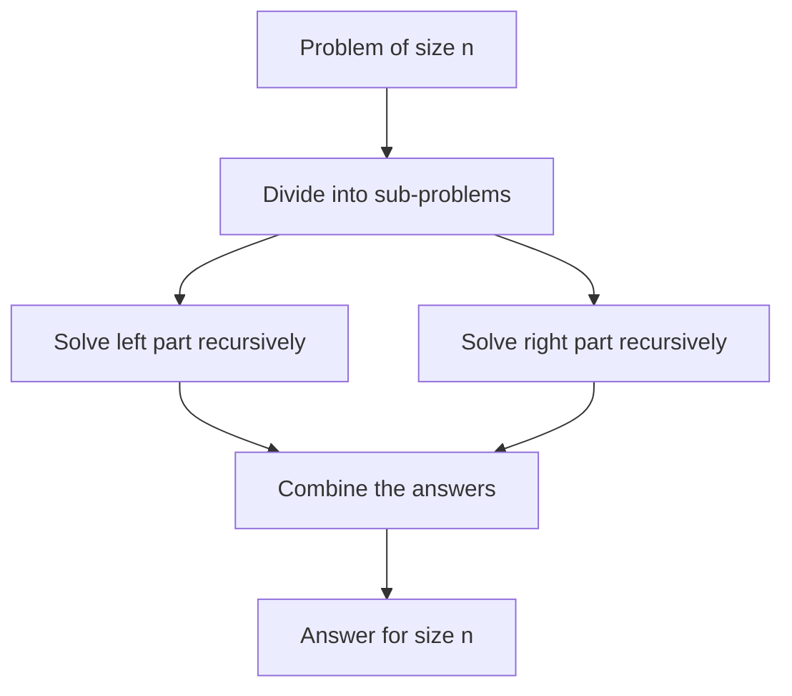
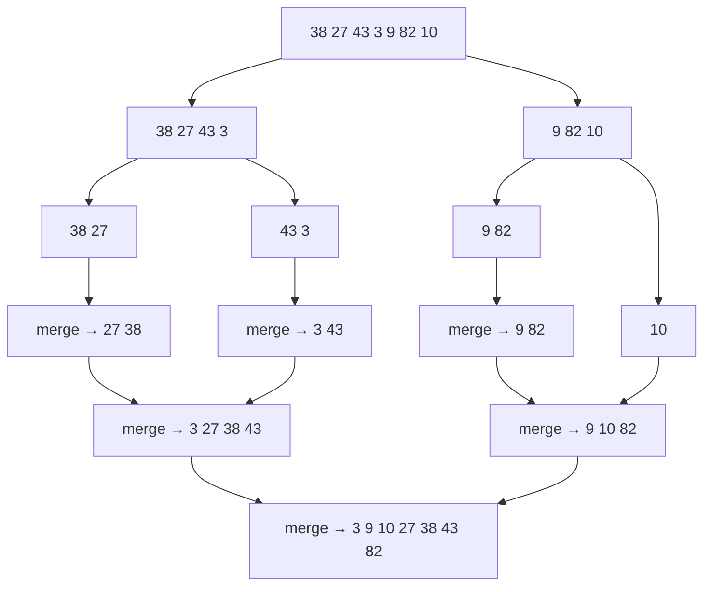
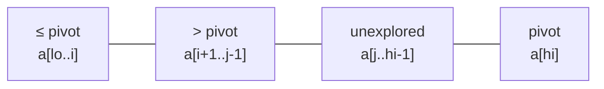

# Session 2 · Merge Sort and Quick Sort

Prepared by **Hamna Zahid Khan**, Junior Lecturer

[🏠 Course home](../README.md) · [📘 Module overview](./README.md) · [⬅ Previous](./session-01-elementary-sorts.md) · [Next ➡](./session-03-heap-counting-and-radix-sort.md)

> **Module 04 · Sorting** · ⏱ 3 hours (90 min lecture + 90 min lab)

## 🎯 Learning objectives

1. Apply the **divide-and-conquer** paradigm: divide, conquer, combine.
2. Implement **merge sort**, trace its recursion tree and prove O(n log n) with a recurrence.
3. Implement **quick sort** with Lomuto partitioning and explain its O(n²) worst case.
4. Fix quick sort's weaknesses with **random pivots** and **3-way partitioning**.
5. Use merging to **count inversions** and partitioning to **select the k-th smallest**.

---

## 1. Divide and conquer



| | Merge sort | Quick sort |
|---|---|---|
| Divide | trivial: split at the middle | **hard work**: partition around a pivot |
| Combine | **hard work**: merge two sorted halves | trivial: nothing to do |
| Split balance | always 50/50 | depends on the pivot |

## 2. Merge sort

> 📚 **Analogy: two teachers merging sorted answer-sheet piles.** Each pile is already in roll-number order. Look at the top sheet of each pile, take the smaller, repeat. Merging two piles of total size n takes n steps.

**Recursion tree for `[38, 27, 43, 3, 9, 82, 10]`**



**Merge dry run: `[3, 27, 38, 43]` + `[9, 10, 82]`**

| Step | Left front | Right front | Take | Output so far |
|---|---|---|---|---|
| 1 | 3 | 9 | 3 | 3 |
| 2 | 27 | 9 | 9 | 3 9 |
| 3 | 27 | 10 | 10 | 3 9 10 |
| 4 | 27 | 82 | 27 | 3 9 10 27 |
| 5 | 38 | 82 | 38 | … 38 |
| 6 | 43 | 82 | 43 | … 43 |
| 7 | – | 82 | 82 | 3 9 10 27 38 43 82 |

**Analysis.** T(n) = 2T(n/2) + n. The tree has log₂ n levels and every level merges n elements in total ⇒ **Θ(n log n) in every case**. Extra space O(n) for the buffer. Stable when ties take from the **left** half.

**Counting inversions for free.** When an element from the right half is taken while i…mid remain on the left, it forms an inversion with each of those `mid − i + 1` elements. Summing gives the inversion count in O(n log n) instead of O(n²).

## 3. Quick sort

> 🧺 **Analogy: sorting laundry around one shirt.** Pick a shirt (the pivot). Everything smaller goes to its left, everything larger to its right. The pivot is now in its final place; repeat on each side.

**Lomuto partition** (pivot = last element): `i` marks the end of the "≤ pivot" zone; `j` scans.

**Trace: partition `[10, 80, 30, 90, 40, 50, 70]`, pivot 70**

| j | a[j] | ≤ 70? | action | array | i |
|---|---|---|---|---|---|
| 0 | 10 | yes | swap a[0], a[0] | 10 80 30 90 40 50 70 | 0 |
| 1 | 80 | no | – | same | 0 |
| 2 | 30 | yes | swap a[1], a[2] | 10 30 80 90 40 50 70 | 1 |
| 3 | 90 | no | – | same | 1 |
| 4 | 40 | yes | swap a[2], a[4] | 10 30 40 90 80 50 70 | 2 |
| 5 | 50 | yes | swap a[3], a[5] | 10 30 40 50 80 90 70 | 3 |
| end | | | swap a[4], pivot | 10 30 40 50 **70** 90 80 | pivot at 4 |



**Analysis.**

| Case | When | Recurrence | Time |
|---|---|---|---|
| Best / average | pivot splits roughly in half | T(n) = 2T(n/2) + n | O(n log n) (≈ 1.39 n log₂ n comparisons on average) |
| Worst | pivot is always the min or max (sorted input with last-element pivot!) | T(n) = T(n−1) + n | O(n²), recursion depth n |

**Fixes.**

1. **Random pivot** (or median-of-three): no particular input is bad anymore; expected O(n log n).
2. **3-way partition** (`< | = | >`): with many duplicates, the equal block is finished in one go. Two-way Lomuto puts all equal keys on one side and degrades to O(n²).
3. **Recurse on the smaller side first** (and loop on the larger) to cap stack depth at O(log n).
4. Switch to insertion sort for tiny sub-arrays.

## 4. Complexity table

| Algorithm | Best | Average | Worst | Space | Stable | In place |
|---|---|---|---|---|---|---|
| Merge sort | O(n log n) | O(n log n) | O(n log n) | O(n) | ✅ | ❌ |
| Quick sort (last pivot) | O(n log n) | O(n log n) | O(n²) | O(log n) avg stack, O(n) worst | ❌ | ✅ |
| Quick sort (random pivot) | O(n log n) | O(n log n) expected | O(n²) (astronomically unlikely) | O(log n) expected | ❌ | ✅ |
| 3-way quick sort | O(n) (all equal) | O(n log n) | O(n²) unlikely | O(log n) | ❌ | ✅ |
| Quickselect (k-th smallest) | O(n) | O(n) | O(n²) | O(1) iterative | – | ✅ |

---

## 5. Complete program

📄 **[`src/MergeQuickSort.java`](src/MergeQuickSort.java)**

```java
import java.util.Arrays;
import java.util.Random;

/**
 * Module 04 · Session 02 — Merge sort and quick sort (divide and conquer).
 *
 * Top-down merge sort with a printed merge trace, inversion counting as a
 * by-product of merging, Lomuto-partition quick sort with a partition trace,
 * randomised pivots, and 3-way (Dutch national flag) partitioning for duplicates.
 *
 * Compile:  javac -d out MergeQuickSort.java
 * Run:      java -cp out MergeQuickSort
 *
 * Prepared by Hamna Zahid Khan, Junior Lecturer
 */
public class MergeQuickSort {

    static long comparisons;
    static boolean trace = false;
    static final Random RND = new Random(7);

    // ------------------------------------------------------------ merge sort

    public static void mergeSort(int[] a) {
        int[] buf = new int[a.length];      // one shared buffer: O(n) extra space
        mergeSort(a, buf, 0, a.length - 1, 0);
    }

    /** Sorts a[lo..hi]; returns the number of inversions (pairs i<j with a[i]>a[j]). */
    static long mergeSort(int[] a, int[] buf, int lo, int hi, int depth) {
        if (lo >= hi) return 0;                        // 0 or 1 element: already sorted
        int mid = lo + (hi - lo) / 2;
        long inv = mergeSort(a, buf, lo, mid, depth + 1);
        inv += mergeSort(a, buf, mid + 1, hi, depth + 1);
        inv += merge(a, buf, lo, mid, hi);
        if (trace) System.out.println("  ".repeat(depth) + "merged [" + lo + ".." + hi + "] -> "
                + Arrays.toString(Arrays.copyOfRange(a, lo, hi + 1)));
        return inv;
    }

    /** Merges sorted a[lo..mid] and a[mid+1..hi]. */
    static long merge(int[] a, int[] buf, int lo, int mid, int hi) {
        System.arraycopy(a, lo, buf, lo, hi - lo + 1);
        int i = lo, j = mid + 1;
        long inv = 0;
        for (int k = lo; k <= hi; k++) {
            if (i > mid) a[k] = buf[j++];              // left exhausted
            else if (j > hi) a[k] = buf[i++];          // right exhausted
            else {
                comparisons++;
                if (buf[j] < buf[i]) {                 // strict '<' keeps it stable
                    a[k] = buf[j++];
                    inv += mid - i + 1;                // buf[j] is smaller than all remaining left items
                } else a[k] = buf[i++];
            }
        }
        return inv;
    }

    static long countInversions(int[] a) {
        int[] c = a.clone();
        return mergeSort(c, new int[c.length], 0, c.length - 1, 0);
    }

    // ------------------------------------------------------------ quick sort

    public static void quickSort(int[] a) {
        quickSort(a, 0, a.length - 1, false);
    }

    static void quickSort(int[] a, int lo, int hi, boolean randomPivot) {
        if (lo >= hi) return;
        if (randomPivot) swap(a, lo + RND.nextInt(hi - lo + 1), hi);   // random pivot moved to the end
        int p = partition(a, lo, hi);
        quickSort(a, lo, p - 1, randomPivot);
        quickSort(a, p + 1, hi, randomPivot);
    }

    /** Lomuto partition around pivot = a[hi]. Returns the pivot's final index. */
    static int partition(int[] a, int lo, int hi) {
        int pivot = a[hi];
        int i = lo - 1;                                 // a[lo..i] holds values <= pivot
        for (int j = lo; j < hi; j++) {
            comparisons++;
            if (a[j] <= pivot) swap(a, ++i, j);
        }
        swap(a, i + 1, hi);
        if (trace) System.out.println("  pivot " + pivot + " -> index " + (i + 1) + ": "
                + Arrays.toString(Arrays.copyOfRange(a, lo, hi + 1)));
        return i + 1;
    }

    /** 3-way quick sort: < pivot | == pivot | > pivot. Fast when there are many duplicates. */
    static void quickSort3(int[] a, int lo, int hi) {
        if (lo >= hi) return;
        int pivot = a[lo + RND.nextInt(hi - lo + 1)];
        int lt = lo, i = lo, gt = hi;
        while (i <= gt) {
            comparisons++;
            if (a[i] < pivot) swap(a, lt++, i++);
            else if (a[i] > pivot) swap(a, i, gt--);
            else i++;
        }
        quickSort3(a, lo, lt - 1);
        quickSort3(a, gt + 1, hi);
    }

    static void swap(int[] a, int i, int j) { int t = a[i]; a[i] = a[j]; a[j] = t; }

    static int[] randomArray(int n, int bound) {
        int[] a = new int[n];
        for (int i = 0; i < n; i++) a[i] = RND.nextInt(bound);
        return a;
    }

    public static void main(String[] args) {
        trace = true;
        int[] a = {38, 27, 43, 3, 9, 82, 10};
        System.out.println("Merge sort trace for " + Arrays.toString(a));
        mergeSort(a);
        System.out.println("sorted: " + Arrays.toString(a));

        int[] b = {10, 80, 30, 90, 40, 50, 70};
        System.out.println("\nQuick sort (Lomuto, last element pivot) trace for " + Arrays.toString(b));
        quickSort(b);
        System.out.println("sorted: " + Arrays.toString(b));
        trace = false;

        System.out.println("\ninversions in [2, 4, 1, 3, 5] = " + countInversions(new int[]{2, 4, 1, 3, 5}));
        System.out.println("inversions in [5, 4, 3, 2, 1] = " + countInversions(new int[]{5, 4, 3, 2, 1}) + " (n(n-1)/2)");

        int n = 20_000;
        int[] rnd = randomArray(n, 1_000_000);
        int[] sorted = rnd.clone();
        Arrays.sort(sorted);
        int[] dups = randomArray(n, 3);   // only values 0, 1, 2
        System.out.printf("%nComparisons for n = %,d:%n", n);
        System.out.printf("  %-34s %12s%n", "case", "comparisons");
        comparisons = 0; mergeSort(rnd.clone());
        System.out.printf("  %-34s %,12d%n", "merge sort, random", comparisons);
        comparisons = 0; mergeSort(sorted.clone());
        System.out.printf("  %-34s %,12d%n", "merge sort, sorted", comparisons);
        comparisons = 0; quickSort(rnd.clone());
        System.out.printf("  %-34s %,12d%n", "quick sort (last pivot), random", comparisons);
        int[] s2 = Arrays.copyOf(sorted, 3000);   // small n: the O(n^2) case recurses n deep
        comparisons = 0; quickSort(s2, 0, s2.length - 1, false);
        System.out.printf("  %-34s %,12d   <- n = 3,000 only! O(n^2)%n", "quick sort (last pivot), sorted", comparisons);
        comparisons = 0; quickSort(sorted.clone(), 0, n - 1, true);
        System.out.printf("  %-34s %,12d%n", "quick sort (random pivot), sorted", comparisons);
        comparisons = 0; quickSort(dups.clone(), 0, n - 1, true);
        System.out.printf("  %-34s %,12d%n", "2-way quick sort, 3 distinct keys", comparisons);
        int[] d3 = dups.clone();
        comparisons = 0; quickSort3(d3, 0, n - 1);
        System.out.printf("  %-34s %,12d%n", "3-way quick sort, 3 distinct keys", comparisons);
        System.out.printf("  reference n log2 n = %,d%n", (long) (n * (Math.log(n) / Math.log(2))));
    }
}
```

**Real output:**

```text
$ java -cp out MergeQuickSort
Merge sort trace for [38, 27, 43, 3, 9, 82, 10]
    merged [0..1] -> [27, 38]
    merged [2..3] -> [3, 43]
  merged [0..3] -> [3, 27, 38, 43]
    merged [4..5] -> [9, 82]
  merged [4..6] -> [9, 10, 82]
merged [0..6] -> [3, 9, 10, 27, 38, 43, 82]
sorted: [3, 9, 10, 27, 38, 43, 82]

Quick sort (Lomuto, last element pivot) trace for [10, 80, 30, 90, 40, 50, 70]
  pivot 70 -> index 4: [10, 30, 40, 50, 70, 90, 80]
  pivot 50 -> index 3: [10, 30, 40, 50]
  pivot 40 -> index 2: [10, 30, 40]
  pivot 30 -> index 1: [10, 30]
  pivot 80 -> index 5: [80, 90]
sorted: [10, 30, 40, 50, 70, 80, 90]

inversions in [2, 4, 1, 3, 5] = 3
inversions in [5, 4, 3, 2, 1] = 10 (n(n-1)/2)

Comparisons for n = 20,000:
  case                                comparisons
  merge sort, random                      260,908
  merge sort, sorted                      148,016
  quick sort (last pivot), random         346,160
  quick sort (last pivot), sorted       4,498,500   <- n = 3,000 only! O(n^2)
  quick sort (random pivot), sorted       329,363
  2-way quick sort, 3 distinct keys    66,676,976
  3-way quick sort, 3 distinct keys        40,034
  reference n log2 n = 285,754
```

**Reading the table.** Merge sort stays near n log₂ n ≈ 285,754 comparisons (fewer on sorted input, because one half is exhausted early). Last-element quick sort on **sorted** data needs ~4.5 million comparisons for only 3,000 items (n²/2), while a random pivot fixes it. With only 3 distinct keys, two-way partitioning explodes to 66 million comparisons; 3-way partitioning needs just 40 thousand.

---

## 6. Worked examples (basic → advanced)

**Example 1 (basic): merging two sorted arrays.** The core of merge sort, useful on its own (e.g. combining two sorted class lists):

```java
/** Merge two sorted arrays into a new sorted array: O(n + m). */
static int[] mergeSorted(int[] x, int[] y) {
    int[] out = new int[x.length + y.length];
    int i = 0, j = 0, k = 0;
    while (i < x.length && j < y.length) out[k++] = (x[i] <= y[j]) ? x[i++] : y[j++];
    while (i < x.length) out[k++] = x[i++];
    while (j < y.length) out[k++] = y[j++];
    return out;
}
```
<sub>Full, compiled version: [`src/Labs04.java`](src/Labs04.java)</sub>

**Example 2 (intermediate): counting inversions in `[2, 4, 1, 3, 5]`.** While merging `[2, 4]` with `[1, 3, 5]`: taking 1 jumps over 2 and 4 (+2), taking 3 jumps over 4 (+1) ⇒ 3 inversions: (2,1), (4,1), (4,3).

**Example 3 (advanced): quickselect.** To find the k-th smallest, partition once; the pivot lands at its final index p. If p = k we are done; otherwise continue on **one** side only. Expected work n + n/2 + n/4 + … = O(n).

```java
/** k-th smallest (k = 0-based) in expected O(n) using quick sort's partition on one side only. */
static int quickSelect(int[] input, int k) {
    int[] a = input.clone();
    int lo = 0, hi = a.length - 1;
    java.util.Random rnd = new java.util.Random(3);
    while (true) {
        int r = lo + rnd.nextInt(hi - lo + 1);
        int t = a[r]; a[r] = a[hi]; a[hi] = t;        // random pivot to the end
        int p = MergeQuickSort.partition(a, lo, hi);
        if (p == k) return a[p];
        if (p < k) lo = p + 1; else hi = p - 1;      // recurse into ONE side only
    }
}
```
<sub>Full, compiled version: [`src/Labs04.java`](src/Labs04.java)</sub>

## 7. Real-life problem: merging campus result files

**Problem.** Three campuses each send a results file already sorted by roll number, and a fourth file arrives unsorted. The head office needs one sorted master list and the **median** score for a report.

**Solution.**

1. Sort the unsorted file with merge sort (stable, guaranteed O(n log n), so students with equal keys keep the campus's ordering).
2. Merge the four sorted lists pairwise with the merge routine: O(N) per round, two rounds.
3. For the median score, quickselect on the scores array: expected O(N) with no need to sort by score.

When the files are too large for memory, the same merge idea becomes **external merge sort**: sort chunks that fit in RAM, write them to disk, then merge the chunks in one streaming pass. Databases sort this way.

## 8. Common mistakes

| Mistake | Effect | Fix |
|---|---|---|
| Allocating a new buffer in every merge call | O(n log n) allocations, slow | one shared buffer |
| Merging with `buf[j] <= buf[i]` | loses stability | take from the left on ties (`<`) |
| `mid = (lo + hi) / 2` on huge arrays | overflow | `lo + (hi - lo) / 2` |
| Last-element pivot on sorted/reversed data | O(n²) time, `StackOverflowError` | random or median-of-three pivot |
| Two-way partition with many duplicates | O(n²) | 3-way partition |
| Recursing on `p` instead of `p − 1` / `p + 1` | infinite recursion | the pivot is already in place: exclude it |

## 9. Best practices

- Need **guaranteed** O(n log n) or **stability** → merge sort (Java's object sort, TimSort, is a merge-sort hybrid).
- Need **in place** and fastest average → randomised / dual-pivot quick sort (Java's primitive sort).
- Need only the k-th element → quickselect, not a full sort.
- For linked lists, merge sort is ideal: merging relinks nodes with O(1) extra space.

---

## 10. Lab tasks

**Lab 2.1: Merge two sorted arrays** into a new array in O(n + m).

<details>
<summary>✅ Solution</summary>

See Example 1.

</details>

**Lab 2.2: k-th smallest.** Return the 3rd smallest mark and the median of `[67, 23, 89, 45, 91, 12, 56]` without sorting.

<details>
<summary>💡 Hint</summary>

Reuse `partition`. After each partition, keep only the side that contains index k.

</details>

<details>
<summary>✅ Solution</summary>

See Example 3. Answers: 45 and 56.

</details>

**Lab 2.3: Bottom-up merge sort.** Implement merge sort without recursion: merge runs of width 1, 2, 4, … until width ≥ n.

<details>
<summary>✅ Solution</summary>

```java
static void mergeSortBottomUp(int[] a) {
    int[] buf = new int[a.length];
    for (int width = 1; width < a.length; width *= 2)
        for (int lo = 0; lo < a.length - width; lo += 2 * width)
            MergeQuickSort.merge(a, buf, lo, lo + width - 1, Math.min(lo + 2 * width - 1, a.length - 1));
}
```

Same O(n log n), no recursion stack.

</details>

```text
$ java -cp out Labs04
cities by length (stable): [Quetta, Lahore, Multan, Sukkur, Karachi, Hyderabad]
bubble swaps for [3,1,2,5,4] = 3, inversions = 3
mergeSorted = [1, 2, 3, 4, 9, 10, 12]
3rd smallest of [67, 23, 89, 45, 91, 12, 56] = 45, median = 56
sortColors -> [0, 0, 0, 1, 1, 1, 2, 2, 2]
dates sorted -> [[25, 12, 1876], [23, 3, 1940], [14, 8, 1940], [14, 8, 1947], [1, 1, 2000]]
```

---

## 11. Quiz

**Q1.** The recurrence for merge sort is:

- **A.** T(n) = T(n−1) + n
- **B.** T(n) = 2T(n/2) + n
- **C.** T(n) = T(n/2) + 1
- **D.** T(n) = 2T(n−1) + 1

**Q2.** Quick sort's worst case with the last element as pivot occurs on:

- **A.** random data
- **B.** already sorted data
- **C.** data with all distinct keys
- **D.** small arrays only

**Q3.** Which is stable?

- **A.** Quick sort
- **B.** Heap sort
- **C.** Merge sort
- **D.** Selection sort

**Q4.** Extra space of standard array merge sort:

- **A.** O(1)
- **B.** O(log n)
- **C.** O(n)
- **D.** O(n log n)

**Q5.** Expected time of quickselect for the k-th smallest:

- **A.** O(n)
- **B.** O(n log n)
- **C.** O(k log n)
- **D.** O(n²)

<details>
<summary><b>Show answers</b></summary>

1. **B**: Two halves plus a linear merge.
2. **B**: Every partition is maximally unbalanced: sizes n−1 and 0.
3. **C**: Merging takes from the left half on ties.
4. **C**: The merge buffer.
5. **A**: It recurses into one side only: n + n/2 + n/4 + … ≈ 2n.

</details>

---

## 12. Summary

- **Merge sort**: easy divide, hard combine; Θ(n log n) always, stable, O(n) space.
- **Quick sort**: hard divide (partition), trivial combine; O(n log n) average, in place, but O(n²) with bad pivots or many duplicates.
- **Randomisation** and **3-way partitioning** make quick sort robust.
- Merging counts inversions; partitioning selects order statistics.

## 13. Viva / interview questions

1. Compare merge sort and quick sort on time, space, stability and cache behaviour.
2. Why does Java use different algorithms for `int[]` and `Object[]`?
3. Explain how randomising the pivot changes the worst case.
4. How do you limit quick sort's stack depth to O(log n)?
5. Show how to count inversions with merge sort.
6. Why is merge sort preferred for linked lists and external sorting?
7. What is the expected number of comparisons of randomised quick sort?

---

[⬅ Previous](./session-01-elementary-sorts.md) · [📘 Module overview](./README.md) · [Next ➡](./session-03-heap-counting-and-radix-sort.md)
