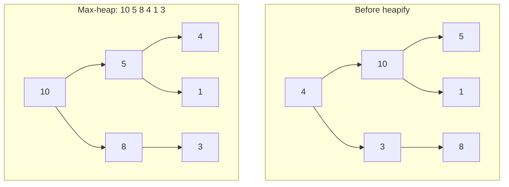
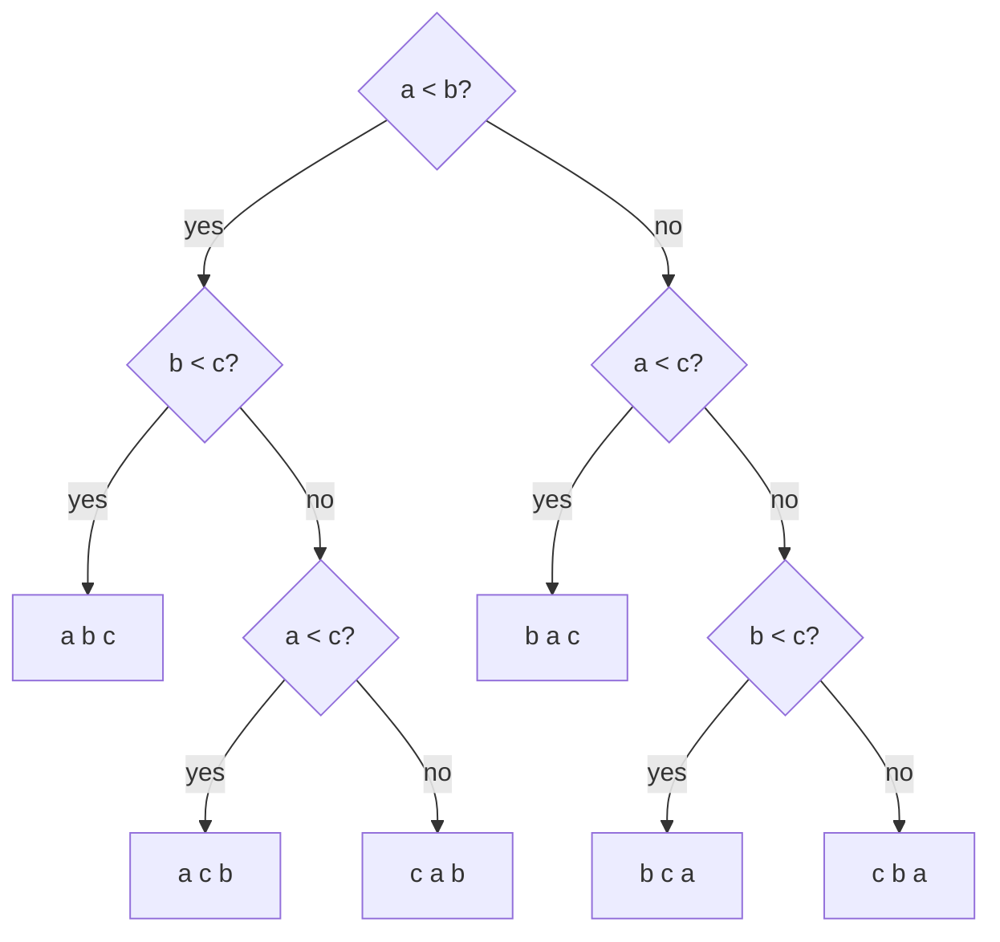
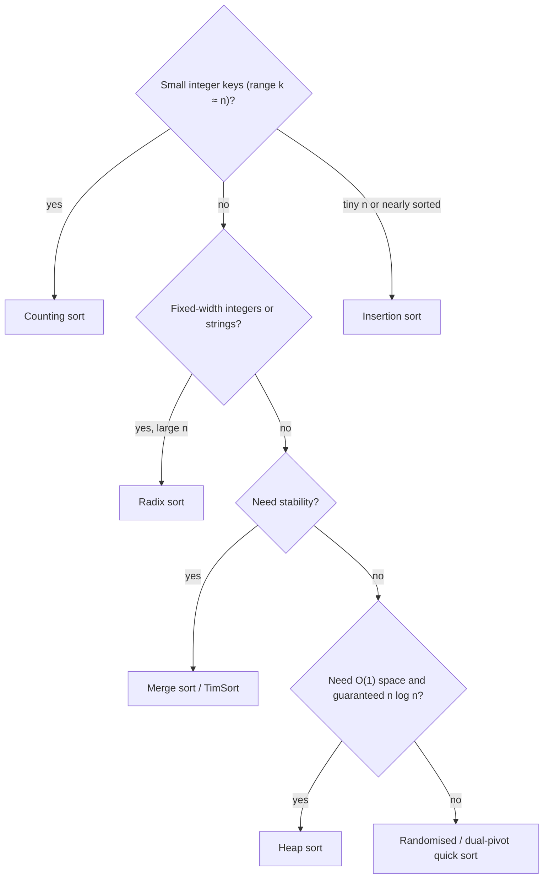

# Session 3 · Heap Sort, Counting Sort and Radix Sort

Prepared by **Hamna Zahid Khan**, Junior Lecturer

[🏠 Course home](../README.md) · [📘 Module overview](./README.md) · [⬅ Previous](./session-02-merge-sort-and-quick-sort.md) · [Practice test ➡](./practice-test.md)

> **Module 04 · Sorting** · ⏱ 3 hours (90 min lecture + 90 min lab)

## 🎯 Learning objectives

1. Store a complete binary tree in an array and implement **sift-down**.
2. Implement **heap sort** in place and explain why building a heap is O(n).
3. Prove the **Ω(n log n) lower bound** for comparison sorting.
4. Implement stable **counting sort** and **LSD radix sort** and know when they beat O(n log n).
5. Choose the right sorting algorithm for a given situation.

---

## 1. Heap sort

A **max-heap** is a complete binary tree where every parent ≥ its children, so the maximum sits at the root. It is stored in an array with no pointers:

| Relation | Index formula (0-based) |
|---|---|
| left child of i | 2i + 1 |
| right child of i | 2i + 2 |
| parent of i | (i − 1) / 2 |

> 🏆 **Analogy: a knockout tournament.** The champion (maximum) is at the top. Remove the champion, promote a new contender to the top, and let them play down the bracket until order is restored. Repeat to rank everyone.

**Algorithm.**

1. **Build** a max-heap: call `siftDown` on every non-leaf from index n/2 − 1 down to 0.
2. **Repeat** n − 1 times: swap the root (max) with the last heap element, shrink the heap by one, `siftDown(0)`.

**Array `[4, 10, 3, 5, 1, 8]` as a tree, then after building the heap**



**Build-heap trace** (non-leaves are indices 2, 1, 0)

| siftDown(i) | Value | Larger child | Action | Array |
|---|---|---|---|---|
| 2 | 3 | 8 (index 5) | swap | 4 10 8 5 1 3 |
| 1 | 10 | 5 | none | 4 10 8 5 1 3 |
| 0 | 4 | 10 (index 1) | swap, continue at 1 | 10 4 8 5 1 3 |
| 1 | 4 | 5 (index 3) | swap | 10 5 8 4 1 3 |

**Why is build-heap O(n), not O(n log n)?** Half the nodes are leaves (0 work), a quarter sift down at most 1 level, an eighth at most 2… Σ (n / 2ʰ⁺¹)·h = O(n).

**Heap sort total:** O(n) build + (n − 1) × O(log n) extractions = **O(n log n) in every case**, **O(1)** extra space. Not stable (long-distance swaps), and less cache-friendly than quick sort.

## 2. The lower bound for comparison sorts

Any algorithm that sorts **only by comparing elements** can be drawn as a **decision tree**: each internal node is a comparison, each leaf is one of the n! possible orderings. A binary tree with n! leaves has height ≥ log₂(n!) ≈ n log₂ n − 1.44n. Therefore every comparison sort needs **Ω(n log n)** comparisons in the worst case. Merge sort and heap sort are **optimal**.



3! = 6 leaves ⇒ at least ⌈log₂ 6⌉ = 3 comparisons in the worst case. To go **below** n log n we must stop comparing and use the **values themselves** as indices.

## 3. Counting sort

> 🗳️ **Analogy: counting votes.** You do not sort ballots by comparing them; you keep one tally per candidate, then read the tallies in order.

For integers in [0, k]:

1. `count[v]++` for every value.
2. Prefix sums: `count[v]` becomes the number of elements ≤ v (= one past the last position for v).
3. Walk the input **from right to left**, placing each value at `--count[v]`. Right-to-left keeps equal keys in input order ⇒ **stable**.

**Trace: grade points `[3, 1, 4, 1, 0, 3, 2, 4, 1]`, k = 4**

| v | 0 | 1 | 2 | 3 | 4 |
|---|---|---|---|---|---|
| frequency | 1 | 3 | 1 | 2 | 2 |
| prefix (end positions) | 1 | 4 | 5 | 7 | 9 |

Output: `0 1 1 1 2 3 3 4 4`. Time **O(n + k)**, space O(n + k). Excellent when k = O(n); useless when k is huge (sorting 10 numbers up to 10⁹ needs a billion counters).

## 4. Radix sort (LSD)

Sort by the **least significant digit** first, then the next, using a **stable** sort (counting sort with k = 10) for each digit. Stability guarantees that ties on the current digit keep the order produced by the lower digits.

**Trace: `[170, 45, 75, 90, 802, 24, 2, 66]`**

| Pass | Key digit | Result |
|---|---|---|
| 1 | ones | 170 90 802 2 24 45 75 66 |
| 2 | tens | 802 2 24 45 66 170 75 90 |
| 3 | hundreds | 2 24 45 66 75 90 170 802 |

Time **O(d·(n + b))** for d digits in base b. For 32-bit ints with base 256, d = 4 ⇒ linear time. Handles negative numbers with an offset or a sign pass; strings with a character per pass.

## 5. Complexity and selection guide

| Algorithm | Best | Average | Worst | Space | Stable | Comparison-based |
|---|---|---|---|---|---|---|
| Heap sort | O(n log n) | O(n log n) | O(n log n) | O(1) | ❌ | ✅ |
| Counting sort | O(n + k) | O(n + k) | O(n + k) | O(n + k) | ✅ | ❌ |
| Radix sort (LSD) | O(d(n + b)) | O(d(n + b)) | O(d(n + b)) | O(n + b) | ✅ | ❌ |



---

## 6. Complete program

📄 **[`src/HeapCountingRadix.java`](src/HeapCountingRadix.java)**

```java
import java.util.Arrays;

/**
 * Module 04 · Session 03 — Heap sort, counting sort and radix sort.
 *
 * In-place heap sort (build max-heap bottom-up, then repeatedly move the max to
 * the end), stable counting sort for small integer ranges, LSD radix sort that
 * runs a stable counting sort per decimal digit, and a timing comparison of
 * all the module's sorts against Arrays.sort.
 *
 * Compile:  javac -d out HeapCountingRadix.java
 * Run:      java -cp out HeapCountingRadix
 *
 * Prepared by Hamna Zahid Khan, Junior Lecturer
 */
public class HeapCountingRadix {

    static boolean trace = false;

    // ---------------------------------------------------------------- heap sort

    public static void heapSort(int[] a) {
        int n = a.length;
        for (int i = n / 2 - 1; i >= 0; i--) siftDown(a, i, n);     // build max-heap in O(n)
        if (trace) System.out.println("  max-heap built: " + Arrays.toString(a));
        for (int end = n - 1; end > 0; end--) {
            int t = a[0]; a[0] = a[end]; a[end] = t;                  // move max to its final place
            siftDown(a, 0, end);                                      // restore heap on a[0..end-1]
            if (trace) System.out.println("  max " + a[end] + " placed: " + Arrays.toString(a));
        }
    }

    /** Pushes a[i] down until both children are smaller (heap of size n). */
    static void siftDown(int[] a, int i, int n) {
        while (true) {
            int left = 2 * i + 1, right = left + 1, largest = i;
            if (left < n && a[left] > a[largest]) largest = left;
            if (right < n && a[right] > a[largest]) largest = right;
            if (largest == i) return;
            int t = a[i]; a[i] = a[largest]; a[largest] = t;
            i = largest;
        }
    }

    // ------------------------------------------------------------ counting sort

    /** Stable counting sort for values in [0, k]. O(n + k) time, O(n + k) space. */
    public static int[] countingSort(int[] a, int k) {
        int[] count = new int[k + 1];
        for (int v : a) count[v]++;                                   // 1. frequencies
        for (int v = 1; v <= k; v++) count[v] += count[v - 1];        // 2. prefix sums = end positions
        int[] out = new int[a.length];
        for (int i = a.length - 1; i >= 0; i--) out[--count[a[i]]] = a[i];  // 3. right-to-left keeps stability
        return out;
    }

    // --------------------------------------------------------------- radix sort

    /** LSD radix sort for non-negative ints, base 10: stable counting sort on each digit. */
    public static void radixSort(int[] a) {
        int max = 0;
        for (int v : a) max = Math.max(max, v);
        int[] out = new int[a.length];
        for (long exp = 1; max / exp > 0; exp *= 10) {
            int[] count = new int[10];
            for (int v : a) count[(int) (v / exp % 10)]++;
            for (int d = 1; d < 10; d++) count[d] += count[d - 1];
            for (int i = a.length - 1; i >= 0; i--) out[--count[(int) (a[i] / exp % 10)]] = a[i];
            System.arraycopy(out, 0, a, 0, a.length);
            if (trace) System.out.println("  after digit place " + exp + ": " + Arrays.toString(a));
        }
    }

    static long timeMs(Runnable r) {
        long t = System.nanoTime();
        r.run();
        return (System.nanoTime() - t) / 1_000_000;
    }

    public static void main(String[] args) {
        trace = true;
        int[] h = {4, 10, 3, 5, 1, 8};
        System.out.println("Heap sort trace for " + Arrays.toString(h));
        heapSort(h);

        int[] grades = {3, 1, 4, 1, 0, 3, 2, 4, 1};
        System.out.println("\nCounting sort of grade points " + Arrays.toString(grades) + " -> "
                + Arrays.toString(countingSort(grades, 4)));

        int[] r = {170, 45, 75, 90, 802, 24, 2, 66};
        System.out.println("\nRadix sort trace for " + Arrays.toString(r));
        radixSort(r);
        trace = false;

        int n = 200_000;
        java.util.Random rnd = new java.util.Random(1);
        int[] base = new int[n];
        for (int i = 0; i < n; i++) base[i] = rnd.nextInt(1_000_000);
        int[] expected = base.clone();
        Arrays.sort(expected);
        System.out.printf("%nSorting %,d random ints in [0, 1,000,000) (times vary by machine):%n", n);
        int[][] copies = new int[6][];
        for (int i = 0; i < 6; i++) copies[i] = base.clone();
        long tHeap = timeMs(() -> heapSort(copies[0]));
        long tMerge = timeMs(() -> MergeQuickSort.mergeSort(copies[1]));
        long tQuick = timeMs(() -> MergeQuickSort.quickSort(copies[2]));
        long tRadix = timeMs(() -> radixSort(copies[3]));
        int[][] counted = new int[1][];
        long tCount = timeMs(() -> counted[0] = countingSort(copies[4], 999_999));
        long tLib = timeMs(() -> Arrays.sort(copies[5]));
        long tIns = timeMs(() -> ElementarySorts.insertionSort(Arrays.copyOf(base, 20_000), false));
        boolean ok = Arrays.equals(copies[0], expected) && Arrays.equals(copies[1], expected)
                && Arrays.equals(copies[2], expected) && Arrays.equals(copies[3], expected)
                && Arrays.equals(counted[0], expected) && Arrays.equals(copies[5], expected);
        System.out.println("  all results identical to Arrays.sort: " + ok);
        System.out.println("  heap, merge, quick, radix, counting and Arrays.sort all finish in well under a second;");
        System.out.println("  insertion sort on just 20,000 items is already the slowest: "
                + (tIns >= Math.min(Math.min(tHeap, tMerge), Math.min(tQuick, Math.min(tRadix, Math.min(tCount, tLib))))));
    }
}
```

**Real output:**

```text
$ java -cp out HeapCountingRadix
Heap sort trace for [4, 10, 3, 5, 1, 8]
  max-heap built: [10, 5, 8, 4, 1, 3]
  max 10 placed: [8, 5, 3, 4, 1, 10]
  max 8 placed: [5, 4, 3, 1, 8, 10]
  max 5 placed: [4, 1, 3, 5, 8, 10]
  max 4 placed: [3, 1, 4, 5, 8, 10]
  max 3 placed: [1, 3, 4, 5, 8, 10]

Counting sort of grade points [3, 1, 4, 1, 0, 3, 2, 4, 1] -> [0, 1, 1, 1, 2, 3, 3, 4, 4]

Radix sort trace for [170, 45, 75, 90, 802, 24, 2, 66]
  after digit place 1: [170, 90, 802, 2, 24, 45, 75, 66]
  after digit place 10: [802, 2, 24, 45, 66, 170, 75, 90]
  after digit place 100: [2, 24, 45, 66, 75, 90, 170, 802]

Sorting 200,000 random ints in [0, 1,000,000) (times vary by machine):
  all results identical to Arrays.sort: true
  heap, merge, quick, radix, counting and Arrays.sort all finish in well under a second;
  insertion sort on just 20,000 items is already the slowest: true
```

The timing section deliberately prints only verified facts (correctness and relative ranking), because absolute milliseconds depend on the machine. Run it yourself to see the numbers on your laptop.

---

## 7. Worked examples (basic → advanced)

**Example 1 (basic): array ↔ tree.** For `[10, 5, 8, 4, 1, 3]`: the children of 5 (index 1) are indices 3 and 4 (values 4 and 1); the parent of 3 (index 5) is index 2 (value 8). ✅ max-heap.

**Example 2 (intermediate): sort colours in one pass.** An array with only 0s, 1s and 2s can be counting-sorted (k = 2), or partitioned in a single pass with three pointers (Dijkstra's Dutch national flag):

```java
/** Sort an array containing only 0, 1, 2 in ONE pass (Dutch national flag). */
static void sortColors(int[] a) {
    int lo = 0, i = 0, hi = a.length - 1;
    while (i <= hi) {
        if (a[i] == 0) { int t = a[lo]; a[lo++] = a[i]; a[i++] = t; }
        else if (a[i] == 2) { int t = a[hi]; a[hi--] = a[i]; a[i] = t; }
        else i++;
    }
}
```
<sub>Full, compiled version: [`src/Labs04.java`](src/Labs04.java)</sub>

**Example 3 (advanced): multi-key sort with stable passes.** Sorting dates by (year, month, day) is radix sort with "digits" = day, month, year, least significant first. Each pass must be stable:

```java
/** Sort dates {day, month, year} chronologically with three STABLE passes (radix idea):
 *  least significant key first (day), then month, then year. */
static void sortDates(int[][] dates) {
    Comparator<int[]> byDay = Comparator.comparingInt(d -> d[0]);
    Comparator<int[]> byMonth = Comparator.comparingInt(d -> d[1]);
    Comparator<int[]> byYear = Comparator.comparingInt(d -> d[2]);
    Arrays.sort(dates, byDay);     // Arrays.sort on objects is stable (TimSort)
    Arrays.sort(dates, byMonth);
    Arrays.sort(dates, byYear);
}
```
<sub>Full, compiled version: [`src/Labs04.java`](src/Labs04.java)</sub>

## 8. Real-life problem: national test results

**Problem.** A national entry test is taken by 1.2 million candidates. Scores are integers 0–200. The board needs the list sorted by score (highest first) and, among equal scores, by registration time (already the input order).

**Solution.** Keys lie in a tiny range (k = 201) relative to n = 1.2 million ⇒ **counting sort**, O(n + k) ≈ 1.2 million steps, and it is **stable**, so registration order is preserved among ties automatically. A comparison sort would need ≈ 1.2M × log₂(1.2M) ≈ 24 million comparisons. For descending order, read the counts from 200 down to 0.

## 9. Common mistakes

| Mistake | Fix |
|---|---|
| Building the heap from index 0 upwards | sift down from n/2 − 1 **down to** 0 |
| `siftDown` ignoring the shrinking heap size | pass the current heap size `end` |
| Counting sort placing elements left to right with `count[v]++` from the prefix start, then reversing | either is fine, but the right-to-left with `--count[v]` version is the standard stable form |
| Using counting sort with huge k | radix sort or comparison sort instead |
| Radix sort with an unstable per-digit sort | results are wrong; per-digit sort must be stable |
| Radix sort on negative numbers without adjustment | separate negatives or add an offset |

## 10. Best practices

- Heap sort is the fallback inside **introsort** (C++ `std::sort`) when quick sort recurses too deep: guaranteed O(n log n) with O(1) space.
- For top-k problems you rarely need a full heap sort; a size-k heap is enough (Module 11).
- Choose radix base 256 (bytes) for integers in practice: 4 passes for 32-bit values.

---

## 11. Lab tasks

**Lab 3.1: Sort colours.** Sort an array of 0/1/2 in one pass and O(1) space.

<details>
<summary>✅ Solution</summary>

See Example 2.

</details>

**Lab 3.2: Chronological dates.** Sort `{day, month, year}` triples using three stable passes.

<details>
<summary>💡 Hint</summary>

Least significant key first: day, then month, then year. `Arrays.sort` on objects is stable.

</details>

<details>
<summary>✅ Solution</summary>

See Example 3.

</details>

**Lab 3.3: Min-heap sort for descending order.** Modify `siftDown` to build a **min**-heap so that heap sort produces descending order.

<details>
<summary>✅ Solution</summary>

Flip both comparisons in `siftDown` (`a[left] < a[smallest]`, `a[right] < a[smallest]`) and rename `largest` to `smallest`. The minimum goes to the end each time, giving descending order.

</details>

**Real output of the Session 3 lab solutions:**

```text
$ java -cp out Labs04 3
-- Session 3 labs --
sortColors -> [0, 0, 0, 1, 1, 1, 2, 2, 2]
dates sorted -> [[25, 12, 1876], [23, 3, 1940], [14, 8, 1940], [14, 8, 1947], [1, 1, 2000]]
```

---

## 12. Quiz

**Q1.** In a 0-based array heap, the children of index 4 are at indices:

- **A.** 8 and 9
- **B.** 9 and 10
- **C.** 5 and 6
- **D.** 2 and 3

**Q2.** Building a max-heap bottom-up from an unsorted array takes:

- **A.** O(log n)
- **B.** O(n)
- **C.** O(n log n)
- **D.** O(n²)

**Q3.** Any comparison-based sort needs, in the worst case, at least:

- **A.** n comparisons
- **B.** n log n comparisons (asymptotically)
- **C.** n² comparisons
- **D.** log n comparisons

**Q4.** Counting sort is a poor choice when:

- **A.** n is large
- **B.** keys are small integers
- **C.** the key range k is much larger than n
- **D.** stability is required

**Q5.** LSD radix sort processes digits:

- **A.** most significant first, with any sort
- **B.** least significant first, with a stable sort
- **C.** in random order
- **D.** least significant first, with heap sort

<details>
<summary><b>Show answers</b></summary>

1. **B**: 2·4 + 1 = 9 and 2·4 + 2 = 10.
2. **B**: Most nodes are near the bottom and sift down only a few levels.
3. **B**: A decision tree with n! leaves has height ≥ log₂(n!) = Θ(n log n).
4. **C**: It needs O(k) counters and time.
5. **B**: Stability preserves the order established by lower digits.

</details>

---

## 13. Summary

- Heap sort: build a max-heap in O(n), then extract the max n − 1 times: O(n log n), in place, not stable.
- Any comparison sort needs Ω(n log n) comparisons (decision-tree argument).
- Counting sort (O(n + k)) and radix sort (O(d(n + b))) break the bound by indexing with key values, and both are stable.
- Choose the algorithm from the data: range of keys, stability, memory, and input order.

## 14. Viva / interview questions

1. Why does build-heap run in O(n)?
2. Explain the decision-tree lower bound in your own words.
3. Why must the per-digit sort in radix sort be stable?
4. When would counting sort be a bad idea?
5. Is heap sort stable? Give a counter-example.
6. Which algorithm does Java's `Arrays.sort(int[])` use, and which does `Arrays.sort(Object[])` use?

---

[⬅ Previous](./session-02-merge-sort-and-quick-sort.md) · [📘 Module overview](./README.md) · [Practice test ➡](./practice-test.md)
