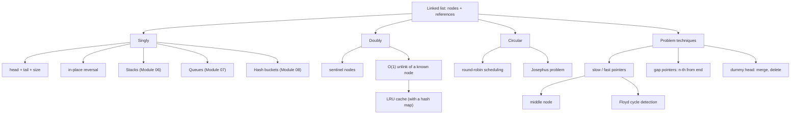

# Module 05 · Linked Lists

Prepared by **Hamna Zahid Khan**, Junior Lecturer

[🏠 Course home](../README.md)

> ⏱ 9 contact hours · 3 sessions · 🟡 Core

Linked lists are the first **pointer-based** data structure in the course. They trade the array's O(1) indexing for O(1) insertion and deletion wherever we hold a reference, and they are the building blocks of stacks, queues, hash-table buckets, LRU caches and graph adjacency lists. This module also trains the pointer-manipulation skills that trees and graphs depend on.

## 🎯 Module objectives

- Implement generic singly, doubly (with sentinels) and circular linked lists.
- Perform insertions, deletions and reversal with correct pointer ordering.
- Apply slow/fast pointers, gap pointers and dummy heads to classic problems.
- Choose between arrays and the linked-list variants for a given workload.

## 📚 Sessions

| # | Session | Key ideas | Code |
|---|---|---|---|
| 1 | [Singly Linked Lists](session-01-singly-linked-list.md) | nodes, head/tail/size, insert/delete, reversal, iteration | [`SinglyLinkedList.java`](src/SinglyLinkedList.java) |
| 2 | [Doubly and Circular Lists](session-02-doubly-and-circular-lists.md) | prev links, sentinels, O(1) unlink, round robin, Josephus | [`DoublyCircularLists.java`](src/DoublyCircularLists.java) |
| 3 | [Classic Linked-List Problems](session-03-classic-linked-list-problems.md) | reversal, Floyd's cycle detection, merge, n-th from end, palindrome | [`LinkedListProblems.java`](src/LinkedListProblems.java) |
| ✍️ | [Practice test](practice-test.md) | 20 MCQs + 3 coding scenarios | [`Labs05.java`](src/Labs05.java), [`SelfCheck.java`](src/SelfCheck.java) |

## 🗺️ Concept map



## 📄 One-page cheat sheet

| Operation | Singly (head+tail) | Doubly (sentinels) | Circular (tail only) | Array |
|---|---|---|---|---|
| access i | O(n) | O(n) | O(n) | O(1) |
| add first | O(1) | O(1) | O(1) | O(n) |
| add last | O(1) | O(1) | O(1) | O(1)* |
| remove first | O(1) | O(1) | O(1) | O(n) |
| remove last | O(n) | O(1) | O(n) | O(1) |
| remove known node | O(n) | O(1) | O(n) | O(n) |
| search | O(n) | O(n) | O(n) | O(n) / O(log n) sorted |

**Pointer recipes**

```java
// insert n after p (singly)
n.next = p.next; p.next = n;
// unlink n (doubly)
n.prev.next = n.next; n.next.prev = n.prev;
// reverse
while (cur != null) { next = cur.next; cur.next = prev; prev = cur; cur = next; }
// middle / cycle
while (fast != null && fast.next != null) { slow = slow.next; fast = fast.next.next; }
```

**Checklist:** link the new node before redirecting old links · update tail when removing the last node · reset head and tail when the list becomes empty · compare nodes with `==`, values with `equals` · test 0, 1, 2 nodes.

## ▶️ Run the code

```bash
cd 05-linked-lists/src
javac -d out *.java
java -ea -cp out SelfCheck
java -cp out LinkedListProblems
```

See [`src/README.md`](src/README.md) for every file.
