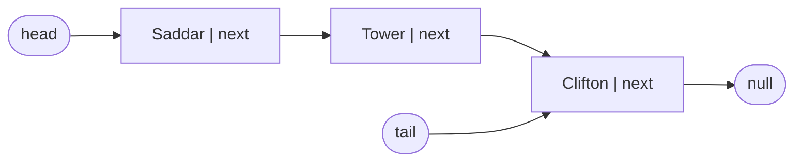
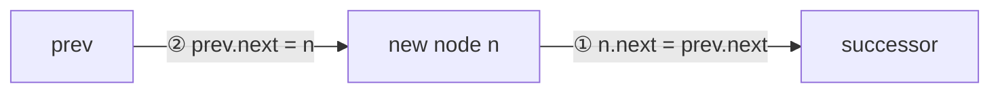

# Session 1 · Singly Linked Lists

Prepared by **Hamna Zahid Khan**, Junior Lecturer

[🏠 Course home](../README.md) · [📘 Module overview](./README.md) · [⬅ Module overview](./README.md) · [Next ➡](./session-02-doubly-and-circular-lists.md)

> **Module 05 · Linked Lists** · ⏱ 3 hours (90 min lecture + 90 min lab)

## 🎯 Learning objectives

1. Describe a linked list as a chain of **nodes** connected by references.
2. Implement a generic singly linked list with `head`, `tail` and `size`.
3. Insert and delete at the front, back and middle, drawing the pointer changes in the correct order.
4. Reverse a list in place and make the list iterable.
5. Compare linked lists with arrays and choose between them.

---

## 1. From arrays to nodes

Arrays store elements side by side, which gives O(1) indexing but forces O(n) shifting to insert in the middle and a costly copy to grow. A **linked list** stores each element in its own **node** anywhere in memory; each node holds a reference to the **next** node.

> 🚂 **Analogy: a train.** Each carriage (node) carries passengers (the value) and a coupling to the next carriage (the `next` reference). Adding a carriage at the front only needs one new coupling; nobody else moves. But to reach the 7th carriage you must walk through the first six.



```java
private static final class Node<T> {
    T value;
    Node<T> next;
}
```

## 2. Core operations and their pointer surgery

### 2.1 `addFirst(x)`: O(1)

1. Create node `n` with `n.next = head`.
2. `head = n`. If the list was empty, `tail = n` as well.

### 2.2 `addLast(x)`: O(1) with a tail reference

1. `tail.next = n`, then `tail = n`. Without `tail` we would walk the whole list: O(n).

### 2.3 `insertAt(i, x)`: O(i)

Walk to the node **before** position i (`prev`), then:



The order matters: if we set `prev.next = n` first, we lose the only reference to the successor and the rest of the list is gone.

### 2.4 `removeAt(i)`: O(i)

`prev.next = prev.next.next`: the removed node is "bypassed" and the garbage collector reclaims it. If the removed node was the tail, move `tail` back to `prev`. Removing the **last** node is O(n) in a singly list, because we must find its predecessor.

**Trace: list `Gulshan → Saddar → Empress Market → Tower → Clifton`, `removeAt(1)`**

| Step | prev | target | Action | List |
|---|---|---|---|---|
| 1 | Gulshan (index 0) | Saddar | `prev.next = target.next` | Gulshan → Empress Market → Tower → Clifton |
| 2 | – | – | size 5 → 4, return "Saddar" | |

### 2.5 In-place reversal: O(n) time, O(1) space

Three pointers walk the list, flipping one arrow per step.

| Step | prev | cur | next | Arrows so far |
|---|---|---|---|---|
| start | null | 1 | – | 1→2→3 |
| 1 | 1 | 2 | 2 | null←1   2→3 |
| 2 | 2 | 3 | 3 | null←1←2   3 |
| 3 | 3 | null | null | null←1←2←3 ⇒ head = 3 |

## 3. Array vs linked list

| Operation | Array / `ArrayList` | Singly linked list (head + tail) |
|---|---|---|
| Access i-th element | **O(1)** | O(n) |
| Insert/delete at front | O(n) | **O(1)** |
| Insert at end | O(1) amortised | **O(1)** |
| Delete at end | O(1) | O(n) (need predecessor) |
| Insert/delete in middle (position known) | O(n) shift | **O(1)** relink (O(n) to find it) |
| Search | O(n) (O(log n) if sorted) | O(n) (no binary search) |
| Memory per element | value only | value + 1 reference (+ object header) |
| Cache friendliness | excellent | poor (nodes scattered) |

**Rule of thumb:** prefer arrays unless you insert/delete frequently at the front or at positions you already hold a reference to. Linked lists shine as the **building block** of stacks, queues, hash-table buckets and adjacency lists.

## 4. Complexity table: `SinglyLinkedList<T>`

| Method | Best | Average | Worst | Space |
|---|---|---|---|---|
| `addFirst`, `addLast`, `removeFirst` | O(1) | O(1) | O(1) | O(1) |
| `get(i)`, `insertAt(i)`, `removeAt(i)` | O(1) (i = 0) | O(n) | O(n) | O(1) |
| `remove(value)`, `indexOf(value)` | O(1) | O(n) | O(n) | O(1) |
| `reverse()` | O(n) | O(n) | O(n) | O(1) |
| whole list | – | – | – | O(n) |

---

## 5. Complete implementation

📄 **[`src/SinglyLinkedList.java`](src/SinglyLinkedList.java)**

```java
import java.util.Iterator;
import java.util.NoSuchElementException;

/**
 * Module 05 · Session 01 — A generic singly linked list built from scratch.
 *
 * Keeps head, tail and size so addFirst, addLast and removeFirst are O(1).
 * Also supports get, insertAt, removeAt, remove(value), indexOf, in-place
 * reverse and for-each iteration.
 *
 * Compile:  javac -d out SinglyLinkedList.java
 * Run:      java -cp out SinglyLinkedList
 *
 * Prepared by Hamna Zahid Khan, Junior Lecturer
 */
public class SinglyLinkedList<T> implements Iterable<T> {

    /** A node holds one value and a reference to the next node (null at the end). */
    private static final class Node<T> {
        T value;
        Node<T> next;
        Node(T value, Node<T> next) { this.value = value; this.next = next; }
    }

    private Node<T> head, tail;
    private int size;

    public int size() { return size; }
    public boolean isEmpty() { return size == 0; }

    /** O(1): new node points at the old head. */
    public void addFirst(T value) {
        head = new Node<>(value, head);
        if (tail == null) tail = head;      // list was empty
        size++;
    }

    /** O(1) thanks to the tail reference. */
    public void addLast(T value) {
        Node<T> node = new Node<>(value, null);
        if (tail == null) head = tail = node;
        else { tail.next = node; tail = node; }
        size++;
    }

    /** O(index): walk to the node before the insertion point. */
    public void insertAt(int index, T value) {
        if (index < 0 || index > size) throw new IndexOutOfBoundsException("index " + index + ", size " + size);
        if (index == 0) { addFirst(value); return; }
        if (index == size) { addLast(value); return; }
        Node<T> prev = nodeAt(index - 1);
        prev.next = new Node<>(value, prev.next);   // 1) new node -> successor, 2) prev -> new node
        size++;
    }

    /** O(1). */
    public T removeFirst() {
        if (head == null) throw new NoSuchElementException("list is empty");
        T v = head.value;
        head = head.next;
        if (head == null) tail = null;
        size--;
        return v;
    }

    /** O(index): unlink the node after 'prev'. Removing the LAST node is O(n) in a singly list. */
    public T removeAt(int index) {
        checkIndex(index);
        if (index == 0) return removeFirst();
        Node<T> prev = nodeAt(index - 1);
        Node<T> target = prev.next;
        prev.next = target.next;              // bypass target; the GC reclaims it
        if (target == tail) tail = prev;
        size--;
        return target.value;
    }

    /** Removes the first node equal to value. O(n). Returns true if something was removed. */
    public boolean remove(T value) {
        Node<T> prev = null, cur = head;
        while (cur != null && !java.util.Objects.equals(cur.value, value)) {
            prev = cur;
            cur = cur.next;
        }
        if (cur == null) return false;
        if (prev == null) head = cur.next; else prev.next = cur.next;
        if (cur == tail) tail = prev;
        size--;
        return true;
    }

    public T get(int index) { checkIndex(index); return nodeAt(index).value; }

    public int indexOf(T value) {
        int i = 0;
        for (Node<T> n = head; n != null; n = n.next, i++)
            if (java.util.Objects.equals(n.value, value)) return i;
        return -1;
    }

    /** Reverses the list in place in O(n) time, O(1) space, by flipping every next pointer. */
    public void reverse() {
        Node<T> prev = null, cur = head;
        tail = head;
        while (cur != null) {
            Node<T> next = cur.next;   // 1. remember the rest
            cur.next = prev;           // 2. flip the arrow
            prev = cur;                // 3. advance prev
            cur = next;                // 4. advance cur
        }
        head = prev;
    }

    private Node<T> nodeAt(int index) {
        Node<T> n = head;
        for (int i = 0; i < index; i++) n = n.next;
        return n;
    }

    private void checkIndex(int index) {
        if (index < 0 || index >= size) throw new IndexOutOfBoundsException("index " + index + ", size " + size);
    }

    @Override
    public Iterator<T> iterator() {
        return new Iterator<T>() {
            private Node<T> cur = head;
            @Override public boolean hasNext() { return cur != null; }
            @Override public T next() {
                if (cur == null) throw new NoSuchElementException();
                T v = cur.value;
                cur = cur.next;
                return v;
            }
        };
    }

    @Override
    public String toString() {
        StringBuilder sb = new StringBuilder("head -> ");
        for (Node<T> n = head; n != null; n = n.next) sb.append(n.value).append(" -> ");
        return sb.append("null").toString();
    }

    public static void main(String[] args) {
        SinglyLinkedList<String> stops = new SinglyLinkedList<>();
        stops.addLast("Saddar");
        stops.addLast("Tower");
        stops.addLast("Clifton");
        System.out.println("addLast x3          : " + stops);
        stops.addFirst("Gulshan");
        System.out.println("addFirst(Gulshan)   : " + stops);
        stops.insertAt(2, "Empress Market");
        System.out.println("insertAt(2, ...)    : " + stops + "  size=" + stops.size());
        System.out.println("get(3) = " + stops.get(3) + ", indexOf(Clifton) = " + stops.indexOf("Clifton"));
        System.out.println("removeAt(1) -> " + stops.removeAt(1) + " : " + stops);
        System.out.println("remove(Tower) -> " + stops.remove("Tower") + " : " + stops);
        System.out.println("remove(Lyari) -> " + stops.remove("Lyari"));
        stops.reverse();
        System.out.println("reverse()           : " + stops);
        stops.addLast("Seaview");
        System.out.println("addLast after reverse (tail still correct): " + stops);
        StringBuilder upper = new StringBuilder();
        for (String s : stops) upper.append(s.toUpperCase()).append(' ');
        System.out.println("for-each            : " + upper.toString().trim());
        while (!stops.isEmpty()) stops.removeFirst();
        System.out.println("after removing all  : " + stops + "  size=" + stops.size());
        try {
            stops.removeFirst();
        } catch (NoSuchElementException e) {
            System.out.println("removeFirst on empty -> " + e.getMessage());
        }
    }
}
```

**Real output:**

```text
$ java -cp out SinglyLinkedList
addLast x3          : head -> Saddar -> Tower -> Clifton -> null
addFirst(Gulshan)   : head -> Gulshan -> Saddar -> Tower -> Clifton -> null
insertAt(2, ...)    : head -> Gulshan -> Saddar -> Empress Market -> Tower -> Clifton -> null  size=5
get(3) = Tower, indexOf(Clifton) = 4
removeAt(1) -> Saddar : head -> Gulshan -> Empress Market -> Tower -> Clifton -> null
remove(Tower) -> true : head -> Gulshan -> Empress Market -> Clifton -> null
remove(Lyari) -> false
reverse()           : head -> Clifton -> Empress Market -> Gulshan -> null
addLast after reverse (tail still correct): head -> Clifton -> Empress Market -> Gulshan -> Seaview -> null
for-each            : CLIFTON EMPRESS MARKET GULSHAN SEAVIEW
after removing all  : head -> null  size=0
removeFirst on empty -> list is empty
```

---

## 6. Worked examples (basic → advanced)

**Example 1 (basic): length and sum.** Traversal is always the same loop: `for (p = head; p != null; p = p.next)`.

```java
/** Sum of all values, iteratively. */
static int sum(LinkedListProblems.ListNode h) {
    int s = 0;
    for (LinkedListProblems.ListNode p = h; p != null; p = p.next) s += p.val;
    return s;
}
```
<sub>Full, compiled version: [`src/Labs05.java`](src/Labs05.java)</sub>

**Example 2 (intermediate): insert into a sorted list.** Find the last node smaller than the new value, then do the two-step link. The front is a special case because the head changes.

```java
/** Insert a value into a sorted list, keeping it sorted. Returns the (possibly new) head. */
static LinkedListProblems.ListNode insertSorted(LinkedListProblems.ListNode h, int v) {
    LinkedListProblems.ListNode n = node(v);
    if (h == null || v <= h.val) { n.next = h; return n; }
    LinkedListProblems.ListNode p = h;
    while (p.next != null && p.next.val < v) p = p.next;
    n.next = p.next;
    p.next = n;
    return h;
}
```
<sub>Full, compiled version: [`src/Labs05.java`](src/Labs05.java)</sub>

**Example 3 (advanced): remove duplicates from a sorted list.** Equal values are adjacent; when `cur.next` duplicates `cur`, unlink it and **stay** on `cur` (there may be more copies).

```java
/** Remove duplicates from a SORTED list in place: skip a node equal to its predecessor. */
static LinkedListProblems.ListNode dedup(LinkedListProblems.ListNode h) {
    LinkedListProblems.ListNode cur = h;
    while (cur != null && cur.next != null) {
        if (cur.next.val == cur.val) cur.next = cur.next.next;   // unlink the duplicate
        else cur = cur.next;
    }
    return h;
}
```
<sub>Full, compiled version: [`src/Labs05.java`](src/Labs05.java)</sub>

## 7. Real-life problem: music playlist

**Problem.** A music app plays songs in order. Users often (a) add a song to "play next" (right after the current song), (b) append songs to the end, and (c) remove the song that just finished. The playlist can contain thousands of songs, and the app always holds a reference to the current song.

**Solution.** A singly linked list with head and tail:

| Action | Operation | Cost |
|---|---|---|
| play next | `insertAfter(current, song)` (two pointer changes) | O(1) |
| add to end | `addLast(song)` | O(1) |
| song finished | `removeFirst()` | O(1) |

An `ArrayList` would shift thousands of elements for every "play next". "Previous song" needs a backward link: that is the doubly linked list of Session 2.

## 8. Common mistakes

| Mistake | Symptom | Fix |
|---|---|---|
| Linking in the wrong order (`prev.next = n` first) | rest of the list lost | `n.next = prev.next` first |
| Forgetting to update `tail` when removing the last node | `addLast` appends to a detached node | `if (target == tail) tail = prev;` |
| Forgetting `tail = null` when the list becomes empty | stale tail, ghost elements | reset both head and tail |
| `while (cur.next != null)` when `cur` can be null | `NullPointerException` | check `cur != null` first |
| Losing the head while traversing (`head = head.next`) | list destroyed | traverse with a separate pointer |
| Comparing values with `==` | object values never "found" | `Objects.equals(a, b)` |

## 9. Best practices

- Keep `head`, `tail` and `size` consistent in **every** method; check them in tests after each operation.
- Hide `Node` as a `private static` nested class so users cannot corrupt links.
- Draw boxes and arrows before writing pointer code; then dry-run the empty, one-element and two-element cases.
- In Java production code use `java.util.LinkedList` (doubly linked) or, more often, `ArrayDeque`/`ArrayList`.

---

## 10. Lab tasks

**Lab 1.1: Recursive length.** Return the number of nodes without a loop.

<details>
<summary>✅ Solution</summary>

```java
/** Length of a list, recursively. */
static int length(LinkedListProblems.ListNode h) {
    return h == null ? 0 : 1 + length(h.next);
}
```
<sub>Full, compiled version: [`src/Labs05.java`](src/Labs05.java)</sub>

</details>

**Lab 1.2: Insert into a sorted list.** Insert 30 and then 5 into `10 → 20 → 40`.

<details>
<summary>💡 Hint</summary>

If the new value is ≤ the head's value, it becomes the new head.

</details>

<details>
<summary>✅ Solution</summary>

See Example 2. Result: `5 → 10 → 20 → 30 → 40`.

</details>

**Lab 1.3: `removeLast()` and `contains()`.** Add both methods to `SinglyLinkedList`. What is the complexity of `removeLast`, and why can't the tail reference make it O(1)?

<details>
<summary>✅ Solution</summary>

```java
public T removeLast() {
    if (head == null) throw new NoSuchElementException();
    if (head == tail) return removeFirst();
    Node<T> p = head;
    while (p.next != tail) p = p.next;   // find the predecessor of tail: O(n)
    T v = tail.value;
    p.next = null;
    tail = p;
    size--;
    return v;
}
public boolean contains(T x) { return indexOf(x) != -1; }
```

`removeLast` is O(n): the tail knows its value but not its **predecessor**, and nodes have no backward links.

</details>

```text
$ java -cp out Labs05
length = 6, sum = 108
dedup(1 1 2 3 3 3 4) = 1 -> 2 -> 3 -> 4 -> null
insertSorted 30, 5 = 5 -> 10 -> 20 -> 30 -> 40 -> null
342 + 465 as lists = 7 -> 0 -> 8 -> null
oddEven(1..7) = 1 -> 3 -> 5 -> 7 -> 2 -> 4 -> 6 -> null
```

---

## 11. Quiz

**Q1.** Accessing the 1000th element of a singly linked list costs:

- **A.** O(1)
- **B.** O(log n)
- **C.** O(n)
- **D.** O(n²)

**Q2.** Which operation is O(1) in a singly linked list with head and tail references?

- **A.** removeLast
- **B.** get(size/2)
- **C.** addLast
- **D.** indexOf

**Q3.** To insert node n after node p, the correct order is:

- **A.** p.next = n; n.next = p.next
- **B.** n.next = p.next; p.next = n
- **C.** n.next = p; p.next = n
- **D.** p = n; n.next = p

**Q4.** After `reverse()` on `A → B → C`, which node is the new tail?

- **A.** C
- **B.** B
- **C.** A
- **D.** null

**Q5.** A key disadvantage of linked lists compared with arrays is:

- **A.** O(n) front insertion
- **B.** no random access and poor cache locality
- **C.** fixed size
- **D.** they cannot store objects

<details>
<summary><b>Show answers</b></summary>

1. **C**: You must follow 999 next references.
2. **C**: tail.next = n; tail = n.
3. **B**: Save the successor in n before overwriting p.next.
4. **C**: The old head becomes the last node.
5. **B**: Nodes are scattered in memory and must be walked.

</details>

---

## 12. Summary

- A linked list is a chain of nodes; it trades O(1) indexing for O(1) front insertion and cheap relinking.
- Maintain `head`, `tail` and `size` together, and link new nodes **before** redirecting old references.
- Reversal is a three-pointer walk: O(n) time, O(1) space.
- Linked lists underlie stacks, queues, hash buckets and graph adjacency lists.

## 13. Viva / interview questions

1. Why is `removeLast` O(n) in a singly linked list even with a tail pointer?
2. Compare memory usage of `ArrayList<Integer>` and a linked list of integers.
3. Write the pointer updates for inserting at the head of an empty list.
4. Why are linked lists slower than arrays in practice even for some O(1) operations?
5. How would you find the k-th node from the end in one pass?
6. When is a linked list the better choice over an array?

---

[⬅ Module overview](./README.md) · [📘 Module overview](./README.md) · [Next ➡](./session-02-doubly-and-circular-lists.md)
