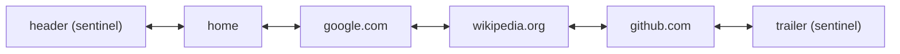
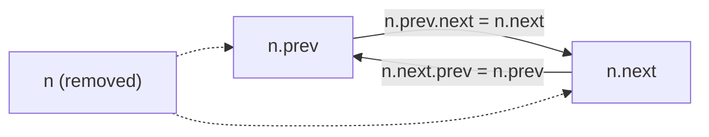
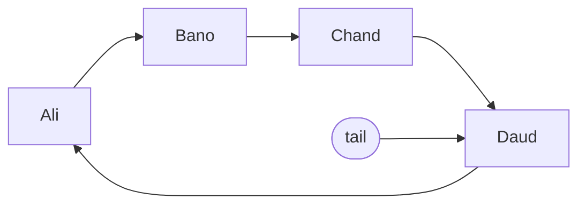

# Session 2 · Doubly and Circular Linked Lists

Prepared by **Hamna Zahid Khan**, Junior Lecturer

[🏠 Course home](../README.md) · [📘 Module overview](./README.md) · [⬅ Previous](./session-01-singly-linked-list.md) · [Next ➡](./session-03-classic-linked-list-problems.md)

> **Module 05 · Linked Lists** · ⏱ 3 hours (90 min lecture + 90 min lab)

## 🎯 Learning objectives

1. Implement a **doubly linked list** with `prev` and `next` references.
2. Use **sentinel (dummy) nodes** to eliminate special cases.
3. Remove a known node in **O(1)** and traverse in both directions.
4. Implement a **circular linked list** with a single tail reference.
5. Apply circular lists to **round-robin scheduling** and the **Josephus problem**.

---

## 1. Doubly linked lists

Each node stores two references: `prev` and `next`.

> 🌐 **Analogy: browser history.** Each page knows the page before it (Back button) and the page after it (Forward button). You can move in both directions and close any page in the middle without searching for its neighbour.



**What we gain:** O(1) `removeLast`, O(1) removal of any node we hold a reference to, backward traversal.
**What we pay:** one extra reference per node and twice the pointer updates.

## 2. Sentinels: no more special cases

Without sentinels, inserting at the front, back or middle, and into an empty list, each needs its own `if`. With a permanent **header** before the first element and **trailer** after the last, *every* real node always has a non-null `prev` and `next`. All insertions become one method:

```java
private Node<T> addBetween(T value, Node<T> a, Node<T> b) {   // a and b are adjacent
    Node<T> n = new Node<>(value);
    n.prev = a;  n.next = b;    // 1-2: new node points to its neighbours
    a.next = n;  b.prev = n;    // 3-4: neighbours point to the new node
    size++;
    return n;
}
```

`addFirst(v)` = `addBetween(v, header, header.next)`; `addLast(v)` = `addBetween(v, trailer.prev, trailer)`.

**Unlink in O(1):**



### Trace: `unlink(wikipedia.org)`

| Step | Statement | Effect |
|---|---|---|
| 1 | `n.prev.next = n.next` | google.com.next → github.com |
| 2 | `n.next.prev = n.prev` | github.com.prev → google.com |
| 3 | `n.prev = n.next = null` | removed node detached |
| 4 | `size--` | 5 → 4 |

No traversal: O(1). This is why `LinkedHashMap` and LRU caches use doubly linked lists.

## 3. Circular linked lists

The last node points back to the first. We keep only a **tail** reference: the head is `tail.next`, so both ends are reachable in O(1).

> 🎠 **Analogy: a merry-go-round or a game of passing turns.** After the last player comes the first again; there is no "end".



| Operation | How | Cost |
|---|---|---|
| head | `tail.next` | O(1) |
| addLast | `n.next = tail.next; tail.next = n; tail = n` | O(1) |
| removeHead | `tail.next = tail.next.next` | O(1) |
| rotate (head to back) | `tail = tail.next` | O(1) |

**Traversal must stop when we return to the start** (use `do … while (n != start)`), otherwise it loops forever.

### Application 1: round-robin CPU scheduling

Each process runs for a fixed time slice (quantum), then goes to the back of the circle; finished processes leave.

**Trace: quantum 3, bursts P1 = 5, P2 = 3, P3 = 8, P4 = 2**

| Clock before | Runs | For | Remaining | Clock after | Action |
|---|---|---|---|---|---|
| 0 | P1 | 3 | 2 | 3 | rotate |
| 3 | P2 | 3 | 0 | 6 | **P2 done** |
| 6 | P3 | 3 | 5 | 9 | rotate |
| 9 | P4 | 2 | 0 | 11 | **P4 done** |
| 11 | P1 | 2 | 0 | 13 | **P1 done** |
| 13 | P3 | 3 | 2 | 16 | rotate |
| 16 | P3 | 2 | 0 | 18 | **P3 done** |

### Application 2: the Josephus problem

n people stand in a circle; counting starts at person 1 and every k-th person is eliminated. Rotate k − 1 times, remove the head, repeat. For n = 7, k = 3 the order is 3, 6, 2, 7, 5, 1, 4. Simulation costs O(n·k).

## 4. Variants compared

| Feature | Singly | Doubly | Circular singly |
|---|---|---|---|
| References per node | 1 | 2 | 1 |
| addFirst / addLast | O(1) / O(1) with tail | O(1) / O(1) | O(1) / O(1) (tail only) |
| removeFirst / removeLast | O(1) / O(n) | O(1) / O(1) | O(1) / O(n) |
| Remove known node | O(n) (need prev) | **O(1)** | O(n) |
| Backward traversal | ❌ | ✅ | ❌ |
| Natural "wrap-around" | ❌ | ❌ (✅ if circular doubly) | ✅ |
| Typical use | stacks, buckets | deques, LRU caches, editors | schedulers, games, buffers |

---

## 5. Complete program

📄 **[`src/DoublyCircularLists.java`](src/DoublyCircularLists.java)**

```java
import java.util.ArrayList;
import java.util.List;
import java.util.NoSuchElementException;

/**
 * Module 05 · Session 02 — Doubly linked lists and circular linked lists.
 *
 * DoublyList<T> uses two sentinel (dummy) nodes so every insert/remove is the
 * same four-pointer operation with no special cases; it supports O(1) work at
 * both ends and O(1) removal of a known node. CircularList<T> keeps only a tail
 * reference (tail.next is the head) and powers a round-robin scheduler and the
 * Josephus problem.
 *
 * Compile:  javac -d out DoublyCircularLists.java
 * Run:      java -cp out DoublyCircularLists
 *
 * Prepared by Hamna Zahid Khan, Junior Lecturer
 */
public class DoublyCircularLists {

    // =============================================================== doubly linked list
    static final class DoublyList<T> {
        static final class Node<T> {
            T value;
            Node<T> prev, next;
            Node(T value) { this.value = value; }
        }

        private final Node<T> header = new Node<>(null);   // sentinel before the first element
        private final Node<T> trailer = new Node<>(null);  // sentinel after the last element
        private int size;

        DoublyList() {
            header.next = trailer;
            trailer.prev = header;
        }

        int size() { return size; }
        boolean isEmpty() { return size == 0; }

        /** Links a new node between a and b (which must be adjacent). O(1). */
        private Node<T> addBetween(T value, Node<T> a, Node<T> b) {
            Node<T> n = new Node<>(value);
            n.prev = a;
            n.next = b;
            a.next = n;
            b.prev = n;
            size++;
            return n;
        }

        /** Unlinks node n. O(1) — the big advantage over a singly linked list. */
        T unlink(Node<T> n) {
            n.prev.next = n.next;
            n.next.prev = n.prev;
            n.prev = n.next = null;   // help the GC and catch misuse
            size--;
            return n.value;
        }

        Node<T> addFirst(T v) { return addBetween(v, header, header.next); }
        Node<T> addLast(T v) { return addBetween(v, trailer.prev, trailer); }
        Node<T> insertAfter(Node<T> n, T v) { return addBetween(v, n, n.next); }

        T removeFirst() {
            if (isEmpty()) throw new NoSuchElementException();
            return unlink(header.next);
        }

        T removeLast() {
            if (isEmpty()) throw new NoSuchElementException();
            return unlink(trailer.prev);
        }

        Node<T> first() { return isEmpty() ? null : header.next; }

        String forward() {
            StringBuilder sb = new StringBuilder("null <-> ");
            for (Node<T> n = header.next; n != trailer; n = n.next) sb.append(n.value).append(" <-> ");
            return sb.append("null").toString();
        }

        String backward() {
            StringBuilder sb = new StringBuilder();
            for (Node<T> n = trailer.prev; n != header; n = n.prev) sb.append(n.value).append(n.prev == header ? "" : " , ");
            return "[" + sb + "]";
        }
    }

    // =============================================================== circular linked list
    static final class CircularList<T> {
        static final class Node<T> {
            T value;
            Node<T> next;
            Node(T value) { this.value = value; }
        }

        private Node<T> tail;   // tail.next is the head
        private int size;

        int size() { return size; }
        boolean isEmpty() { return size == 0; }

        void addLast(T v) {
            Node<T> n = new Node<>(v);
            if (tail == null) { n.next = n; tail = n; }      // single node points to itself
            else { n.next = tail.next; tail.next = n; tail = n; }
            size++;
        }

        /** Moves the head to the back: O(1). This is exactly one round-robin "tick". */
        void rotate() { if (tail != null) tail = tail.next; }

        T head() { if (tail == null) throw new NoSuchElementException(); return tail.next.value; }

        T removeHead() {
            if (tail == null) throw new NoSuchElementException();
            Node<T> h = tail.next;
            if (h == tail) tail = null;                      // removing the only node
            else tail.next = h.next;
            size--;
            return h.value;
        }

        @Override public String toString() {
            if (tail == null) return "(empty)";
            StringBuilder sb = new StringBuilder();
            Node<T> n = tail.next;
            do { sb.append(n.value).append(" -> "); n = n.next; } while (n != tail.next);
            return sb.append("(back to ").append(tail.next.value).append(")").toString();
        }
    }

    /** Round-robin CPU scheduling: each job gets 'quantum' ms per turn until finished. */
    static List<String> roundRobin(String[] jobs, int[] burst, int quantum) {
        CircularList<int[]> ready = new CircularList<>();   // {jobIndex, remainingTime}
        for (int i = 0; i < jobs.length; i++) ready.addLast(new int[]{i, burst[i]});
        List<String> finished = new ArrayList<>();
        int clock = 0;
        while (!ready.isEmpty()) {
            int[] job = ready.head();
            int run = Math.min(quantum, job[1]);
            clock += run;
            job[1] -= run;
            if (job[1] == 0) {
                ready.removeHead();
                finished.add(jobs[job[0]] + "@" + clock);
            } else {
                ready.rotate();                              // back of the queue
            }
        }
        return finished;
    }

    /** Josephus: n people in a circle, every k-th is eliminated; returns the elimination order. */
    static List<Integer> josephus(int n, int k) {
        CircularList<Integer> circle = new CircularList<>();
        for (int i = 1; i <= n; i++) circle.addLast(i);
        List<Integer> order = new ArrayList<>();
        while (!circle.isEmpty()) {
            for (int step = 1; step < k; step++) circle.rotate();
            order.add(circle.removeHead());
        }
        return order;
    }

    public static void main(String[] args) {
        System.out.println("=== Doubly linked list (browser history) ===");
        DoublyList<String> history = new DoublyList<>();
        history.addLast("google.com");
        DoublyList.Node<String> wiki = history.addLast("wikipedia.org");
        history.addLast("github.com");
        history.addFirst("home");
        System.out.println("forward : " + history.forward());
        System.out.println("backward: " + history.backward());
        history.insertAfter(wiki, "en.wikipedia.org/wiki/Linked_list");
        System.out.println("insertAfter(wiki): " + history.forward());
        System.out.println("unlink(wiki) in O(1) -> " + history.unlink(wiki));
        System.out.println("removeFirst -> " + history.removeFirst() + ", removeLast -> " + history.removeLast());
        System.out.println("now: " + history.forward() + "  size=" + history.size());

        System.out.println("\n=== Circular linked list ===");
        CircularList<String> players = new CircularList<>();
        for (String p : new String[]{"Ali", "Bano", "Chand", "Daud"}) players.addLast(p);
        System.out.println("players: " + players);
        players.rotate();
        System.out.println("after one turn: " + players);

        System.out.println("\nRound robin (quantum 3 ms), bursts P1=5 P2=3 P3=8 P4=2:");
        System.out.println("  finish order @time: " + roundRobin(new String[]{"P1", "P2", "P3", "P4"}, new int[]{5, 3, 8, 2}, 3));
        System.out.println("\nJosephus n=7, k=3 elimination order: " + josephus(7, 3));
        List<Integer> j = josephus(41, 3);
        System.out.println("Josephus n=41, k=3 survivor: " + j.get(j.size() - 1));
    }
}
```

**Real output:**

```text
$ java -cp out DoublyCircularLists
=== Doubly linked list (browser history) ===
forward : null <-> home <-> google.com <-> wikipedia.org <-> github.com <-> null
backward: [github.com , wikipedia.org , google.com , home]
insertAfter(wiki): null <-> home <-> google.com <-> wikipedia.org <-> en.wikipedia.org/wiki/Linked_list <-> github.com <-> null
unlink(wiki) in O(1) -> wikipedia.org
removeFirst -> home, removeLast -> github.com
now: null <-> google.com <-> en.wikipedia.org/wiki/Linked_list <-> null  size=2

=== Circular linked list ===
players: Ali -> Bano -> Chand -> Daud -> (back to Ali)
after one turn: Bano -> Chand -> Daud -> Ali -> (back to Bano)

Round robin (quantum 3 ms), bursts P1=5 P2=3 P3=8 P4=2:
  finish order @time: [P2@6, P4@11, P1@13, P3@18]

Josephus n=7, k=3 elimination order: [3, 6, 2, 7, 5, 1, 4]
Josephus n=41, k=3 survivor: 31
```

---

## 6. Worked examples (basic → advanced)

**Example 1 (basic): backward printing.** Start from `trailer.prev` and follow `prev` until the header: impossible in a singly list without reversing it.

**Example 2 (intermediate): `insertAfter(node, value)` in O(1).** `addBetween(value, node, node.next)`. The program inserts a new page right after "wikipedia.org" without searching.

**Example 3 (advanced): Josephus with n = 41, k = 3.** In the historical legend, Josephus chose position 31, the survivor the program prints. The closed-form recurrence J(1) = 0, J(n) = (J(n−1) + k) mod n (0-based) gives the survivor in O(n) without simulation: a nice cross-check.

```java
int j = 0;
for (int i = 2; i <= 41; i++) j = (j + 3) % i;
System.out.println(j + 1);   // 31
```

## 7. Real-life problem: a text editor's undo/redo and cursor

**Problem.** A simple line-based text editor must support: move the cursor up/down a line, insert a line at the cursor, delete the current line, and jump to the first/last line. Files can have 100,000 lines and the cursor moves constantly.

**Solution.** Store lines in a doubly linked list with sentinels and keep a reference `cursor` to the current node:

| Action | Implementation | Cost |
|---|---|---|
| up / down | `cursor = cursor.prev` / `cursor.next` | O(1) |
| insert below cursor | `insertAfter(cursor, text)` | O(1) |
| delete line | `next = cursor.next; unlink(cursor); cursor = next` | O(1) |
| first / last line | `header.next` / `trailer.prev` | O(1) |

An array of lines would shift up to 100,000 references on every insert or delete.

## 8. Common mistakes

| Mistake | Fix |
|---|---|
| Updating only `next` (forgetting `prev`) | every insert/remove changes **four** references |
| Using `null` checks instead of sentinels, missing the empty-list case | add header/trailer sentinels |
| Infinite loop when traversing a circular list | stop when you return to the start node |
| Removing the only node of a circular list without setting `tail = null` | special-case `h == tail` |
| Unlinking a node that was already removed | null its links after unlinking so misuse fails fast |

## 9. Best practices

- Prefer sentinels for doubly linked lists; the code becomes shorter and safer.
- Return the created `Node` from insert methods when callers need O(1) removal later (LRU caches store these handles in a hash map).
- In Java, `ArrayDeque` beats `LinkedList` as a stack/queue; use `LinkedHashMap` for LRU behaviour.

---

## 10. Lab tasks

**Lab 2.1: Reverse a doubly linked list.** Swap `prev` and `next` in every node (including the sentinels' roles).

<details>
<summary>✅ Solution</summary>

Walk from `header` to `trailer` swapping `n.prev` and `n.next` in each node (follow the **old** `next`, which after the swap is `n.prev`), then swap the roles of `header` and `trailer` (or, with final sentinels, relink real nodes between them in reverse order). O(n) time, O(1) space.

</details>

**Lab 2.2: Josephus by formula.** Implement the O(n) recurrence and compare with the simulation for n = 1…50, k = 2…5.

<details>
<summary>✅ Solution</summary>

```java
static int survivor(int n, int k) { int j = 0; for (int i = 2; i <= n; i++) j = (j + k) % i; return j + 1; }
```

It must equal the last element of `josephus(n, k)` for every pair.

</details>

**Lab 2.3: Round-robin statistics.** Extend `roundRobin` to report each job's **waiting time** (finish time − burst time) and the average.

<details>
<summary>✅ Solution</summary>

For the example: P1 13 − 5 = 8, P2 6 − 3 = 3, P3 18 − 8 = 10, P4 11 − 2 = 9 ⇒ average 7.5 ms. Store the original burst alongside the remaining time in each node.

</details>

```text
$ java -cp out Labs05
length = 6, sum = 108
dedup(1 1 2 3 3 3 4) = 1 -> 2 -> 3 -> 4 -> null
insertSorted 30, 5 = 5 -> 10 -> 20 -> 30 -> 40 -> null
342 + 465 as lists = 7 -> 0 -> 8 -> null
oddEven(1..7) = 1 -> 3 -> 5 -> 7 -> 2 -> 4 -> 6 -> null
```

---

## 11. Quiz

**Q1.** In a doubly linked list, removing a node you already hold a reference to costs:

- **A.** O(n)
- **B.** O(log n)
- **C.** O(1)
- **D.** O(n²)

**Q2.** How many references change when inserting into the middle of a doubly linked list?

- **A.** 1
- **B.** 2
- **C.** 4
- **D.** 6

**Q3.** The main benefit of sentinel nodes is:

- **A.** faster search
- **B.** no special cases for empty lists or the ends
- **C.** less memory
- **D.** automatic sorting

**Q4.** In a circular list with only a tail reference, the head is:

- **A.** tail.prev
- **B.** tail.next
- **C.** null
- **D.** unreachable

**Q5.** Josephus with n = 5, k = 2 eliminates in the order:

- **A.** 2, 4, 1, 5, 3
- **B.** 1, 3, 5, 2, 4
- **C.** 2, 4, 5, 1, 3
- **D.** 5, 4, 3, 2, 1

<details>
<summary><b>Show answers</b></summary>

1. **C**: Its neighbours are reachable through prev and next.
2. **C**: n.prev, n.next, a.next and b.prev.
3. **B**: Every real node always has real neighbours.
4. **B**: The last node links back to the first.
5. **A**: Count 1,2 → 2 out; 3,4 → 4 out; 5,1 → 1 out; 3,5 → 5 out; 3 survives.

</details>

---

## 12. Summary

- Doubly linked lists add `prev` links: O(1) at both ends and O(1) removal of known nodes.
- Sentinels make insert/remove uniform and bug-resistant.
- Circular lists have no end; a tail reference gives O(1) access to both ends and natural rotation.
- Applications: browser history, editors, LRU caches, round-robin schedulers, turn-based games.

## 13. Viva / interview questions

1. What are sentinel nodes and why do they simplify code?
2. Why can a doubly linked list remove its last element in O(1)?
3. How do you detect the end of a traversal in a circular list?
4. Design an LRU cache: which two structures do you combine and why?
5. How would you split a circular list into two halves?
6. Derive the Josephus recurrence.

---

[⬅ Previous](./session-01-singly-linked-list.md) · [📘 Module overview](./README.md) · [Next ➡](./session-03-classic-linked-list-problems.md)
