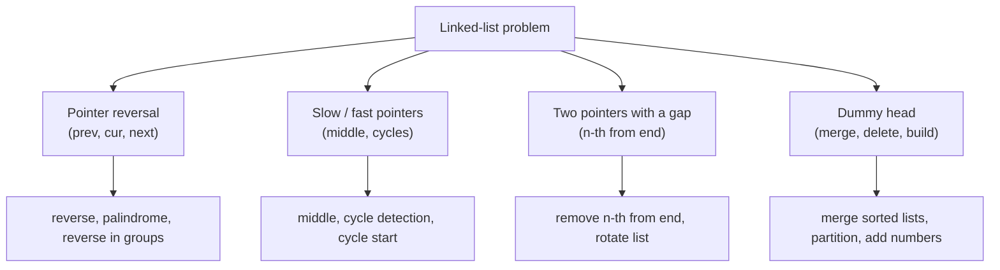
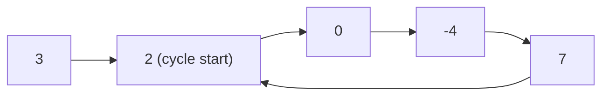

# Session 3 · Classic Linked-List Problems

Prepared by **Hamna Zahid Khan**, Junior Lecturer

[🏠 Course home](../README.md) · [📘 Module overview](./README.md) · [⬅ Previous](./session-02-doubly-and-circular-lists.md) · [Practice test ➡](./practice-test.md)

> **Module 05 · Linked Lists** · ⏱ 3 hours (90 min lecture + 90 min lab)

## 🎯 Learning objectives

1. Reverse a list iteratively and recursively and explain the recursive "hook-back" step.
2. Use **slow/fast pointers** to find the middle and detect cycles (Floyd's algorithm).
3. Prove why Floyd's method finds the **start** of a cycle.
4. Use a **dummy head** to merge lists and delete nodes without special cases.
5. Solve palindrome, n-th-from-end and intersection problems in O(n) time and O(1) space.

---

## 1. The toolkit

Almost every linked-list interview question is solved with one of four techniques.



We use a minimal node type, exactly as in interviews:

```java
static final class ListNode { int val; ListNode next; }
```

## 2. Reversal, iteratively and recursively

The iterative version flips one arrow per step (Session 1). The recursive version trusts that `reverseRec(head.next)` reverses the rest and returns its new head; the current node is then **hooked** at the end:

```java
ListNode newHead = reverseRec(head.next);
head.next.next = head;   // my old successor now points back to me
head.next = null;        // I am the new tail (for now)
```

**Trace for 1 → 2 → 3**

| Call | After the recursive call returns | Hook-back | Returns |
|---|---|---|---|
| rev(3) | base case | – | 3 |
| rev(2) | 3 (rest reversed: 3) | 3.next = 2, 2.next = null | 3 → 2 |
| rev(1) | 3 → 2 | 2.next = 1, 1.next = null | 3 → 2 → 1 |

Iterative: O(1) space. Recursive: O(n) stack space (deep lists can overflow).

## 3. Slow and fast pointers

> 🏃 **Analogy: two runners on a track.** One runs twice as fast. On a straight road, when the fast one reaches the finish the slow one is exactly halfway (middle of the list). On a circular track, the fast runner eventually laps the slow one (cycle detection).

### 3.1 Middle node

Move `slow` one step and `fast` two steps while `fast` and `fast.next` exist. For 1..5, slow stops at 3; for 1..6 at 4 (second middle).

### 3.2 Floyd's cycle detection

If there is no cycle, `fast` hits `null`. If there is one, `fast` gains one node per step on `slow` inside the loop, so they **must** meet.



**Why resetting one pointer finds the start.** Let a = distance from head to the cycle start, c = cycle length, and suppose they meet b steps into the cycle. Slow travelled a + b, fast 2(a + b), and the difference is a whole number of laps: a + b = m·c. Hence a = m·c − b: walking a steps from the meeting point lands exactly on the cycle start. So move one pointer back to the head and advance both one step at a time; they meet at the start.

**Trace on the list above** (a = 1, c = 4)

| Step | slow | fast |
|---|---|---|
| 0 | 3 | 3 |
| 1 | 2 | 0 |
| 2 | 0 | 7 |
| 3 | -4 | 0 |
| 4 | 7 | 7 ← meet |
| reset | p = 3, slow = 7 | |
| 1 | p = 2, slow = 2 | ← cycle start ✅ |

## 4. Dummy head and gap pointers

**Dummy head.** Creating `dummy` before the real head means "the node before the first node" always exists, so merging, deleting the head, or building a new list never needs a special case. Return `dummy.next`.

**Merge two sorted lists** (relinking, no new nodes):

| a | b | take | merged so far |
|---|---|---|---|
| 1 | 2 | 1 | 1 |
| 4 | 2 | 2 | 1 2 |
| 4 | 3 | 3 | 1 2 3 |
| 4 | 10 | 4 | 1 2 3 4 |
| 9 | 10 | 9 | 1 2 3 4 9 |
| 12 | 10 | 10 | … 10 |
| 12 | null | append rest | 1 2 3 4 9 10 12 |

**Remove the n-th node from the end in one pass.** Advance `lead` n + 1 steps from the dummy, then move `lead` and `lag` together; when `lead` falls off the end, `lag` is just before the target.

## 5. Complexity table

| Problem | Technique | Time | Space |
|---|---|---|---|
| Reverse (iterative / recursive) | pointer reversal | O(n) | O(1) / O(n) |
| Middle node | slow/fast | O(n) | O(1) |
| Detect cycle and its start | Floyd | O(n) | O(1) |
| Merge two sorted lists | dummy head | O(n + m) | O(1) |
| Remove n-th from end | gap pointers + dummy | O(n) | O(1) |
| Palindrome | middle + reverse half + restore | O(n) | O(1) |
| Intersection of two lists | switch heads | O(n + m) | O(1) |

(With a `HashSet` of visited nodes, cycle detection and intersection are easy in O(n) **space**; the techniques above achieve O(1).)

---

## 6. Complete program

📄 **[`src/LinkedListProblems.java`](src/LinkedListProblems.java)**

```java
/**
 * Module 05 · Session 03 — Classic linked-list problems.
 *
 * Works on a minimal ListNode (int value + next) like most interview questions:
 * iterative and recursive reversal, middle node (slow/fast pointers), Floyd's
 * cycle detection and cycle start, merging two sorted lists with a dummy head,
 * removing the n-th node from the end, palindrome check and the intersection
 * point of two lists.
 *
 * Compile:  javac -d out LinkedListProblems.java
 * Run:      java -cp out LinkedListProblems
 *
 * Prepared by Hamna Zahid Khan, Junior Lecturer
 */
public class LinkedListProblems {

    static final class ListNode {
        int val;
        ListNode next;
        ListNode(int val) { this.val = val; }
    }

    static ListNode build(int... values) {
        ListNode dummy = new ListNode(0), t = dummy;
        for (int v : values) { t.next = new ListNode(v); t = t.next; }
        return dummy.next;
    }

    static String show(ListNode h) {
        StringBuilder sb = new StringBuilder();
        for (int guard = 0; h != null && guard < 50; h = h.next, guard++) sb.append(h.val).append(" -> ");
        return sb.append("null").toString();
    }

    /** Iterative reversal: O(n) time, O(1) space. */
    static ListNode reverse(ListNode head) {
        ListNode prev = null;
        while (head != null) {
            ListNode next = head.next;
            head.next = prev;
            prev = head;
            head = next;
        }
        return prev;
    }

    /** Recursive reversal: reverse the rest, then hook the current node at its end. O(n) stack. */
    static ListNode reverseRec(ListNode head) {
        if (head == null || head.next == null) return head;
        ListNode newHead = reverseRec(head.next);
        head.next.next = head;   // the node after me now points back to me
        head.next = null;
        return newHead;
    }

    /** Middle node: fast moves 2 steps, slow 1. For even length returns the second middle. */
    static ListNode middle(ListNode head) {
        ListNode slow = head, fast = head;
        while (fast != null && fast.next != null) {
            slow = slow.next;
            fast = fast.next.next;
        }
        return slow;
    }

    /** Floyd's tortoise and hare: returns the node where the cycle starts, or null. */
    static ListNode cycleStart(ListNode head) {
        ListNode slow = head, fast = head;
        while (fast != null && fast.next != null) {
            slow = slow.next;
            fast = fast.next.next;
            if (slow == fast) {                   // they met inside the cycle
                ListNode p = head;
                while (p != slow) { p = p.next; slow = slow.next; }   // equal distance to the start
                return p;
            }
        }
        return null;
    }

    /** Merge two sorted lists by relinking nodes (no new nodes). O(n + m). */
    static ListNode mergeSorted(ListNode a, ListNode b) {
        ListNode dummy = new ListNode(0), tail = dummy;  // dummy head removes "first node" special cases
        while (a != null && b != null) {
            if (a.val <= b.val) { tail.next = a; a = a.next; }
            else { tail.next = b; b = b.next; }
            tail = tail.next;
        }
        tail.next = (a != null) ? a : b;
        return dummy.next;
    }

    /** Remove the n-th node from the end in ONE pass: lead pointer is n nodes ahead. */
    static ListNode removeNthFromEnd(ListNode head, int n) {
        ListNode dummy = new ListNode(0);
        dummy.next = head;
        ListNode lead = dummy, lag = dummy;
        for (int i = 0; i <= n; i++) lead = lead.next;  // gap of n nodes between lag and lead
        while (lead != null) { lead = lead.next; lag = lag.next; }
        lag.next = lag.next.next;
        return dummy.next;
    }

    /** Palindrome in O(n) time, O(1) space: reverse the second half, compare, restore. */
    static boolean isPalindrome(ListNode head) {
        ListNode mid = middle(head);
        ListNode second = reverse(mid);
        boolean ok = true;
        for (ListNode p = head, q = second; q != null; p = p.next, q = q.next)
            if (p.val != q.val) { ok = false; break; }
        reverse(second);                                 // restore the original list
        return ok;
    }

    /** Intersection of two Y-shaped lists: walk A then B, and B then A; pointers meet at the join. */
    static ListNode intersection(ListNode a, ListNode b) {
        ListNode p = a, q = b;
        while (p != q) {
            p = (p == null) ? b : p.next;
            q = (q == null) ? a : q.next;
        }
        return p;   // the join node, or null if the lists never meet
    }

    public static void main(String[] args) {
        ListNode list = build(1, 2, 3, 4, 5);
        System.out.println("list              : " + show(list));
        list = reverse(list);
        System.out.println("reverse           : " + show(list));
        list = reverseRec(list);
        System.out.println("reverseRec        : " + show(list));
        System.out.println("middle of 1..5    : " + middle(list).val + ", middle of 1..6: " + middle(build(1, 2, 3, 4, 5, 6)).val);

        ListNode cyc = build(3, 2, 0, -4, 7);
        ListNode join = cyc.next;                // node with value 2
        ListNode last = cyc;
        while (last.next != null) last = last.next;
        last.next = join;                        // 7 -> 2 creates a cycle
        System.out.println("cycle start       : " + cycleStart(cyc).val + " (expected 2)");
        System.out.println("no cycle          : " + cycleStart(build(1, 2, 3)));

        System.out.println("mergeSorted       : " + show(mergeSorted(build(1, 4, 9, 12), build(2, 3, 10))));
        System.out.println("remove 2nd from end of 10..50: " + show(removeNthFromEnd(build(10, 20, 30, 40, 50), 2)));
        ListNode pal = build(1, 2, 3, 2, 1);
        System.out.println("isPalindrome(1 2 3 2 1) = " + isPalindrome(pal) + ", list restored: " + show(pal));
        System.out.println("isPalindrome(1 2 3 4)   = " + isPalindrome(build(1, 2, 3, 4)));

        ListNode common = build(8, 9);
        ListNode a = build(1, 2, 3);
        a.next.next.next = common;
        ListNode b = build(7);
        b.next = common;
        System.out.println("A: " + show(a) + " | B: " + show(b));
        System.out.println("intersection node : " + intersection(a, b).val);
    }
}
```

**Real output:**

```text
$ java -cp out LinkedListProblems
list              : 1 -> 2 -> 3 -> 4 -> 5 -> null
reverse           : 5 -> 4 -> 3 -> 2 -> 1 -> null
reverseRec        : 1 -> 2 -> 3 -> 4 -> 5 -> null
middle of 1..5    : 3, middle of 1..6: 4
cycle start       : 2 (expected 2)
no cycle          : null
mergeSorted       : 1 -> 2 -> 3 -> 4 -> 9 -> 10 -> 12 -> null
remove 2nd from end of 10..50: 10 -> 20 -> 30 -> 50 -> null
isPalindrome(1 2 3 2 1) = true, list restored: 1 -> 2 -> 3 -> 2 -> 1 -> null
isPalindrome(1 2 3 4)   = false
A: 1 -> 2 -> 3 -> 8 -> 9 -> null | B: 7 -> 8 -> 9 -> null
intersection node : 8
```

---

## 7. Worked examples (basic → advanced)

**Example 1 (basic): palindrome.** Find the middle, reverse the second half, compare the halves node by node, then **reverse back** so the caller's list is unchanged (good manners for a "check" method).

**Example 2 (intermediate): intersection.** Lists A (length 5) and B (length 3) share the tail `8 → 9`. Pointer p walks A then B (5 + 3 steps), q walks B then A (3 + 5 steps). Both have travelled the same distance when they reach the shared node, so they meet at **8**. If there is no intersection both become `null` together.

**Example 3 (advanced): adding two numbers stored as lists.** Digits are stored least-significant first, so we add like on paper, carrying as we go. A dummy head builds the result.

```java
/** Add two numbers stored as digit lists in REVERSE order: (2->4->3) + (5->6->4) = 7->0->8 (342 + 465 = 807). */
static LinkedListProblems.ListNode addNumbers(LinkedListProblems.ListNode a, LinkedListProblems.ListNode b) {
    LinkedListProblems.ListNode dummy = node(0), t = dummy;
    int carry = 0;
    while (a != null || b != null || carry != 0) {
        int s = carry + (a != null ? a.val : 0) + (b != null ? b.val : 0);
        t.next = node(s % 10);
        t = t.next;
        carry = s / 10;
        if (a != null) a = a.next;
        if (b != null) b = b.next;
    }
    return dummy.next;
}
```
<sub>Full, compiled version: [`src/Labs05.java`](src/Labs05.java)</sub>

`2 → 4 → 3` (342) + `5 → 6 → 4` (465) = `7 → 0 → 8` (807).

## 8. Real-life problem: detecting a redirect loop

**Problem.** A web crawler follows HTTP redirects: each URL redirects to at most one other URL. A misconfigured site can create a loop (A → B → C → B …), which would trap the crawler forever. Memory per crawl must stay constant because thousands of crawls run in parallel.

**Solution.** Treat each URL as a node whose `next` is its redirect target and apply **Floyd's algorithm**: one pointer follows one redirect per step, the other two. If they meet, there is a loop; resetting one pointer to the starting URL finds the first URL inside the loop, which is what the site administrator must fix. O(1) memory instead of a `HashSet` of every visited URL.

## 9. Common mistakes

| Mistake | Fix |
|---|---|
| `while (fast.next != null)` without checking `fast` | `while (fast != null && fast.next != null)` |
| Comparing node **values** to detect cycles | compare **references** (`slow == fast`); values can repeat |
| Returning `head` instead of `dummy.next` after deleting the head | always return `dummy.next` |
| Forgetting `head.next = null` in recursive reversal | creates a 2-node cycle |
| Leaving the list modified after a palindrome check | reverse the second half back |
| Gap of n instead of n + 1 when starting from the dummy | lag must stop **before** the target |

## 10. Best practices

- Draw the list and dry-run with 0, 1, 2 and 3 nodes before submitting.
- Reach for a **dummy head** whenever the head might change.
- Prefer iterative solutions for long lists (no stack overflow).
- State space complexity explicitly; O(1) extra space is usually what interviewers want.

---

## 11. Lab tasks

**Lab 3.1: Odd-even grouping.** Rearrange `1 → 2 → 3 → 4 → 5 → 6 → 7` into `1 → 3 → 5 → 7 → 2 → 4 → 6` in place.

<details>
<summary>💡 Hint</summary>

Maintain two chains (`odd` and `even`), remember `evenHead`, and attach it after the last odd node.

</details>

<details>
<summary>✅ Solution</summary>

```java
/** Group odd-POSITION nodes before even-position nodes, O(n) time, O(1) space. */
static LinkedListProblems.ListNode oddEven(LinkedListProblems.ListNode h) {
    if (h == null) return null;
    LinkedListProblems.ListNode odd = h, even = h.next, evenHead = even;
    while (even != null && even.next != null) {
        odd.next = even.next;
        odd = odd.next;
        even.next = odd.next;
        even = even.next;
    }
    odd.next = evenHead;
    return h;
}
```
<sub>Full, compiled version: [`src/Labs05.java`](src/Labs05.java)</sub>

</details>

**Lab 3.2: Add two numbers.** Implement `addNumbers` for reverse-order digit lists.

<details>
<summary>✅ Solution</summary>

See Example 3. Test the carry case `9 → 9` + `1` = `0 → 0 → 1`.

</details>

**Lab 3.3: Cycle length.** After Floyd's pointers meet, compute the length of the cycle.

<details>
<summary>✅ Solution</summary>

Keep one pointer fixed at the meeting node and move the other until it returns, counting steps: `int len = 1; for (ListNode p = meet.next; p != meet; p = p.next) len++;`. For the example list the length is 4.

</details>

**Real output of the Session 3 lab solutions:**

```text
$ java -cp out Labs05 3
-- Session 3 labs --
342 + 465 as lists = 7 -> 0 -> 8 -> null
oddEven(1..7) = 1 -> 3 -> 5 -> 7 -> 2 -> 4 -> 6 -> null
```

---

## 12. Quiz

**Q1.** Floyd's algorithm detects a cycle when:

- **A.** fast becomes null
- **B.** slow and fast reference the same node
- **C.** slow.val == fast.val
- **D.** the list length is even

**Q2.** For the list 10 → 20 → 30 → 40, the slow/fast middle function returns:

- **A.** 20
- **B.** 30
- **C.** 40
- **D.** 10

**Q3.** What is the main purpose of a dummy head node?

- **A.** Faster traversal
- **B.** Avoid special cases when the real head changes
- **C.** Store the list length
- **D.** Detect cycles

**Q4.** Space complexity of recursive list reversal:

- **A.** O(1)
- **B.** O(log n)
- **C.** O(n)
- **D.** O(n²)

**Q5.** To remove the 3rd node from the end in one pass (starting both pointers at a dummy), lead first moves:

- **A.** 2 steps
- **B.** 3 steps
- **C.** 4 steps
- **D.** n steps

<details>
<summary><b>Show answers</b></summary>

1. **B**: Meeting inside the loop proves a cycle exists.
2. **B**: For even length it returns the second middle.
3. **B**: The node before the first node always exists.
4. **C**: One stack frame per node.
5. **C**: n + 1 steps so lag stops just before the target.

</details>

---

## 13. Summary

- Four techniques cover most problems: **pointer reversal**, **slow/fast**, **gap pointers**, **dummy head**.
- Floyd's algorithm finds cycles and their start in O(n) time and O(1) space; the proof is a + b = m·c.
- Always handle the empty, single-node and head-changing cases.

## 14. Viva / interview questions

1. Prove that the fast and slow pointers must meet if a cycle exists.
2. Why does resetting one pointer to the head find the cycle's start?
3. Reverse a linked list in groups of k. What is the complexity?
4. Merge k sorted linked lists efficiently (hint: Module 11).
5. How do you find the intersection of two lists if one may have a cycle?
6. Sort a linked list in O(n log n) time (hint: merge sort with the middle-finding trick).

---

[⬅ Previous](./session-02-doubly-and-circular-lists.md) · [📘 Module overview](./README.md) · [Practice test ➡](./practice-test.md)
