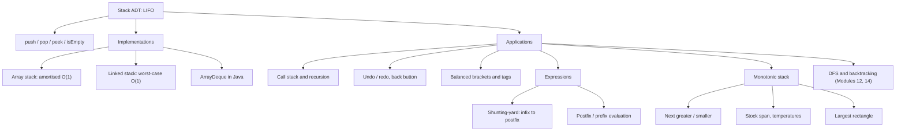

# Module 06 · Stacks

Prepared by **Hamna Zahid Khan**, Junior Lecturer

[🏠 Course home](../README.md)

> ⏱ 9 contact hours · 3 sessions · 🟡 Core

The stack is the simplest restricted data structure (only the top is accessible) and one of the most useful. It powers method calls, undo, parsing and expression evaluation, and the monotonic-stack technique turns a whole family of O(n²) problems into O(n).

## 🎯 Module objectives

- Define the stack ADT and implement it with arrays and linked nodes.
- Apply stacks to bracket matching, notation conversion and expression evaluation.
- Use monotonic stacks for next-greater, span and histogram problems.
- Choose `ArrayDeque` in production Java code.

## 📚 Sessions

| # | Session | Key ideas | Code |
|---|---|---|---|
| 1 | [The Stack ADT and Its Implementations](session-01-stack-adt-and-implementations.md) | LIFO, array vs linked stack, undo, back button | [`StackImplementations.java`](src/StackImplementations.java) |
| 2 | [Brackets and Expressions](session-02-expression-evaluation.md) | balanced brackets, infix/prefix/postfix, shunting-yard | [`ExpressionEvaluation.java`](src/ExpressionEvaluation.java) |
| 3 | [Monotonic Stacks](session-03-monotonic-stack.md) | next greater, stock span, histogram, min-stack | [`MonotonicStack.java`](src/MonotonicStack.java) |
| ✍️ | [Practice test](practice-test.md) | 20 MCQs + 3 coding scenarios | [`Labs06.java`](src/Labs06.java), [`SelfCheck.java`](src/SelfCheck.java) |

## 🗺️ Concept map



## 📄 One-page cheat sheet

| Implementation | push | pop | peek | Notes |
|---|---|---|---|---|
| Array (top at end) | O(1)* | O(1)* | O(1) | double when full, halve at ¼ |
| Linked (top at head) | O(1) | O(1) | O(1) | extra node memory |
| `ArrayDeque` | O(1)* | O(1) | O(1) | use `push/pop/peek` |

**Shunting-yard rules:** number → output · `(` → push · `)` → pop to output until `(` · operator o → pop while top has higher precedence (or equal and o is left-assoc) → push o · end → pop all.

**Postfix evaluation:** number → push · operator → `b = pop(); a = pop(); push(a op b)`.

| Precedence | Operators | Associativity |
|---|---|---|
| 3 | `^` | right |
| 2 | `* / %` | left |
| 1 | `+ -` | left |

**Monotonic stack template**

```java
Deque<Integer> st = new ArrayDeque<>();          // indices
for (int i = 0; i < n; i++) {
    while (!st.isEmpty() && a[st.peek()] < a[i])  // breaks the decreasing order
        answer[st.pop()] = a[i];                  // a[i] is the next greater
    st.push(i);
}
```

## ▶️ Run the code

```bash
cd 06-stacks/src
javac -d out *.java
java -ea -cp out SelfCheck
java -cp out ExpressionEvaluation
```

See [`src/README.md`](src/README.md) for every file.
