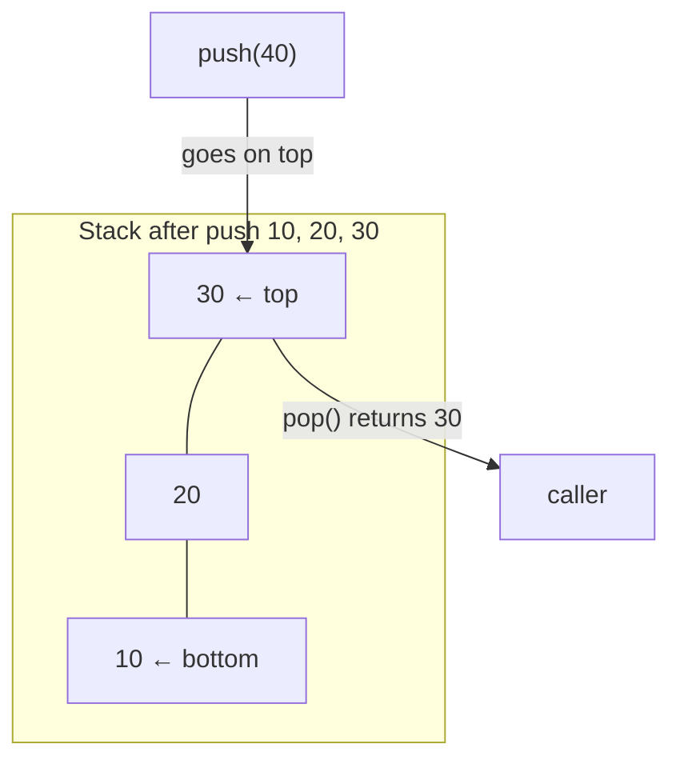
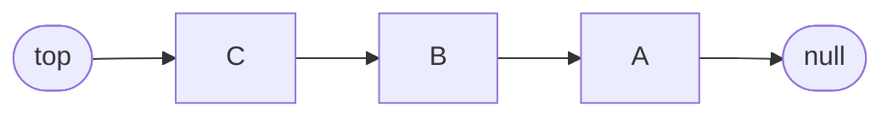

# Session 1 · The Stack ADT and Its Implementations

Prepared by **Hamna Zahid Khan**, Junior Lecturer

[🏠 Course home](../README.md) · [📘 Module overview](./README.md) · [⬅ Module overview](./README.md) · [Next ➡](./session-02-expression-evaluation.md)

> **Module 06 · Stacks** · ⏱ 3 hours (90 min lecture + 90 min lab)

## 🎯 Learning objectives

1. Define an **abstract data type (ADT)** and the stack's **LIFO** contract.
2. Implement a stack with a **resizable array** and with a **linked list**, behind one interface.
3. Analyse both implementations (worst-case vs amortised O(1), memory).
4. Recognise stack behaviour in real systems: call stack, undo, back button.
5. Use `ArrayDeque` as Java's recommended stack.

---

## 1. ADT vs data structure

An **abstract data type** says *what* operations exist and how they behave; a **data structure** says *how* they are implemented. The stack ADT is:

| Operation | Behaviour |
|---|---|
| `push(x)` | put x on top |
| `pop()` | remove and return the top (error if empty: **underflow**) |
| `peek()` / `top()` | return the top without removing it |
| `isEmpty()`, `size()` | queries |

**LIFO: Last In, First Out.** The element pushed most recently is the first one popped.

> 🍽️ **Analogy: a stack of plates in a canteen.** You add clean plates on top and always take the top plate. The plate at the bottom was put there first and will be used last.



## 2. Implementation 1: array-based

Keep elements in `data[0..size-1]`; the **top is `data[size-1]`**, so push and pop touch only the end: no shifting.

| Operation | Code | Time |
|---|---|---|
| push | `if full resize(2·cap); data[size++] = x` | O(1) amortised, O(n) on resize |
| pop | `x = data[--size]; data[size] = null; maybe shrink at ¼` | O(1) amortised |
| peek | `data[size-1]` | O(1) |

**Trace (initial capacity 2):**

| Operation | Contents (bottom → top) | size | capacity |
|---|---|---|---|
| push 10 | 10 | 1 | 2 |
| push 20 | 10 20 | 2 | 2 |
| push 30 | 10 20 30 | 3 | **4** (resized) |
| push 40 | 10 20 30 40 | 4 | 4 |
| push 50 | 10 20 30 40 50 | 5 | **8** |
| pop → 50 | 10 20 30 40 | 4 | 8 |
| pop → 30 | 10 20 | 2 | **4** (shrunk at ¼) |

Why put the top at the **end** of the array? Putting it at index 0 would make every push and pop shift all elements: O(n).

## 3. Implementation 2: linked

The top is the **head** of a singly linked list. `push` = `addFirst`, `pop` = `removeFirst`: both are **worst-case** O(1), with no resizing.



Why not use the tail as the top? Removing the tail of a singly linked list is O(n).

## 4. Comparing the implementations

| | `ArrayStack` | `LinkedStack` |
|---|---|---|
| push / pop | O(1) amortised (occasional O(n) resize) | O(1) worst case |
| Memory per element | 1 reference (+ up to 4× slack) | node object: value + next + header (~3–4×) |
| Cache behaviour | excellent (contiguous) | poor (scattered nodes) |
| Max size | grows until memory is exhausted | same |
| Best for | general use, speed | real-time systems needing guaranteed O(1) |

In Java, use **`ArrayDeque<T>`** as a stack (`push`, `pop`, `peek`). The legacy `java.util.Stack` extends `Vector` (synchronised, slower, and exposes index access that breaks the ADT).

## 5. Where stacks appear

| System | What is stacked |
|---|---|
| JVM call stack | one frame per method call (Module 01, recursion) |
| Undo / redo | previous document states or edit commands |
| Browser back | previously visited pages |
| Compilers | bracket matching, expression parsing (Session 2) |
| DFS graph traversal | vertices still to explore (Module 12) |
| Backtracking | partial solutions (Module 14) |

---

## 6. Complete program

📄 **[`src/StackImplementations.java`](src/StackImplementations.java)**

```java
import java.util.ArrayDeque;
import java.util.Deque;
import java.util.EmptyStackException;

/**
 * Module 06 · Session 01 — The stack ADT with array and linked implementations.
 *
 * Defines a small Stack<T> interface (push, pop, peek, isEmpty, size) and two
 * implementations: ArrayStack (resizable array, amortised O(1)) and LinkedStack
 * (singly linked nodes, worst-case O(1)). The demo also simulates browser
 * "Back", an undo history, and shows Java's recommended ArrayDeque.
 *
 * Compile:  javac -d out StackImplementations.java
 * Run:      java -cp out StackImplementations
 *
 * Prepared by Hamna Zahid Khan, Junior Lecturer
 */
public class StackImplementations {

    /** The stack abstract data type: Last In, First Out. */
    interface Stack<T> {
        void push(T x);
        T pop();          // removes and returns the top; throws if empty
        T peek();         // returns the top without removing it
        boolean isEmpty();
        int size();
    }

    /** Array-based stack: top is at index size-1; doubles when full, halves at 1/4. */
    static final class ArrayStack<T> implements Stack<T> {
        private Object[] data = new Object[2];
        private int size;

        @Override public void push(T x) {
            if (size == data.length) resize(2 * data.length);
            data[size++] = x;
        }

        @Override @SuppressWarnings("unchecked")
        public T pop() {
            if (size == 0) throw new EmptyStackException();
            T x = (T) data[--size];
            data[size] = null;                         // avoid loitering
            if (size > 0 && size == data.length / 4) resize(data.length / 2);
            return x;
        }

        @Override @SuppressWarnings("unchecked")
        public T peek() {
            if (size == 0) throw new EmptyStackException();
            return (T) data[size - 1];
        }

        @Override public boolean isEmpty() { return size == 0; }
        @Override public int size() { return size; }
        int capacity() { return data.length; }

        private void resize(int cap) {
            Object[] d = new Object[cap];
            System.arraycopy(data, 0, d, 0, size);
            data = d;
        }

        @Override public String toString() {
            StringBuilder sb = new StringBuilder("[bottom");
            for (int i = 0; i < size; i++) sb.append(' ').append(data[i]);
            return sb.append(" <- top]").toString();
        }
    }

    /** Linked stack: top is the head of a singly linked list. Every operation is worst-case O(1). */
    static final class LinkedStack<T> implements Stack<T> {
        private static final class Node<T> {
            final T value;
            final Node<T> next;
            Node(T value, Node<T> next) { this.value = value; this.next = next; }
        }

        private Node<T> top;
        private int size;

        @Override public void push(T x) { top = new Node<>(x, top); size++; }

        @Override public T pop() {
            if (top == null) throw new EmptyStackException();
            T x = top.value;
            top = top.next;
            size--;
            return x;
        }

        @Override public T peek() {
            if (top == null) throw new EmptyStackException();
            return top.value;
        }

        @Override public boolean isEmpty() { return top == null; }
        @Override public int size() { return size; }

        @Override public String toString() {
            StringBuilder sb = new StringBuilder("[top ->");
            for (Node<T> n = top; n != null; n = n.next) sb.append(' ').append(n.value);
            return sb.append("]").toString();
        }
    }

    /** Reverses a string using any Stack implementation. */
    static String reverse(String s, Stack<Character> st) {
        for (char c : s.toCharArray()) st.push(c);
        StringBuilder sb = new StringBuilder();
        while (!st.isEmpty()) sb.append(st.pop());
        return sb.toString();
    }

    public static void main(String[] args) {
        System.out.println("=== ArrayStack ===");
        ArrayStack<Integer> a = new ArrayStack<>();
        for (int i = 1; i <= 5; i++) {
            a.push(i * 10);
            System.out.println("push " + (i * 10) + " -> " + a + "  capacity " + a.capacity());
        }
        System.out.println("peek = " + a.peek());
        while (a.size() > 1) System.out.println("pop  " + a.pop() + " -> " + a + "  capacity " + a.capacity());

        System.out.println("\n=== LinkedStack ===");
        LinkedStack<String> l = new LinkedStack<>();
        l.push("A"); l.push("B"); l.push("C");
        System.out.println(l + " size " + l.size() + ", pop -> " + l.pop() + ", now " + l);

        System.out.println("\nreverse(\"stack\") with ArrayStack  = " + reverse("stack", new ArrayStack<>()));
        System.out.println("reverse(\"LIFO!\") with LinkedStack = " + reverse("LIFO!", new LinkedStack<>()));

        System.out.println("\n=== Browser back button ===");
        LinkedStack<String> back = new LinkedStack<>();
        String current = "home";
        for (String page : new String[]{"courses", "dsa", "stacks"}) {
            back.push(current);
            current = page;
            System.out.println("visit " + page + "   back stack " + back);
        }
        for (int i = 0; i < 2; i++) {
            current = back.pop();
            System.out.println("Back -> now on " + current + "   back stack " + back);
        }

        System.out.println("\n=== Undo in a text box ===");
        ArrayStack<String> undo = new ArrayStack<>();
        StringBuilder text = new StringBuilder();
        for (String w : new String[]{"Data ", "Structures ", "in ", "Java"}) {
            undo.push(text.toString());
            text.append(w);
            System.out.println("type \"" + w.trim() + "\" -> \"" + text + "\"");
        }
        text = new StringBuilder(undo.pop());
        System.out.println("undo -> \"" + text + "\"");
        text = new StringBuilder(undo.pop());
        System.out.println("undo -> \"" + text + "\"");

        System.out.println("\n=== Java's recommended stack: ArrayDeque ===");
        Deque<Integer> dq = new ArrayDeque<>();
        dq.push(1); dq.push(2); dq.push(3);
        System.out.println("ArrayDeque " + dq + " pop -> " + dq.pop() + " peek -> " + dq.peek());
        try {
            new ArrayStack<Integer>().pop();
        } catch (EmptyStackException e) {
            System.out.println("pop on empty stack -> EmptyStackException (stack underflow)");
        }
    }
}
```

**Real output:**

```text
$ java -cp out StackImplementations
=== ArrayStack ===
push 10 -> [bottom 10 <- top]  capacity 2
push 20 -> [bottom 10 20 <- top]  capacity 2
push 30 -> [bottom 10 20 30 <- top]  capacity 4
push 40 -> [bottom 10 20 30 40 <- top]  capacity 4
push 50 -> [bottom 10 20 30 40 50 <- top]  capacity 8
peek = 50
pop  50 -> [bottom 10 20 30 40 <- top]  capacity 8
pop  40 -> [bottom 10 20 30 <- top]  capacity 8
pop  30 -> [bottom 10 20 <- top]  capacity 4
pop  20 -> [bottom 10 <- top]  capacity 2

=== LinkedStack ===
[top -> C B A] size 3, pop -> C, now [top -> B A]

reverse("stack") with ArrayStack  = kcats
reverse("LIFO!") with LinkedStack = !OFIL

=== Browser back button ===
visit courses   back stack [top -> home]
visit dsa   back stack [top -> courses home]
visit stacks   back stack [top -> dsa courses home]
Back -> now on dsa   back stack [top -> courses home]
Back -> now on courses   back stack [top -> home]

=== Undo in a text box ===
type "Data" -> "Data "
type "Structures" -> "Data Structures "
type "in" -> "Data Structures in "
type "Java" -> "Data Structures in Java"
undo -> "Data Structures in "
undo -> "Data Structures "

=== Java's recommended stack: ArrayDeque ===
ArrayDeque [3, 2, 1] pop -> 3 peek -> 2
pop on empty stack -> EmptyStackException (stack underflow)
```

---

## 7. Worked examples (basic → advanced)

**Example 1 (basic): reverse a string.** Push every character, then pop them all: the first character comes out last.

**Example 2 (intermediate): decimal to binary.** Repeated division by 2 produces the bits from least to most significant; a stack reverses them.

```java
/** Repeated division by 2 produces bits in reverse; a stack puts them back in order. */
static String toBinary(int n) {
    if (n == 0) return "0";
    Deque<Integer> st = new ArrayDeque<>();
    while (n > 0) { st.push(n % 2); n /= 2; }
    StringBuilder sb = new StringBuilder();
    while (!st.isEmpty()) sb.append(st.pop());
    return sb.toString();
}
```
<sub>Full, compiled version: [`src/Labs06.java`](src/Labs06.java)</sub>

| n | n % 2 pushed | n / 2 |
|---|---|---|
| 37 | 1 | 18 |
| 18 | 0 | 9 |
| 9 | 1 | 4 |
| 4 | 0 | 2 |
| 2 | 0 | 1 |
| 1 | 1 | 0 |

Pop order: 1 0 0 1 0 1 ⇒ `100101`.

**Example 3 (advanced): a queue from two stacks.** Push into `in`; when `out` is empty, pour everything from `in` to `out` (reversing it), then pop from `out`. Each element moves at most twice, so every operation is amortised O(1).

```java
/** A queue built from two stacks: amortised O(1) per operation. */
static final class QueueFromStacks<T> {
    private final Deque<T> in = new ArrayDeque<>(), out = new ArrayDeque<>();
    void enqueue(T x) { in.push(x); }
    T dequeue() {
        if (out.isEmpty()) while (!in.isEmpty()) out.push(in.pop());   // reverse once
        return out.pop();
    }
    boolean isEmpty() { return in.isEmpty() && out.isEmpty(); }
}
```
<sub>Full, compiled version: [`src/Labs06.java`](src/Labs06.java)</sub>

## 8. Real-life problem: undo in an editor

**Problem.** A note-taking app must support unlimited **undo** and **redo**. Typing a new word after undoing must discard the redo history (as in every real editor).

**Solution.** Two stacks of document states (or of edit commands):

| User action | undo stack | redo stack |
|---|---|---|
| type | push previous state | **clear** |
| undo | pop → current state; push current onto redo | push |
| redo | push current onto undo | pop → current state |

The program's "Undo in a text box" section shows the undo half. Storing **commands** (e.g. "insert 'Java' at 19") instead of full states saves memory for large documents.

## 9. Common mistakes

| Mistake | Fix |
|---|---|
| Popping/peeking an empty stack | check `isEmpty()` or catch `EmptyStackException` |
| Top at index 0 of an array | top at `size-1` so nothing shifts |
| Top at the tail of a singly linked list | top at the head |
| Forgetting `data[size] = null` after pop | prevents memory leaks |
| Using `java.util.Stack` in new code | `Deque<T> st = new ArrayDeque<>()` |
| Iterating an `ArrayDeque` expecting bottom-to-top order | it iterates top-to-bottom |

## 10. Best practices

- Program to the **interface** (`Stack<T>` / `Deque<T>`), not the implementation.
- Throw a clear exception on underflow; never return a "magic" value like −1 for generic stacks.
- Prefer iterative algorithms with an explicit stack when recursion might be too deep.

---

## 11. Lab tasks

**Lab 1.1: Decimal to binary** with a stack.

<details>
<summary>✅ Solution</summary>

See Example 2.

</details>

**Lab 1.2: Queue from two stacks.** Implement `enqueue` and `dequeue` and argue the amortised cost.

<details>
<summary>💡 Hint</summary>

Only move elements from `in` to `out` when `out` is empty.

</details>

<details>
<summary>✅ Solution</summary>

See Example 3. Each element is pushed and popped at most twice ⇒ amortised O(1).

</details>

**Lab 1.3: Simplify a Unix path.** `"/home/./hamna/../dsa//stacks/"` → `"/home/dsa/stacks"`.

<details>
<summary>💡 Hint</summary>

Split by `/`. Skip empty parts and `.`; `..` pops a directory; anything else is pushed.

</details>

<details>
<summary>✅ Solution</summary>

```java
/** Simplify a Unix path: "/a/./b/../../c/" -> "/c". '..' pops a directory. */
static String simplifyPath(String path) {
    Deque<String> st = new ArrayDeque<>();
    for (String part : path.split("/")) {
        if (part.isEmpty() || part.equals(".")) continue;
        if (part.equals("..")) { if (!st.isEmpty()) st.pop(); }
        else st.push(part);
    }
    StringBuilder sb = new StringBuilder();
    while (!st.isEmpty()) sb.append('/').append(st.pollLast());     // bottom of the stack first
    return sb.length() == 0 ? "/" : sb.toString();
}
```
<sub>Full, compiled version: [`src/Labs06.java`](src/Labs06.java)</sub>

</details>

**Real output of the Session 1 lab solutions:**

```text
$ java -cp out Labs06 1
-- Session 1 labs --
toBinary(37) = 100101, toBinary(0) = 0
queue from two stacks: a b c d
simplifyPath("/home/./hamna/../dsa//stacks/") = /home/dsa/stacks
```

---

## 12. Quiz

**Q1.** Push 1, 2, 3, pop, push 4, pop, pop. What is popped last?

- **A.** 1
- **B.** 2
- **C.** 3
- **D.** 4

**Q2.** In an array stack, the top should be stored at:

- **A.** index 0
- **B.** index size − 1
- **C.** the middle
- **D.** a random index

**Q3.** Worst-case time of push in a resizable array stack:

- **A.** O(1)
- **B.** O(log n)
- **C.** O(n)
- **D.** O(n²)

**Q4.** Which Java class is recommended for a stack in new code?

- **A.** java.util.Stack
- **B.** java.util.Vector
- **C.** java.util.ArrayDeque
- **D.** java.util.TreeSet

**Q5.** Popping from an empty stack is called:

- **A.** overflow
- **B.** underflow
- **C.** wrap-around
- **D.** collision

<details>
<summary><b>Show answers</b></summary>

1. **B**: Pops return 3, then 4, then 2.
2. **B**: No shifting is needed at the end of the array.
3. **C**: A resize copies all elements, though the amortised cost is O(1).
4. **C**: ArrayDeque is fast and unsynchronised.
5. **B**: There is nothing to remove.

</details>

---

## 13. Summary

- A stack is a **LIFO** ADT: push, pop, peek, isEmpty, size.
- Array implementation: top at the end, amortised O(1), compact and fast.
- Linked implementation: top at the head, worst-case O(1), more memory.
- Stacks model anything "most recent first": calls, undo, back navigation, nested structures.

## 14. Viva / interview questions

1. Distinguish an ADT from a data structure with the stack as an example.
2. Why is `java.util.Stack` discouraged?
3. Implement a stack using a queue (or two). What are the costs?
4. How does the JVM call stack relate to the stack ADT?
5. When would you choose a linked stack over an array stack?
6. Design a stack that supports `getMin()` in O(1) (preview: Session 3).

---

[⬅ Module overview](./README.md) · [📘 Module overview](./README.md) · [Next ➡](./session-02-expression-evaluation.md)
