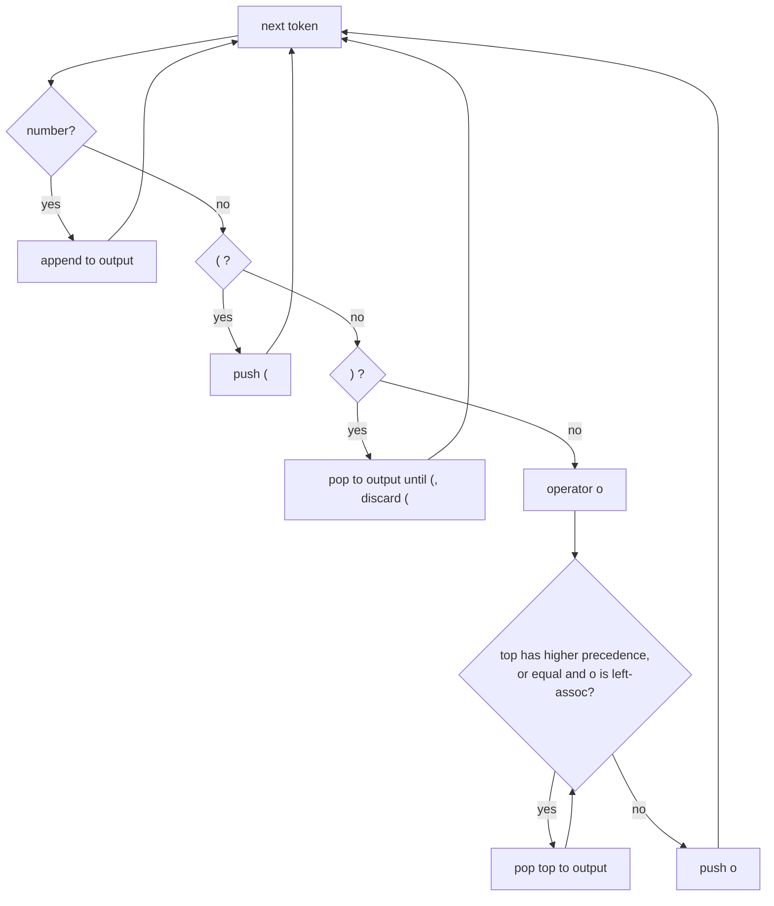

# Session 2 · Stack Applications: Brackets and Expressions

Prepared by **Hamna Zahid Khan**, Junior Lecturer

[🏠 Course home](../README.md) · [📘 Module overview](./README.md) · [⬅ Previous](./session-01-stack-adt-and-implementations.md) · [Next ➡](./session-03-monotonic-stack.md)

> **Module 06 · Stacks** · ⏱ 3 hours (90 min lecture + 90 min lab)

## 🎯 Learning objectives

1. Check balanced brackets with a stack and explain why a counter is not enough.
2. Explain **infix**, **prefix** and **postfix** notation and why computers prefer postfix.
3. Convert infix to postfix with the **shunting-yard algorithm**, respecting precedence and associativity.
4. Evaluate postfix and prefix expressions with an operand stack.
5. Build a small calculator from these pieces.

---

## 1. Balanced brackets

Every closing bracket must match the **most recent unmatched** opening bracket: "most recent first" is exactly LIFO.

> 🪆 **Analogy: nested boxes.** You must close the innermost box before the one that contains it.

**Algorithm:** push openers; on a closer, the stack must be non-empty and its top must be the matching opener; at the end the stack must be empty.

**Trace: `{[()()]}`**

| Char | Action | Stack (bottom → top) |
|---|---|---|
| { | push | { |
| [ | push | { [ |
| ( | push | { [ ( |
| ) | pop ( ✅ | { [ |
| ( | push | { [ ( |
| ) | pop ( ✅ | { [ |
| ] | pop [ ✅ | { |
| } | pop { ✅ | (empty) ⇒ **balanced** |

A simple counter would accept `([)]` (counts balance) but the stack rejects it: at `)` the top is `[`.

## 2. Three notations

| Notation | Example for (12 + 3) × 4 | Operator position | Needs brackets? |
|---|---|---|---|
| Infix | `(12 + 3) * 4` | between operands | yes |
| Prefix (Polish) | `* + 12 3 4` | before operands | no |
| Postfix (Reverse Polish) | `12 3 + 4 *` | after operands | no |

Postfix is unambiguous and evaluates left-to-right with one stack, which is why compilers translate infix into postfix-like code (e.g. JVM bytecode is stack-based: `iload a; iload b; iadd`).

**Precedence and associativity used here**

| Operator | Precedence | Associativity |
|---|---|---|
| `^` | 3 | right (2^3^2 = 2^(3^2) = 512) |
| `* / %` | 2 | left |
| `+ -` | 1 | left (100−20−30 = (100−20)−30 = 50) |

## 3. Shunting-yard: infix → postfix

> 🚉 **Analogy: a railway shunting yard (Dijkstra's name).** Numbers (carriages) go straight to the output track. Operators wait on a side track (the stack) until a lower-priority operator arrives and pushes them out.



At the end, pop all remaining operators to the output.

**Hand trace: `(12 + 3) * 4 - 10 / 2`**

| Token | Action | Stack (top first) | Output |
|---|---|---|---|
| ( | push | ( | |
| 12 | output | ( | 12 |
| + | push | + ( | 12 |
| 3 | output | + ( | 12 3 |
| ) | pop until ( | | 12 3 + |
| * | push | * | 12 3 + |
| 4 | output | * | 12 3 + 4 |
| − | pop * (higher), push − | − | 12 3 + 4 * |
| 10 | output | − | 12 3 + 4 * 10 |
| / | push (higher than −) | / − | … 10 |
| 2 | output | / − | … 10 2 |
| end | pop all | | 12 3 + 4 * 10 2 / − |

## 4. Evaluating postfix

Scan left to right: push numbers; on an operator pop **b** (right operand) then **a** (left operand), push `a op b`. The final single value is the answer.

| Token | Stack after (top first) |
|---|---|
| 12 | 12 |
| 3 | 3 12 |
| + | 15 |
| 4 | 4 15 |
| * | 60 |
| 10 | 10 60 |
| 2 | 2 10 60 |
| / | 5 60 (10 / 2) |
| − | 55 (60 − 5) |

**Prefix** is evaluated the same way scanning **right to left**, popping the left operand first.

## 5. Complexity

| Algorithm | Time | Space |
|---|---|---|
| Balanced brackets | O(n) | O(n) worst case (all openers) |
| Tokenising | O(n) | O(n) |
| Shunting-yard | O(n): each operator pushed and popped once | O(n) |
| Postfix / prefix evaluation | O(n) | O(n) |
| Full calculator | O(n) | O(n) |

---

## 6. Complete program

📄 **[`src/ExpressionEvaluation.java`](src/ExpressionEvaluation.java)**

```java
import java.util.ArrayDeque;
import java.util.ArrayList;
import java.util.Deque;
import java.util.List;

/**
 * Module 06 · Session 02 — Stack applications: brackets and expressions.
 *
 * Balanced-bracket checking, infix to postfix conversion with Dijkstra's
 * shunting-yard algorithm (printed step by step), postfix evaluation, prefix
 * evaluation, and a full infix calculator built from the two.
 *
 * Compile:  javac -d out ExpressionEvaluation.java
 * Run:      java -cp out ExpressionEvaluation
 *
 * Prepared by Hamna Zahid Khan, Junior Lecturer
 */
public class ExpressionEvaluation {

    /** Every closing bracket must match the most recent unmatched opening bracket. */
    static boolean isBalanced(String s) {
        Deque<Character> st = new ArrayDeque<>();
        for (char c : s.toCharArray()) {
            if (c == '(' || c == '[' || c == '{') st.push(c);
            else if (c == ')' || c == ']' || c == '}') {
                if (st.isEmpty()) return false;                 // closer with no opener
                char open = st.pop();
                if ((c == ')' && open != '(') || (c == ']' && open != '[') || (c == '}' && open != '{'))
                    return false;                               // wrong type
            }
        }
        return st.isEmpty();                                    // leftover openers are unmatched
    }

    static int precedence(String op) {
        switch (op) {
            case "^": return 3;
            case "*": case "/": case "%": return 2;
            case "+": case "-": return 1;
            default: return 0;
        }
    }

    static boolean isOperator(String t) { return precedence(t) > 0; }

    /** Splits "12+3*(4-1)" into tokens [12, +, 3, *, (, 4, -, 1, )]. */
    static List<String> tokenize(String expr) {
        List<String> out = new ArrayList<>();
        for (int i = 0; i < expr.length(); ) {
            char c = expr.charAt(i);
            if (Character.isWhitespace(c)) { i++; continue; }
            if (Character.isDigit(c)) {
                int j = i;
                while (j < expr.length() && Character.isDigit(expr.charAt(j))) j++;
                out.add(expr.substring(i, j));
                i = j;
            } else { out.add(String.valueOf(c)); i++; }
        }
        return out;
    }

    /** Shunting-yard: operators wait on a stack until an operator of lower precedence arrives. */
    static List<String> toPostfix(String infix, boolean trace) {
        List<String> output = new ArrayList<>();
        Deque<String> ops = new ArrayDeque<>();
        if (trace) System.out.printf("  %-6s %-22s %s%n", "token", "operator stack (top first)", "output");
        for (String t : tokenize(infix)) {
            if (Character.isDigit(t.charAt(0))) output.add(t);
            else if (t.equals("(")) ops.push(t);
            else if (t.equals(")")) {
                while (!ops.peek().equals("(")) output.add(ops.pop());
                ops.pop();                                      // discard "("
            } else {                                            // operator
                while (!ops.isEmpty() && isOperator(ops.peek())
                        && (precedence(ops.peek()) > precedence(t)
                        || (precedence(ops.peek()) == precedence(t) && !t.equals("^")))) // ^ is right-associative
                    output.add(ops.pop());
                ops.push(t);
            }
            if (trace) System.out.printf("  %-6s %-22s %s%n", t, ops, String.join(" ", output));
        }
        while (!ops.isEmpty()) output.add(ops.pop());
        if (trace) System.out.printf("  %-6s %-22s %s%n", "end", ops, String.join(" ", output));
        return output;
    }

    static long apply(String op, long a, long b) {
        switch (op) {
            case "+": return a + b;
            case "-": return a - b;
            case "*": return a * b;
            case "/": return a / b;
            case "%": return a % b;
            case "^": long r = 1; for (int i = 0; i < b; i++) r *= a; return r;
            default: throw new IllegalArgumentException("unknown operator " + op);
        }
    }

    /** Postfix evaluation: operands are pushed; an operator pops two (right operand first). */
    static long evalPostfix(List<String> tokens, boolean trace) {
        Deque<Long> st = new ArrayDeque<>();
        for (String t : tokens) {
            if (isOperator(t)) {
                long b = st.pop(), a = st.pop();               // order matters for - / ^
                st.push(apply(t, a, b));
            } else st.push(Long.parseLong(t));
            if (trace) System.out.printf("  %-4s stack (top first) %s%n", t, st);
        }
        if (st.size() != 1) throw new IllegalArgumentException("malformed expression");
        return st.pop();
    }

    /** Prefix (Polish) evaluation: scan right to left; an operator pops a (first) then b. */
    static long evalPrefix(String[] tokens) {
        Deque<Long> st = new ArrayDeque<>();
        for (int i = tokens.length - 1; i >= 0; i--) {
            String t = tokens[i];
            if (isOperator(t)) {
                long a = st.pop(), b = st.pop();
                st.push(apply(t, a, b));
            } else st.push(Long.parseLong(t));
        }
        return st.pop();
    }

    static long calculate(String infix) { return evalPostfix(toPostfix(infix, false), false); }

    public static void main(String[] args) {
        System.out.println("=== balanced brackets ===");
        for (String s : new String[]{"{[()()]}", "([)]", "((a+b)*c", "int[] a = {1, (2)};", "]["})
            System.out.printf("  %-22s -> %s%n", s, isBalanced(s));

        String expr = "3+4*2/(1-5)^2^3";
        System.out.println("\n=== infix -> postfix (shunting yard): " + expr + " ===");
        List<String> post = toPostfix(expr, true);
        System.out.println("postfix: " + String.join(" ", post));

        String e2 = "(12+3)*4-10/2";
        List<String> p2 = toPostfix(e2, false);
        System.out.println("\n=== evaluate postfix of " + e2 + "  ->  " + String.join(" ", p2) + " ===");
        System.out.println("result = " + evalPostfix(p2, true));

        System.out.println("\nprefix  \"- * + 12 3 4 / 10 2\" = " + evalPrefix("- * + 12 3 4 / 10 2".split(" ")));
        System.out.println("calculate(\"2^3^2\")       = " + calculate("2^3^2") + "  (right-associative: 2^9)");
        System.out.println("calculate(\"100-20-30\")   = " + calculate("100-20-30") + "  (left-associative)");
        System.out.println("calculate(\"7*(8+2)%9\")   = " + calculate("7*(8+2)%9"));
    }
}
```

**Real output:**

```text
$ java -cp out ExpressionEvaluation
=== balanced brackets ===
  {[()()]}               -> true
  ([)]                   -> false
  ((a+b)*c               -> false
  int[] a = {1, (2)};    -> true
  ][                     -> false

=== infix -> postfix (shunting yard): 3+4*2/(1-5)^2^3 ===
  token  operator stack (top first) output
  3      []                     3
  +      [+]                    3
  4      [+]                    3 4
  *      [*, +]                 3 4
  2      [*, +]                 3 4 2
  /      [/, +]                 3 4 2 *
  (      [(, /, +]              3 4 2 *
  1      [(, /, +]              3 4 2 * 1
  -      [-, (, /, +]           3 4 2 * 1
  5      [-, (, /, +]           3 4 2 * 1 5
  )      [/, +]                 3 4 2 * 1 5 -
  ^      [^, /, +]              3 4 2 * 1 5 -
  2      [^, /, +]              3 4 2 * 1 5 - 2
  ^      [^, ^, /, +]           3 4 2 * 1 5 - 2
  3      [^, ^, /, +]           3 4 2 * 1 5 - 2 3
  end    []                     3 4 2 * 1 5 - 2 3 ^ ^ / +
postfix: 3 4 2 * 1 5 - 2 3 ^ ^ / +

=== evaluate postfix of (12+3)*4-10/2  ->  12 3 + 4 * 10 2 / - ===
  12   stack (top first) [12]
  3    stack (top first) [3, 12]
  +    stack (top first) [15]
  4    stack (top first) [4, 15]
  *    stack (top first) [60]
  10   stack (top first) [10, 60]
  2    stack (top first) [2, 10, 60]
  /    stack (top first) [5, 60]
  -    stack (top first) [55]
result = 55

prefix  "- * + 12 3 4 / 10 2" = 55
calculate("2^3^2")       = 512  (right-associative: 2^9)
calculate("100-20-30")   = 50  (left-associative)
calculate("7*(8+2)%9")   = 7
```

Note how the trace of `3+4*2/(1-5)^2^3` keeps both `^` operators on the stack (right-associativity) and only flushes them at the end.

---

## 7. Worked examples (basic → advanced)

**Example 1 (basic): reject `((a+b)*c`.** The input ends with one `(` still on the stack ⇒ unbalanced.

**Example 2 (intermediate): left vs right associativity.** In `100-20-30`, the second `-` sees an equal-precedence, left-associative `-` on the stack and pops it first ⇒ `100 20 - 30 -` = 50. In `2^3^2`, the second `^` does **not** pop the first (right-associative) ⇒ `2 3 2 ^ ^` = 2⁹ = 512.

**Example 3 (advanced): checking HTML tags.** The bracket algorithm generalises to any nested markup: opening tags are pushed, closing tags must match the top.

```java
/** Checks that simple tags like <b>, </b> are properly nested. */
static boolean tagsBalanced(String html) {
    Deque<String> st = new ArrayDeque<>();
    int i = 0;
    while ((i = html.indexOf('<', i)) != -1) {
        int j = html.indexOf('>', i);
        if (j == -1) return false;
        String tag = html.substring(i + 1, j);
        if (tag.startsWith("/")) {
            if (st.isEmpty() || !st.pop().equals(tag.substring(1))) return false;
        } else st.push(tag);
        i = j + 1;
    }
    return st.isEmpty();
}
```
<sub>Full, compiled version: [`src/Labs06.java`](src/Labs06.java)</sub>

## 8. Real-life problem: a spreadsheet formula engine

**Problem.** A lightweight spreadsheet lets users type formulas like `=(B2+B3)*4-B5/2`. Each formula is entered once but recalculated thousands of times as cell values change.

**Solution.**

1. On entry, **validate** bracket balance and **convert** to postfix once with shunting-yard (store the token list).
2. On every recalculation, substitute the current cell values and run the O(n) **postfix evaluator**: no re-parsing, no precedence logic, no brackets.
3. Report errors clearly: unbalanced brackets at entry, "malformed expression" if the operand stack does not end with exactly one value, division by zero at evaluation.

This "compile once, evaluate many times" design is how real spreadsheets and query engines work.

## 9. Common mistakes

| Mistake | Fix |
|---|---|
| Popping operands in the wrong order for `-`, `/`, `^` | pop **b** first, then **a**; compute a op b |
| Treating `^` as left-associative | do not pop an equal-precedence `^` |
| Forgetting to discard `(` after `)` | pop it without outputting |
| Not flushing the operator stack at the end | pop all remaining operators |
| Tokenising multi-digit numbers digit by digit | read the full run of digits |
| Accepting `([)]` with counters | use a stack and check bracket **types** |

## 10. Best practices

- Separate the pipeline: **tokenise → parse (to postfix) → evaluate**; each stage is testable alone.
- Validate early (brackets, unknown characters) and report the position of the error.
- Use `long` or `BigInteger`/`BigDecimal` when overflow or precision matters.
- Unary minus (`-3 + 4`) needs special handling: convert it to a distinct operator token during tokenising.

---

## 11. Lab tasks

**Lab 2.1: HTML tag checker.** Verify that `<p><b>hi</b></p>` is valid and `<p><b>hi</p></b>` is not.

<details>
<summary>✅ Solution</summary>

See Example 3.

</details>

**Lab 2.2: Infix to prefix.** Convert `(A-B/C)*(A/K-L)` to prefix.

<details>
<summary>💡 Hint</summary>

Reverse the infix string (swapping `(` and `)`), convert to postfix, then reverse the result.

</details>

<details>
<summary>✅ Solution</summary>

`*-A/BC-/AKL`. Check by evaluating both forms with numbers, e.g. A=10, B=6, C=2, K=5, L=1: infix = (10−3)·(2−1) = 7.

</details>

**Lab 2.3: Postfix by hand.** Evaluate `5 1 2 + 4 * + 3 -`.

<details>
<summary>✅ Solution</summary>

Stack evolves: 5 → 5 1 → 5 1 2 → 5 3 → 5 3 4 → 5 12 → 17 → 17 3 → **14**. Verify with `evalPostfix(List.of("5","1","2","+","4","*","+","3","-"), true)`.

</details>

**Real output of the Session 2 lab solutions:**

```text
$ java -cp out Labs06 2
-- Session 2 labs --
tagsBalanced(<p><b>hi</b></p>) = true, (<p><b>hi</p></b>) = false
```

---

## 12. Quiz

**Q1.** The postfix form of `A + B * C` is:

- **A.** A B + C
- **B.** A B C * +
- **C.** + A * B C
- **D.** A B C +

**Q2.** Evaluating `6 2 / 3 -` in postfix gives:

- **A.** 0
- **B.** 1
- **C.** -1
- **D.** 6

**Q3.** Why does `([)]` fail the stack bracket check?

- **A.** It has an odd length
- **B.** At `)` the top of the stack is `[`, not `(`
- **C.** The stack is empty at the end
- **D.** It contains square brackets

**Q4.** `2^3^2` with right-associative `^` equals:

- **A.** 64
- **B.** 512
- **C.** 36
- **D.** 12

**Q5.** Time complexity of the shunting-yard algorithm for n tokens:

- **A.** O(n)
- **B.** O(n log n)
- **C.** O(n²)
- **D.** O(2ⁿ)

<details>
<summary><b>Show answers</b></summary>

1. **D**: * binds tighter, so B C * is computed first.
2. **A**: 6/2 = 3, then 3 − 3 = 0.
3. **B**: Bracket types must match in LIFO order.
4. **B**: 2^(3^2) = 2^9.
5. **A**: Each token is pushed and popped at most once.

</details>

---

## 13. Summary

- Stacks match **nested** structures: brackets, tags, function calls.
- **Postfix** needs no brackets or precedence rules and evaluates with one stack.
- **Shunting-yard** converts infix to postfix in O(n) using an operator stack, precedence and associativity.
- Real systems parse once and evaluate the postfix form many times.

## 14. Viva / interview questions

1. Why can't a single counter validate mixed bracket types?
2. Convert `a + b * (c ^ d - e) ^ (f + g * h) - i` to postfix.
3. How would you support unary minus in the shunting-yard algorithm?
4. Why is postfix natural for stack machines like the JVM?
5. How do you detect a malformed postfix expression during evaluation?
6. Extend the calculator to support variables like `x`.

---

[⬅ Previous](./session-01-stack-adt-and-implementations.md) · [📘 Module overview](./README.md) · [Next ➡](./session-03-monotonic-stack.md)
