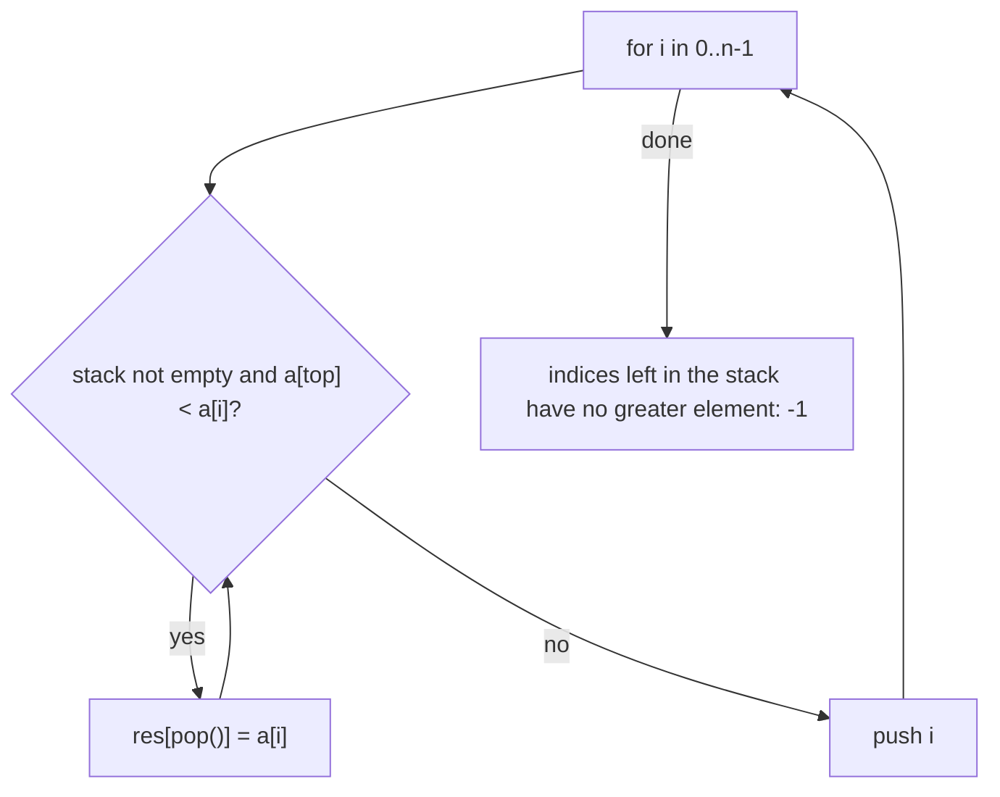
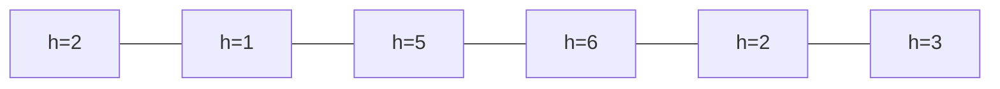

# Session 3 · Monotonic Stacks

Prepared by **Hamna Zahid Khan**, Junior Lecturer

[🏠 Course home](../README.md) · [📘 Module overview](./README.md) · [⬅ Previous](./session-02-expression-evaluation.md) · [Practice test ➡](./practice-test.md)

> **Module 06 · Stacks** · ⏱ 3 hours (90 min lecture + 90 min lab)

## 🎯 Learning objectives

1. Define a **monotonic stack** and explain why each element is pushed and popped at most once.
2. Solve **next greater element**, **daily temperatures** and **stock span** in O(n).
3. Solve **largest rectangle in a histogram** with a sentinel bar.
4. Design a **min-stack** with O(1) `getMin`.
5. Recognise the "nearest bigger/smaller to the left/right" family of problems.

---

## 1. The idea

Many problems ask, for every element, *"where is the nearest element to the right (or left) that is bigger (or smaller)?"*. The brute force looks ahead from every position: O(n²).

A **monotonic stack** keeps elements (usually **indices**) in increasing or decreasing order of value. When a new element breaks the order, it pops the elements it "beats", and **it is the answer for each of them**.

> 🏔️ **Analogy: looking for the next taller mountain on a ridge walk.** Walking east, you keep a list of peaks still waiting to learn "which taller peak comes next?". When you reach a tall peak, every shorter peak still waiting gets its answer (this one) and leaves the list. The peaks left waiting are always in decreasing height order: a monotonic stack.

**Why O(n)?** Each index is pushed once and popped at most once ⇒ at most 2n stack operations in total, even though there is a `while` inside the `for`.

| Want, for each element | Stack keeps values | Pop when new value is |
|---|---|---|
| next **greater** to the right | decreasing | greater than top |
| next **smaller** to the right | increasing | smaller than top |
| previous greater / smaller | same idea, read the top *after* popping | |

## 2. Next greater element



**Trace: `[4, 5, 2, 25, 7, 8]`** (stack shows values, bottom → top)

| i | a[i] | Pops (and answers) | Stack after | res |
|---|---|---|---|---|
| 0 | 4 | – | 4 | – |
| 1 | 5 | 4 → 5 | 5 | res[0] = 5 |
| 2 | 2 | – | 5 2 | |
| 3 | 25 | 2 → 25, 5 → 25 | 25 | res[2] = 25, res[1] = 25 |
| 4 | 7 | – | 25 7 | |
| 5 | 8 | 7 → 8 | 25 8 | res[4] = 8 |
| end | | 25, 8 have none | | res[3] = res[5] = −1 |

**Daily temperatures** is the same loop storing `i − j` (distance) instead of the value.

## 3. Stock span

The **span** of today's price is the number of consecutive days ending today with price ≤ today's. Keep a stack of indices with **strictly decreasing** prices; pop everything ≤ today's price; the span is the distance to the remaining top (or i + 1 if the stack is empty).

| Day | Price | Popped | Top after pops | Span |
|---|---|---|---|---|
| 0 | 100 | – | none | 1 |
| 1 | 80 | – | 100 (day 0) | 1 |
| 2 | 60 | – | 80 (day 1) | 1 |
| 3 | 70 | 60 | 80 (day 1) | 2 |
| 4 | 60 | – | 70 (day 3) | 1 |
| 5 | 75 | 60, 70 | 80 (day 1) | 4 |
| 6 | 85 | 75, 80 | 100 (day 0) | 6 |

## 4. Largest rectangle in a histogram

For every bar, the widest rectangle of exactly its height extends left and right until a **shorter** bar. Keep indices with **increasing** heights. When bar i is shorter than the top, the top bar's rectangle ends at i − 1, and the new top after popping is the first shorter bar on its left. A final sentinel bar of height 0 flushes the stack.



**Key pops for `[2, 1, 5, 6, 2, 3]`**

| i (height) | Popped bar | Height | Left boundary | Width | Area |
|---|---|---|---|---|---|
| 1 (1) | 0 | 2 | −1 | 1 | 2 |
| 4 (2) | 3 | 6 | 2 | 1 | 6 |
| 4 (2) | 2 | 5 | 1 | 2 | **10** |
| 6 (0, sentinel) | 5 | 3 | 4 | 1 | 3 |
| 6 | 4 | 2 | 1 | 4 | 8 |
| 6 | 1 | 1 | −1 | 6 | 6 |

Answer: **10** (heights 5 and 6, width 2).

## 5. Min-stack

Keep a second stack where each entry is the minimum of everything at or below that depth. `push(x)` pushes `min(x, mins.peek())`; `pop` pops both. `getMin` = `mins.peek()`: O(1) time, O(n) extra space.

| Push | values | mins |
|---|---|---|
| 5 | 5 | 5 |
| 3 | 5 3 | 5 3 |
| 7 | 5 3 7 | 5 3 3 |
| 2 | 5 3 7 2 | 5 3 3 2 |
| 8 | 5 3 7 2 8 | 5 3 3 2 2 |

## 6. Complexity table

| Problem | Brute force | Monotonic stack | Space |
|---|---|---|---|
| Next greater element | O(n²) | O(n) | O(n) |
| Daily temperatures | O(n²) | O(n) | O(n) |
| Stock span | O(n²) | O(n) (amortised O(1) per day) | O(n) |
| Largest rectangle | O(n²) | O(n) | O(n) |
| Min-stack `getMin` | O(n) scan | O(1) | O(n) |

---

## 7. Complete program

📄 **[`src/MonotonicStack.java`](src/MonotonicStack.java)**

```java
import java.util.ArrayDeque;
import java.util.Arrays;
import java.util.Deque;

/**
 * Module 06 · Session 03 — Monotonic stacks.
 *
 * A stack whose contents stay sorted lets each element be pushed and popped at
 * most once, turning many O(n^2) "look for the next bigger/smaller" problems into
 * O(n): next greater element, daily temperatures, stock span, largest rectangle
 * in a histogram and the min-stack design.
 *
 * Compile:  javac -d out MonotonicStack.java
 * Run:      java -cp out MonotonicStack
 *
 * Prepared by Hamna Zahid Khan, Junior Lecturer
 */
public class MonotonicStack {

    /** For each element, the first larger element to its right (-1 if none). O(n). */
    static int[] nextGreater(int[] a, boolean trace) {
        int[] res = new int[a.length];
        Arrays.fill(res, -1);
        Deque<Integer> st = new ArrayDeque<>();      // indices whose values are DECREASING from bottom to top
        for (int i = 0; i < a.length; i++) {
            while (!st.isEmpty() && a[st.peek()] < a[i]) res[st.pop()] = a[i];   // a[i] answers them
            st.push(i);
            if (trace) {
                StringBuilder sb = new StringBuilder();
                for (int idx : st) sb.insert(0, a[idx] + " ");
                System.out.printf("  i=%d a[i]=%2d stack(bottom->top)=[%s] res=%s%n", i, a[i], sb.toString().trim(), Arrays.toString(res));
            }
        }
        return res;
    }

    /** Days until a warmer temperature (0 if never). */
    static int[] dailyTemperatures(int[] t) {
        int[] wait = new int[t.length];
        Deque<Integer> st = new ArrayDeque<>();
        for (int i = 0; i < t.length; i++) {
            while (!st.isEmpty() && t[st.peek()] < t[i]) {
                int j = st.pop();
                wait[j] = i - j;
            }
            st.push(i);
        }
        return wait;
    }

    /** Stock span: number of consecutive days up to today with price <= today's price. */
    static int[] stockSpan(int[] price) {
        int[] span = new int[price.length];
        Deque<Integer> st = new ArrayDeque<>();      // indices of prices that are still "blocking"
        for (int i = 0; i < price.length; i++) {
            while (!st.isEmpty() && price[st.peek()] <= price[i]) st.pop();
            span[i] = st.isEmpty() ? i + 1 : i - st.peek();
            st.push(i);
        }
        return span;
    }

    /** Largest rectangle in a histogram: each bar is popped when a shorter bar ends its extent. O(n). */
    static long largestRectangle(int[] h) {
        Deque<Integer> st = new ArrayDeque<>();      // indices with INCREASING heights
        long best = 0;
        for (int i = 0; i <= h.length; i++) {
            int cur = (i == h.length) ? 0 : h[i];    // sentinel bar of height 0 flushes the stack
            while (!st.isEmpty() && h[st.peek()] >= cur) {
                int height = h[st.pop()];
                int left = st.isEmpty() ? -1 : st.peek();   // first shorter bar on the left
                best = Math.max(best, (long) height * (i - left - 1));
            }
            st.push(i);
        }
        return best;
    }

    /** Stack with O(1) getMin: a second stack stores the minimum at each depth. */
    static final class MinStack {
        private final Deque<Integer> values = new ArrayDeque<>();
        private final Deque<Integer> mins = new ArrayDeque<>();

        void push(int x) {
            values.push(x);
            mins.push(mins.isEmpty() ? x : Math.min(x, mins.peek()));
        }
        int pop() { mins.pop(); return values.pop(); }
        int getMin() { return mins.peek(); }
    }

    /** Brute force next-greater for comparison: O(n^2). */
    static int[] nextGreaterBrute(int[] a) {
        int[] res = new int[a.length];
        for (int i = 0; i < a.length; i++) {
            res[i] = -1;
            for (int j = i + 1; j < a.length; j++) if (a[j] > a[i]) { res[i] = a[j]; break; }
        }
        return res;
    }

    public static void main(String[] args) {
        int[] a = {4, 5, 2, 25, 7, 8};
        System.out.println("Next greater element of " + Arrays.toString(a) + ":");
        System.out.println("result " + Arrays.toString(nextGreater(a, true)));

        int[] temps = {30, 28, 32, 31, 29, 35, 33};
        System.out.println("\ndaily temperatures " + Arrays.toString(temps) + " -> wait " + Arrays.toString(dailyTemperatures(temps)));
        int[] prices = {100, 80, 60, 70, 60, 75, 85};
        System.out.println("stock prices " + Arrays.toString(prices) + " -> span " + Arrays.toString(stockSpan(prices)));
        int[] bars = {2, 1, 5, 6, 2, 3};
        System.out.println("largest rectangle in histogram " + Arrays.toString(bars) + " = " + largestRectangle(bars));

        MinStack ms = new MinStack();
        for (int x : new int[]{5, 3, 7, 2, 8}) ms.push(x);
        System.out.print("\nMinStack after pushing 5 3 7 2 8: min=" + ms.getMin());
        ms.pop(); ms.pop();
        System.out.print(" | pop 8, 2 -> min=" + ms.getMin());
        ms.pop(); ms.pop();
        System.out.println(" | pop 7, 3 -> min=" + ms.getMin());

        int n = 200_000;
        int[] big = new int[n];
        java.util.Random r = new java.util.Random(9);
        for (int i = 0; i < n; i++) big[i] = n - i + r.nextInt(3);   // mostly decreasing: brute force's bad case
        long t0 = System.nanoTime();
        int[] fast = nextGreater(big, false);
        long t1 = System.nanoTime();
        int[] slow = nextGreaterBrute(Arrays.copyOf(big, 20_000));
        long t2 = System.nanoTime();
        int[] small = Arrays.copyOf(big, 20_000);
        System.out.printf("%nstack and brute force agree on the same 20,000 values: %b%n",
                Arrays.equals(nextGreater(small, false), slow));
        System.out.println("stack result computed for all " + String.format("%,d", fast.length) + " values");
        System.out.println("stack version faster despite 10x more data: " + ((t1 - t0) < (t2 - t1)));
    }
}
```

**Real output:**

```text
$ java -cp out MonotonicStack
Next greater element of [4, 5, 2, 25, 7, 8]:
  i=0 a[i]= 4 stack(bottom->top)=[4] res=[-1, -1, -1, -1, -1, -1]
  i=1 a[i]= 5 stack(bottom->top)=[5] res=[5, -1, -1, -1, -1, -1]
  i=2 a[i]= 2 stack(bottom->top)=[5 2] res=[5, -1, -1, -1, -1, -1]
  i=3 a[i]=25 stack(bottom->top)=[25] res=[5, 25, 25, -1, -1, -1]
  i=4 a[i]= 7 stack(bottom->top)=[25 7] res=[5, 25, 25, -1, -1, -1]
  i=5 a[i]= 8 stack(bottom->top)=[25 8] res=[5, 25, 25, -1, 8, -1]
result [5, 25, 25, -1, 8, -1]

daily temperatures [30, 28, 32, 31, 29, 35, 33] -> wait [2, 1, 3, 2, 1, 0, 0]
stock prices [100, 80, 60, 70, 60, 75, 85] -> span [1, 1, 1, 2, 1, 4, 6]
largest rectangle in histogram [2, 1, 5, 6, 2, 3] = 10

MinStack after pushing 5 3 7 2 8: min=2 | pop 8, 2 -> min=3 | pop 7, 3 -> min=5

stack and brute force agree on the same 20,000 values: true
stack result computed for all 200,000 values
stack version faster despite 10x more data: true
```

The final lines verify the O(n) stack answer against the O(n²) brute force on the same data and show it finishing 200,000 values faster than the brute force handles 20,000.

---

## 8. Worked examples (basic → advanced)

**Example 1 (basic): daily temperatures.** For `[30, 28, 32, 31, 29, 35, 33]`, day 0 waits 2 days (32), day 2 waits 3 days (35), the last two days never see warmer weather (0).

**Example 2 (intermediate): remove k digits to make the smallest number.** Keep the digits in an **increasing** stack; a smaller digit pops larger digits before it while removals remain.

```java
/** Remove k digits to make the smallest number: keep an increasing (monotonic) stack of digits. */
static String removeKDigits(String num, int k) {
    StringBuilder st = new StringBuilder();              // used as a stack of chars
    for (char c : num.toCharArray()) {
        while (k > 0 && st.length() > 0 && st.charAt(st.length() - 1) > c) {
            st.deleteCharAt(st.length() - 1);
            k--;
        }
        st.append(c);
    }
    st.setLength(st.length() - k);                       // still need removals: drop from the end
    int z = 0;
    while (z < st.length() - 1 && st.charAt(z) == '0') z++;  // strip leading zeros
    return st.length() == 0 ? "0" : st.substring(z);
}
```
<sub>Full, compiled version: [`src/Labs06.java`](src/Labs06.java)</sub>

`"1432219"`, k = 3: `3` pops `4`, the first `2` pops `3`, and the final `1` pops the `2` before it, using all three removals; the result is `1219`.

**Example 3 (advanced): maximal rectangle of 1s in a binary matrix.** Build a histogram per row (height = consecutive 1s above, including this row) and run `largestRectangle` on each row: O(R·C) total.

## 9. Real-life problem: stock analytics dashboard

**Problem.** A brokerage dashboard streams one closing price per day for 5,000 stocks and must display each stock's **span** ("price has been at or above this level for N days") instantly as each new price arrives.

**Solution.** Keep one monotonic stack per stock of `(price, span)` pairs. For a new price, pop all pairs with price ≤ new price, adding their spans; the new span = 1 + sum of popped spans; push the new pair. Each price is pushed and popped once ⇒ **amortised O(1) per update**, regardless of history length. A naive scan back over history would be O(days) per update.

## 10. Common mistakes

| Mistake | Fix |
|---|---|
| Storing values when you need distances | store **indices** on the stack |
| Wrong comparison (`<` vs `<=`) | decide how ties count: strict for next *greater*, `<=` pops for span |
| Forgetting elements left on the stack | they have no answer (−1 / 0) or need the sentinel flush |
| Width formula off by one in histogram | width = `i − left − 1` with `left = −1` when the stack is empty |
| Thinking the nested `while` makes it O(n²) | count total pushes/pops: at most 2n |

## 11. Best practices

- Write down: "stack is increasing/decreasing", "pop when …", "answer for the popped element is …".
- Use a sentinel (height 0 at the end) to avoid duplicate cleanup code.
- Store indices; derive values with `a[idx]`.

---

## 12. Lab tasks

**Lab 3.1: Remove k digits.** Implement it and test `("1432219", 3)` and `("10200", 1)`.

<details>
<summary>✅ Solution</summary>

See Example 2. Results: `1219` and `200` (leading zeros removed).

</details>

**Lab 3.2: Next smaller element to the left.** For each element, return the nearest smaller value on its **left** (−1 if none). `[4, 10, 5, 8, 20, 15, 3, 12]` → `[-1, 4, 4, 5, 8, 8, -1, 3]`.

<details>
<summary>💡 Hint</summary>

Scan left to right with an **increasing** stack; pop while top ≥ current; the remaining top (if any) is the answer; then push current.

</details>

<details>
<summary>✅ Solution</summary>

```java
static int[] prevSmaller(int[] a) {
    int[] res = new int[a.length];
    Deque<Integer> st = new ArrayDeque<>();   // values, increasing bottom -> top
    for (int i = 0; i < a.length; i++) {
        while (!st.isEmpty() && st.peek() >= a[i]) st.pop();
        res[i] = st.isEmpty() ? -1 : st.peek();
        st.push(a[i]);
    }
    return res;
}
```

</details>

**Lab 3.3: Circular next greater.** The array is circular (after the last element comes the first). `[1, 2, 1]` → `[2, -1, 2]`.

<details>
<summary>✅ Solution</summary>

Loop i from 0 to 2n − 1 using `a[i % n]`, but only push indices during the first pass (`if (i < n) st.push(i)`). Each index is still pushed once ⇒ O(n).

</details>

```text
$ java -cp out Labs06
toBinary(37) = 100101, toBinary(0) = 0
queue from two stacks: a b c d
simplifyPath("/home/./hamna/../dsa//stacks/") = /home/dsa/stacks
tagsBalanced(<p><b>hi</b></p>) = true, (<p><b>hi</p></b>) = false
removeKDigits("1432219", 3) = 1219, ("10200", 1) = 200
```

---

## 13. Quiz

**Q1.** Why is the next-greater-element algorithm O(n) despite a nested while loop?

- **A.** The while loop runs at most once per i
- **B.** Each index is pushed once and popped at most once
- **C.** The array is sorted
- **D.** It uses binary search

**Q2.** Next greater elements of `[3, 1, 4]`:

- **A.** [4, 4, -1]
- **B.** [1, 4, -1]
- **C.** [4, -1, -1]
- **D.** [-1, 3, 1]

**Q3.** For next greater element, the stack's values (bottom to top) are:

- **A.** increasing
- **B.** decreasing
- **C.** random
- **D.** all equal

**Q4.** Stock span for prices `[10, 4, 5, 90, 120, 80]` on the day of price 90:

- **A.** 1
- **B.** 3
- **C.** 4
- **D.** 2

**Q5.** A min-stack's getMin runs in:

- **A.** O(1)
- **B.** O(log n)
- **C.** O(n)
- **D.** O(n log n)

<details>
<summary><b>Show answers</b></summary>

1. **B**: Total stack operations are at most 2n.
2. **A**: 3 → 4, 1 → 4, 4 → none.
3. **B**: A larger new value pops smaller ones.
4. **C**: 90 ≥ 5, 4 and 10, so the span covers 4 days.
5. **A**: The auxiliary stack's top is the current minimum.

</details>

---

## 14. Summary

- A monotonic stack keeps indices in sorted value order; the element that breaks the order **answers** the elements it pops.
- Push/pop each index once ⇒ O(n) for next greater/smaller, temperatures, span and histogram problems.
- An auxiliary stack gives O(1) `getMin`.

## 15. Viva / interview questions

1. Prove the O(n) bound of the monotonic-stack technique.
2. How do you find the previous greater element instead of the next?
3. Walk through the histogram algorithm for `[6, 2, 5, 4, 5, 1, 6]` (answer 12).
4. How would you implement a max-stack with O(1) `getMax`?
5. Solve "trapping rain water" with a stack.
6. Can the min-stack use O(1) extra space? (Hint: store encoded differences.)

---

[⬅ Previous](./session-02-expression-evaluation.md) · [📘 Module overview](./README.md) · [Practice test ➡](./practice-test.md)
