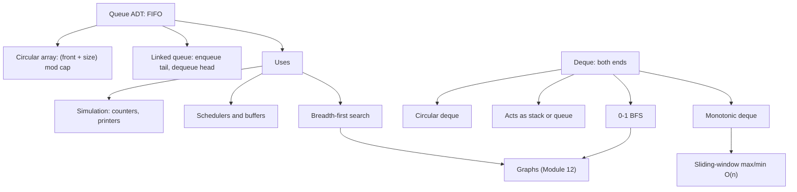

# Module 07 · Queues and Deques

Prepared by **Hamna Zahid Khan**, Junior Lecturer

[🏠 Course home](../README.md)

> ⏱ 6 contact hours · 2 sessions · 🟡 Core

Queues process work in arrival order and underpin schedulers, buffers and breadth-first search. Deques generalise stacks and queues and enable the monotonic-deque technique for sliding windows and 0-1 BFS for shortest paths.

## 🎯 Module objectives

- Implement FIFO queues with circular arrays and linked nodes.
- Implement a circular-array deque.
- Use queues for simulation and BFS; use deques for sliding-window extremes and 0-1 BFS.
- Use Java's `Queue`/`Deque` interfaces and `ArrayDeque` correctly.

## 📚 Sessions

| # | Session | Key ideas | Code |
|---|---|---|---|
| 1 | [Queue ADT and Circular Buffer](session-01-queue-adt-and-circular-buffer.md) | FIFO, wrap-around indices, linked queue, simulation | [`QueueImplementations.java`](src/QueueImplementations.java) |
| 2 | [Deques and Applications](session-02-deques-and-applications.md) | circular deque, sliding-window max, grid BFS, 0-1 BFS | [`DequeApplications.java`](src/DequeApplications.java) |
| ✍️ | [Practice test](practice-test.md) | 20 MCQs + 3 coding scenarios | [`Labs07.java`](src/Labs07.java), [`SelfCheck.java`](src/SelfCheck.java) |

## 🗺️ Concept map



## 📄 One-page cheat sheet

| Structure | Add | Remove | Peek | Notes |
|---|---|---|---|---|
| Circular-array queue | O(1)* | O(1) | O(1) | rear = (front + size) % cap |
| Linked queue | O(1) | O(1) | O(1) | head = front, tail = rear |
| Circular deque | O(1)* both ends | O(1) both ends | O(1) | addFirst: head = (head − 1 + cap) % cap |
| `ArrayDeque` | O(1)* | O(1) | O(1) | no nulls; fastest stack/queue in Java |

**Java `Queue`:** `offer / poll / peek` (no exceptions) vs `add / remove / element` (throw).
**Java `Deque`:** `offerFirst/offerLast`, `pollFirst/pollLast`, `peekFirst/peekLast`; stack methods `push/pop/peek` work on the front.

**Sliding-window max template**

```java
for (int i = 0; i < n; i++) {
    if (!dq.isEmpty() && dq.peekFirst() <= i - k) dq.pollFirst();
    while (!dq.isEmpty() && a[dq.peekLast()] <= a[i]) dq.pollLast();
    dq.offerLast(i);
    if (i >= k - 1) out[i - k + 1] = a[dq.peekFirst()];
}
```

**BFS template:** enqueue start, mark visited · while queue not empty: poll, process, enqueue unvisited neighbours and mark them.

## ▶️ Run the code

```bash
cd 07-queues-and-deques/src
javac -d out *.java
java -ea -cp out SelfCheck
java -cp out DequeApplications
```

See [`src/README.md`](src/README.md) for every file.
