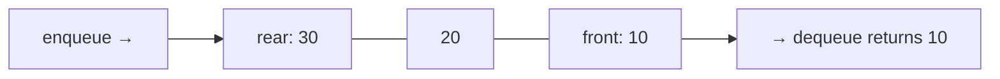
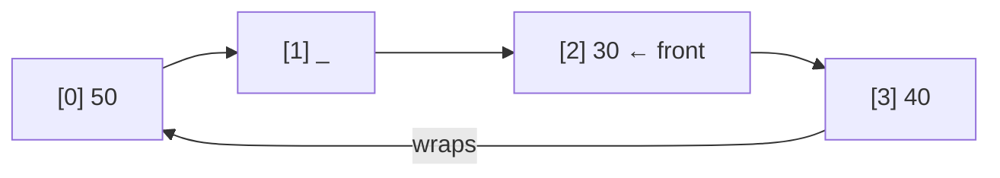

# Session 1 · The Queue ADT and the Circular Buffer

Prepared by **Hamna Zahid Khan**, Junior Lecturer

[🏠 Course home](../README.md) · [📘 Module overview](./README.md) · [⬅ Module overview](./README.md) · [Next ➡](./session-02-deques-and-applications.md)

> **Module 07 · Queues and Deques** · ⏱ 3 hours (90 min lecture + 90 min lab)

## 🎯 Learning objectives

1. Define the queue ADT and its **FIFO** behaviour.
2. Explain why a naive array queue wastes space or time, and fix it with a **circular buffer**.
3. Implement a growable circular-array queue and a linked queue in Java.
4. Use `java.util.Queue` correctly (`offer/poll/peek` vs `add/remove/element`).
5. Simulate a real service counter with a queue.

---

## 1. FIFO: first in, first out

| Operation | Behaviour |
|---|---|
| `enqueue(x)` / `offer(x)` | add x at the **rear** |
| `dequeue()` / `poll()` | remove and return the **front** |
| `peek()` | look at the front |
| `isEmpty()`, `size()` | queries |

> 🎫 **Analogy: the queue at a fee-submission counter.** The first student to arrive is served first; newcomers join at the back. Nobody jumps the line.



Queues appear wherever work must be handled **in arrival order**: printer spoolers, CPU ready queues, network packet buffers, message brokers, call centres, and **breadth-first search** (Module 12).

## 2. Why a naive array fails

**Attempt 1: front fixed at index 0.** Enqueue at `size`, dequeue from index 0 and shift everything left: dequeue is **O(n)**.

**Attempt 2: moving front and rear indices.** Dequeue just advances `front`: O(1). But the used region creeps to the right and the free slots at the start are never reused: the array "fills up" while mostly empty.

**Fix: wrap around.** Treat the array as a **ring**: after the last index comes index 0.

> rear position = (front + size) mod capacity  · after dequeue: front = (front + 1) mod capacity



Keeping a **size** counter distinguishes "empty" from "full" (both have front == rear+1 in some designs). The alternative, leaving one slot always unused, works too.

### Trace: capacity 4

| Operation | Array | front | rear | size |
|---|---|---|---|---|
| enqueue 10, 20, 30 | 10 20 30 _ | 0 | 2 | 3 |
| dequeue → 10 | _ 20 30 _ | 1 | 2 | 2 |
| dequeue → 20 | _ _ 30 _ | 2 | 2 | 1 |
| enqueue 40 | _ _ 30 40 | 2 | 3 | 2 |
| enqueue 50 | **50** _ 30 40 | 2 | **0** (wrapped) | 3 |
| enqueue 60 | 50 60 30 40 | 2 | 1 | 4 (full) |
| enqueue 70 | grow → 30 40 50 60 70 _ _ _ | 0 | 4 | 5 |

When growing, copy in **queue order** (from `front`, wrapping) so the new array starts at index 0.

## 3. Linked queue

Enqueue at the **tail**, dequeue at the **head**: both O(1) with a singly linked list that keeps head and tail. (The opposite choice would make dequeue at the tail O(n).) Remember: when the last element is dequeued, set `tail = null` too.

## 4. Complexity table

| Implementation | enqueue | dequeue | peek | Space |
|---|---|---|---|---|
| Array, front fixed at 0 | O(1)* | **O(n)** | O(1) | O(n) |
| Circular array (growable) | O(1) amortised | O(1) | O(1) | O(n) |
| Linked (head + tail) | O(1) | O(1) | O(1) | O(n) + node overhead |
| `ArrayDeque` | O(1) amortised | O(1) | O(1) | O(n) |

**`java.util.Queue` method pairs**

| | Throws exception on failure | Returns special value |
|---|---|---|
| insert | `add(e)` | `offer(e)` → false |
| remove | `remove()` | `poll()` → null |
| examine | `element()` | `peek()` → null |

---

## 5. Complete program

📄 **[`src/QueueImplementations.java`](src/QueueImplementations.java)**

```java
import java.util.ArrayDeque;
import java.util.NoSuchElementException;
import java.util.Queue;

/**
 * Module 07 · Session 01 — The queue ADT: circular array and linked implementations.
 *
 * CircularQueue<T> stores elements in a fixed array with wrap-around front/rear
 * indices (and grows when full); LinkedQueue<T> enqueues at the tail and dequeues
 * at the head. The demo prints the internal array to show wrap-around, then runs
 * a bank-counter simulation that measures average waiting time.
 *
 * Compile:  javac -d out QueueImplementations.java
 * Run:      java -cp out QueueImplementations
 *
 * Prepared by Hamna Zahid Khan, Junior Lecturer
 */
public class QueueImplementations {

    /** Array-based FIFO queue with wrap-around indices. */
    static final class CircularQueue<T> {
        private Object[] data;
        private int front;   // index of the first element
        private int size;

        CircularQueue(int capacity) { data = new Object[capacity]; }

        boolean isEmpty() { return size == 0; }
        int size() { return size; }

        /** rear position = (front + size) % capacity. Amortised O(1). */
        void enqueue(T x) {
            if (size == data.length) grow();
            data[(front + size) % data.length] = x;
            size++;
        }

        /** O(1): take from front, advance front with wrap-around. */
        @SuppressWarnings("unchecked")
        T dequeue() {
            if (size == 0) throw new NoSuchElementException("queue underflow");
            T x = (T) data[front];
            data[front] = null;
            front = (front + 1) % data.length;
            size--;
            return x;
        }

        @SuppressWarnings("unchecked")
        T peek() {
            if (size == 0) throw new NoSuchElementException("queue is empty");
            return (T) data[front];
        }

        /** Copies elements in queue order into a twice-as-large array, front at index 0. */
        private void grow() {
            Object[] bigger = new Object[data.length * 2];
            for (int i = 0; i < size; i++) bigger[i] = data[(front + i) % data.length];
            data = bigger;
            front = 0;
        }

        String internals() {
            StringBuilder sb = new StringBuilder("[");
            for (int i = 0; i < data.length; i++) {
                sb.append(data[i] == null ? "_" : data[i]);
                if (i < data.length - 1) sb.append(' ');
            }
            int rear = (front + size - 1 + data.length) % data.length;
            return sb.append("] front=").append(front).append(" rear=").append(size == 0 ? "-" : String.valueOf(rear))
                    .append(" size=").append(size).toString();
        }
    }

    /** Linked FIFO queue: enqueue at tail, dequeue at head, both O(1) worst case. */
    static final class LinkedQueue<T> {
        private static final class Node<T> {
            T value;
            Node<T> next;
            Node(T value) { this.value = value; }
        }

        private Node<T> head, tail;
        private int size;

        void enqueue(T x) {
            Node<T> n = new Node<>(x);
            if (tail == null) head = tail = n;
            else { tail.next = n; tail = n; }
            size++;
        }

        T dequeue() {
            if (head == null) throw new NoSuchElementException("queue underflow");
            T x = head.value;
            head = head.next;
            if (head == null) tail = null;   // queue became empty
            size--;
            return x;
        }

        boolean isEmpty() { return head == null; }
        int size() { return size; }
    }

    /** Single-counter bank: customers arrive at given minutes and need given service minutes. */
    static double averageWait(int[] arrival, int[] service) {
        LinkedQueue<int[]> line = new LinkedQueue<>();
        for (int i = 0; i < arrival.length; i++) line.enqueue(new int[]{arrival[i], service[i]});
        int clock = 0;
        long totalWait = 0;
        while (!line.isEmpty()) {
            int[] c = line.dequeue();
            clock = Math.max(clock, c[0]);        // counter idles until the customer arrives
            totalWait += clock - c[0];
            clock += c[1];
        }
        return (double) totalWait / arrival.length;
    }

    public static void main(String[] args) {
        System.out.println("=== CircularQueue (capacity 4) ===");
        CircularQueue<Integer> q = new CircularQueue<>(4);
        q.enqueue(10); System.out.println("enqueue 10 -> " + q.internals());
        q.enqueue(20); System.out.println("enqueue 20 -> " + q.internals());
        q.enqueue(30); System.out.println("enqueue 30 -> " + q.internals());
        System.out.println("dequeue " + q.dequeue() + " -> " + q.internals());
        System.out.println("dequeue " + q.dequeue() + " -> " + q.internals());
        q.enqueue(40); System.out.println("enqueue 40 -> " + q.internals());
        q.enqueue(50); System.out.println("enqueue 50 -> " + q.internals() + "   <- wrapped around");
        q.enqueue(60); System.out.println("enqueue 60 -> " + q.internals());
        q.enqueue(70); System.out.println("enqueue 70 -> " + q.internals() + "   <- grew, unwrapped");
        StringBuilder order = new StringBuilder();
        while (!q.isEmpty()) order.append(q.dequeue()).append(' ');
        System.out.println("dequeue all: " + order.toString().trim() + "  (FIFO order preserved)");

        System.out.println("\n=== LinkedQueue: print jobs ===");
        LinkedQueue<String> printer = new LinkedQueue<>();
        for (String job : new String[]{"assignment.pdf", "timetable.xlsx", "notes.docx"}) printer.enqueue(job);
        while (!printer.isEmpty()) System.out.println("printing " + printer.dequeue() + " (" + printer.size() + " waiting)");

        System.out.println("\n=== Bank counter simulation ===");
        int[] arrive = {0, 1, 2, 6, 7, 15};
        int[] serve = {4, 3, 2, 5, 1, 2};
        System.out.printf("average wait = %.2f minutes%n", averageWait(arrive, serve));

        Queue<String> lib = new ArrayDeque<>();
        lib.offer("first"); lib.offer("second");
        System.out.println("\njava.util.Queue via ArrayDeque: poll -> " + lib.poll() + ", peek -> " + lib.peek()
                + ", poll -> " + lib.poll() + ", poll on empty -> " + lib.poll() + " (no exception)");
    }
}
```

**Real output:**

```text
$ java -cp out QueueImplementations
=== CircularQueue (capacity 4) ===
enqueue 10 -> [10 _ _ _] front=0 rear=0 size=1
enqueue 20 -> [10 20 _ _] front=0 rear=1 size=2
enqueue 30 -> [10 20 30 _] front=0 rear=2 size=3
dequeue 10 -> [_ 20 30 _] front=1 rear=2 size=2
dequeue 20 -> [_ _ 30 _] front=2 rear=2 size=1
enqueue 40 -> [_ _ 30 40] front=2 rear=3 size=2
enqueue 50 -> [50 _ 30 40] front=2 rear=0 size=3   <- wrapped around
enqueue 60 -> [50 60 30 40] front=2 rear=1 size=4
enqueue 70 -> [30 40 50 60 70 _ _ _] front=0 rear=4 size=5   <- grew, unwrapped
dequeue all: 30 40 50 60 70  (FIFO order preserved)

=== LinkedQueue: print jobs ===
printing assignment.pdf (2 waiting)
printing timetable.xlsx (1 waiting)
printing notes.docx (0 waiting)

=== Bank counter simulation ===
average wait = 3.00 minutes

java.util.Queue via ArrayDeque: poll -> first, peek -> second, poll -> second, poll on empty -> null (no exception)
```

---

## 6. Worked examples (basic → advanced)

**Example 1 (basic): reverse a queue with a stack.** Dequeue all into a stack, then pop all back: LIFO undoes FIFO.

```java
/** Reverse a queue using a stack: dequeue everything onto the stack, then pop back. */
static <T> void reverse(Queue<T> q) {
    Deque<T> st = new ArrayDeque<>();
    while (!q.isEmpty()) st.push(q.poll());
    while (!st.isEmpty()) q.offer(st.pop());
}
```
<sub>Full, compiled version: [`src/Labs07.java`](src/Labs07.java)</sub>

**Example 2 (intermediate): generate binary numbers 1…n.** Start with "1"; each dequeued string s is output and produces `s0` and `s1`. The queue yields them in increasing order: a mini BFS over a binary tree of strings.

```java
/** First n binary numbers using a queue: each number s generates s+"0" and s+"1". */
static List<String> binaryNumbers(int n) {
    List<String> out = new ArrayList<>();
    Queue<String> q = new ArrayDeque<>();
    q.offer("1");
    while (out.size() < n) {
        String s = q.poll();
        out.add(s);
        q.offer(s + "0");
        q.offer(s + "1");
    }
    return out;
}
```
<sub>Full, compiled version: [`src/Labs07.java`](src/Labs07.java)</sub>

**Example 3 (advanced): bank counter simulation.** Customers arrive at minutes 0, 1, 2, 6, 7, 15 needing 4, 3, 2, 5, 1, 2 minutes.

| Customer | Arrives | Starts | Waits | Leaves |
|---|---|---|---|---|
| 1 | 0 | 0 | 0 | 4 |
| 2 | 1 | 4 | 3 | 7 |
| 3 | 2 | 7 | 5 | 9 |
| 4 | 6 | 9 | 3 | 14 |
| 5 | 7 | 14 | 7 | 15 |
| 6 | 15 | 15 | 0 | 17 |

Average wait = 18 / 6 = **3.00** minutes, matching the program.

## 7. Real-life problem: API rate monitoring

**Problem.** A university portal must count how many requests a user made in the **last 3 seconds** to block abusive scripts. Requests arrive with increasing timestamps (ms).

**Solution.** Keep a queue of timestamps. On each request, enqueue it, then dequeue from the front while the front is older than `t − 3000`. The queue size is the answer. Each timestamp is enqueued and dequeued once ⇒ amortised O(1) per request.

```java
/** Count requests in the last 3000 ms: old timestamps fall off the front of the queue. */
static final class RecentCounter {
    private final Queue<Integer> times = new ArrayDeque<>();
    int ping(int t) {
        times.offer(t);
        while (times.peek() < t - 3000) times.poll();
        return times.size();
    }
}
```
<sub>Full, compiled version: [`src/Labs07.java`](src/Labs07.java)</sub>

## 8. Common mistakes

| Mistake | Fix |
|---|---|
| Shifting elements on every dequeue | circular indices |
| `rear = rear + 1` without `% capacity` | wrap around |
| Cannot tell full from empty when front == rear | keep `size`, or sacrifice one slot |
| Copying the array as-is when growing | copy in queue order starting at `front` |
| Linked queue: forgetting `tail = null` on the last dequeue | stale tail breaks the next enqueue |
| Using `remove()` when the queue may be empty | `poll()` and check for `null` |

## 9. Best practices

- Use `Queue<T> q = new ArrayDeque<>()` for general FIFO work; `LinkedList` also works but is slower.
- For producer/consumer threads use `java.util.concurrent.BlockingQueue` (e.g. `ArrayBlockingQueue`, itself a circular buffer).
- Bounded queues (fixed capacity, reject or block when full) protect servers from overload.

---

## 10. Lab tasks

**Lab 1.1: Reverse a queue** using only a stack.

<details>
<summary>✅ Solution</summary>

See Example 1.

</details>

**Lab 1.2: Hot potato.** Children pass a potato around a circle; after `passes` passes the holder leaves. Simulate with a queue.

<details>
<summary>💡 Hint</summary>

One pass = `q.offer(q.poll())`. After the passes, `q.poll()` removes the holder.

</details>

<details>
<summary>✅ Solution</summary>

```java
/** Hot potato: pass the potato 'passes' times (front to back), then the holder is out. */
static String hotPotato(String[] names, int passes) {
    Queue<String> q = new ArrayDeque<>(List.of(names));
    while (q.size() > 1) {
        for (int i = 0; i < passes; i++) q.offer(q.poll());
        q.poll();
    }
    return q.peek();
}
```
<sub>Full, compiled version: [`src/Labs07.java`](src/Labs07.java)</sub>

</details>

**Lab 1.3: Fixed-capacity queue.** Modify `CircularQueue` so that `enqueue` returns `false` instead of growing when full (a bounded buffer). What changes in the complexity table?

<details>
<summary>✅ Solution</summary>

Replace `if (size == data.length) grow();` with `if (size == data.length) return false;` and return `true` after inserting. Enqueue becomes worst-case O(1) (no resizing) and memory is fixed.

</details>

**Real output of the Session 1 lab solutions:**

```text
$ java -cp out Labs07 1
-- Session 1 labs --
reversed queue = [5, 4, 3, 2, 1]
first 10 binary numbers = [1, 10, 11, 100, 101, 110, 111, 1000, 1001, 1010]
hot potato survivor = Chand
recent calls at t=1,100,3001,3002 -> 1 2 3 3
```

---

## 11. Quiz

**Q1.** Enqueue A, B, C; dequeue; enqueue D; dequeue. What is at the front now?

- **A.** A
- **B.** B
- **C.** C
- **D.** D

**Q2.** In a circular queue of capacity 5 with front = 3 and size = 4, where does the next element go?

- **A.** index 7
- **B.** index 2
- **C.** index 0
- **D.** index 4

**Q3.** A linked queue dequeues from the head because:

- **A.** the head is the newest element
- **B.** removing the head is O(1) while removing the tail of a singly list is O(n)
- **C.** Java requires it
- **D.** it saves memory

**Q4.** `queue.poll()` on an empty `ArrayDeque` returns:

- **A.** an exception
- **B.** null
- **C.** 0
- **D.** -1

**Q5.** Which algorithm fundamentally relies on a queue?

- **A.** Depth-first search
- **B.** Breadth-first search
- **C.** Binary search
- **D.** Quick sort

<details>
<summary><b>Show answers</b></summary>

1. **C**: Dequeues remove A then B.
2. **B**: (3 + 4) mod 5 = 2.
3. **B**: The tail has no link to its predecessor.
4. **B**: poll returns a special value; remove() would throw.
5. **B**: BFS explores vertices in order of distance.

</details>

---

## 12. Summary

- A queue is **FIFO**: enqueue at the rear, dequeue at the front.
- A **circular buffer** reuses array slots with modular indices: O(1) operations without shifting.
- A linked queue enqueues at the tail and dequeues at the head.
- In Java, use `ArrayDeque` through the `Queue` interface; prefer `offer/poll/peek`.

## 13. Viva / interview questions

1. Why does a non-circular array queue eventually report "full" while having free slots?
2. How do you distinguish empty from full in a circular buffer?
3. Implement a queue using two stacks and analyse it.
4. Where are bounded circular buffers used in operating systems and networking?
5. What is the difference between `add` and `offer`?
6. How would you implement a thread-safe queue?

---

[⬅ Module overview](./README.md) · [📘 Module overview](./README.md) · [Next ➡](./session-02-deques-and-applications.md)
