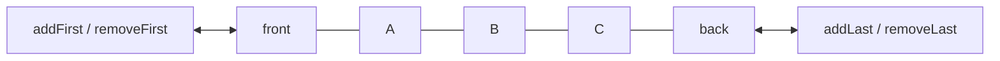
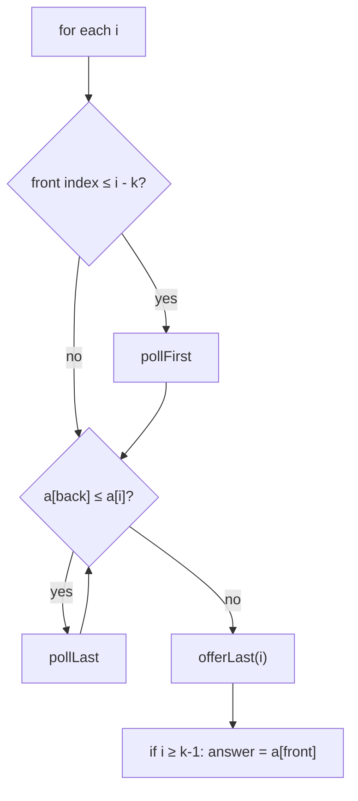

# Session 2 · Deques and Their Applications

Prepared by **Hamna Zahid Khan**, Junior Lecturer

[🏠 Course home](../README.md) · [📘 Module overview](./README.md) · [⬅ Previous](./session-01-queue-adt-and-circular-buffer.md) · [Practice test ➡](./practice-test.md)

> **Module 07 · Queues and Deques** · ⏱ 3 hours (90 min lecture + 90 min lab)

## 🎯 Learning objectives

1. Define the **deque** (double-ended queue) and implement it on a circular array.
2. Use a deque as a stack, a queue, or both.
3. Solve **sliding-window maximum** in O(n) with a **monotonic deque**.
4. Find shortest paths in a grid with **BFS** and with **0-1 BFS**.
5. Know Java's `Deque` API and when to use `ArrayDeque`.

---

## 1. The deque ADT

A deque allows insertion and removal at **both** ends.

| Front | Back |
|---|---|
| `addFirst / offerFirst` | `addLast / offerLast` |
| `removeFirst / pollFirst` | `removeLast / pollLast` |
| `peekFirst` | `peekLast` |

> 🚌 **Analogy: a bus with doors at both ends.** Passengers may board or leave at the front or the back. Restrict it to one door and it becomes a stack; board at the back and leave at the front and it becomes a queue.



| Restriction | Becomes |
|---|---|
| use only one end | stack |
| add at back, remove at front | queue |
| both ends | full deque |

## 2. Circular-array deque

Keep `head` (index of the first element) and `size`. `addFirst` steps `head` **backwards** with wrap-around: `head = (head − 1 + cap) % cap`. The last element is at `(head + size − 1) % cap`. All four end operations are O(1) (amortised with growth).

**Trace (capacity 4):** `addLast B`, `addLast C`, `addFirst A`, `addFirst Z`

| Operation | head | Array (index 0..3) | Logical order |
|---|---|---|---|
| addLast B | 0 | B _ _ _ | B |
| addLast C | 0 | B C _ _ | B C |
| addFirst A | 3 | B C _ A | A B C |
| addFirst Z | 2 | B C Z A | Z A B C |

## 3. Sliding-window maximum

Given an array and window size k, report the maximum of every window. Brute force: O(n·k). With a **monotonic deque** of indices whose values are **decreasing** from front to back:

1. Drop the front index if it has left the window (`≤ i − k`).
2. Drop from the back every index whose value ≤ `a[i]`: they can never be a maximum again while `a[i]` is in the window.
3. Push `i` at the back. The front is the current window's maximum.



**Trace: a = [1, 3, −1, −3, 5, 3, 6, 7], k = 3** (deque shown as values)

| i | a[i] | Removed | Deque | Window max |
|---|---|---|---|---|
| 0 | 1 | – | 1 | – |
| 1 | 3 | 1 (smaller) | 3 | – |
| 2 | −1 | – | 3 −1 | 3 |
| 3 | −3 | – | 3 −1 −3 | 3 |
| 4 | 5 | 3 (left window), −3, −1 | 5 | 5 |
| 5 | 3 | – | 5 3 | 5 |
| 6 | 6 | 3, 5 | 6 | 6 |
| 7 | 7 | 6 | 7 | 7 |

Each index enters and leaves the deque once ⇒ **O(n)** total.

## 4. Breadth-first search on a grid

BFS explores cells in **rings of increasing distance** from the start, using a FIFO queue. The first time we reach the exit, we have the shortest path (each move costs 1).

> 🌊 **Analogy: dropping a stone in a pond.** Ripples reach nearby points before far ones; the first ripple to reach the exit took the shortest route.

**0-1 BFS.** If moves cost either 0 or 1 (e.g. paved road = 0, mud = 1), use a **deque**: push 0-cost neighbours at the **front** and 1-cost neighbours at the **back**. The deque stays ordered by distance, giving shortest paths in O(V + E) without a priority queue (Dijkstra, Module 12, handles general weights).

## 5. Complexity table

| Operation / algorithm | Time | Space |
|---|---|---|
| Deque add/remove at either end | O(1) amortised | O(n) |
| Palindrome check with a deque | O(n) | O(n) |
| Sliding-window maximum (brute force) | O(n·k) | O(1) |
| Sliding-window maximum (monotonic deque) | O(n) | O(k) |
| Grid BFS (R × C) | O(R·C) | O(R·C) |
| 0-1 BFS | O(V + E) | O(V) |

---

## 6. Complete program

📄 **[`src/DequeApplications.java`](src/DequeApplications.java)**

```java
import java.util.ArrayDeque;
import java.util.ArrayList;
import java.util.Arrays;
import java.util.Deque;
import java.util.List;

/**
 * Module 07 · Session 02 — Deques (double-ended queues) and their applications.
 *
 * CircularDeque<T> supports O(1) add/remove at both ends on a circular array.
 * Applications: palindrome checking, sliding-window maximum with a monotonic
 * deque (O(n) instead of O(n*k)), BFS shortest path in a grid maze using a queue,
 * and 0-1 BFS where a deque gives shortest paths when edge weights are 0 or 1.
 *
 * Compile:  javac -d out DequeApplications.java
 * Run:      java -cp out DequeApplications
 *
 * Prepared by Hamna Zahid Khan, Junior Lecturer
 */
public class DequeApplications {

    /** Circular-array deque with automatic growth. */
    static final class CircularDeque<T> {
        private Object[] data = new Object[4];
        private int head, size;   // head = index of the first element

        int size() { return size; }
        boolean isEmpty() { return size == 0; }

        void addFirst(T x) {
            if (size == data.length) grow();
            head = (head - 1 + data.length) % data.length;   // step backwards with wrap-around
            data[head] = x;
            size++;
        }

        void addLast(T x) {
            if (size == data.length) grow();
            data[(head + size) % data.length] = x;
            size++;
        }

        @SuppressWarnings("unchecked")
        T removeFirst() {
            if (size == 0) throw new java.util.NoSuchElementException();
            T x = (T) data[head];
            data[head] = null;
            head = (head + 1) % data.length;
            size--;
            return x;
        }

        @SuppressWarnings("unchecked")
        T removeLast() {
            if (size == 0) throw new java.util.NoSuchElementException();
            int tail = (head + size - 1) % data.length;
            T x = (T) data[tail];
            data[tail] = null;
            size--;
            return x;
        }

        private void grow() {
            Object[] b = new Object[data.length * 2];
            for (int i = 0; i < size; i++) b[i] = data[(head + i) % data.length];
            data = b;
            head = 0;
        }

        @Override public String toString() {
            StringBuilder sb = new StringBuilder("[");
            for (int i = 0; i < size; i++) sb.append(i == 0 ? "" : ", ").append(data[(head + i) % data.length]);
            return sb.append("]").toString();
        }
    }

    /** Palindrome: remove from both ends and compare. */
    static boolean isPalindrome(String s) {
        CircularDeque<Character> d = new CircularDeque<>();
        for (char c : s.toLowerCase().toCharArray()) if (Character.isLetterOrDigit(c)) d.addLast(c);
        while (d.size() > 1) if (!d.removeFirst().equals(d.removeLast())) return false;
        return true;
    }

    /** Maximum of every window of size k. The deque holds indices with DECREASING values. O(n). */
    static int[] slidingWindowMax(int[] a, int k, boolean trace) {
        int[] out = new int[a.length - k + 1];
        Deque<Integer> dq = new ArrayDeque<>();
        for (int i = 0; i < a.length; i++) {
            if (!dq.isEmpty() && dq.peekFirst() <= i - k) dq.pollFirst();      // front left the window
            while (!dq.isEmpty() && a[dq.peekLast()] <= a[i]) dq.pollLast();  // smaller ones can never be max
            dq.offerLast(i);
            if (i >= k - 1) out[i - k + 1] = a[dq.peekFirst()];
            if (trace) {
                List<Integer> vals = new ArrayList<>();
                for (int idx : dq) vals.add(a[idx]);
                System.out.printf("  i=%d a[i]=%2d deque values=%-12s %s%n", i, a[i], vals,
                        i >= k - 1 ? "window max=" + out[i - k + 1] : "");
            }
        }
        return out;
    }

    /** Brute force for comparison: O(n*k). */
    static int[] slidingWindowMaxBrute(int[] a, int k) {
        int[] out = new int[a.length - k + 1];
        for (int s = 0; s + k <= a.length; s++) {
            int m = Integer.MIN_VALUE;
            for (int j = s; j < s + k; j++) m = Math.max(m, a[j]);
            out[s] = m;
        }
        return out;
    }

    /** Fewest steps from S to E in a maze ('#' = wall) using BFS with a queue; -1 if unreachable. */
    static int shortestPath(String[] maze) {
        int r = maze.length, c = maze[0].length();
        int[][] dist = new int[r][c];
        for (int[] row : dist) Arrays.fill(row, -1);
        Deque<int[]> q = new ArrayDeque<>();
        for (int i = 0; i < r; i++)
            for (int j = 0; j < c; j++)
                if (maze[i].charAt(j) == 'S') { q.offer(new int[]{i, j}); dist[i][j] = 0; }
        int[][] moves = {{1, 0}, {-1, 0}, {0, 1}, {0, -1}};
        while (!q.isEmpty()) {
            int[] p = q.poll();
            if (maze[p[0]].charAt(p[1]) == 'E') return dist[p[0]][p[1]];
            for (int[] m : moves) {
                int ni = p[0] + m[0], nj = p[1] + m[1];
                if (ni >= 0 && nj >= 0 && ni < r && nj < c && maze[ni].charAt(nj) != '#' && dist[ni][nj] == -1) {
                    dist[ni][nj] = dist[p[0]][p[1]] + 1;
                    q.offer(new int[]{ni, nj});
                }
            }
        }
        return -1;
    }

    /** 0-1 BFS: moving onto '.' costs 0 (paved road), onto '~' costs 1 (mud). Minimum total cost. */
    static int zeroOneBfs(String[] grid) {
        int r = grid.length, c = grid[0].length();
        int[][] cost = new int[r][c];
        for (int[] row : cost) Arrays.fill(row, Integer.MAX_VALUE);
        Deque<int[]> dq = new ArrayDeque<>();
        cost[0][0] = 0;
        dq.offerFirst(new int[]{0, 0});
        int[][] moves = {{1, 0}, {-1, 0}, {0, 1}, {0, -1}};
        while (!dq.isEmpty()) {
            int[] p = dq.pollFirst();
            for (int[] m : moves) {
                int ni = p[0] + m[0], nj = p[1] + m[1];
                if (ni < 0 || nj < 0 || ni >= r || nj >= c) continue;
                int w = grid[ni].charAt(nj) == '~' ? 1 : 0;
                if (cost[p[0]][p[1]] + w < cost[ni][nj]) {
                    cost[ni][nj] = cost[p[0]][p[1]] + w;
                    if (w == 0) dq.offerFirst(new int[]{ni, nj});   // free edge: front
                    else dq.offerLast(new int[]{ni, nj});           // cost-1 edge: back
                }
            }
        }
        return cost[r - 1][c - 1];
    }

    public static void main(String[] args) {
        CircularDeque<String> d = new CircularDeque<>();
        d.addLast("B"); d.addLast("C"); d.addFirst("A"); d.addFirst("Z");
        System.out.println("deque after addLast B, C, addFirst A, Z: " + d);
        System.out.println("removeFirst -> " + d.removeFirst() + ", removeLast -> " + d.removeLast() + ", now " + d);
        for (int i = 0; i < 6; i++) d.addFirst("x" + i);
        System.out.println("after 6 more addFirst (grew): " + d + " size " + d.size());

        System.out.println("\nisPalindrome(\"Never odd or even\") = " + isPalindrome("Never odd or even"));
        System.out.println("isPalindrome(\"deque\") = " + isPalindrome("deque"));

        int[] a = {1, 3, -1, -3, 5, 3, 6, 7};
        System.out.println("\nSliding window maximum, k = 3, a = " + Arrays.toString(a));
        System.out.println("result " + Arrays.toString(slidingWindowMax(a, 3, true)));

        String[] maze = {
                "S.#.....",
                ".##.###.",
                "....#...",
                "##.##.#.",
                "...#..#E"
        };
        System.out.println("\nMaze:");
        for (String row : maze) System.out.println("  " + row);
        System.out.println("BFS shortest path S->E = " + shortestPath(maze) + " steps");

        String[] city = {
                "..~~~",
                "~.~.~",
                "~...~",
                "~~~~.",
        };
        System.out.println("\n0-1 BFS: minimum mud cells crossed from top-left to bottom-right = " + zeroOneBfs(city));
    }
}
```

**Real output:**

```text
$ java -cp out DequeApplications
deque after addLast B, C, addFirst A, Z: [Z, A, B, C]
removeFirst -> Z, removeLast -> C, now [A, B]
after 6 more addFirst (grew): [x5, x4, x3, x2, x1, x0, A, B] size 8

isPalindrome("Never odd or even") = true
isPalindrome("deque") = false

Sliding window maximum, k = 3, a = [1, 3, -1, -3, 5, 3, 6, 7]
  i=0 a[i]= 1 deque values=[1]
  i=1 a[i]= 3 deque values=[3]
  i=2 a[i]=-1 deque values=[3, -1]      window max=3
  i=3 a[i]=-3 deque values=[3, -1, -3]  window max=3
  i=4 a[i]= 5 deque values=[5]          window max=5
  i=5 a[i]= 3 deque values=[5, 3]       window max=5
  i=6 a[i]= 6 deque values=[6]          window max=6
  i=7 a[i]= 7 deque values=[7]          window max=7
result [3, 3, 5, 5, 6, 7]

Maze:
  S.#.....
  .##.###.
  ....#...
  ##.##.#.
  ...#..#E
BFS shortest path S->E = 15 steps

0-1 BFS: minimum mud cells crossed from top-left to bottom-right = 1
```

---

## 7. Worked examples (basic → advanced)

**Example 1 (basic): palindrome.** Load the letters into a deque and repeatedly compare `removeFirst()` with `removeLast()`. "Never odd or even" passes; "deque" fails at d ≠ e.

**Example 2 (intermediate): first negative in every window.** A deque (used as a queue) holds the indices of negative numbers in the current window; the front is the answer.

```java
/** First negative number in every window of size k (0 if none), using a queue of indices. */
static int[] firstNegative(int[] a, int k) {
    int[] out = new int[a.length - k + 1];
    Deque<Integer> neg = new ArrayDeque<>();
    for (int i = 0; i < a.length; i++) {
        if (a[i] < 0) neg.offerLast(i);
        if (!neg.isEmpty() && neg.peekFirst() <= i - k) neg.pollFirst();
        if (i >= k - 1) out[i - k + 1] = neg.isEmpty() ? 0 : a[neg.peekFirst()];
    }
    return out;
}
```
<sub>Full, compiled version: [`src/Labs07.java`](src/Labs07.java)</sub>

**Example 3 (advanced): maze shortest path.** In the 5 × 8 maze of the program, BFS labels every reachable cell with its distance from S. The exit is first dequeued at distance **15**. Walls (`#`) are never enqueued, and the `dist == -1` check ensures each cell is enqueued once.

## 8. Real-life problem: traffic-sensor peaks

**Problem.** A traffic camera on Shahrah-e-Faisal records vehicle counts every minute. The control room wants, for every minute, the **maximum count over the last 15 minutes** to detect congestion, computed live for 1,440 readings per day across 200 cameras.

**Solution.** One monotonic deque per camera with k = 15. Each new reading costs amortised O(1): pop expired indices from the front, pop smaller readings from the back, push the new one, read the front. The brute-force approach recomputes 15 values per minute per camera; the deque version touches each reading at most twice, and memory stays at most 15 entries per camera.

## 9. Common mistakes

| Mistake | Fix |
|---|---|
| Storing values instead of indices in the window deque | indices let you detect expiry |
| Checking expiry after reading the front | expire first, then read |
| Using `<` instead of `<=` when popping from the back | either works for maxima; `<=` keeps the deque smaller |
| BFS marking cells visited when dequeued instead of enqueued | mark on enqueue, or cells get queued many times |
| Using 0-1 BFS with weights other than 0/1 | use Dijkstra |
| `java.util.Stack` and `LinkedList` as default choices | `ArrayDeque` is faster for both roles |

## 10. Best practices

- Declare by role: `Deque<T> stack = new ArrayDeque<>()`, `Queue<T> queue = new ArrayDeque<>()`.
- `ArrayDeque` forbids `null` elements: a `null` return from `poll` unambiguously means "empty".
- Keep BFS distance arrays separate from the input grid; never mutate input you were given.

---

## 11. Lab tasks

**Lab 2.1: First negative per window.** For `[-8, 2, 3, -6, 10]` and k = 3 return `[-8, -6, -6]`.

<details>
<summary>✅ Solution</summary>

See Example 2.

</details>

**Lab 2.2: Sliding-window minimum.** Adapt the maximum algorithm to minima.

<details>
<summary>💡 Hint</summary>

Keep values **increasing** from front to back: pop from the back while `a[back] >= a[i]`.

</details>

<details>
<summary>✅ Solution</summary>

Identical code with the comparison flipped: `while (!dq.isEmpty() && a[dq.peekLast()] >= a[i]) dq.pollLast();`. For `[1, 3, −1, −3, 5, 3, 6, 7]`, k = 3: `[−1, −3, −3, −3, 3, 3]`.

</details>

**Lab 2.3: Print the BFS path.** Extend `shortestPath` to return the actual path, not just its length.

<details>
<summary>✅ Solution</summary>

Store a `parent[r][c]` cell when a neighbour is first enqueued. After reaching E, follow parents back to S, pushing cells onto a stack (or adding to the front of a deque), then read them in order.

</details>

```text
$ java -cp out Labs07
reversed queue = [5, 4, 3, 2, 1]
first 10 binary numbers = [1, 10, 11, 100, 101, 110, 111, 1000, 1001, 1010]
hot potato survivor = Chand
recent calls at t=1,100,3001,3002 -> 1 2 3 3
first negative per window (k=3) of [-8, 2, 3, -6, 10] = [-8, -6, -6]
```

---

## 12. Quiz

**Q1.** A deque used only through addFirst and removeFirst behaves as a:

- **A.** queue
- **B.** stack
- **C.** priority queue
- **D.** set

**Q2.** In a circular deque with capacity 8 and head = 0, addFirst sets head to:

- **A.** 1
- **B.** 7
- **C.** 0
- **D.** -1

**Q3.** The sliding-window maximum deque stores values that are, from front to back:

- **A.** increasing
- **B.** decreasing
- **C.** unordered
- **D.** all equal

**Q4.** Window maxima of `[4, 2, 12, 3]` with k = 2:

- **A.** [4, 12, 12]
- **B.** [4, 2, 12]
- **C.** [2, 2, 3]
- **D.** [12, 12, 12]

**Q5.** 0-1 BFS pushes a neighbour reached by a 0-cost edge to the:

- **A.** back of the deque
- **B.** front of the deque
- **C.** a separate stack
- **D.** nowhere

<details>
<summary><b>Show answers</b></summary>

1. **B**: One end only: LIFO.
2. **B**: (0 − 1 + 8) mod 8 = 7.
3. **B**: A larger new value removes smaller ones from the back.
4. **A**: max(4,2)=4, max(2,12)=12, max(12,3)=12.
5. **B**: Its distance equals the current one, so it is processed next.

</details>

---

## 13. Summary

- A deque supports O(1) operations at both ends and can act as a stack or a queue.
- A circular array implements it with `head` and `size` and modular indices.
- The **monotonic deque** solves sliding-window extremes in O(n).
- Queues give BFS shortest paths; deques give **0-1 BFS** for 0/1 edge weights.

## 14. Viva / interview questions

1. Implement `addFirst` on a circular array. How do you handle the wrap-around?
2. Prove that sliding-window maximum with a deque is O(n).
3. Why does BFS find shortest paths in unweighted graphs?
4. When would you use 0-1 BFS instead of Dijkstra's algorithm?
5. Why can't `ArrayDeque` store `null`?
6. How would you implement an "undo with a maximum history of 100 steps"? (Hint: a deque that drops from the far end.)

---

[⬅ Previous](./session-01-queue-adt-and-circular-buffer.md) · [📘 Module overview](./README.md) · [Practice test ➡](./practice-test.md)
