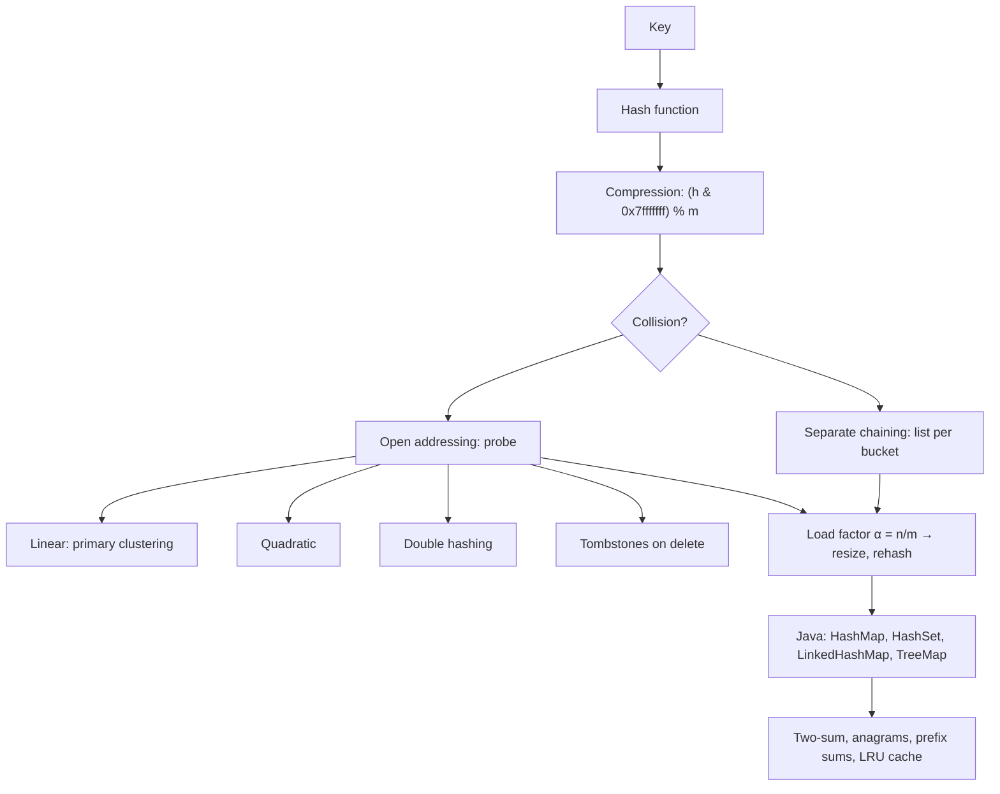

# Module 08 · Hashing

Prepared by **Hamna Zahid Khan**, Junior Lecturer

[🏠 Course home](../README.md)

> ⏱ 6 contact hours · 2 sessions · 🟡 Core

Hash tables give expected O(1) lookup, insertion and deletion by computing where a key lives. This module builds a chained map and a linear-probing map from scratch, measures how hash quality and load factor change performance, and then uses Java's hash collections to turn O(n²) problems into O(n).

## 🎯 Module objectives

- Design and evaluate hash functions; compress hash codes safely.
- Implement separate chaining and open addressing (with tombstones), with resizing.
- Explain load factor, clustering and amortised resizing.
- Apply the `equals`/`hashCode` contract and pick the right Java map or set.
- Solve counting, deduplication, prefix-sum and caching problems with hashing.

## 📚 Sessions

| # | Session | Key ideas | Code |
|---|---|---|---|
| 1 | [Hash Functions and Separate Chaining](session-01-hash-functions-and-chaining.md) | polynomial hash, compression, chaining, load factor, resize | [`HashChaining.java`](src/HashChaining.java) |
| 2 | [Open Addressing and Java's Hash Collections](session-02-open-addressing-and-java-collections.md) | probing, clustering, tombstones, equals/hashCode, LRU | [`OpenAddressing.java`](src/OpenAddressing.java) |
| ✍️ | [Practice test](practice-test.md) | 20 MCQs + 3 coding scenarios | [`Labs08.java`](src/Labs08.java), [`SelfCheck.java`](src/SelfCheck.java) |

## 🗺️ Concept map



## 📄 One-page cheat sheet

| Structure | search | insert | delete | Notes |
|---|---|---|---|---|
| Chained hash table | O(1) exp. | O(1) amort. | O(1) exp. | α ≤ 0.75, list per bucket |
| Linear probing | O(1) exp. | O(1) amort. | O(1) exp. | keep α ≤ 0.5, tombstones |
| Double hashing | O(1) exp. | O(1) amort. | O(1) exp. | step h₂ ≠ 0, prime m |
| Worst case (all collide) | O(n) | O(n) | O(n) | `HashMap` tree bins: O(log n) |
| `TreeMap` | O(log n) | O(log n) | O(log n) | sorted, floor/ceiling |

**Hash recipe:** `h = 31*h + c` for strings · `Objects.hash(f1, f2)` for objects · index = `(h & 0x7fffffff) % m`.

**Contract:** `a.equals(b)` ⇒ `a.hashCode() == b.hashCode()`; hash only immutable fields.

**Pattern templates**

```java
count.merge(x, 1, Integer::sum);                         // frequency
if (!seen.add(x)) { /* duplicate */ }                    // dedupe with HashSet
Integer i = seen.get(target - a[j]);                     // complement lookup (two-sum)
groups.computeIfAbsent(key, k -> new ArrayList<>()).add(v); // grouping
count += prefix.getOrDefault(sum - k, 0);                // subarray sum = k
```

## ▶️ Run the code

```bash
cd 08-hashing/src
javac -d out *.java
java -ea -cp out SelfCheck
java -cp out OpenAddressing
java -cp out Labs08 1          # Session 1 lab solutions (2 for Session 2)
```

See [`src/README.md`](src/README.md) for every file.
