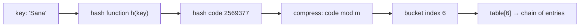
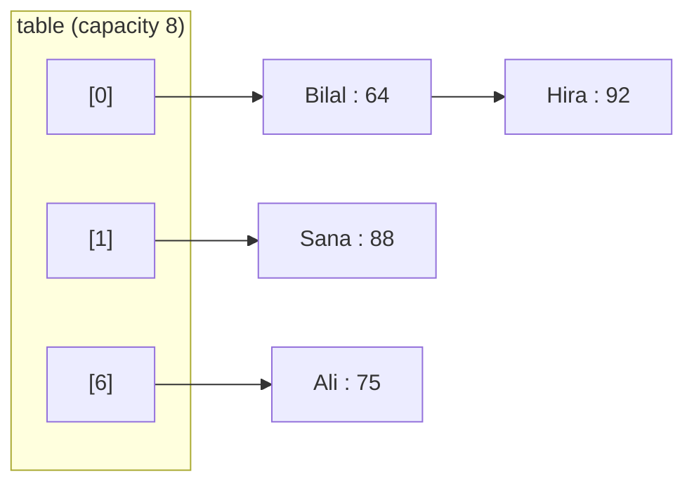

# Session 1 · Hash Functions and Separate Chaining

Prepared by **Hamna Zahid Khan**, Junior Lecturer

[🏠 Course home](../README.md) · [📘 Module overview](./README.md) · [⬅ Module overview](./README.md) · [Next ➡](./session-02-open-addressing-and-java-collections.md)

> **Module 08 · Hashing** · ⏱ 3 hours (90 min lecture + 90 min lab)

## 🎯 Learning objectives

1. Explain how a **hash table** turns a key into an array index in O(1) expected time.
2. Design and evaluate **hash functions**: determinism, uniformity, speed, and the polynomial string hash.
3. Compress a hash code into a bucket index safely (no negative indices).
4. Implement a **separate-chaining** map with `put`, `get`, `remove` and **resizing by load factor**.
5. Solve counting and lookup problems (two-sum, anagram grouping, first unique character) with hashing.

---

## 1. Why hashing?

So far, finding a key has cost O(n) (linear search) or O(log n) (binary search on a sorted array, Module 03). Hashing aims for **O(1) on average** by computing *where* a key lives instead of *searching* for it.

> 🗄️ **Analogy: the department's pigeon-hole mailboxes.** Every lecturer has a box labelled with the first letter of their surname. To deliver a letter for "Siddiqui" you go straight to box **S**: no scanning of every box. Two lecturers whose names both start with S share the box: that is a **collision**, and inside the box you look through a small pile (a **chain**).



A hash table has three ingredients:

| Ingredient | Role | Example |
|---|---|---|
| **Hash function** | key → integer hash code | `String.hashCode()` |
| **Compression** | hash code → index in `0..m-1` | `(h & 0x7fffffff) % m` |
| **Collision strategy** | what to do when two keys land in one bucket | separate chaining (this session), open addressing (Session 2) |

## 2. What makes a good hash function?

| Property | Meaning | Why it matters |
|---|---|---|
| **Deterministic** | same key → same code, every time | otherwise `get` cannot find what `put` stored |
| **Uniform** | keys spread evenly over buckets | short chains ⇒ O(1) operations |
| **Fast** | O(length of key) | hashing runs on every operation |
| **Uses the whole key** | every character/field affects the code | similar keys should not collide |

### The polynomial (rolling) string hash

For a string `s` of length n:

> h(s) = s₀·31ⁿ⁻¹ + s₁·31ⁿ⁻² + … + sₙ₋₁   (computed with Horner's rule: `h = 31*h + c`)

This is **exactly** Java's `String.hashCode()`. Multiplying by 31 makes the code depend on the **position** of each character, so anagrams differ. A plain sum of characters (the *additive hash*) gives "cat", "act" and "tac" the same code.

**Dry run: `polyHash("cat")`** (`'c'` = 99, `'a'` = 97, `'t'` = 116)

| Step | char | h = 31·h + c |
|---|---|---|
| start | – | 0 |
| 1 | c (99) | 31·0 + 99 = **99** |
| 2 | a (97) | 31·99 + 97 = **3166** |
| 3 | t (116) | 31·3166 + 116 = **98262** |

The program below prints 98262 for both `polyHash` and `String.hashCode()`.

Why 31? It is an odd prime (multiplying by an even number would lose the top bit on overflow), and `31*h` compiles to the cheap `(h << 5) - h`. Overflow simply wraps around, which is harmless: we only need determinism and spread.

### Compression: from hash code to index

A hash code can be **negative**. `h % m` in Java keeps the sign, so `-7 % 5 == -2`, an invalid index.

| Approach | Problem |
|---|---|
| `h % m` | negative for negative h |
| `Math.abs(h) % m` | `Math.abs(Integer.MIN_VALUE)` is still negative! |
| `(h & 0x7fffffff) % m` ✅ | clears the sign bit: always 0..m-1 |
| `h & (m - 1)` when m is a power of 2 | what `java.util.HashMap` does (after mixing the high bits in) |

---

## 3. Separate chaining

Each bucket holds a **linked list** (Module 05) of the entries that hash there.



| Operation | Steps | Expected cost |
|---|---|---|
| `get(k)` | compute bucket, walk its chain comparing with `equals` | O(1 + α) |
| `put(k, v)` | walk chain; update if found, else insert at head | O(1 + α) |
| `remove(k)` | walk chain keeping `prev`, unlink the node | O(1 + α) |

where **α = n / m** is the **load factor** (entries per bucket on average).

### Load factor and resizing

If α grows, chains grow and operations slow down. The fix: when α exceeds a threshold (Java uses **0.75**), **double** the table and **rehash** every entry, because each key's bucket `h mod m` changes when m changes.

| Event | Cost |
|---|---|
| A single resize | O(n): every entry moves |
| Resizes over n inserts | 1 + 2 + 4 + … + n < 2n ⇒ **O(1) amortised** per insert |

This is the same doubling argument as the dynamic array in Module 02.

### Dry run: inserting into a chained map of capacity 4

Bucket = `(hashCode & 0x7fffffff) % m`. Hash codes: Ali 65918, Sana 2569377, Bilal 64187344, Hira 2249488.

| Operation | Bucket (m = 4) | Table after | size | α |
|---|---|---|---|---|
| put(Ali, 71) | 65918 % 4 = 2 | [2] Ali | 1 | 0.25 |
| put(Sana, 88) | 2569377 % 4 = 1 | [1] Sana, [2] Ali | 2 | 0.50 |
| put(Bilal, 64) | 64187344 % 4 = 0 | [0] Bilal, [1] Sana, [2] Ali | 3 | 0.75 |
| put(Ali, 75) | 2 | value of Ali updated (old 71 returned) | 3 | 0.75 |
| put(Hira, 92) | 2249488 % 4 = 0 | size 4 ⇒ α = 1.0 > 0.75 ⇒ **resize to 8** | 4 | 0.50 |
| after rehash (m = 8) | Bilal→0, Hira→0, Sana→1, Ali→6 | [0] Bilal → Hira, [1] Sana, [6] Ali | 4 | 0.50 |

Notice how Ali moved from bucket 2 to bucket 6: rehashing is not optional.

## 4. Complexity table

| Structure | search | insert | delete | ordered iteration |
|---|---|---|---|---|
| Unsorted array | O(n) | O(1)* | O(n) | no |
| Sorted array + binary search | O(log n) | O(n) | O(n) | yes |
| Hash table, good hash, α ≤ 0.75 | **O(1) expected** | **O(1) amortised** | **O(1) expected** | no |
| Hash table, all keys collide | O(n) | O(n) | O(n) | no |
| Balanced BST (Module 10) | O(log n) | O(log n) | O(log n) | yes |

Space: O(n + m). Java 8+ `HashMap` converts a chain longer than 8 into a red-black tree, so even its worst case is O(log n).

---

## 5. Complete program

📄 **[`src/HashChaining.java`](src/HashChaining.java)**

```java
import java.util.ArrayList;
import java.util.List;

/**
 * Session 1 demo: hash functions, compression and a separate-chaining hash map built from scratch.
 *
 * Shows a polynomial string hash, how keys are compressed into bucket indices, how collisions form
 * chains, and how the table doubles when the load factor passes 0.75.
 *
 * Compile:  javac -d out HashChaining.java
 * Run:      java -cp out HashChaining
 *
 * Prepared by Hamna Zahid Khan, Junior Lecturer
 */
public class HashChaining {

    /** Polynomial rolling hash h = s0*31^(n-1) + ... + s(n-1), exactly what String.hashCode() computes. */
    static int polyHash(String s) {
        int h = 0;
        for (int i = 0; i < s.length(); i++) h = 31 * h + s.charAt(i);   // overflow wraps, which is fine
        return h;
    }

    /** A deliberately weak hash: sum of characters. Anagrams always collide. */
    static int additiveHash(String s) {
        int h = 0;
        for (char c : s.toCharArray()) h += c;
        return h;
    }

    /** Compression: map any int (possibly negative) to 0..m-1. */
    static int bucketOf(int hash, int m) {
        return (hash & 0x7fffffff) % m;     // clear the sign bit, never Math.abs (abs(MIN_VALUE) < 0)
    }

    /** Separate chaining: an array of singly linked lists of entries. */
    static final class ChainedMap<K, V> {
        private static final class Node<K, V> {
            final K key;
            V value;
            Node<K, V> next;
            Node(K k, V v, Node<K, V> n) { key = k; value = v; next = n; }
        }

        private Node<K, V>[] table;
        private int size;
        private int resizes;
        private static final double MAX_LOAD = 0.75;

        ChainedMap(int capacity) { table = newTable(capacity); }

        @SuppressWarnings("unchecked")
        private static <K, V> Node<K, V>[] newTable(int m) { return (Node<K, V>[]) new Node<?, ?>[m]; }

        private int index(Object key, int m) { return bucketOf(key.hashCode(), m); }

        V get(K key) {
            for (Node<K, V> n = table[index(key, table.length)]; n != null; n = n.next)
                if (n.key.equals(key)) return n.value;
            return null;
        }

        /** Insert or update. Returns the previous value or null. */
        V put(K key, V value) {
            int i = index(key, table.length);
            for (Node<K, V> n = table[i]; n != null; n = n.next)
                if (n.key.equals(key)) { V old = n.value; n.value = value; return old; }
            table[i] = new Node<>(key, value, table[i]);            // insert at head of chain: O(1)
            size++;
            if ((double) size / table.length > MAX_LOAD) resize(2 * table.length);
            return null;
        }

        V remove(K key) {
            int i = index(key, table.length);
            Node<K, V> prev = null;
            for (Node<K, V> n = table[i]; n != null; prev = n, n = n.next) {
                if (n.key.equals(key)) {
                    if (prev == null) table[i] = n.next; else prev.next = n.next;
                    size--;
                    return n.value;
                }
            }
            return null;
        }

        private void resize(int m) {
            Node<K, V>[] old = table;
            table = newTable(m);
            for (Node<K, V> head : old)
                for (Node<K, V> n = head; n != null; ) {
                    Node<K, V> next = n.next;
                    int i = index(n.key, m);                           // every key is rehashed
                    n.next = table[i];
                    table[i] = n;
                    n = next;
                }
            resizes++;
        }

        int size() { return size; }
        int capacity() { return table.length; }
        int resizes() { return resizes; }
        double loadFactor() { return (double) size / table.length; }

        int longestChain() {
            int best = 0;
            for (Node<K, V> head : table) {
                int len = 0;
                for (Node<K, V> n = head; n != null; n = n.next) len++;
                best = Math.max(best, len);
            }
            return best;
        }

        /** Text picture of the buckets, e.g. "[2] Sana -> Ali". */
        List<String> dump() {
            List<String> out = new ArrayList<>();
            for (int i = 0; i < table.length; i++) {
                StringBuilder sb = new StringBuilder("[" + i + "]");
                for (Node<K, V> n = table[i]; n != null; n = n.next) sb.append(n == table[i] ? " " : " -> ").append(n.key);
                out.add(sb.toString());
            }
            return out;
        }
    }

    public static void main(String[] args) {
        System.out.println("== 1. Hash functions ==");
        for (String s : new String[]{"cat", "act", "tac", "dog"})
            System.out.printf("%-4s poly=%-8d String.hashCode=%-8d additive=%d%n",
                    s, polyHash(s), s.hashCode(), additiveHash(s));

        System.out.println("\n== 2. Compression into 7 buckets ==");
        for (String s : new String[]{"Ali", "Sana", "Bilal", "Hira", "Zoya"})
            System.out.printf("%-6s hash=%-9d bucket=%d%n", s, s.hashCode(), bucketOf(s.hashCode(), 7));
        System.out.println("bucketOf(Integer.MIN_VALUE, 7) = " + bucketOf(Integer.MIN_VALUE, 7)
                + "   (Math.abs would give " + Math.abs(Integer.MIN_VALUE) + ")");

        System.out.println("\n== 3. Separate chaining (capacity 4, no resize yet) ==");
        ChainedMap<String, Integer> marks = new ChainedMap<>(4);
        marks.put("Ali", 71);
        marks.put("Sana", 88);
        marks.put("Bilal", 64);
        for (String line : marks.dump()) System.out.println(line);
        System.out.println("get(Sana) = " + marks.get("Sana") + ", get(Omar) = " + marks.get("Omar"));
        System.out.println("put(Ali, 75) returned old value " + marks.put("Ali", 75));
        System.out.println("load factor = " + marks.loadFactor());

        System.out.println("\n== 4. Fourth key pushes load past 0.75 -> resize to 8 ==");
        marks.put("Hira", 92);
        for (String line : marks.dump()) System.out.println(line);
        System.out.println("size=" + marks.size() + " capacity=" + marks.capacity() + " resizes=" + marks.resizes());

        System.out.println("\n== 5. remove(Bilal) ==");
        System.out.println("removed " + marks.remove("Bilal") + ", size now " + marks.size());

        System.out.println("\n== 6. 100,000 roll numbers: weak vs good hash ==");
        ChainedMap<String, Integer> good = new ChainedMap<>(16);
        ChainedMap<WeakKey, Integer> weak = new ChainedMap<>(16);
        for (int i = 0; i < 100_000; i++) {
            String roll = "FA24-BCS-" + i;
            good.put(roll, i);
            weak.put(new WeakKey(roll), i);
        }
        System.out.println("String.hashCode : capacity=" + good.capacity() + " longest chain=" + good.longestChain());
        System.out.println("additive hash   : capacity=" + weak.capacity() + " longest chain=" + weak.longestChain());
    }

    /** Wraps a String but uses the additive hash: shows how a poor hash function creates long chains. */
    record WeakKey(String s) {
        @Override public int hashCode() { return additiveHash(s); }
    }
}
```

**Real output:**

```text
$ java -cp out HashChaining
== 1. Hash functions ==
cat  poly=98262    String.hashCode=98262    additive=312
act  poly=96402    String.hashCode=96402    additive=312
tac  poly=114582   String.hashCode=114582   additive=312
dog  poly=99644    String.hashCode=99644    additive=314

== 2. Compression into 7 buckets ==
Ali    hash=65918     bucket=6
Sana   hash=2569377   bucket=6
Bilal  hash=64187344  bucket=4
Hira   hash=2249488   bucket=3
Zoya   hash=2791709   bucket=4
bucketOf(Integer.MIN_VALUE, 7) = 0   (Math.abs would give -2147483648)

== 3. Separate chaining (capacity 4, no resize yet) ==
[0] Bilal
[1] Sana
[2] Ali
[3]
get(Sana) = 88, get(Omar) = null
put(Ali, 75) returned old value 71
load factor = 0.75

== 4. Fourth key pushes load past 0.75 -> resize to 8 ==
[0] Bilal -> Hira
[1] Sana
[2]
[3]
[4]
[5]
[6] Ali
[7]
size=4 capacity=8 resizes=1

== 5. remove(Bilal) ==
removed 64, size now 3

== 6. 100,000 roll numbers: weak vs good hash ==
String.hashCode : capacity=262144 longest chain=3
additive hash   : capacity=262144 longest chain=5520
```

Read section 6 of the output carefully: with the same 100,000 keys and the same table, a good hash keeps the longest chain at 3 while the additive hash builds a chain of thousands. **The data structure is only as good as its hash function.**

---

## 6. Worked examples (basic → advanced)

**Example 1 (basic): frequency counting.** Count each character of `"banana"`: walk the string, `count.merge(c, 1, Integer::sum)`. Result `{a=3, b=1, n=2}` in O(n), versus O(n²) comparing every pair.

**Example 2 (intermediate): two-sum in one pass.** Given `[2, 7, 11, 15]` and target 9, store each value's index; for each `a[j]` ask "have I already seen `target − a[j]`?"

| j | a[j] | need | seen before | action |
|---|---|---|---|---|
| 0 | 2 | 7 | {} | store 2→0 |
| 1 | 7 | 2 | {2→0} | **found** ⇒ return [0, 1] |

```java
/** Indices i < j with a[i] + a[j] == target, or null. One pass: remember what we have seen. */
static int[] twoSum(int[] a, int target) {
    Map<Integer, Integer> seen = new HashMap<>();      // value -> index
    for (int j = 0; j < a.length; j++) {
        Integer i = seen.get(target - a[j]);
        if (i != null) return new int[]{i, j};
        seen.put(a[j], j);
    }
    return null;
}
```
<sub>Full, compiled version: [`src/Labs08.java`](src/Labs08.java)</sub>

O(n) time, O(n) space, versus O(n²) for checking every pair.

**Example 3 (advanced): group anagrams.** Anagrams share their **sorted letters**, so use that as the map key: `"listen"`, `"silent"`, `"enlist"` → key `"eilnst"`.

```java
/** Group words that are anagrams: the sorted letters are the key. */
static List<List<String>> groupAnagrams(String[] words) {
    Map<String, List<String>> groups = new LinkedHashMap<>();
    for (String w : words) {
        char[] c = w.toCharArray();
        Arrays.sort(c);
        groups.computeIfAbsent(new String(c), k -> new ArrayList<>()).add(w);
    }
    return new ArrayList<>(groups.values());
}
```
<sub>Full, compiled version: [`src/Labs08.java`](src/Labs08.java)</sub>

Cost: O(N · L log L) for N words of length L. A `LinkedHashMap` keeps the groups in first-seen order, which makes the output predictable.

## 7. Real-life problem: duplicate exam-portal submissions

**Problem.** During an online exam, a flaky network makes students press *Submit* several times. The server log contains 50,000 `(rollNo, timestamp)` lines. The examiner needs each student's **first** submission only, and fast.

**Solution.** Walk the log in time order with a `HashMap<String, Long> firstSubmit`. For each line, `firstSubmit.putIfAbsent(roll, time)`. Every roll number is hashed once per line ⇒ O(n) total; the sorted-array alternative would cost O(n log n), and the naive "search the list of accepted rolls" costs O(n²) (2.5 billion comparisons for 50,000 lines).

```java
Map<String, Long> firstSubmit = new HashMap<>();
for (String line : log) {                 // "FA24-BCS-017,1730102400"
    String[] p = line.split(",");
    firstSubmit.putIfAbsent(p[0], Long.parseLong(p[1]));
}
```

The same pattern (seen-set or first-seen map) deduplicates payment callbacks, sensor readings and email sends.

## 8. Common mistakes

| Mistake | Consequence | Fix |
|---|---|---|
| `Math.abs(h) % m` | negative index for `Integer.MIN_VALUE` | `(h & 0x7fffffff) % m` |
| Comparing keys with `==` | two equal strings are "different" | always `equals` inside the chain |
| Resizing without rehashing | keys are looked up in the wrong bucket | recompute every bucket |
| Weak hash (sum of chars, first letter only) | long chains, O(n) operations | polynomial hash / `Objects.hash` |
| Mutating a key after inserting it | its hash changes; the entry is "lost" | use immutable keys (`String`, records) |
| Expecting iteration order from `HashMap` | order looks random and changes after resizes | `LinkedHashMap` or `TreeMap` |

## 9. Best practices

- Use **immutable** keys: `String`, `Integer`, `record` types.
- Pre-size when you know n: `new HashMap<>(expected * 4 / 3 + 1)` avoids repeated resizes.
- Use the modern `Map` API: `getOrDefault`, `merge`, `computeIfAbsent`, `putIfAbsent`.
- Think "**have I seen this before?**" whenever a brute-force solution compares all pairs: a hash set often turns O(n²) into O(n).

---

## 10. Lab tasks

**Lab 1.1: Two-sum.** Implement `twoSum(int[] a, int target)` in O(n).

<details>
<summary>✅ Solution</summary>

See Example 2.

</details>

**Lab 1.2: Group anagrams** of `{"listen", "silent", "enlist", "rat", "tar", "art", "dog"}`.

<details>
<summary>✅ Solution</summary>

See Example 3.

</details>

**Lab 1.3: First unique character.** Return the index of the first character of `s` that occurs exactly once (`"swiss"` → 1).

<details>
<summary>💡 Hint</summary>

Pass 1 counts characters; pass 2 finds the first with count 1.

</details>

<details>
<summary>✅ Solution</summary>

```java
/** Index of the first character that appears exactly once, or -1. Two passes over a count table. */
static int firstUnique(String s) {
    Map<Character, Integer> count = new HashMap<>();
    for (char c : s.toCharArray()) count.merge(c, 1, Integer::sum);
    for (int i = 0; i < s.length(); i++) if (count.get(s.charAt(i)) == 1) return i;
    return -1;
}
```
<sub>Full, compiled version: [`src/Labs08.java`](src/Labs08.java)</sub>

</details>

**Lab 1.4: Measure chains.** Insert 10,000 random words into `ChainedMap` and print the longest chain and the average non-empty chain length. Then replace the hash with the additive hash and compare.

<details>
<summary>✅ Solution</summary>

Use `longestChain()` from the program. Expect a longest chain of about 3-4 with `String.hashCode()` and dozens or hundreds with the additive hash, because words with the same letters (and many other words) sum to the same value.

</details>

**Real output of the Session 1 lab solutions:**

```text
$ java -cp out Labs08 1
-- Session 1 labs --
twoSum([2, 7, 11, 15], 9) = [0, 1]
groupAnagrams = [[listen, silent, enlist], [rat, tar, art], [dog]]
firstUnique("swiss") = 1, firstUnique("aabb") = -1
```

---

## 11. Quiz

**Q1.** A hash table with a good hash function and load factor ≤ 0.75 searches in:

- **A.** O(log n) worst case
- **B.** O(1) expected
- **C.** O(n) always
- **D.** O(n log n)

**Q2.** Why does `Math.abs(h) % m` sometimes fail?

- **A.** abs is slow
- **B.** abs(Integer.MIN_VALUE) is still negative
- **C.** modulo is undefined for primes
- **D.** it never fails

**Q3.** Which hash makes "cat" and "act" collide?

- **A.** polynomial hash with base 31
- **B.** sum of character codes
- **C.** String.hashCode()
- **D.** SHA-256

**Q4.** A chained table has 12 entries and 16 buckets. Its load factor is:

- **A.** 0.75
- **B.** 1.33
- **C.** 12
- **D.** 4

**Q5.** After doubling a hash table you must:

- **A.** keep every entry in its old bucket
- **B.** rehash every entry into the new table
- **C.** sort the keys
- **D.** delete half of the entries

<details>
<summary><b>Show answers</b></summary>

1. **B**: Chains stay short on average.
2. **B**: The positive value 2³¹ does not fit in an int.
3. **B**: Addition ignores position.
4. **A**: α = n / m = 12 / 16.
5. **B**: The bucket index depends on m.

</details>

---

## 12. Summary

- Hashing maps a key to an index: **hash → compress → bucket**.
- A good hash is deterministic, uniform, fast and uses the whole key; `String.hashCode()` is a polynomial hash with base 31.
- **Separate chaining** keeps a linked list per bucket; operations cost O(1 + α).
- Keep α bounded by **doubling and rehashing**: O(1) amortised insertion.
- Hash maps and sets turn many O(n²) "compare all pairs" problems into O(n).

## 13. Viva / interview questions

1. What is a collision, and why can collisions never be avoided completely? (Pigeonhole principle.)
2. Why is 31 used as the multiplier in `String.hashCode()`?
3. Derive the amortised cost of insertion with doubling.
4. What happens if two unequal keys have the same hash code? If two equal keys have different hash codes?
5. Why does Java's `HashMap` use power-of-two capacities, and what does it do to compensate for poor low bits?
6. How does Java 8 bound the worst case of a very long chain?

---

[⬅ Module overview](./README.md) · [📘 Module overview](./README.md) · [Next ➡](./session-02-open-addressing-and-java-collections.md)
