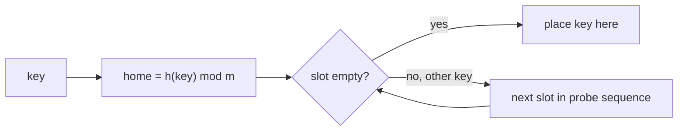
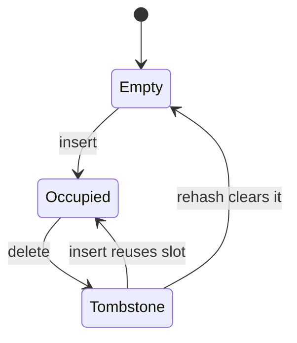
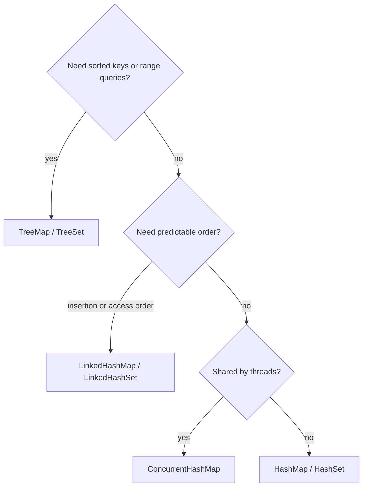

# Session 2 · Open Addressing and Java's Hash Collections

Prepared by **Hamna Zahid Khan**, Junior Lecturer

[🏠 Course home](../README.md) · [📘 Module overview](./README.md) · [⬅ Previous](./session-01-hash-functions-and-chaining.md) · [Practice test ➡](./practice-test.md)

> **Module 08 · Hashing** · ⏱ 3 hours (90 min lecture + 90 min lab)

## 🎯 Learning objectives

1. Store all entries inside the array itself with **open addressing**.
2. Compare **linear probing**, **quadratic probing** and **double hashing**, and explain **primary clustering**.
3. Delete correctly from an open-addressing table using **tombstones**.
4. Apply the **`equals`/`hashCode` contract** to your own key classes.
5. Choose between `HashMap`, `HashSet`, `LinkedHashMap` and `TreeMap`, and build an **LRU cache**.

---

## 1. Open addressing: no chains, just probing

In separate chaining every collision allocates a node. **Open addressing** keeps one entry per slot: when the home slot is taken, the key **probes** other slots in a fixed sequence until it finds an empty one.

> 🅿️ **Analogy: parking at the campus lot.** Your "home" spot is the one with your department's number. If it is taken, you drive forward to the next free spot (linear probing). To find your car later you start at your home spot and walk forward until you reach it, or until you reach an empty spot (then you know it is not there).



### Probe sequences (attempt i = 0, 1, 2, …)

| Scheme | Slot for attempt i | Strength | Weakness |
|---|---|---|---|
| Linear probing | (h + i) mod m | simple, cache-friendly | **primary clustering**: runs of full slots grow and merge |
| Quadratic probing | (h + i²) mod m | breaks up primary clusters | secondary clustering; may not visit all slots unless m is prime and α ≤ ½ |
| Double hashing | (h₁ + i·h₂) mod m, h₂ ≠ 0 | each key has its own step ⇒ closest to ideal | two hash computations |

**Primary clustering.** A long run of occupied slots is hit by every key whose home lies anywhere inside it; each such key lands at the end of the run and makes it longer. The rich get richer.

### Load factor matters more here

With open addressing α = n/m **must stay below 1** (there is no room otherwise). Expected probes for an unsuccessful search under linear probing are about ½(1 + 1/(1−α)²):

| α | 0.25 | 0.50 | 0.75 | 0.90 |
|---|---|---|---|---|
| ½(1 + 1/(1−α)²) | 1.4 | 2.5 | 8.5 | 50.5 |

That is why our implementation resizes once the table is **half** full, and why the program's measurements (section 4) show linear probing degrading fastest.

## 2. Deleting with tombstones

Setting a deleted slot back to `null` breaks searches: a later key that probed **past** that slot would now stop early and be reported missing.

**Dry run** (capacity 8; `"Aa"` and `"BB"` have the same `hashCode` 2112, so both have home slot 0):

| Step | Slots 0 1 2 3 | Note |
|---|---|---|
| put Aa | Aa _ _ _ | home 0 free |
| put BB | Aa **BB** _ _ | home 0 taken ⇒ probe 1 |
| put C | Aa BB _ **C** | home 3 |
| remove Aa, **wrong way** (null) | _ BB _ C | get(BB): slot 0 empty ⇒ "not found" ❌ |
| remove Aa, **tombstone** | † BB _ C | get(BB): skip †, find BB at 1 ✅ |
| put Aa again | **Aa** BB _ C | insert may reuse the first tombstone |

Tombstones count as "used" for the resize rule; rehashing throws them away.



## 3. Chaining vs open addressing

| | Separate chaining | Open addressing |
|---|---|---|
| Storage | array + nodes | one array |
| α allowed | can exceed 1 | must stay < 1 (keep ≤ 0.5-0.7) |
| Deletion | easy (unlink) | tombstones |
| Cache behaviour | pointer chasing | excellent (linear probing) |
| Used by | `java.util.HashMap` | Python `dict`, `IdentityHashMap`, many C++ tables |

Complexity for both: **O(1) expected** search/insert/delete with a good hash and bounded α; **O(n) worst case** (Java's `HashMap` caps it at O(log n) via tree bins).

---

## 4. Complete program

📄 **[`src/OpenAddressing.java`](src/OpenAddressing.java)**

```java
import java.util.HashMap;
import java.util.HashSet;
import java.util.LinkedHashMap;
import java.util.Map;
import java.util.Objects;
import java.util.Random;
import java.util.Set;
import java.util.TreeMap;

/**
 * Session 2 demo: open addressing (linear probing with tombstones), probe-sequence comparison,
 * the equals/hashCode contract, and Java's HashMap, HashSet, LinkedHashMap and TreeMap.
 *
 * Compile:  javac -d out OpenAddressing.java
 * Run:      java -cp out OpenAddressing
 *
 * Prepared by Hamna Zahid Khan, Junior Lecturer
 */
public class OpenAddressing {

    /** Linear-probing map with String keys and int values. Deleted slots become tombstones. */
    static final class LinearProbingMap {
        private static final String TOMBSTONE = new String("<deleted>");   // unique object, compared by ==
        private String[] keys;
        private int[] vals;
        private int size, used;          // used = live keys + tombstones
        long probes;                     // total slots inspected, for measurement

        LinearProbingMap(int capacity) { keys = new String[capacity]; vals = new int[capacity]; }

        private int home(String k, int m) { return (k.hashCode() & 0x7fffffff) % m; }

        /** Index of key k, or -1. Skips tombstones but stops at a truly empty slot. */
        private int find(String k) {
            int m = keys.length;
            for (int i = home(k, m), step = 0; step < m; i = (i + 1) % m, step++) {
                probes++;
                if (keys[i] == null) return -1;
                if (keys[i] != TOMBSTONE && keys[i].equals(k)) return i;
            }
            return -1;
        }

        Integer get(String k) { int i = find(k); return i < 0 ? null : vals[i]; }

        void put(String k, int v) {
            int i = find(k);
            if (i >= 0) { vals[i] = v; return; }
            if (2 * (used + 1) > keys.length) rehash(4 * size + 4);    // keep (live + tombstones) <= 1/2
            int m = keys.length;
            int j = home(k, m);
            while (keys[j] != null && keys[j] != TOMBSTONE) { j = (j + 1) % m; probes++; }
            if (keys[j] == null) used++;
            keys[j] = k;
            vals[j] = v;
            size++;
        }

        boolean remove(String k) {
            int i = find(k);
            if (i < 0) return false;
            keys[i] = TOMBSTONE;            // NOT null: that would break the probe chains behind it
            size--;
            return true;
        }

        private void rehash(int m) {
            String[] ok = keys;
            int[] ov = vals;
            keys = new String[m];
            vals = new int[m];
            size = used = 0;
            for (int i = 0; i < ok.length; i++)
                if (ok[i] != null && ok[i] != TOMBSTONE) put(ok[i], ov[i]);
        }

        int size() { return size; }
        int capacity() { return keys.length; }

        String layout() {
            StringBuilder sb = new StringBuilder();
            for (int i = 0; i < keys.length; i++)
                sb.append(i).append(':').append(keys[i] == null ? "_" : keys[i] == TOMBSTONE ? "†" : keys[i]).append(' ');
            return sb.toString().trim();
        }
    }

    /** Average probes per successful insert for one probing scheme into a table of size m at load alpha. */
    static double averageProbes(String scheme, int m, double alpha, long seed) {
        Integer[] t = new Integer[m];
        Random r = new Random(seed);
        int n = (int) (alpha * m);
        long total = 0;
        for (int c = 0; c < n; c++) {
            int key = r.nextInt(1_000_000);
            int h1 = key % m, h2 = 1 + key % (m - 2);
            for (int i = 0; ; i++) {
                int idx;
                if (scheme.equals("linear")) idx = (h1 + i) % m;
                else if (scheme.equals("quadratic")) idx = (int) ((h1 + (long) i * i) % m);
                else idx = (int) ((h1 + (long) i * h2) % m);
                total++;
                if (t[idx] == null) { t[idx] = key; break; }
                if (i > m) break;           // quadratic may cycle; give up (counted)
            }
        }
        return (double) total / n;
    }

    /** A key class that follows the equals/hashCode contract. */
    static final class Student {
        final String roll;
        final String name;
        Student(String roll, String name) { this.roll = roll; this.name = name; }
        @Override public boolean equals(Object o) {
            return o instanceof Student && ((Student) o).roll.equals(roll);
        }
        @Override public int hashCode() { return Objects.hash(roll); }
        @Override public String toString() { return roll; }
    }

    /** Same fields, but overrides equals only: breaks HashSet. */
    static final class BrokenStudent {
        final String roll;
        BrokenStudent(String roll) { this.roll = roll; }
        @Override public boolean equals(Object o) {
            return o instanceof BrokenStudent && ((BrokenStudent) o).roll.equals(roll);
        }
        @Override public int hashCode() { return System.identityHashCode(this); }  // what you get by NOT overriding
    }

    public static void main(String[] args) {
        System.out.println("== 1. Linear probing, capacity 8 ==");
        LinearProbingMap m = new LinearProbingMap(8);
        // "Aa" and "BB" have the same String.hashCode (2112): a classic collision
        for (String k : new String[]{"Aa", "BB", "C"}) {
            m.put(k, k.length());
            System.out.printf("put %-3s home=%d -> %s%n", k, (k.hashCode() & 0x7fffffff) % 8, m.layout());
        }
        m.remove("Aa");
        System.out.println("remove Aa       -> " + m.layout());
        System.out.println("get(BB) after delete = " + m.get("BB") + "  (tombstone kept the chain intact)");
        m.put("Aa", 9);
        System.out.println("put Aa again    -> " + m.layout());

        System.out.println("\n== 2. Average probes per insert (m = 10007) ==");
        System.out.println("load    linear  quadratic  double");
        for (double a : new double[]{0.25, 0.5, 0.75, 0.9})
            System.out.printf("%.2f  %7.2f  %9.2f  %6.2f%n", a,
                    averageProbes("linear", 10007, a, 1), averageProbes("quadratic", 10007, a, 1),
                    averageProbes("double", 10007, a, 1));

        System.out.println("\n== 3. equals/hashCode contract ==");
        Set<Student> good = new HashSet<>();
        good.add(new Student("BCS-01", "Hira"));
        good.add(new Student("BCS-01", "Hira A."));
        Set<BrokenStudent> bad = new HashSet<>();
        bad.add(new BrokenStudent("BCS-01"));
        bad.add(new BrokenStudent("BCS-01"));
        System.out.println("HashSet<Student> size       = " + good.size() + "  (duplicates detected)");
        System.out.println("HashSet<BrokenStudent> size = " + bad.size() + "  (equal objects, different hash codes)");
        System.out.println("contains(new Student(BCS-01)) = " + good.contains(new Student("BCS-01", "?")));

        System.out.println("\n== 4. Word frequency with HashMap.merge ==");
        String text = "to be or not to be that is the question to ask";
        Map<String, Integer> freq = new HashMap<>();
        for (String w : text.split(" ")) freq.merge(w, 1, Integer::sum);
        System.out.println("freq(to) = " + freq.get("to") + ", freq(be) = " + freq.get("be")
                + ", freq(why) = " + freq.getOrDefault("why", 0));

        System.out.println("\n== 5. Same entries, three maps ==");
        String[] courses = {"DSA", "OOP", "AI", "DB"};
        Map<String, Integer> hm = new HashMap<>(), lhm = new LinkedHashMap<>(), tm = new TreeMap<>();
        for (int i = 0; i < courses.length; i++) { hm.put(courses[i], i); lhm.put(courses[i], i); tm.put(courses[i], i); }
        System.out.println("HashMap       " + hm.keySet() + "  (order not guaranteed)");
        System.out.println("LinkedHashMap " + lhm.keySet() + "  (insertion order)");
        System.out.println("TreeMap       " + tm.keySet() + "  (sorted)");
    }
}
```

**Real output:**

```text
$ java -cp out OpenAddressing
== 1. Linear probing, capacity 8 ==
put Aa  home=0 -> 0:Aa 1:_ 2:_ 3:_ 4:_ 5:_ 6:_ 7:_
put BB  home=0 -> 0:Aa 1:BB 2:_ 3:_ 4:_ 5:_ 6:_ 7:_
put C   home=3 -> 0:Aa 1:BB 2:_ 3:C 4:_ 5:_ 6:_ 7:_
remove Aa       -> 0:† 1:BB 2:_ 3:C 4:_ 5:_ 6:_ 7:_
get(BB) after delete = 2  (tombstone kept the chain intact)
put Aa again    -> 0:Aa 1:BB 2:_ 3:C 4:_ 5:_ 6:_ 7:_

== 2. Average probes per insert (m = 10007) ==
load    linear  quadratic  double
0.25     1.16       1.15    1.14
0.50     1.52       1.43    1.37
0.75     2.53       1.95    1.84
0.90     5.19       2.77    2.53

== 3. equals/hashCode contract ==
HashSet<Student> size       = 1  (duplicates detected)
HashSet<BrokenStudent> size = 2  (equal objects, different hash codes)
contains(new Student(BCS-01)) = true

== 4. Word frequency with HashMap.merge ==
freq(to) = 3, freq(be) = 2, freq(why) = 0

== 5. Same entries, three maps ==
HashMap       [OOP, DSA, AI, DB]  (order not guaranteed)
LinkedHashMap [DSA, OOP, AI, DB]  (insertion order)
TreeMap       [AI, DB, DSA, OOP]  (sorted)
```

Section 2 of the output confirms the theory: at α = 0.9, linear probing needs roughly twice as many probes as double hashing.

---

## 5. The `equals`/`hashCode` contract

Every Java hash collection relies on two rules:

1. If `a.equals(b)` then `a.hashCode() == b.hashCode()`.
2. `hashCode()` must not change while the object is inside a hash collection.

(Unequal objects *may* share a hash code; that is just a collision.)

| You override… | Result in `HashSet` |
|---|---|
| neither | each object equal only to itself (identity) |
| `equals` only ❌ | equal objects land in different buckets ⇒ duplicates, failed `contains` |
| `hashCode` only | same bucket, but never "equal" ⇒ duplicates |
| both, on the same fields ✅ | correct |

The output above shows `BrokenStudent` producing a set of size 2 for two equal objects. A Java `record` generates both methods for you from its components.

## 6. Choosing a Java collection

| Need | Use | Ops |
|---|---|---|
| key → value, no order | `HashMap` | O(1) expected |
| unique items, membership test | `HashSet` | O(1) expected |
| keep insertion (or access) order | `LinkedHashMap` / `LinkedHashSet` | O(1) expected |
| sorted keys, floor/ceiling, range queries | `TreeMap` / `TreeSet` | O(log n) |
| many threads | `ConcurrentHashMap` | O(1) expected |



---

## 7. Worked examples (basic → advanced)

**Example 1 (basic): longest consecutive sequence.** For `[100, 4, 200, 1, 3, 2]` the answer is 4 (1, 2, 3, 4). Put everything in a set and start counting only at numbers whose predecessor is absent, so each number is visited O(1) times overall.

```java
/** Length of the longest run of consecutive integers in an unsorted array, O(n) expected. */
static int longestConsecutive(int[] a) {
    Set<Integer> s = new HashSet<>();
    for (int x : a) s.add(x);
    int best = 0;
    for (int x : s) {
        if (s.contains(x - 1)) continue;          // only start counting at the beginning of a run
        int len = 1;
        while (s.contains(x + len)) len++;
        best = Math.max(best, len);
    }
    return best;
}
```
<sub>Full, compiled version: [`src/Labs08.java`](src/Labs08.java)</sub>

**Example 2 (intermediate): count subarrays with sum k (negatives allowed).** If prefix sums at two positions differ by k, the subarray between them sums to k. Store how many times each prefix sum has occurred.

Dry run for `[1, 2, 3, -2, 2]`, k = 3:

| x | prefix sum | need sum − k | times seen | count | map after |
|---|---|---|---|---|---|
| – | 0 | – | – | 0 | {0:1} |
| 1 | 1 | −2 | 0 | 0 | {0:1, 1:1} |
| 2 | 3 | 0 | 1 | 1 | {…, 3:1} |
| 3 | 6 | 3 | 1 | 2 | {…, 6:1} |
| −2 | 4 | 1 | 1 | 3 | {…, 4:1} |
| 2 | 6 | 3 | 1 | **4** | {…, 6:2} |

```java
/** Number of contiguous subarrays summing to k (negatives allowed): prefix sums + hash map. */
static int subarraySum(int[] a, int k) {
    Map<Integer, Integer> prefixCount = new HashMap<>();
    prefixCount.put(0, 1);                      // empty prefix
    int sum = 0, count = 0;
    for (int x : a) {
        sum += x;
        count += prefixCount.getOrDefault(sum - k, 0);
        prefixCount.merge(sum, 1, Integer::sum);
    }
    return count;
}
```
<sub>Full, compiled version: [`src/Labs08.java`](src/Labs08.java)</sub>

The sliding-window technique cannot do this because negative numbers break its monotonicity.

**Example 3 (advanced): LRU cache in ten lines.** `LinkedHashMap` with `accessOrder = true` moves an entry to the end on every `get`/`put`; overriding `removeEldestEntry` evicts the front when full.

```java
/** LRU cache: LinkedHashMap in access order evicts the least recently used entry. */
static final class LRUCache<K, V> extends LinkedHashMap<K, V> {
    private static final long serialVersionUID = 1L;
    private final int capacity;
    LRUCache(int capacity) { super(16, 0.75f, true); this.capacity = capacity; }
    @Override protected boolean removeEldestEntry(Map.Entry<K, V> eldest) { return size() > capacity; }
}
```
<sub>Full, compiled version: [`src/Labs08.java`](src/Labs08.java)</sub>

Every operation is O(1). (Under the hood: a hash map pointing into a doubly linked list, Module 05.)

## 8. Real-life problem: caching student-transcript pages

**Problem.** The results portal renders a transcript page in about 400 ms by querying several tables. On result day thousands of students refresh the same pages. Memory allows only the **500 most recent** pages to be cached.

**Solution.** An LRU cache keyed by roll number: on a request, `cache.get(roll)`; on a miss, render the page and `cache.put(roll, html)`. Popular pages stay hot; pages nobody has viewed recently are evicted automatically. Both operations are O(1), so the cache never becomes the bottleneck. In production the same idea appears as `Caffeine`/`Guava` caches and as Redis with the `allkeys-lru` policy.

## 9. Common mistakes

| Mistake | Fix |
|---|---|
| Deleting by setting the slot to `null` in open addressing | use a tombstone |
| Letting an open-addressing table fill up | resize at α ≈ 0.5-0.7 |
| Overriding `equals` but not `hashCode` | override both, using the same fields (or use a `record`) |
| Using mutable fields (e.g. `marks`) inside `hashCode` | hash only identity fields such as `roll` |
| `map.get(k) + 1` when k may be absent | `merge(k, 1, Integer::sum)` or `getOrDefault` |
| Comparing `Integer` values from a map with `==` | `==` compares references above 127; use `equals` or unbox |

## 10. Best practices

- Default to `HashMap`/`HashSet`; switch to `TreeMap` only when you need order or ranges.
- Use `record` key types: correct `equals`/`hashCode` and immutability for free.
- Do not rely on `HashMap` iteration order, ever; it can change between Java versions.
- For security-sensitive input (web request parameters), remember attackers can craft colliding keys; Java's tree bins protect `HashMap`.

---

## 11. Lab tasks

**Lab 2.1: Longest consecutive sequence** in O(n).

<details>
<summary>✅ Solution</summary>

See Example 1.

</details>

**Lab 2.2: Subarrays with sum k.** Implement and test on `[1, 2, 3, -2, 2]`, k = 3 (answer 4).

<details>
<summary>✅ Solution</summary>

See Example 2.

</details>

**Lab 2.3: Isomorphic strings.** `"egg"`/`"add"` are isomorphic, `"foo"`/`"bar"` are not. The mapping must be one-to-one in both directions.

<details>
<summary>💡 Hint</summary>

Keep two maps, s→t and t→s, and reject any conflict.

</details>

<details>
<summary>✅ Solution</summary>

```java
/** "egg" and "add" are isomorphic: a consistent one-to-one letter mapping exists. */
static boolean isomorphic(String s, String t) {
    if (s.length() != t.length()) return false;
    Map<Character, Character> st = new HashMap<>(), ts = new HashMap<>();
    for (int i = 0; i < s.length(); i++) {
        char a = s.charAt(i), b = t.charAt(i);
        if (st.getOrDefault(a, b) != b || ts.getOrDefault(b, a) != a) return false;
        st.put(a, b);
        ts.put(b, a);
    }
    return true;
}
```
<sub>Full, compiled version: [`src/Labs08.java`](src/Labs08.java)</sub>

</details>

**Lab 2.4: Add double hashing** to `LinearProbingMap`: step `h₂ = 1 + (h mod (m − 1))` and use a **prime** capacity. Why must h₂ never be 0, and why does a prime m help?

<details>
<summary>✅ Solution</summary>

Replace `i = (i + 1) % m` with `i = (i + step) % m` where `step = 1 + (h & 0x7fffffff) % (m - 1)`. If h₂ were 0 the probe would stay on one slot forever. With a prime m, any step from 1 to m − 1 is coprime with m, so the sequence visits **every** slot before repeating.

</details>

**Real output of the Session 2 lab solutions:**

```text
$ java -cp out Labs08 2
-- Session 2 labs --
longestConsecutive([100, 4, 200, 1, 3, 2]) = 4
subarraySum([1, 2, 3, -2, 2], 3) = 4
LRU cache keys after access + insert = [/home, /ai]
isomorphic(egg, add) = true, isomorphic(foo, bar) = false
```

---

## 12. Quiz

**Q1.** Primary clustering is a weakness of:

- **A.** separate chaining
- **B.** linear probing
- **C.** double hashing
- **D.** TreeMap

**Q2.** Why can an open-addressing table not simply set a deleted slot to null?

- **A.** it wastes memory
- **B.** later searches would stop early and miss keys that probed past it
- **C.** Java forbids null
- **D.** it changes the hash function

**Q3.** You override `equals` in a class but not `hashCode`. Two equal objects added to a HashSet give size:

- **A.** 1
- **B.** usually 2
- **C.** 0
- **D.** compile error

**Q4.** Which map returns keys in sorted order?

- **A.** HashMap
- **B.** LinkedHashMap
- **C.** TreeMap
- **D.** IdentityHashMap

**Q5.** An LRU cache with O(1) operations combines:

- **A.** an array and binary search
- **B.** a hash map and a doubly linked list
- **C.** two stacks
- **D.** a heap and a queue

<details>
<summary><b>Show answers</b></summary>

1. **B**: Runs of occupied slots grow and merge.
2. **B**: Use a tombstone instead.
3. **B**: Different identity hash codes put them in different buckets.
4. **C**: TreeMap is a red-black tree.
5. **B**: LinkedHashMap is exactly this combination.

</details>

---

## 13. Summary

- **Open addressing** stores entries in the array and probes on collision; keep α low.
- Linear probing is fast but clusters; quadratic probing and **double hashing** spread keys better.
- Delete with **tombstones**; rehash to clean them up.
- Override **`equals` and `hashCode` together** on the same immutable fields.
- Pick `HashMap` for speed, `LinkedHashMap` for order (and LRU), `TreeMap` for sorted keys.

## 14. Viva / interview questions

1. Compare chaining and open addressing on memory, cache behaviour and deletion.
2. Explain primary and secondary clustering.
3. Why does quadratic probing need a prime table size and α ≤ ½ to guarantee an empty slot is found?
4. State the `equals`/`hashCode` contract and give a bug that results from breaking it.
5. Design an LRU cache with O(1) `get` and `put` without using `LinkedHashMap`.
6. When would you choose `TreeMap` over `HashMap` despite the slower operations?

---

[⬅ Previous](./session-01-hash-functions-and-chaining.md) · [📘 Module overview](./README.md) · [Practice test ➡](./practice-test.md)
