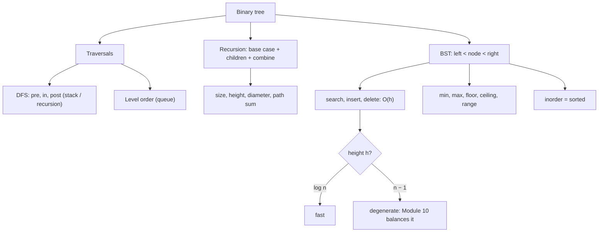

# Module 09 · Trees and Binary Search Trees

Prepared by **Hamna Zahid Khan**, Junior Lecturer

[🏠 Course home](../README.md)

> ⏱ 6 contact hours · 2 sessions · 🟡 Core

Trees are the first non-linear structure in the course. This module builds binary trees, all four traversals and recursive tree algorithms, then adds ordering to get the binary search tree: search, insert, delete, floor/ceiling and range queries in O(h).

## 🎯 Module objectives

- Use tree terminology and relate height to the number of nodes.
- Implement preorder, inorder, postorder (recursive and iterative) and level-order traversal.
- Write recursive tree algorithms: size, height, path sum, diameter, symmetry.
- Implement a BST with search, insert, delete (three cases), floor, ceiling and range queries.
- Explain why height matters and why balancing is needed.

## 📚 Sessions

| # | Session | Key ideas | Code |
|---|---|---|---|
| 1 | [Binary Trees and Traversals](session-01-binary-trees-and-traversals.md) | terminology, traversals, recursion template, diameter | [`BinaryTrees.java`](src/BinaryTrees.java) |
| 2 | [Binary Search Trees](session-02-binary-search-trees.md) | BST property, ordered queries, deletion, validation, height | [`BinarySearchTree.java`](src/BinarySearchTree.java) |
| ✍️ | [Practice test](practice-test.md) | 20 MCQs + 3 coding scenarios | [`Labs09.java`](src/Labs09.java), [`SelfCheck.java`](src/SelfCheck.java) |

## 🗺️ Concept map



## 📄 One-page cheat sheet

| Operation | Binary tree | BST (height h) |
|---|---|---|
| Traversal | O(n) | O(n) |
| Search | O(n) | O(h) |
| Insert / delete | – | O(h) |
| min / max / floor / ceiling | O(n) | O(h) |
| Range query (k results) | O(n) | O(h + k) |

**Traversal orders:** pre = N L R · in = L N R · post = L R N · level = queue.
**Height:** empty = −1, one node = 0; balanced ≈ log₂ n, degenerate = n − 1.

**Recursion template**

```java
R solve(Node n) {
    if (n == null) return BASE;
    R l = solve(n.left), r = solve(n.right);
    return combine(n, l, r);
}
```

**BST delete:** leaf → null · one child → that child · two children → copy successor (min of right), delete it.
**BST validate:** `isValid(n, lo, hi)` with `lo < n.key < hi`.

## ▶️ Run the code

```bash
cd 09-trees-and-bst/src
javac -d out *.java
java -ea -cp out SelfCheck
java -cp out BinarySearchTree
java -cp out Labs09 1          # Session 1 lab solutions (2 for Session 2)
```

See [`src/README.md`](src/README.md) for every file.
