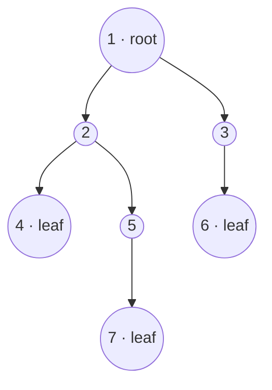
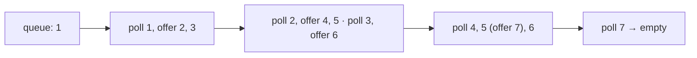

# Session 1 · Binary Trees and Traversals

Prepared by **Hamna Zahid Khan**, Junior Lecturer

[🏠 Course home](../README.md) · [📘 Module overview](./README.md) · [⬅ Module overview](./README.md) · [Next ➡](./session-02-binary-search-trees.md)

> **Module 09 · Trees and Binary Search Trees** · ⏱ 3 hours (90 min lecture + 90 min lab)

## 🎯 Learning objectives

1. Use tree vocabulary precisely: root, parent, child, leaf, depth, height, subtree, level.
2. Classify binary trees: full, complete, perfect, degenerate, and relate height to node count.
3. Implement **preorder, inorder, postorder** (recursive and iterative) and **level-order** traversal.
4. Write recursive tree functions with the pattern "solve for the children, combine at the node".
5. Serialise a tree and rebuild it, and solve classic problems (symmetry, path sum, diameter).

---

## 1. From lists to trees

Arrays and linked lists are **linear**: each element has one successor. A **tree** is **hierarchical**: each node can have several children, and every node except the root has exactly one parent.

> 🏛️ **Analogy: the university organogram.** The Vice-Chancellor is the **root**. Deans are children of the VC, chairpersons are children of deans, and lecturers with nobody reporting to them are **leaves**. "Everyone under the Dean of Computing" is a **subtree**. The number of levels from the VC down to the most junior lecturer is the **height**.

Trees model file systems (folders), HTML/XML documents (the DOM), compilers' expression trees, decision trees in machine learning, and the menus of every app.



| Term | Meaning (for the tree above) |
|---|---|
| Root | the only node without a parent: **1** |
| Parent / child | 2 is the parent of 4 and 5 |
| Leaf | node with no children: 4, 7, 6 |
| Internal node | node with at least one child: 1, 2, 3, 5 |
| Depth of a node | edges from the root: depth(7) = 3 |
| Height of the tree | max depth of any node: **3** (empty tree: −1) |
| Level | all nodes with the same depth: level 2 = {4, 5, 6} |
| Subtree | a node and all its descendants: subtree(2) = {2, 4, 5, 7} |

### Kinds of binary trees

In a **binary tree** each node has at most two children, called **left** and **right**.

| Kind | Definition | Example use |
|---|---|---|
| Full | every node has 0 or 2 children | expression trees, Huffman trees |
| Complete | all levels full except possibly the last, filled left to right | binary heaps (Module 11) |
| Perfect | all internal nodes have 2 children, all leaves at the same depth | idealised analysis |
| Degenerate | every node has one child | a linked list in disguise: worst case |

**Height and size.** A perfect tree of height h has 2^(h+1) − 1 nodes, so a tree with n nodes has height at least ⌊log₂ n⌋ and at most n − 1. Almost every tree operation costs **O(h)**, which is why Module 10 is all about keeping h close to log n.

## 2. Representing a node in Java

```java
static final class Node {
    int val;
    Node left, right;      // null means "no child"
    Node(int v) { val = v; }
}
```

A tree is just a reference to its root; an **empty tree is `null`**. Every recursive function therefore starts with the base case `if (n == null) …`.

## 3. Traversals

A traversal visits every node exactly once: **O(n) time**. Depth-first traversals use the call stack (O(h) extra space); level order uses a queue (O(width) extra space).

| Traversal | Order | Output for the sample tree | Typical use |
|---|---|---|---|
| Preorder | **N**ode, Left, Right | 1 2 4 5 7 3 6 | copy/serialise a tree, prefix expressions |
| Inorder | Left, **N**ode, Right | 4 2 7 5 1 3 6 | BST ⇒ sorted order (Session 2) |
| Postorder | Left, Right, **N**ode | 4 7 5 2 6 3 1 | delete a tree, evaluate expressions, compute sizes/heights |
| Level order | level by level, left to right | 1 · 2 3 · 4 5 6 · 7 | shortest path in unweighted trees, printing by level |

> 🧭 **Memory trick:** the prefix tells you **when the node itself is visited**: *pre* = before its children, *in* = between them, *post* = after them.

### Dry run: recursive inorder on the sample tree

| Call | Action | Output so far |
|---|---|---|
| inorder(1) | go left to 2 | |
| inorder(2) | go left to 4 | |
| inorder(4) | left null, **visit 4**, right null | 4 |
| back in 2 | **visit 2**, go right to 5 | 4 2 |
| inorder(5) | go left to 7, **visit 7**, back, **visit 5**, right null | 4 2 7 5 |
| back in 1 | **visit 1**, go right to 3 | 4 2 7 5 1 |
| inorder(3) | left null, **visit 3**, go right to 6, **visit 6** | 4 2 7 5 1 3 6 |

### Iterative inorder with an explicit stack

Recursion uses the call stack; we can manage our own (Module 06): push nodes while going left, pop to visit, then move to the right child.

| Step | Stack (top at right) | cur | Visited |
|---|---|---|---|
| push left spine of 1 | 1 2 4 | null | |
| pop 4, visit | 1 2 | 4.right = null | 4 |
| pop 2, visit, go right | 1 | 5 | 4 2 |
| push left spine of 5 | 1 5 7 | null | 4 2 |
| pop 7, pop 5 | 1 | null | 4 2 7 5 |
| pop 1, go right | – | 3 | … 1 |
| push 3; pop 3; go right; push 6; pop 6 | – | null | 4 2 7 5 1 3 6 |

### Level order with a queue



Recording `q.size()` at the start of each round gives the exact width of the current level, so the output can be grouped `[[1], [2, 3], [4, 5, 6], [7]]`.

## 4. Thinking recursively about trees

Almost every tree function follows one template:

```java
static R solve(Node n) {
    if (n == null) return BASE;                 // empty tree
    R left = solve(n.left), right = solve(n.right);
    return combine(n.val, left, right);
}
```

| Function | BASE | combine |
|---|---|---|
| size | 0 | 1 + left + right |
| height (edges) | −1 | 1 + max(left, right) |
| sum | 0 | val + left + right |
| leaves | 0 | (leaf ? 1 : left + right) |
| max value | −∞ | max(val, left, right) |

Each is a **postorder** computation: the children's answers are needed first.

## 5. Complexity table

| Operation | Time | Extra space |
|---|---|---|
| Any traversal | O(n) | O(h) recursion/stack, or O(w) queue for level order |
| size, height, sum, leaves | O(n) | O(h) |
| Search for a value (no ordering) | O(n) | O(h) |
| Serialise / rebuild | O(n) | O(n) output, O(h) recursion |

h ranges from log₂ n (balanced) to n − 1 (degenerate); w (maximum width) can be up to about n/2.

---

## 6. Complete program

📄 **[`src/BinaryTrees.java`](src/BinaryTrees.java)**

```java
import java.util.ArrayDeque;
import java.util.ArrayList;
import java.util.Deque;
import java.util.List;
import java.util.Queue;

/**
 * Session 1 demo: binary-tree nodes, the four traversals (recursive and iterative), and basic
 * recursive measurements: size, height, leaves, and a sideways picture of the tree.
 *
 * Compile:  javac -d out BinaryTrees.java
 * Run:      java -cp out BinaryTrees
 *
 * Prepared by Hamna Zahid Khan, Junior Lecturer
 */
public class BinaryTrees {

    /** A binary-tree node: a value and two child links. */
    static final class Node {
        int val;
        Node left, right;
        Node(int v) { val = v; }
        Node(int v, Node l, Node r) { val = v; left = l; right = r; }
    }

    // ---------- depth-first traversals (recursive) ----------
    static void preorder(Node n, List<Integer> out) {      // Node, Left, Right
        if (n == null) return;
        out.add(n.val);
        preorder(n.left, out);
        preorder(n.right, out);
    }

    static void inorder(Node n, List<Integer> out) {       // Left, Node, Right
        if (n == null) return;
        inorder(n.left, out);
        out.add(n.val);
        inorder(n.right, out);
    }

    static void postorder(Node n, List<Integer> out) {     // Left, Right, Node
        if (n == null) return;
        postorder(n.left, out);
        postorder(n.right, out);
        out.add(n.val);
    }

    /** Iterative inorder with an explicit stack: go left as far as possible, visit, then go right. */
    static List<Integer> inorderIterative(Node root) {
        List<Integer> out = new ArrayList<>();
        Deque<Node> stack = new ArrayDeque<>();
        Node cur = root;
        while (cur != null || !stack.isEmpty()) {
            while (cur != null) { stack.push(cur); cur = cur.left; }
            cur = stack.pop();
            out.add(cur.val);
            cur = cur.right;
        }
        return out;
    }

    /** Breadth-first (level-order) traversal with a queue, one list per level. */
    static List<List<Integer>> levelOrder(Node root) {
        List<List<Integer>> levels = new ArrayList<>();
        if (root == null) return levels;
        Queue<Node> q = new ArrayDeque<>();
        q.offer(root);
        while (!q.isEmpty()) {
            int width = q.size();                    // nodes currently in the queue = one whole level
            List<Integer> level = new ArrayList<>();
            for (int i = 0; i < width; i++) {
                Node n = q.poll();
                level.add(n.val);
                if (n.left != null) q.offer(n.left);
                if (n.right != null) q.offer(n.right);
            }
            levels.add(level);
        }
        return levels;
    }

    // ---------- recursive measurements ----------
    static int size(Node n) { return n == null ? 0 : 1 + size(n.left) + size(n.right); }

    /** Height in edges: empty tree = -1, single node = 0. */
    static int height(Node n) { return n == null ? -1 : 1 + Math.max(height(n.left), height(n.right)); }

    static int leaves(Node n) {
        if (n == null) return 0;
        if (n.left == null && n.right == null) return 1;
        return leaves(n.left) + leaves(n.right);
    }

    static int sum(Node n) { return n == null ? 0 : n.val + sum(n.left) + sum(n.right); }

    /** Prints the tree rotated 90° counter-clockwise: the root on the left, right subtree on top. */
    static void printSideways(Node n, String indent) {
        if (n == null) return;
        printSideways(n.right, indent + "      ");
        System.out.println(indent + n.val);
        printSideways(n.left, indent + "      ");
    }

    /** Rebuild a tree from preorder with nulls (-1 marks an empty child): the usual serialisation. */
    static int pos;
    static Node fromPreorder(int[] a) { pos = 0; return build(a); }
    private static Node build(int[] a) {
        int v = a[pos++];
        if (v == -1) return null;
        Node n = new Node(v);
        n.left = build(a);
        n.right = build(a);
        return n;
    }

    /** The sample tree used throughout the session. */
    static Node sample() {
        //            1
        //          /   \
        //         2     3
        //        / \     \
        //       4   5     6
        //          /
        //         7
        return new Node(1,
                new Node(2, new Node(4), new Node(5, new Node(7), null)),
                new Node(3, null, new Node(6)));
    }

    public static void main(String[] args) {
        Node root = sample();
        System.out.println("Tree printed sideways (root at left):");
        printSideways(root, "");

        List<Integer> pre = new ArrayList<>(), in = new ArrayList<>(), post = new ArrayList<>();
        preorder(root, pre);
        inorder(root, in);
        postorder(root, post);
        System.out.println("\npreorder  (N L R) = " + pre);
        System.out.println("inorder   (L N R) = " + in);
        System.out.println("postorder (L R N) = " + post);
        System.out.println("inorder, iterative = " + inorderIterative(root));
        System.out.println("level order        = " + levelOrder(root));

        System.out.println("\nsize = " + size(root) + ", height = " + height(root)
                + ", leaves = " + leaves(root) + ", sum = " + sum(root));

        int[] serial = {1, 2, 4, -1, -1, 5, 7, -1, -1, -1, 3, -1, 6, -1, -1};
        Node copy = fromPreorder(serial);
        List<Integer> check = new ArrayList<>();
        preorder(copy, check);
        System.out.println("rebuilt from serialised preorder -> preorder = " + check
                + ", same as original: " + check.equals(pre));
    }
}
```

**Real output:**

```text
$ java -cp out BinaryTrees
Tree printed sideways (root at left):
            6
      3
1
            5
                  7
      2
            4

preorder  (N L R) = [1, 2, 4, 5, 7, 3, 6]
inorder   (L N R) = [4, 2, 7, 5, 1, 3, 6]
postorder (L R N) = [4, 7, 5, 2, 6, 3, 1]
inorder, iterative = [4, 2, 7, 5, 1, 3, 6]
level order        = [[1], [2, 3], [4, 5, 6], [7]]

size = 7, height = 3, leaves = 3, sum = 28
rebuilt from serialised preorder -> preorder = [1, 2, 4, 5, 7, 3, 6], same as original: true
```

---

## 7. Worked examples (basic → advanced)

**Example 1 (basic): symmetric tree.** A tree is a mirror of itself if the left subtree's left matches the right subtree's right, and vice versa.

```java
/** A tree is symmetric if its left subtree mirrors its right subtree. */
static boolean isSymmetric(BinaryTrees.Node root) { return root == null || mirror(root.left, root.right); }

static boolean mirror(BinaryTrees.Node a, BinaryTrees.Node b) {
    if (a == null || b == null) return a == b;
    return a.val == b.val && mirror(a.left, b.right) && mirror(a.right, b.left);
}
```
<sub>Full, compiled version: [`src/Labs09.java`](src/Labs09.java)</sub>

**Example 2 (intermediate): root-to-leaf path sum.** Is there a path from the root to a leaf with sum 15? Subtract each value on the way down; at a leaf, check whether what remains equals the leaf's value. In the sample tree 1 → 2 → 5 → 7 sums to 15.

```java
/** Is there a root-to-leaf path whose values add up to target? Subtract as you descend. */
static boolean hasPathSum(BinaryTrees.Node n, int target) {
    if (n == null) return false;
    if (n.left == null && n.right == null) return n.val == target;
    return hasPathSum(n.left, target - n.val) || hasPathSum(n.right, target - n.val);
}
```
<sub>Full, compiled version: [`src/Labs09.java`](src/Labs09.java)</sub>

**Example 3 (advanced): diameter.** The longest path between any two nodes may not pass through the root. At each node, the longest path that **bends** there is height(left) + height(right). Computing heights bottom-up and tracking the best bend gives O(n) instead of O(n²).

```java
/** Diameter = longest path (in edges) between any two nodes. One post-order pass returning heights. */
static int best;
static int diameter(BinaryTrees.Node root) { best = 0; depth(root); return best; }

private static int depth(BinaryTrees.Node n) {          // height in nodes
    if (n == null) return 0;
    int l = depth(n.left), r = depth(n.right);
    best = Math.max(best, l + r);                        // path that bends at n
    return 1 + Math.max(l, r);
}
```
<sub>Full, compiled version: [`src/Labs09.java`](src/Labs09.java)</sub>

| Node | height L (nodes) | height R | bend L + R | returns |
|---|---|---|---|---|
| 4 | 0 | 0 | 0 | 1 |
| 7 | 0 | 0 | 0 | 1 |
| 5 | 1 | 0 | 1 | 2 |
| 2 | 1 | 2 | 3 | 3 |
| 6 | 0 | 0 | 0 | 1 |
| 3 | 0 | 1 | 1 | 2 |
| 1 | 3 | 2 | **5** | 4 |

## 8. Real-life problem: total size of a project folder

**Problem.** A lab server stores student projects as nested folders. The administrator needs each folder's total size (its own files plus all subfolders) to find who is using the most disk space.

**Solution.** The folder hierarchy is a tree (general, not binary: a node holds a list of children). The total of a folder is a **postorder** computation: total(folder) = own files + Σ total(child). One traversal computes every folder's size in O(n). Tools like `du -sh` work exactly this way.

```java
record Folder(String name, long ownBytes, List<Folder> children) {
    long total() {
        long t = ownBytes;
        for (Folder c : children) t += c.total();     // children first, then combine
        return t;
    }
}
```

## 9. Common mistakes

| Mistake | Fix |
|---|---|
| Forgetting the `null` base case | start every recursive function with `if (n == null)` |
| Mixing up height in **nodes** and in **edges** | state the convention; this course uses edges (empty = −1) |
| Using a stack for level order | level order needs a **queue** |
| Recomputing height inside a recursive height-based check (O(n²)) | return the height while computing the answer (one pass) |
| Assuming inorder alone identifies a tree | inorder + preorder (or a null-marked preorder) is needed |
| Deep recursion on a degenerate tree | iterative version or increase the stack size (`-Xss`) |

## 10. Best practices

- Draw the tree and trace by hand before coding; trees punish guessing.
- Write the recursive template first (base case, children, combine), then fill in the combine step.
- Prefer returning values to modifying static fields; use a field only for "best so far" answers like the diameter.
- Use level order when the question says "nearest", "minimum depth" or "by level".

---

## 11. Lab tasks

**Lab 1.1: Symmetric tree.** Implement `isSymmetric`.

<details>
<summary>✅ Solution</summary>

See Example 1.

</details>

**Lab 1.2: Path sum.** Implement `hasPathSum(root, target)`.

<details>
<summary>✅ Solution</summary>

See Example 2.

</details>

**Lab 1.3: Diameter** of a binary tree in O(n).

<details>
<summary>✅ Solution</summary>

See Example 3.

</details>

**Lab 1.4: Mirror a tree** in place. What is the relationship between the inorder traversals before and after?

<details>
<summary>💡 Hint</summary>

Swap the two children of every node; any traversal order works.

</details>

<details>
<summary>✅ Solution</summary>

```java
/** Mirror a tree in place: swap the children of every node. */
static BinaryTrees.Node invert(BinaryTrees.Node n) {
    if (n == null) return null;
    BinaryTrees.Node tmp = n.left;
    n.left = invert(n.right);
    n.right = invert(tmp);
    return n;
}
```
<sub>Full, compiled version: [`src/Labs09.java`](src/Labs09.java)</sub>

The inorder of the mirror is the original inorder **reversed** (Left-Node-Right becomes Right-Node-Left).

</details>

**Real output of the Session 1 lab solutions:**

```text
$ java -cp out Labs09 1
-- Session 1 labs --
isSymmetric(1,[2,3,4],[2,4,3]) = true, isSymmetric(sample) = false
hasPathSum(sample, 15) = true  (1+2+5+7), hasPathSum(sample, 9) = false
diameter(sample) = 5 edges  (7-5-2-1-3-6)
inorder of mirrored sample = [6, 3, 1, 5, 7, 2, 4]  (the original inorder reversed)
```

---

## 12. Quiz

**Q1.** Which traversal visits the root first?

- **A.** inorder
- **B.** preorder
- **C.** postorder
- **D.** level order and inorder

**Q2.** The height (in edges) of a tree with a single node is:

- **A.** −1
- **B.** 0
- **C.** 1
- **D.** undefined

**Q3.** Postorder is the natural choice for:

- **A.** printing a BST in sorted order
- **B.** deleting a tree or computing subtree sizes
- **C.** finding the nearest leaf
- **D.** serialising level by level

**Q4.** A binary tree with n nodes has height at most:

- **A.** log₂ n
- **B.** n − 1
- **C.** n²
- **D.** 2n

**Q5.** Level-order traversal is implemented with a:

- **A.** stack
- **B.** queue
- **C.** hash map
- **D.** priority queue

<details>
<summary><b>Show answers</b></summary>

1. **B**: Preorder = Node, Left, Right.
2. **B**: No edges below the root.
3. **B**: Children must be processed before the parent.
4. **B**: A degenerate tree is a chain.
5. **B**: FIFO order processes shallower nodes first.

</details>

---

## 13. Summary

- Trees are hierarchical; key measures are **depth**, **height** and **size**.
- Most operations cost O(h); h is between log₂ n and n − 1.
- Four traversals: pre (N L R), in (L N R), post (L R N) and level order (queue).
- Recursive tree code = base case + solve children + combine at the node.
- One-pass bottom-up recursion avoids O(n²) solutions (diameter, balance checks).

## 14. Viva / interview questions

1. Why can an iterative DFS of a tree be written with a stack, and BFS with a queue?
2. Given preorder `[3, 9, 20, 15, 7]` and inorder `[9, 3, 15, 20, 7]`, draw the tree.
3. How many null links does a binary tree with n nodes have? (Answer: n + 1.)
4. What is the minimum height of a binary tree with 1000 nodes?
5. How would you print the "right side view" (last node of every level)?
6. What is Morris traversal and what does it save?

---

[⬅ Module overview](./README.md) · [📘 Module overview](./README.md) · [Next ➡](./session-02-binary-search-trees.md)
