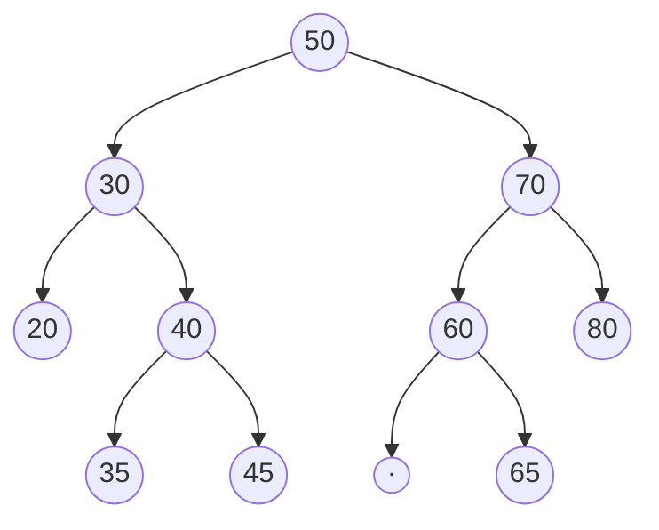
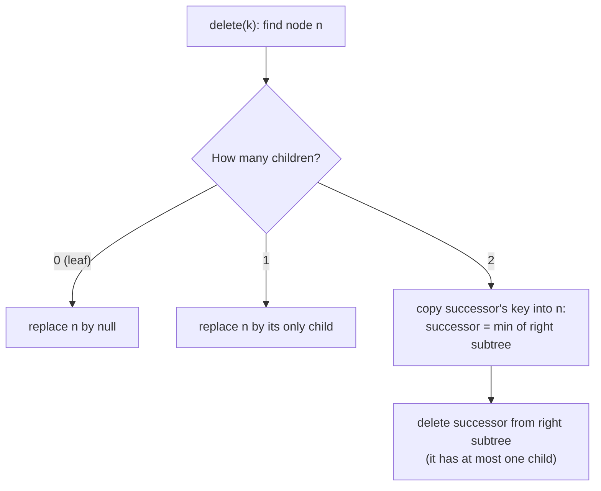

# Session 2 · Binary Search Trees

Prepared by **Hamna Zahid Khan**, Junior Lecturer

[🏠 Course home](../README.md) · [📘 Module overview](./README.md) · [⬅ Previous](./session-01-binary-trees-and-traversals.md) · [Practice test ➡](./practice-test.md)

> **Module 09 · Trees and Binary Search Trees** · ⏱ 3 hours (90 min lecture + 90 min lab)

## 🎯 Learning objectives

1. State the **BST property** and explain why inorder traversal of a BST is sorted.
2. Implement search, insert, min/max, **floor/ceiling** and **range queries** in O(h).
3. Delete a key in all three cases (leaf, one child, two children) using the **in-order successor**.
4. Validate a BST correctly with min/max bounds.
5. Explain how insertion order controls height, motivating balanced trees (Module 10).

---

## 1. The BST property

A **binary search tree** is a binary tree in which, for every node with key k:

> all keys in the **left** subtree < k < all keys in the **right** subtree

> 📚 **Analogy: finding a book in a well-ordered library.** At each shelf junction a sign says "A-M to the left, N-Z to the right". You never look at the shelves you turned away from, so each decision throws away a whole section. That is binary search (Module 03), but on a structure that also supports fast insertion and deletion.



(The "·" marks an empty left child so that 65 is drawn as the **right** child of 60.)

**Consequence:** inorder traversal (Left, Node, Right) lists the keys in **sorted order**: 20 30 35 40 45 50 60 65 70 80.

| | Sorted array | Linked list | BST (height h) | Hash table |
|---|---|---|---|---|
| search | O(log n) | O(n) | **O(h)** | O(1) exp. |
| insert / delete | O(n) | O(1) at known spot | **O(h)** | O(1) exp. |
| min / max / floor / ceiling | O(log n) | O(n) | **O(h)** | O(n) |
| sorted iteration | O(n) | O(n log n) to sort | **O(n)** | O(n log n) |

The BST is the only structure in the table that is good at **everything**, provided h stays small.

## 2. Search and insert

Search: compare with the current key; go left if smaller, right if larger; stop when equal (found) or null (absent).

Insert: search for the key; the null link where the search falls off is exactly where the new node belongs.

**Dry run: insert 50, 30, 70, 20, 40, 60, 80, 35, 45, 65**

| Insert | Path taken | Becomes |
|---|---|---|
| 50 | empty tree | root |
| 30 | 50 → left | left of 50 |
| 70 | 50 → right | right of 50 |
| 20 | 50 → 30 → left | left of 30 |
| 40 | 50 → 30 → right | right of 30 |
| 60 | 50 → 70 → left | left of 70 |
| 80 | 50 → 70 → right | right of 70 |
| 35 | 50 → 30 → 40 → left | left of 40 |
| 45 | 50 → 30 → 40 → right | right of 40 |
| 65 | 50 → 70 → 60 → right | right of 60 |

## 3. Ordered queries

| Query | Idea |
|---|---|
| `min()` | keep going left |
| `max()` | keep going right |
| `floor(x)` (largest ≤ x) | if key ≤ x it is a **candidate**, go right for a bigger one; else go left |
| `ceiling(x)` (smallest ≥ x) | mirror image of floor |
| `range(lo, hi)` | inorder, but skip a subtree when it cannot contain keys in range |

**Dry run: `floor(58)`**

| At node | Compare | Candidate | Move |
|---|---|---|---|
| 50 | 50 ≤ 58 | **50** | right |
| 70 | 70 > 58 | 50 | left |
| 60 | 60 > 58 | 50 | left |
| null | – | – | return **50** |

## 4. Deletion: three cases



Why the successor works: the smallest key in the right subtree is larger than everything on the left and smaller than everything else on the right, so it can take n's place without breaking the BST property. (The in-order **predecessor**, max of the left subtree, works equally well.)

**Dry run: delete 30 (two children) from the tree above**

| Step | Action |
|---|---|
| 1 | 30 has children 20 and 40 ⇒ case 3 |
| 2 | successor = min(right subtree of 30) = go to 40, then left to **35** |
| 3 | copy 35 into the node that held 30 |
| 4 | delete 35 from the subtree rooted at 40: it is a leaf ⇒ case 1 |
| result | inorder 20 35 40 45 50 60 65 70 80 ✔ |

## 5. Validating a BST: the classic trap

Checking only `left.key < n.key < right.key` at each node is **wrong**: in the tree 50 → left 30 → right 60, every parent-child pair looks fine, but 60 sits in the left subtree of 50.

Correct approach: pass down an allowed window (lo, hi). Going left narrows hi to the node's key; going right narrows lo.

| Node | Window | OK? |
|---|---|---|
| 50 | (−∞, +∞) | ✔ |
| 30 | (−∞, 50) | ✔ |
| 60 | (30, 50) | ✘ 60 ≥ 50 |

## 6. Height is everything

Inserting keys **in sorted order** makes every new key the right child of the last: a degenerate tree with height n − 1 and O(n) operations. Random insertion order gives expected height about 2.99 · log₂ n (about 30 for a million keys). The program measures both.

| Insertion order (n = 1023) | Height | Cost per search |
|---|---|---|
| sorted | 1022 | like a linked list |
| random | ~20-25 | close to log n |
| perfectly balanced | 9 | optimal |

Module 10 shows how **AVL** and **red-black** trees rebalance automatically to guarantee O(log n).

---

## 7. Complete program

📄 **[`src/BinarySearchTree.java`](src/BinarySearchTree.java)**

```java
import java.util.ArrayList;
import java.util.List;
import java.util.Random;

/**
 * Session 2 demo: a binary search tree of int keys with insert, search, min/max, floor/ceiling,
 * delete (all three cases), range queries, and a demonstration of how insertion order controls height.
 *
 * Compile:  javac -d out BinarySearchTree.java
 * Run:      java -cp out BinarySearchTree
 *
 * Prepared by Hamna Zahid Khan, Junior Lecturer
 */
public class BinarySearchTree {

    static final class Node {
        int key;
        Node left, right;
        Node(int k) { key = k; }
    }

    private Node root;
    private int size;

    /** Iterative search: go left if smaller, right if larger. */
    boolean contains(int key) {
        Node n = root;
        while (n != null) {
            if (key == n.key) return true;
            n = key < n.key ? n.left : n.right;
        }
        return false;
    }

    void insert(int key) { root = insert(root, key); }

    private Node insert(Node n, int key) {
        if (n == null) { size++; return new Node(key); }
        if (key < n.key) n.left = insert(n.left, key);
        else if (key > n.key) n.right = insert(n.right, key);
        // equal: duplicate ignored (a set)
        return n;
    }

    int min() { Node n = root; while (n.left != null) n = n.left; return n.key; }
    int max() { Node n = root; while (n.right != null) n = n.right; return n.key; }

    /** Largest key <= x, or null. */
    Integer floor(int x) {
        Integer best = null;
        for (Node n = root; n != null; ) {
            if (n.key == x) return x;
            if (n.key < x) { best = n.key; n = n.right; }   // candidate; maybe a larger one on the right
            else n = n.left;
        }
        return best;
    }

    /** Smallest key >= x, or null. */
    Integer ceiling(int x) {
        Integer best = null;
        for (Node n = root; n != null; ) {
            if (n.key == x) return x;
            if (n.key > x) { best = n.key; n = n.left; }
            else n = n.right;
        }
        return best;
    }

    void delete(int key) { root = delete(root, key); }

    /** Hibbard deletion: 0 or 1 child -> splice out; 2 children -> copy in-order successor, delete it. */
    private Node delete(Node n, int key) {
        if (n == null) return null;
        if (key < n.key) n.left = delete(n.left, key);
        else if (key > n.key) n.right = delete(n.right, key);
        else {
            if (n.left == null) { size--; return n.right; }       // case 1 and 2
            if (n.right == null) { size--; return n.left; }       // case 2
            Node s = n.right;                                      // case 3: successor = min of right subtree
            while (s.left != null) s = s.left;
            n.key = s.key;
            n.right = delete(n.right, s.key);
        }
        return n;
    }

    /** Keys in [lo, hi] in sorted order: prune subtrees that cannot contain answers. */
    List<Integer> range(int lo, int hi) {
        List<Integer> out = new ArrayList<>();
        range(root, lo, hi, out);
        return out;
    }

    private void range(Node n, int lo, int hi, List<Integer> out) {
        if (n == null) return;
        if (lo < n.key) range(n.left, lo, hi, out);
        if (lo <= n.key && n.key <= hi) out.add(n.key);
        if (n.key < hi) range(n.right, lo, hi, out);
    }

    List<Integer> inorder() { return range(Integer.MIN_VALUE, Integer.MAX_VALUE); }

    Node rootNode() { return root; }
    int height() { return height(root); }
    private int height(Node n) { return n == null ? -1 : 1 + Math.max(height(n.left), height(n.right)); }
    int size() { return size; }

    /** Is the subtree a valid BST? Every key must lie strictly inside the (lo, hi) window. */
    boolean isValid() { return isValid(root, Long.MIN_VALUE, Long.MAX_VALUE); }
    private boolean isValid(Node n, long lo, long hi) {
        if (n == null) return true;
        if (n.key <= lo || n.key >= hi) return false;
        return isValid(n.left, lo, n.key) && isValid(n.right, n.key, hi);
    }

    void printSideways() { print(root, ""); }
    private void print(Node n, String ind) {
        if (n == null) return;
        print(n.right, ind + "     ");
        System.out.println(ind + n.key);
        print(n.left, ind + "     ");
    }

    public static void main(String[] args) {
        BinarySearchTree t = new BinarySearchTree();
        for (int k : new int[]{50, 30, 70, 20, 40, 60, 80, 35, 45, 65}) t.insert(k);
        System.out.println("BST after inserting 50 30 70 20 40 60 80 35 45 65:");
        t.printSideways();
        System.out.println("inorder (always sorted) = " + t.inorder());
        System.out.println("size = " + t.size() + ", height = " + t.height() + ", valid = " + t.isValid());
        System.out.println("contains(45) = " + t.contains(45) + ", contains(55) = " + t.contains(55));
        System.out.println("min = " + t.min() + ", max = " + t.max());
        System.out.println("floor(58) = " + t.floor(58) + ", ceiling(58) = " + t.ceiling(58)
                + ", floor(10) = " + t.floor(10));
        System.out.println("range [33, 62] = " + t.range(33, 62));

        System.out.println("\ndelete 30 (two children)  -> " + del(t, 30));
        System.out.println("delete 20 (leaf)          -> " + del(t, 20));
        System.out.println("delete 60 (one child)     -> " + del(t, 60));
        System.out.println("delete 50 (root, two ch.) -> " + del(t, 50));
        System.out.println("tree now:");
        t.printSideways();
        System.out.println("valid = " + t.isValid());

        System.out.println("\nHeight depends on insertion order (n = 1023 keys):");
        BinarySearchTree sorted = new BinarySearchTree(), shuffled = new BinarySearchTree();
        List<Integer> keys = new ArrayList<>();
        for (int i = 1; i <= 1023; i++) { sorted.insert(i); keys.add(i); }
        java.util.Collections.shuffle(keys, new Random(9));
        for (int k : keys) shuffled.insert(k);
        System.out.println("  sorted insertion   height = " + sorted.height() + "  (a linked list!)");
        System.out.println("  random insertion   height = " + shuffled.height());
        System.out.println("  perfectly balanced height = " + (int) (Math.log(1024) / Math.log(2) - 1));
    }

    private static List<Integer> del(BinarySearchTree t, int k) { t.delete(k); return t.inorder(); }
}
```

**Real output:**

```text
$ java -cp out BinarySearchTree
BST after inserting 50 30 70 20 40 60 80 35 45 65:
          80
     70
               65
          60
50
               45
          40
               35
     30
          20
inorder (always sorted) = [20, 30, 35, 40, 45, 50, 60, 65, 70, 80]
size = 10, height = 3, valid = true
contains(45) = true, contains(55) = false
min = 20, max = 80
floor(58) = 50, ceiling(58) = 60, floor(10) = null
range [33, 62] = [35, 40, 45, 50, 60]

delete 30 (two children)  -> [20, 35, 40, 45, 50, 60, 65, 70, 80]
delete 20 (leaf)          -> [35, 40, 45, 50, 60, 65, 70, 80]
delete 60 (one child)     -> [35, 40, 45, 50, 65, 70, 80]
delete 50 (root, two ch.) -> [35, 40, 45, 65, 70, 80]
tree now:
          80
     70
65
               45
          40
     35
valid = true

Height depends on insertion order (n = 1023 keys):
  sorted insertion   height = 1022  (a linked list!)
  random insertion   height = 23
  perfectly balanced height = 9
```

---

## 8. Worked examples (basic → advanced)

**Example 1 (basic): lowest common ancestor in a BST.** For keys p and q, walk down from the root: if both are smaller go left, if both are larger go right; otherwise the current node is where their paths split.

```java
/** Lowest common ancestor in a BST: walk down until p and q split to different sides. */
static int lcaBst(BinarySearchTree.Node root, int p, int q) {
    BinarySearchTree.Node n = root;
    while (true) {
        if (p < n.key && q < n.key) n = n.left;
        else if (p > n.key && q > n.key) n = n.right;
        else return n.key;
    }
}
```
<sub>Full, compiled version: [`src/Labs09.java`](src/Labs09.java)</sub>

LCA(35, 45) = 40, LCA(20, 45) = 30, LCA(35, 65) = 50. O(h), no extra space.

**Example 2 (intermediate): build a balanced BST from a sorted array.** The middle element becomes the root; recurse on both halves. Height = ⌈log₂(n + 1)⌉ − 1.

```java
/** Build a height-balanced BST from a sorted array: middle element becomes the root. */
static BinaryTrees.Node sortedArrayToBst(int[] a, int lo, int hi) {
    if (lo > hi) return null;
    int mid = (lo + hi) >>> 1;
    return n(a[mid], sortedArrayToBst(a, lo, mid - 1), sortedArrayToBst(a, mid + 1, hi));
}
```
<sub>Full, compiled version: [`src/Labs09.java`](src/Labs09.java)</sub>

**Example 3 (advanced): k-th smallest key.** Inorder visits keys in ascending order, so stop at the k-th visit: O(h + k). (Storing subtree sizes in each node gives O(h) for any k: an *order-statistic tree*.)

```java
/** k-th smallest key (1-based): the k-th node visited by an inorder traversal; stop early. */
static int count, answer;
static int kthSmallest(BinarySearchTree.Node root, int k) { count = k; answer = -1; walk(root); return answer; }

private static void walk(BinarySearchTree.Node n) {
    if (n == null || count == 0) return;
    walk(n.left);
    if (count > 0 && --count == 0) { answer = n.key; return; }
    walk(n.right);
}
```
<sub>Full, compiled version: [`src/Labs09.java`](src/Labs09.java)</sub>

## 9. Real-life problem: nearest available appointment slot

**Problem.** The university clinic stores booked appointment times (minutes since 8:00) and must answer queries like "a student asks for 10:40; what is the nearest free booked-slot boundary before and after?" and "list all appointments between 11:00 and 12:30", while bookings are added and cancelled all day.

**Solution.** Keep the times in a BST (in Java, `TreeSet<Integer>` or `TreeMap<Integer, Booking>`, which is a self-balancing BST). `floor(t)` and `ceiling(t)` give the neighbouring appointments; `subSet(lo, true, hi, true)` lists a range; `add`/`remove` handle bookings. Every operation is O(log n). A hash table could not answer the "nearest" or "range" queries without scanning everything; a sorted array would make every booking O(n).

```java
TreeMap<Integer, String> day = new TreeMap<>();
day.put(150, "Hira"); day.put(170, "Ali"); day.put(210, "Sana");
System.out.println(day.floorKey(160) + " " + day.ceilingKey(160));  // 150 170
System.out.println(day.subMap(160, true, 220, true));               // {170=Ali, 210=Sana}
```

## 10. Common mistakes

| Mistake | Fix |
|---|---|
| Validating with parent-child comparisons only | pass (lo, hi) bounds down the recursion |
| Using `int` bounds and failing on `Integer.MIN_VALUE` keys | use `long` bounds or nullable `Integer` |
| Forgetting `n.left = insert(n.left, k)` (losing the returned subtree) | always reassign the child link |
| Deleting a two-child node by removing it outright | copy successor, then delete successor |
| Not handling duplicates consciously | decide: ignore, count, or always go right |
| Assuming a BST is balanced | sorted input gives a chain; use `TreeMap` in production |

## 11. Best practices

- In production use `TreeMap`/`TreeSet`; write your own BST to understand them.
- Return the (possibly new) subtree root from recursive insert/delete: it handles the empty-tree case naturally.
- For order statistics (rank, k-th), augment each node with its subtree size.
- Shuffle input before building an unbalanced BST if you cannot use a balanced tree.

---

## 12. Lab tasks

**Lab 2.1: LCA in a BST.** Implement `lcaBst(root, p, q)` in O(h).

<details>
<summary>✅ Solution</summary>

See Example 1.

</details>

**Lab 2.2: Sorted array → balanced BST.** Build it and print its level order and height for `[1..7]`.

<details>
<summary>✅ Solution</summary>

See Example 2: level order `[[4], [2, 6], [1, 3, 5, 7]]`, height 2.

</details>

**Lab 2.3: k-th smallest.** Return the k-th smallest key without building a list of all keys.

<details>
<summary>✅ Solution</summary>

See Example 3.

</details>

**Lab 2.4: Validate.** Write `isValid` for the tree 10 → left 5 → right 15 (it must return false). Then check that `BinarySearchTree.isValid` returns true after many random insertions and deletions.

<details>
<summary>✅ Solution</summary>

`isValid(n, lo, hi)` in the program: `15` is checked against the window (5, 10) and fails. `SelfCheck` runs 4000 random operations and asserts `isValid()` afterwards.

</details>

**Real output of the Session 2 lab solutions:**

```text
$ java -cp out Labs09 2
-- Session 2 labs --
LCA(35, 45) = 40, LCA(20, 45) = 30, LCA(35, 65) = 50
sortedArrayToBst([1..7]) level order = [[4], [2, 6], [1, 3, 5, 7]], height = 2
kthSmallest k=1,4,10 = 20, 40, 80
```

---

## 13. Quiz

**Q1.** Inorder traversal of a BST produces:

- **A.** keys in insertion order
- **B.** keys in ascending order
- **C.** keys in level order
- **D.** keys in descending order

**Q2.** Inserting 1, 2, 3, 4, 5 in that order into an empty BST gives height:

- **A.** 2
- **B.** 3
- **C.** 4
- **D.** 5

**Q3.** To delete a node with two children we replace its key with:

- **A.** the root's key
- **B.** its in-order successor (minimum of the right subtree)
- **C.** its parent's key
- **D.** the maximum of the right subtree

**Q4.** floor(58) in the tree with keys 20 30 35 40 45 50 60 65 70 80 is:

- **A.** 60
- **B.** 50
- **C.** 45
- **D.** null

**Q5.** Which check correctly validates a BST?

- **A.** left.key < node.key < right.key at every node
- **B.** every key lies within the (lo, hi) bounds inherited from its ancestors
- **C.** inorder traversal has n elements
- **D.** the tree is complete

<details>
<summary><b>Show answers</b></summary>

1. **B**: Left subtree < node < right subtree at every node.
2. **C**: Each key becomes the right child of the previous one.
3. **B**: The successor keeps the BST ordering intact.
4. **B**: Largest key ≤ 58.
5. **B**: Parent-child checks miss violations deeper in the tree.

</details>

---

## 14. Summary

- BST property: left < node < right for **every** node; inorder is sorted.
- Search, insert, delete, min, max, floor, ceiling are all **O(h)**.
- Delete with two children: copy the in-order successor, then delete it.
- Validate with inherited (lo, hi) bounds.
- Height ranges from log₂ n to n − 1; balanced trees (Module 10) guarantee O(log n).

## 15. Viva / interview questions

1. Why is a BST better than a hash table for "nearest key" and range queries?
2. Prove that the in-order successor of a node with two children has no left child.
3. What is the expected height of a BST built from a random permutation?
4. How do you find the in-order successor of a node that has **no** right child?
5. How would you support "rank of key k" in O(h)?
6. Convert a BST to a sorted doubly linked list in place.

---

[⬅ Previous](./session-01-binary-trees-and-traversals.md) · [📘 Module overview](./README.md) · [Practice test ➡](./practice-test.md)
