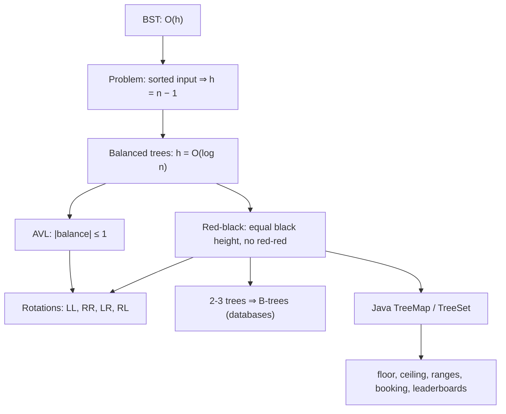

# Module 10 · Balanced Search Trees

Prepared by **Hamna Zahid Khan**, Junior Lecturer

[🏠 Course home](../README.md)

> ⏱ 6 contact hours · 2 sessions · 🔴 Advanced

A BST is only as fast as it is short. This module builds an AVL tree with all four rotation cases, then a left-leaning red-black tree, proves their O(log n) height bounds, and shows how Java's red-black `TreeMap`/`TreeSet` solve "nearest", "range" and "rank" problems.

## 🎯 Module objectives

- Explain why balancing is needed and what it guarantees.
- Perform left/right rotations and fix LL, RR, LR and RL imbalances.
- Implement AVL insertion and deletion; prove h ≤ 1.44 log₂ n.
- State the red-black properties, relate them to 2-3 trees, and implement LLRB insertion.
- Use `TreeMap`/`TreeSet` for floor/ceiling, ranges and ordered updates.

## 📚 Sessions

| # | Session | Key ideas | Code |
|---|---|---|---|
| 1 | [AVL Trees](session-01-avl-trees.md) | balance factor, rotations, LL/RR/LR/RL, height proof | [`AVLTree.java`](src/AVLTree.java) |
| 2 | [Red-Black Trees and TreeMap](session-02-red-black-trees-overview.md) | red-black properties, 2-3 trees, LLRB insert, TreeMap API | [`RedBlackTree.java`](src/RedBlackTree.java) |
| ✍️ | [Practice test](practice-test.md) | 20 MCQs + 3 coding scenarios | [`Labs10.java`](src/Labs10.java), [`SelfCheck.java`](src/SelfCheck.java) |

## 🗺️ Concept map



## 📄 One-page cheat sheet

| | AVL | Red-black | Plain BST |
|---|---|---|---|
| Invariant | \|h(L) − h(R)\| ≤ 1 | root black, no red-red, equal black height | L < N < R only |
| Height | ≤ 1.44 log₂ n | ≤ 2 log₂(n + 1) | up to n − 1 |
| Search / insert / delete | O(log n) | O(log n) | O(h) |
| Rotations: insert / delete | ≤ 2 / O(log n) | ≤ 2 / ≤ 3 | – |
| Used in | lookup-heavy indexes | `TreeMap`, `std::map`, Linux CFS | teaching |

**Imbalance cases:** b(z) = +2 & b(z.left) ≥ 0 → **LL**: rotR(z) · b(z) = +2 & b(z.left) < 0 → **LR**: rotL(z.left), rotR(z) · mirror for **RR** and **RL**.

**Rotation (right):** `x = y.left; y.left = x.right; x.right = y; update(y); update(x); return x;`

**LLRB insert fixes (in order):** right red & left black → rotateLeft · left red & left.left red → rotateRight · both red → flipColors · root black.

**TreeMap essentials:** `floorKey`, `ceilingKey`, `lowerKey`, `higherKey`, `firstKey`, `lastKey`, `headMap`, `tailMap`, `subMap`, `pollFirstEntry`.

## ▶️ Run the code

```bash
cd 10-balanced-trees/src
javac -d out *.java
java -ea -cp out SelfCheck
java -cp out AVLTree
java -cp out Labs10 1          # Session 1 lab solutions (2 for Session 2)
```

See [`src/README.md`](src/README.md) for every file.
