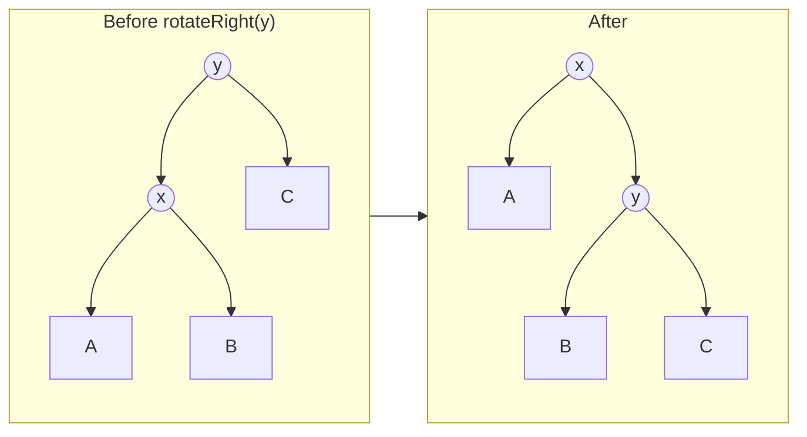
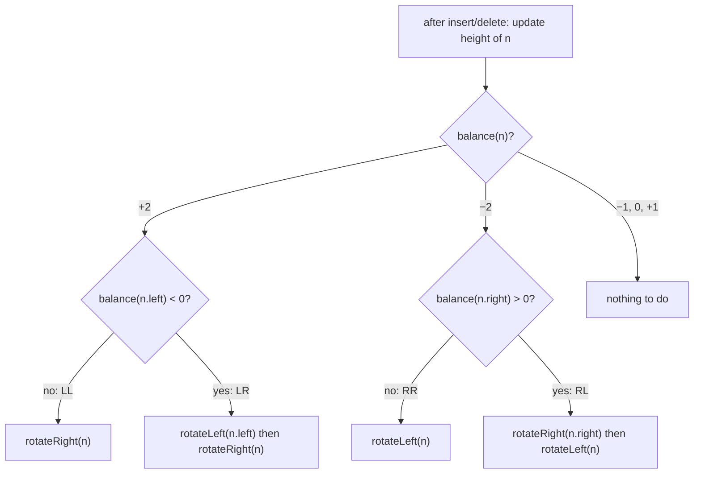

# Session 1 · AVL Trees

Prepared by **Hamna Zahid Khan**, Junior Lecturer

[🏠 Course home](../README.md) · [📘 Module overview](./README.md) · [⬅ Module overview](./README.md) · [Next ➡](./session-02-red-black-trees-overview.md)

> **Module 10 · Balanced Search Trees** · ⏱ 3 hours (90 min lecture + 90 min lab)

## 🎯 Learning objectives

1. Explain why an unbalanced BST degrades to O(n) and what "balanced" must guarantee.
2. Define the **balance factor** and the **AVL invariant**.
3. Perform **left and right rotations** and recognise the four imbalance cases **LL, RR, LR, RL**.
4. Implement AVL insertion and deletion that rebalance on the way back up the recursion.
5. Prove that AVL height is O(log n) using the minimum-node recurrence.

---

## 1. The problem: height decides everything

Module 09 showed that inserting sorted keys into a BST builds a chain: 1,023 keys gave height 1,022. Real data is often sorted or nearly sorted (roll numbers, timestamps, IDs), so we cannot rely on luck.

A **balanced** search tree adds a rule that keeps h = O(log n) after **every** insertion and deletion, paying only O(log n) extra work to restore it.

> ⚖️ **Analogy: a weighing scale in the chemistry lab.** After each sample you add, you glance at the pointer. If one pan sinks too far, you make a small local adjustment right away instead of rebuilding the whole setup. An AVL tree checks each node on the path you just changed and fixes a lopsided node with one or two **rotations**.

## 2. The AVL invariant

Named after its inventors **A**delson-**V**elsky and **L**andis (1962), the first self-balancing BST.

> **balance(n) = height(n.left) − height(n.right)**, and an AVL tree requires **balance(n) ∈ {−1, 0, +1} for every node n**.

(Height of an empty tree is −1, of a leaf 0.) Each node stores its height so the balance factor is O(1) to compute.

| balance | meaning |
|---|---|
| +1 | left subtree one level taller (fine) |
| 0 | perfectly even (fine) |
| −1 | right subtree one level taller (fine) |
| **+2** | left heavy: **rotate** |
| **−2** | right heavy: **rotate** |

## 3. Rotations

A rotation rearranges three links around a node in O(1) and **preserves the BST order** (inorder stays the same).



Inorder before: A x B y C. Inorder after: A x B y C. ✔ Subtree B (keys between x and y) simply changes parent. `rotateLeft` is the mirror image.

```java
private Node rotateRight(Node y) {
    Node x = y.left;
    y.left = x.right;      // B moves under y
    x.right = y;
    update(y); update(x);  // y first: it is now x's child
    return x;              // new root of this subtree
}
```

## 4. The four imbalance cases

Name the case by the path from the unbalanced node **z** towards the inserted key.

| Case | Shape at z | Detect | Fix |
|---|---|---|---|
| **LL** | left child's left subtree too tall | balance(z) = +2, balance(z.left) ≥ 0 | rotateRight(z) |
| **RR** | right child's right subtree too tall | balance(z) = −2, balance(z.right) ≤ 0 | rotateLeft(z) |
| **LR** | left child's right subtree too tall | balance(z) = +2, balance(z.left) < 0 | rotateLeft(z.left), then rotateRight(z) |
| **RL** | right child's left subtree too tall | balance(z) = −2, balance(z.right) > 0 | rotateRight(z.right), then rotateLeft(z) |



The **zig-zag** cases (LR, RL) need two rotations: the first straightens the zig-zag into a straight line, the second fixes it like LL/RR.

### Dry run: insert 10, 20, 30, 40, 50, 25

| Insert | Unbalanced node | Case | Action | Tree (root: children) |
|---|---|---|---|---|
| 10 | – | – | – | 10 |
| 20 | – | – | – | 10: (–, 20) |
| 30 | 10 (b = −2) | RR | rotateLeft(10) | 20: (10, 30) |
| 40 | – | – | – | 20: (10, 30: (–, 40)) |
| 50 | 30 (b = −2) | RR | rotateLeft(30) | 20: (10, 40: (30, 50)) |
| 25 | 20 (b = −2), and balance(40) = +1 | **RL** | rotateRight(40), rotateLeft(20) | 30: (20: (10, 25), 40: (–, 50)) |

Insert of 25 in detail: it goes 20 → right to 40 → left to 30 → left of 30. On the way back up, 30 and 40 are fine, but 20 has a left height of 0 and a right height of 2. The path from 20 goes **R**ight then **L**eft ⇒ RL.

## 5. Insertion and deletion

Both are the ordinary BST algorithms, followed by `rebalance(n)` at **every node on the way back up** (the recursion does this for free):

```java
private Node insert(Node n, int key) {
    if (n == null) return new Node(key);
    if (key < n.key) n.left = insert(n.left, key);
    else if (key > n.key) n.right = insert(n.right, key);
    return rebalance(n);          // update height, rotate if |balance| = 2
}
```

| | Insertion | Deletion |
|---|---|---|
| Rotations needed | at most **one** fix (single or double) restores the whole tree | may need a fix at **every level** up to the root |
| Total cost | O(log n) | O(log n) |

## 6. Why the height is O(log n)

Let N(h) be the **fewest** nodes in an AVL tree of height h. The sparsest tree has one subtree of height h − 1 and the other of height h − 2:

> N(h) = N(h − 1) + N(h − 2) + 1, N(0) = 1, N(1) = 2

| h | 0 | 1 | 2 | 3 | 4 | 5 | 6 | 7 | 8 | 9 | 10 |
|---|---|---|---|---|---|---|---|---|---|---|---|
| N(h) | 1 | 2 | 4 | 7 | 12 | 20 | 33 | 54 | 88 | 143 | 232 |

This grows like the Fibonacci numbers, i.e. like φʰ with φ ≈ 1.618. So n ≥ N(h) ≈ φʰ ⇒ **h ≤ 1.44 log₂(n + 2)**. An AVL tree is at most 44% taller than a perfect tree.

## 7. Complexity table

| Operation | Plain BST (worst) | AVL tree |
|---|---|---|
| search | O(n) | **O(log n)** |
| insert | O(n) | **O(log n)**, ≤ 2 rotations |
| delete | O(n) | **O(log n)**, ≤ O(log n) rotations |
| min / max / floor / ceiling / range | O(n) | **O(log n)** (+k for range) |
| extra space per node | – | one int (height) or 2 bits (balance) |

---

## 8. Complete program

📄 **[`src/AVLTree.java`](src/AVLTree.java)**

```java
import java.util.ArrayList;
import java.util.List;

/**
 * Session 1 demo: an AVL tree (self-balancing BST) with insert, delete, the four rotation cases,
 * a rotation log, and a height comparison against a plain BST on sorted input.
 *
 * Compile:  javac -d out AVLTree.java
 * Run:      java -cp out AVLTree
 *
 * Prepared by Hamna Zahid Khan, Junior Lecturer
 */
public class AVLTree {

    static final class Node {
        int key, height;               // height of a leaf = 0
        Node left, right;
        Node(int k) { key = k; }
    }

    private Node root;
    private int size;
    final List<String> log = new ArrayList<>();   // which rotations happened, for teaching
    int rotations;

    static int h(Node n) { return n == null ? -1 : n.height; }
    static int balance(Node n) { return h(n.left) - h(n.right); }   // +2 = left heavy, -2 = right heavy
    private static void update(Node n) { n.height = 1 + Math.max(h(n.left), h(n.right)); }

    /** Right rotation around y: y's left child x becomes the subtree root. */
    private Node rotateRight(Node y) {
        Node x = y.left;
        y.left = x.right;            // x's right subtree (keys between x and y) moves under y
        x.right = y;
        update(y);
        update(x);
        rotations++;
        return x;
    }

    /** Left rotation around x: mirror image of rotateRight. */
    private Node rotateLeft(Node x) {
        Node y = x.right;
        x.right = y.left;
        y.left = x;
        update(x);
        update(y);
        rotations++;
        return y;
    }

    /** Restore the AVL property at n (|balance| <= 1), returning the new subtree root. */
    private Node rebalance(Node n) {
        update(n);
        int b = balance(n);
        if (b > 1) {                                       // left heavy
            if (balance(n.left) < 0) {                     // left-right case
                log.add("LR at " + n.key);
                n.left = rotateLeft(n.left);
            } else log.add("LL at " + n.key);
            return rotateRight(n);
        }
        if (b < -1) {                                      // right heavy
            if (balance(n.right) > 0) {                    // right-left case
                log.add("RL at " + n.key);
                n.right = rotateRight(n.right);
            } else log.add("RR at " + n.key);
            return rotateLeft(n);
        }
        return n;
    }

    void insert(int key) { root = insert(root, key); }

    private Node insert(Node n, int key) {
        if (n == null) { size++; return new Node(key); }
        if (key < n.key) n.left = insert(n.left, key);
        else if (key > n.key) n.right = insert(n.right, key);
        else return n;
        return rebalance(n);                 // fix every ancestor on the way back up
    }

    void delete(int key) { root = delete(root, key); }

    private Node delete(Node n, int key) {
        if (n == null) return null;
        if (key < n.key) n.left = delete(n.left, key);
        else if (key > n.key) n.right = delete(n.right, key);
        else {
            if (n.left == null || n.right == null) { size--; return n.left != null ? n.left : n.right; }
            Node s = n.right;
            while (s.left != null) s = s.left;
            n.key = s.key;
            n.right = delete(n.right, s.key);
        }
        return rebalance(n);
    }

    boolean contains(int key) {
        for (Node n = root; n != null; n = key < n.key ? n.left : n.right) if (n.key == key) return true;
        return false;
    }

    int height() { return h(root); }
    int size() { return size; }

    /** Checks BST order, stored heights, and |balance| <= 1 everywhere. */
    boolean isAVL() { return check(root, Long.MIN_VALUE, Long.MAX_VALUE); }
    private boolean check(Node n, long lo, long hi) {
        if (n == null) return true;
        if (n.key <= lo || n.key >= hi) return false;
        if (n.height != 1 + Math.max(h(n.left), h(n.right))) return false;
        if (Math.abs(balance(n)) > 1) return false;
        return check(n.left, lo, n.key) && check(n.right, n.key, hi);
    }

    List<Integer> inorder() { List<Integer> out = new ArrayList<>(); in(root, out); return out; }
    private void in(Node n, List<Integer> out) { if (n == null) return; in(n.left, out); out.add(n.key); in(n.right, out); }

    void printSideways() { print(root, ""); }
    private void print(Node n, String ind) {
        if (n == null) return;
        print(n.right, ind + "     ");
        System.out.println(ind + n.key + "(b=" + balance(n) + ")");
        print(n.left, ind + "     ");
    }

    /** Plain BST height for comparison (iterative insert so sorted input does not overflow the stack). */
    static int plainBstHeight(int[] keys) {
        int[] left = new int[keys.length], right = new int[keys.length], depth = new int[keys.length];
        java.util.Arrays.fill(left, -1);
        java.util.Arrays.fill(right, -1);
        int maxDepth = 0;
        for (int i = 1; i < keys.length; i++) {
            int cur = 0, d = 0;
            while (true) {
                d++;
                if (keys[i] < keys[cur]) { if (left[cur] < 0) { left[cur] = i; break; } cur = left[cur]; }
                else { if (right[cur] < 0) { right[cur] = i; break; } cur = right[cur]; }
            }
            depth[i] = d;
            maxDepth = Math.max(maxDepth, d);
        }
        return maxDepth;
    }

    public static void main(String[] args) {
        System.out.println("== The four cases, one at a time ==");
        int[][] cases = {{30, 20, 10}, {10, 20, 30}, {30, 10, 20}, {10, 30, 20}};
        for (int[] c : cases) {
            AVLTree t = new AVLTree();
            for (int k : c) t.insert(k);
            System.out.println("insert " + java.util.Arrays.toString(c) + " -> " + t.log + ", root = " + t.root.key
                    + ", height = " + t.height());
        }

        System.out.println("\n== Insert 10 20 30 40 50 25 ==");
        AVLTree t = new AVLTree();
        for (int k : new int[]{10, 20, 30, 40, 50, 25}) {
            t.insert(k);
            System.out.println("after " + k + ": rotations so far " + t.log);
        }
        t.printSideways();
        System.out.println("inorder = " + t.inorder() + ", valid AVL = " + t.isAVL());

        System.out.println("\n== Delete 50, then 40: the root becomes left heavy and rotates ==");
        t.log.clear();
        t.delete(50);
        t.delete(40);
        t.printSideways();
        System.out.println("rotations: " + t.log + ", valid AVL = " + t.isAVL());

        System.out.println("\n== Sorted input: AVL vs plain BST ==");
        System.out.println("     n   plain BST height   AVL height   floor(log2 n)   1.44*log2(n+2)");
        for (int n : new int[]{15, 1023, 10_000}) {
            int[] keys = new int[n];
            AVLTree a = new AVLTree();
            for (int i = 0; i < n; i++) { keys[i] = i; a.insert(i); }
            double lg = Math.log(n) / Math.log(2);
            System.out.printf("%6d   %16d   %10d   %13d   %14.1f%n", n, plainBstHeight(keys), a.height(),
                    (int) Math.floor(lg), 1.44 * Math.log(n + 2) / Math.log(2));
        }
    }
}
```

**Real output:**

```text
$ java -cp out AVLTree
== The four cases, one at a time ==
insert [30, 20, 10] -> [LL at 30], root = 20, height = 1
insert [10, 20, 30] -> [RR at 10], root = 20, height = 1
insert [30, 10, 20] -> [LR at 30], root = 20, height = 1
insert [10, 30, 20] -> [RL at 10], root = 20, height = 1

== Insert 10 20 30 40 50 25 ==
after 10: rotations so far []
after 20: rotations so far []
after 30: rotations so far [RR at 10]
after 40: rotations so far [RR at 10]
after 50: rotations so far [RR at 10, RR at 30]
after 25: rotations so far [RR at 10, RR at 30, RL at 20]
          50(b=0)
     40(b=-1)
30(b=0)
          25(b=0)
     20(b=0)
          10(b=0)
inorder = [10, 20, 25, 30, 40, 50], valid AVL = true

== Delete 50, then 40: the root becomes left heavy and rotates ==
     30(b=1)
          25(b=0)
20(b=-1)
     10(b=0)
rotations: [LL at 30], valid AVL = true

== Sorted input: AVL vs plain BST ==
     n   plain BST height   AVL height   floor(log2 n)   1.44*log2(n+2)
    15                 14            3               3              5.9
  1023               1022            9               9             14.4
 10000               9999           13              13             19.1
```

Look at the last table: on sorted input the plain BST has height n − 1, while the AVL tree stays at exactly ⌊log₂ n⌋, far below the 1.44 log₂ n worst-case bound.

---

## 9. Worked examples (basic → advanced)

**Example 1 (basic): is a binary tree height-balanced?** A naive solution calls `height()` at every node (O(n²) on a chain). Returning the height and a failure signal in one post-order pass makes it O(n).

```java
/** Height-balanced check in ONE pass: return the height, or -2 as soon as any subtree is unbalanced. */
static boolean isBalanced(Node root) { return heightOrFail(root) != -2; }

private static int heightOrFail(Node n) {
    if (n == null) return -1;
    int l = heightOrFail(n.left);
    if (l == -2) return -2;
    int r = heightOrFail(n.right);
    if (r == -2) return -2;
    if (Math.abs(l - r) > 1) return -2;
    return 1 + Math.max(l, r);
}
```
<sub>Full, compiled version: [`src/Labs10.java`](src/Labs10.java)</sub>

**Example 2 (intermediate): the smallest AVL trees.** Compute N(h) and see the Fibonacci growth that proves the height bound.

```java
/** Fewest nodes an AVL tree of height h can have: N(h) = N(h-1) + N(h-2) + 1 (Fibonacci-like). */
static long minNodes(int h) {
    if (h < 0) return 0;
    if (h == 0) return 1;
    long a = 1, b = 2;                 // N(0), N(1)
    for (int i = 2; i <= h; i++) { long c = a + b + 1; a = b; b = c; }
    return h == 1 ? 2 : b;
}
```
<sub>Full, compiled version: [`src/Labs10.java`](src/Labs10.java)</sub>

**Example 3 (advanced): predict the rotations.** Insert 20, 10, 30, 25, 27. Before running the code, predict: 27 goes 20 → 30 → 25 → right. Node 30 now has left height 1 and right height −1 (balance +2), and its left child 25 has balance −1 ⇒ **LR at 30**: rotateLeft(25), then rotateRight(30). Result: 20: (10, 27: (25, 30)).

```java
/** Insert keys into an AVL tree and report the rotation log. */
static String rotationsFor(int... keys) {
    AVLTree t = new AVLTree();
    for (int k : keys) t.insert(k);
    return t.log + " (" + t.rotations + " single rotations), height " + t.height();
}
```
<sub>Full, compiled version: [`src/Labs10.java`](src/Labs10.java)</sub>

## 10. Real-life problem: a live exam-roll index

**Problem.** The examination system registers students as they walk in. Roll numbers arrive almost **in sorted order** (seating is by roll number). Invigilators query "is roll X present?" and "who is the next roll after X?" thousands of times. A plain BST would degrade to a linked list exactly because the input is sorted.

**Solution.** Store present roll numbers in an AVL tree (or Java's `TreeSet`, a red-black tree). Every check-in, presence query and successor query is O(log n), about 13 steps for 10,000 students instead of up to 10,000. The tree rebalances itself as students arrive, so no nightly rebuild is needed.

## 11. Common mistakes

| Mistake | Fix |
|---|---|
| Updating heights in the wrong order after a rotation | update the **lower** node (old root) first, then the new root |
| Forgetting to return the new subtree root from a rotation | `n.left = rotateLeft(n.left)` / `return rotateRight(n)` |
| Using a single rotation for LR/RL | zig-zag shapes need two rotations |
| Rebalancing only the inserted node's parent | check every ancestor on the way up |
| Height of `null` = 0 and leaf = 0 | be consistent: null = −1, leaf = 0 |
| Checking `balance == 2` instead of `> 1` after deletion | use `> 1` / `< -1` |

## 12. Best practices

- Encapsulate `update`, `balance`, `rotateLeft`, `rotateRight` and `rebalance`: insertion and deletion then only differ in their BST part.
- Keep an `isAVL()` validator and call it in tests after random operations (see `SelfCheck`).
- In application code use `TreeMap`/`TreeSet`; write AVL to understand guarantees and interviews.
- AVL trees are slightly better for **lookup-heavy** workloads (they are more strictly balanced than red-black trees).

---

## 13. Lab tasks

**Lab 1.1: Balanced check** in O(n).

<details>
<summary>✅ Solution</summary>

See Example 1.

</details>

**Lab 1.2: Minimum nodes.** Compute N(h) for h = 0…10 and use it to find the **maximum** height of an AVL tree with 100 nodes.

<details>
<summary>✅ Solution</summary>

See Example 2. N(8) = 88 ≤ 100 < N(9) = 143, so the height is at most **8** (a perfect tree would have height 6).

</details>

**Lab 1.3: Trace by hand.** Insert 50, 40, 30, 20, 10 and list every rotation. Then run `rotationsFor` to check.

<details>
<summary>✅ Solution</summary>

30 makes 50 left-left heavy ⇒ **LL at 50** ⇒ root 40: (30, 50). 20 then 10 make 30 left-left heavy ⇒ **LL at 30** ⇒ 40: (20: (10, 30), 50). Height 2. The program prints `[LL at 50, LL at 30]`.

</details>

**Lab 1.4: Deletion fix-up.** Starting from the tree after inserting 10 20 30 40 50 25, delete 50 and then 40. Which node becomes unbalanced and which case is it?

<details>
<summary>✅ Solution</summary>

After both deletions the root 30 has left height 1 (subtree 20: (10, 25)) and right height −1 ⇒ balance +2; balance(20) = 0 ⇒ **LL at 30** ⇒ rotateRight(30). New root 20: (10, 30: (25, –)). The program's "Delete 50, then 40" section shows exactly this.

</details>

**Real output of the Session 1 lab solutions:**

```text
$ java -cp out Labs10 1
-- Session 1 labs --
isBalanced(balanced) = true, isBalanced(left chain) = false
min nodes for AVL height 0..10 = 1, 2, 4, 7, 12, 20, 33, 54, 88, 143, 232
rotations for 50 40 30 20 10 = [LL at 50, LL at 30] (2 single rotations), height 2
rotations for 20 10 30 25 27 = [LR at 30] (2 single rotations), height 2
```

---

## 14. Quiz

**Q1.** The AVL invariant requires every node's balance factor to be in:

- **A.** {0}
- **B.** {−1, 0, +1}
- **C.** {−2, …, +2}
- **D.** any value when n is small

**Q2.** Inserting 30, 20, 10 into an empty AVL tree triggers which case?

- **A.** RR
- **B.** LL
- **C.** LR
- **D.** RL

**Q3.** An LR imbalance at node z is fixed by:

- **A.** rotateRight(z)
- **B.** rotateLeft(z)
- **C.** rotateLeft(z.left) then rotateRight(z)
- **D.** rotateRight(z.left) then rotateLeft(z)

**Q4.** A rotation changes the inorder sequence of keys:

- **A.** always
- **B.** never
- **C.** only for double rotations
- **D.** only at the root

**Q5.** The height of an AVL tree with n nodes is at most about:

- **A.** n/2
- **B.** log₂ n
- **C.** 1.44 log₂ n
- **D.** 2 log₂ n

<details>
<summary><b>Show answers</b></summary>

1. **B**: At most one level of difference.
2. **B**: 10 is in the left subtree of the left child of 30.
3. **C**: Straighten the zig-zag, then fix as LL.
4. **B**: Rotations preserve BST order.
5. **C**: From N(h) = N(h−1) + N(h−2) + 1.

</details>

---

## 15. Summary

- AVL trees keep |height(left) − height(right)| ≤ 1 at every node.
- Rotations are O(1), preserve BST order, and fix imbalance; LR/RL need two.
- Insert/delete = BST insert/delete + `rebalance` on the way up; all O(log n).
- Height ≤ 1.44 log₂(n + 2), proved by the Fibonacci-like recurrence N(h).

## 16. Viva / interview questions

1. Why is a rotation O(1), and why does it preserve the BST property?
2. Why can an insertion need at most one (single or double) rotation, but a deletion more?
3. Derive N(h) and the 1.44 log₂ n bound.
4. How many bits per node are really needed to implement AVL trees?
5. Compare AVL and red-black trees for read-heavy vs write-heavy workloads.
6. Draw the tree after inserting 1 to 7 in order into an AVL tree.

---

[⬅ Module overview](./README.md) · [📘 Module overview](./README.md) · [Next ➡](./session-02-red-black-trees-overview.md)
