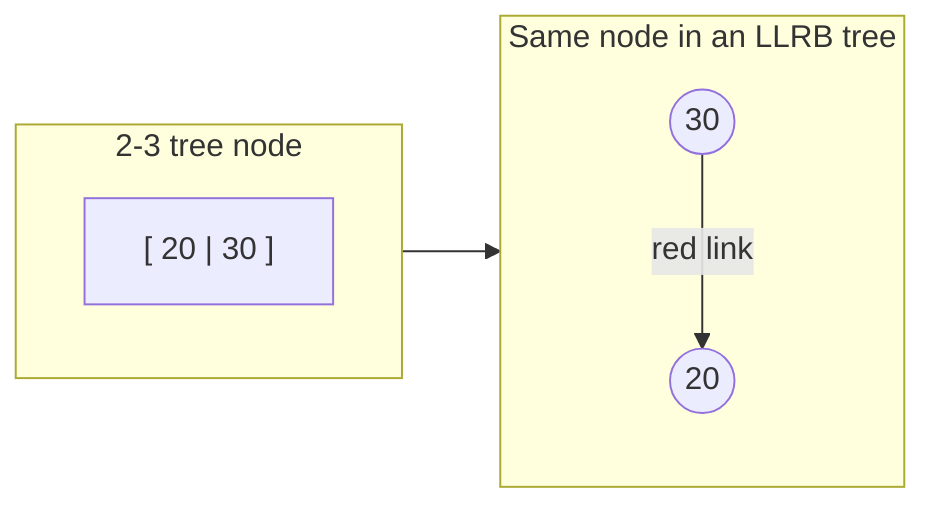
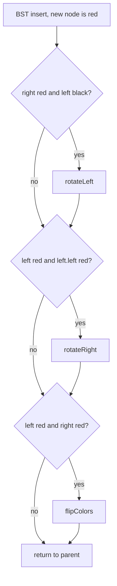

# Session 2 · Red-Black Trees (Overview) and Java's TreeMap

Prepared by **Hamna Zahid Khan**, Junior Lecturer

[🏠 Course home](../README.md) · [📘 Module overview](./README.md) · [⬅ Previous](./session-01-avl-trees.md) · [Practice test ➡](./practice-test.md)

> **Module 10 · Balanced Search Trees** · ⏱ 3 hours (90 min lecture + 90 min lab)

## 🎯 Learning objectives

1. State the five **red-black properties** and explain why they bound the height by 2 log₂(n + 1).
2. Relate red-black trees to **2-3 trees** (and B-trees) through the "red link = glued node" view.
3. Implement insertion in a **left-leaning red-black (LLRB) tree** with three local fixes.
4. Compare AVL and red-black trees and know which libraries use which.
5. Use `TreeMap` and `TreeSet` (floor, ceiling, head/tail/sub maps) to solve ordered problems.

---

## 1. Why another balanced tree?

AVL trees balance strictly, which means frequent rotations on updates. **Red-black trees** allow a little more imbalance (height up to about 2 log₂ n) in exchange for **fewer structural changes per update**: at most 2 rotations for an insertion and 3 for a deletion in the classic version. That is why `java.util.TreeMap`, `TreeSet`, the C++ `std::map` and the Linux kernel's scheduler all use red-black trees.

> 🚦 **Analogy: colour-coded staff in an exam hall.** Black badges are full invigilators; red badges are assistants who must always stand right next to an invigilator, never alone and never next to another assistant. The hall rule is that every route from the entrance to any exit passes the **same number of black badges**. Because reds cannot pile up, no route can be more than twice as long as another.

## 2. The red-black properties

1. Every node is **red** or **black**.
2. The **root** is black.
3. Every null leaf (NIL) is black.
4. A red node has **no red child** (no two reds in a row).
5. Every path from a node to its descendant NILs has the **same number of black nodes** (the **black height**).

**Height bound.** By 5, a tree with black height b has at least 2^b − 1 internal nodes. By 4, at least half of the nodes on any root-to-leaf path are black, so b ≥ h/2. Therefore n ≥ 2^(h/2) − 1 ⇒ **h ≤ 2 log₂(n + 1)**.

| Tree | Height bound | Rotations per insert | Rotations per delete |
|---|---|---|---|
| AVL | 1.44 log₂ n | ≤ 2 | O(log n) |
| Red-black | 2 log₂(n + 1) | ≤ 2 | ≤ 3 |
| Plain BST | n − 1 | 0 | 0 |

## 3. The 2-3 tree view: red links are glue

A **2-3 tree** is a perfectly balanced search tree whose nodes hold 1 key (2-node, 2 children) or 2 keys (3-node, 3 children). Every leaf is at the same depth. Insertion puts a key into a leaf; if it becomes a temporary **4-node** (3 keys), it splits and pushes its middle key up.

A **left-leaning red-black tree** is a 2-3 tree drawn as a binary tree: a **3-node is two binary nodes joined by a red link** that leans left.



| 2-3 tree concept | LLRB equivalent |
|---|---|
| 3-node [a b] | b with a red left child a |
| Perfect balance (all leaves same depth) | every path has the same number of **black** links |
| No 4-nodes after insertion | no node with two red links / no two reds in a row |
| Split a 4-node and pass the middle key up | **colour flip** |

B-trees (used by databases and file systems) generalise 2-3 trees to hundreds of keys per node so that one disk read fetches a whole node.

## 4. LLRB insertion: three local fixes

Insert as in a BST, colour the new node **red** (it joins an existing node), then on the way back up apply, in this order:

| Situation at node h | Fix | 2-3 meaning |
|---|---|---|
| right child red, left child black | `rotateLeft(h)` | make the 3-node lean left |
| left child red **and** left-left grandchild red | `rotateRight(h)` | balance a temporary 4-node |
| both children red | `flipColors(h)` | split the 4-node, pass the middle key up |

Finally colour the root black.



### Dry run: insert 1, 2, 3 (sorted)

| Step | Insert | Situation | Fix | Result (R = red) |
|---|---|---|---|---|
| 1 | 1 | root | colour black | 1 |
| 2 | 2 | 2 is a red right child of 1 | rotateLeft(1) | 2 with left 1R |
| 3 | 3 | 3 is red right child of 2, left 1 is red | both children red ⇒ flipColors(2) | 2 with black 1 and 3 |
| 4 | – | root is red after the flip | colour root black | perfectly balanced, height 1 |

In 2-3 terms: [1] → [1 2] → [1 2 3] splits into 2 with children [1] and [3].

### Rotation in a red-black tree

The rotations are the same as in AVL trees, plus colour bookkeeping: the new subtree root takes the old root's colour, and the old root becomes red (it is now glued to its new parent).

## 5. Complexity table

| Operation | Red-black tree | AVL tree | Hash table |
|---|---|---|---|
| search | O(log n) | O(log n) | O(1) expected |
| insert / delete | O(log n) | O(log n) | O(1) expected |
| floor / ceiling / min / max | O(log n) | O(log n) | O(n) |
| range of k keys | O(log n + k) | O(log n + k) | O(n) |
| ordered iteration | O(n) | O(n) | needs sorting |
| extra space per node | 1 bit (colour) | small int (height) | – |

---

## 6. Complete program

📄 **[`src/RedBlackTree.java`](src/RedBlackTree.java)**

```java
import java.util.ArrayList;
import java.util.List;
import java.util.Random;
import java.util.TreeMap;

/**
 * Session 2 demo: a left-leaning red-black tree (LLRB), the simplest red-black variant to code.
 * Insert uses three local fixes: rotate left, rotate right, flip colours. The demo validates the
 * red-black invariants, counts fixes, compares heights with AVL, and shows java.util.TreeMap.
 *
 * Compile:  javac -d out AVLTree.java RedBlackTree.java
 * Run:      java -cp out RedBlackTree
 *
 * Prepared by Hamna Zahid Khan, Junior Lecturer
 */
public class RedBlackTree {
    private static final boolean RED = true, BLACK = false;

    static final class Node {
        int key;
        Node left, right;
        boolean color;               // colour of the link from the parent to this node
        Node(int k) { key = k; color = RED; }
    }

    private Node root;
    private int size;
    int leftRotations, rightRotations, flips;

    private static boolean isRed(Node n) { return n != null && n.color == RED; }

    private Node rotateLeft(Node h) {             // a right-leaning red link becomes left-leaning
        Node x = h.right;
        h.right = x.left;
        x.left = h;
        x.color = h.color;
        h.color = RED;
        leftRotations++;
        return x;
    }

    private Node rotateRight(Node h) {            // two reds in a row on the left: lift the middle one
        Node x = h.left;
        h.left = x.right;
        x.right = h;
        x.color = h.color;
        h.color = RED;
        rightRotations++;
        return x;
    }

    private void flipColors(Node h) {             // split a temporary 4-node: pass red up to the parent
        h.color = RED;
        h.left.color = BLACK;
        h.right.color = BLACK;
        flips++;
    }

    void insert(int key) {
        root = insert(root, key);
        root.color = BLACK;                        // the root is always black
    }

    private Node insert(Node h, int key) {
        if (h == null) { size++; return new Node(key); }   // new nodes arrive red
        if (key < h.key) h.left = insert(h.left, key);
        else if (key > h.key) h.right = insert(h.right, key);
        else return h;
        // the three local fixes, applied bottom-up
        if (isRed(h.right) && !isRed(h.left)) h = rotateLeft(h);
        if (isRed(h.left) && isRed(h.left.left)) h = rotateRight(h);
        if (isRed(h.left) && isRed(h.right)) flipColors(h);
        return h;
    }

    boolean contains(int key) {
        for (Node n = root; n != null; n = key < n.key ? n.left : n.right) if (n.key == key) return true;
        return false;
    }

    int height() { return height(root); }
    private int height(Node n) { return n == null ? -1 : 1 + Math.max(height(n.left), height(n.right)); }
    int size() { return size; }

    /** Number of black links from the root to any null link; -1 if paths disagree. */
    int blackHeight() { return bh(root); }
    private int bh(Node n) {
        if (n == null) return 0;
        int l = bh(n.left), r = bh(n.right);
        if (l < 0 || r < 0 || l != r) return -1;
        return l + (isRed(n) ? 0 : 1);
    }

    /** Red-black invariants: BST order, root black, no red right links, no two reds in a row, perfect black balance. */
    boolean isValid() {
        return !isRed(root) && ordered(root, Long.MIN_VALUE, Long.MAX_VALUE) && noBadReds(root) && blackHeight() >= 0;
    }
    private boolean ordered(Node n, long lo, long hi) {
        return n == null || (n.key > lo && n.key < hi && ordered(n.left, lo, n.key) && ordered(n.right, n.key, hi));
    }
    private boolean noBadReds(Node n) {
        if (n == null) return true;
        if (isRed(n.right)) return false;
        if (isRed(n) && isRed(n.left)) return false;
        return noBadReds(n.left) && noBadReds(n.right);
    }

    List<String> levels() {
        List<String> out = new ArrayList<>();
        List<Node> level = new ArrayList<>();
        if (root != null) level.add(root);
        while (!level.isEmpty()) {
            StringBuilder sb = new StringBuilder();
            List<Node> next = new ArrayList<>();
            for (Node n : level) {
                sb.append(n.key).append(isRed(n) ? "R " : "B ");
                if (n.left != null) next.add(n.left);
                if (n.right != null) next.add(n.right);
            }
            out.add(sb.toString().trim());
            level = next;
        }
        return out;
    }

    public static void main(String[] args) {
        System.out.println("== Insert 1..10 in order into an LLRB tree ==");
        RedBlackTree t = new RedBlackTree();
        for (int k = 1; k <= 10; k++) t.insert(k);
        System.out.println("levels (R = red link from parent, B = black):");
        for (String l : t.levels()) System.out.println("  " + l);
        System.out.println("height = " + t.height() + ", black height = " + t.blackHeight() + ", valid = " + t.isValid());
        System.out.println("fixes: rotateLeft=" + t.leftRotations + " rotateRight=" + t.rightRotations + " flips=" + t.flips);

        System.out.println("\n== Heights for n keys (sorted and random input) ==");
        System.out.println("      n   input    AVL   red-black   log2 n   2*log2 n");
        for (int n : new int[]{1000, 100_000}) {
            for (String order : new String[]{"sorted", "random"}) {
                int[] keys = new int[n];
                for (int i = 0; i < n; i++) keys[i] = i;
                if (order.equals("random")) {
                    Random r = new Random(10);
                    for (int i = n - 1; i > 0; i--) { int j = r.nextInt(i + 1); int tmp = keys[i]; keys[i] = keys[j]; keys[j] = tmp; }
                }
                AVLTree a = new AVLTree();
                RedBlackTree rb = new RedBlackTree();
                for (int k : keys) { a.insert(k); rb.insert(k); }
                double lg = Math.log(n) / Math.log(2);
                System.out.printf("%7d   %-6s %4d   %9d   %6.1f   %8.1f   valid=%b%n", n, order, a.height(), rb.height(), lg, 2 * lg, rb.isValid());
            }
        }

        System.out.println("\n== java.util.TreeMap is a red-black tree ==");
        TreeMap<Integer, String> slots = new TreeMap<>();
        slots.put(900, "DSA lecture");
        slots.put(1100, "AI lab");
        slots.put(1400, "OOP tutorial");
        slots.put(1600, "Office hours");
        System.out.println("firstKey = " + slots.firstKey() + ", lastKey = " + slots.lastKey());
        System.out.println("floorEntry(1230)   = " + slots.floorEntry(1230));
        System.out.println("ceilingEntry(1230) = " + slots.ceilingEntry(1230));
        System.out.println("headMap(1400)      = " + slots.headMap(1400));
        System.out.println("descendingKeySet   = " + slots.descendingKeySet());
    }
}
```

**Real output:**

```text
$ java -cp out RedBlackTree
== Insert 1..10 in order into an LLRB tree ==
levels (R = red link from parent, B = black):
  4B
  2B 8B
  1B 3B 6R 10B
  5B 7B 9R
height = 3, black height = 3, valid = true
fixes: rotateLeft=7 rotateRight=0 flips=5

== Heights for n keys (sorted and random input) ==
      n   input    AVL   red-black   log2 n   2*log2 n
   1000   sorted    9           9     10.0       19.9   valid=true
   1000   random   11          12     10.0       19.9   valid=true
 100000   sorted   16          16     16.6       33.2   valid=true
 100000   random   19          22     16.6       33.2   valid=true

== java.util.TreeMap is a red-black tree ==
firstKey = 900, lastKey = 1600
floorEntry(1230)   = 1100=AI lab
ceilingEntry(1230) = 1400=OOP tutorial
headMap(1400)      = {900=DSA lecture, 1100=AI lab}
descendingKeySet   = [1600, 1400, 1100, 900]
```

Two things to notice: inserting 1…10 in order produced a balanced tree of height 3 with only local fixes, and on random input the red-black tree is a little taller than the AVL tree, always well inside 2 log₂ n.

---

## 7. Java's ordered collections

| Method (`TreeMap`) | Returns | Cost |
|---|---|---|
| `firstKey()` / `lastKey()` | smallest / largest key | O(log n) |
| `floorKey(x)` / `ceilingKey(x)` | largest ≤ x / smallest ≥ x | O(log n) |
| `lowerKey(x)` / `higherKey(x)` | largest < x / smallest > x | O(log n) |
| `headMap(x)` / `tailMap(x)` / `subMap(a, b)` | live **views** of a key range | O(log n) to create |
| `pollFirstEntry()` | remove and return the smallest | O(log n) |
| `descendingMap()` | reverse-order view | O(1) |

`TreeSet<E>` offers the same with `floor`, `ceiling`, `headSet`, `tailSet`, `subSet`. Keys must be `Comparable` or you pass a `Comparator`, and the comparator must be **consistent with equals** (two keys that compare as 0 are treated as the same key).

## 8. Worked examples (basic → advanced)

**Example 1 (basic): lab-room booking.** A booking `[start, end)` is accepted only if it overlaps nothing. Only the two neighbours of `start` can overlap, so `floorKey` and `ceilingKey` answer in O(log n).

```java
/** Lab-room booking: accept [start, end) only if it overlaps no existing booking. O(log n) per request. */
static final class RoomCalendar {
    private final TreeMap<Integer, Integer> bookings = new TreeMap<>();   // start -> end

    boolean book(int start, int end) {
        Integer before = bookings.floorKey(start);            // latest booking starting at or before start
        Integer after = bookings.ceilingKey(start);           // earliest booking starting at or after start
        if (before != null && bookings.get(before) > start) return false;   // previous one still running
        if (after != null && after < end) return false;                      // next one starts too early
        bookings.put(start, end);
        return true;
    }
}
```
<sub>Full, compiled version: [`src/Labs10.java`](src/Labs10.java)</sub>

| Request | floor neighbour | ceiling neighbour | Result |
|---|---|---|---|
| [10, 20) | – | – | ✔ |
| [15, 25) | 10 (ends 20 > 15) | – | ✘ |
| [20, 30) | 10 (ends 20, not > 20) | – | ✔ |
| [5, 10) | – | 10 (not < 10) | ✔ |
| [8, 12) | 5 (ends 10 > 8) | 10 | ✘ |

**Example 2 (intermediate): leaderboard rank.** Store `score → number of students`; the competition rank of a score is one plus the students in `tailMap(score, false)`.

```java
/** Competition rank = 1 + number of students with a strictly higher score. tailMap views the higher scores. */
static int rank(TreeMap<Integer, Integer> scoreCount, int s) {
    return 1 + scoreCount.tailMap(s, false).values().stream().mapToInt(Integer::intValue).sum();
}
```
<sub>Full, compiled version: [`src/Labs10.java`](src/Labs10.java)</sub>

**Example 3 (advanced): nearby almost-duplicates.** Is there a pair at most k positions apart whose values differ by at most t? Keep the last k values in a `TreeSet`; for each new value x ask for `ceiling(x − t)` and check it is ≤ x + t. O(n log k). (`long` avoids overflow for extreme values.)

```java
/** Are there i != j with |i - j| <= k and |a[i] - a[j]| <= t? Sliding window kept in a balanced BST. */
static boolean nearbyAlmostDuplicate(int[] a, int k, int t) {
    TreeSet<Long> window = new TreeSet<>();
    for (int i = 0; i < a.length; i++) {
        Long c = window.ceiling((long) a[i] - t);              // smallest value >= a[i] - t
        if (c != null && c <= (long) a[i] + t) return true;
        window.add((long) a[i]);
        if (i >= k) window.remove((long) a[i - k]);
    }
    return false;
}
```
<sub>Full, compiled version: [`src/Labs10.java`](src/Labs10.java)</sub>

## 9. Real-life problem: matching drivers to ride requests by time

**Problem.** A campus shuttle service receives ride requests with a desired departure minute and has shuttles that become free at various minutes. For each request, it must assign the shuttle that becomes free **at or just before** the requested time, and shuttles keep being added and removed all day.

**Solution.** Keep free shuttles in a `TreeMap<Integer, Deque<String>>` keyed by the minute they become free. For a request at time t: `floorEntry(t)` gives the best shuttle in O(log n); remove it (and the key if its deque empties). When a shuttle finishes a trip at time f, `computeIfAbsent(f, …).add(id)`. A hash map cannot answer "closest time ≤ t"; a sorted list would make every update O(n). This "nearest key" pattern also powers stock order books, event schedulers and IP-range lookup tables.

## 10. Common mistakes

| Mistake | Fix |
|---|---|
| Forgetting to colour the root black after insertion | `root.color = BLACK` at the end of `insert` |
| Applying the three LLRB fixes in the wrong order | rotateLeft, then rotateRight, then flipColors |
| Assuming red-black trees are perfectly balanced | only **black** height is perfect; total height ≤ 2 log₂(n + 1) |
| `TreeMap` comparator inconsistent with `equals` | distinct objects that compare as 0 silently overwrite each other |
| Modifying a key object after inserting it | the tree's order is broken; keys must be immutable |
| Using `TreeMap` when no ordering is needed | `HashMap` is faster for pure lookups |

## 11. Best practices

- Reach for `TreeMap`/`TreeSet` whenever the question contains *nearest*, *next*, *previous*, *range*, *k-th* or *sorted while updating*.
- Prefer `floorKey`/`ceilingKey` over iterating: they are O(log n).
- Remember views (`headMap`, `subMap`) are **live**: changes show through both ways.
- Implementing a full red-black delete is rarely required; understand insertion and the invariants, and use the library.

---

## 12. Lab tasks

**Lab 2.1: Room booking.** Implement `RoomCalendar.book(start, end)`.

<details>
<summary>✅ Solution</summary>

See Example 1.

</details>

**Lab 2.2: Leaderboard rank** for the scores 88, 92, 75, 92, 60, 88.

<details>
<summary>✅ Solution</summary>

See Example 2: rank(92) = 1, rank(88) = 3, rank(60) = 6.

</details>

**Lab 2.3: Nearby almost-duplicates.** Implement and test with `[1, 5, 9, 1, 5, 9]`, k = 2, t = 3 (false) and `[1, 2, 3, 1]`, k = 3, t = 0 (true).

<details>
<summary>✅ Solution</summary>

See Example 3.

</details>

**Lab 2.4: Verify the invariants.** Insert 1…10 into the LLRB tree, draw it from the printed levels, and verify properties 2, 4 and 5 by hand. Then mark which pairs of nodes form 3-nodes in the equivalent 2-3 tree.

<details>
<summary>✅ Solution</summary>

Levels: 4B · 2B 8B · 1B 3B 6R 10B · 5B 7B 9R. Root 4 is black ✔. The red nodes are 6 (a child of 8, which is black) and 9 (a child of 10, which is black): no red has a red child ✔. Every root-to-null path passes 3 black nodes (e.g. 4-2-1, 4-8-6-5, 4-8-10-9) ✔. The 3-nodes are **[6 8]** and **[9 10]**; every other node is a 2-node.

</details>

**Real output of the Session 2 lab solutions:**

```text
$ java -cp out Labs10 2
-- Session 2 labs --
bookings: [10,20)=true [15,25)=false [20,30)=true [5,10)=true [8,12)=false
nearbyAlmostDuplicate([1, 5, 9, 1, 5, 9], k=2, t=3) = false, ([1, 2, 3, 1], k=3, t=0) = true
rank(92) = 1, rank(88) = 3, rank(60) = 6
```

---

## 13. Quiz

**Q1.** Which is NOT a red-black tree property?

- **A.** the root is black
- **B.** a red node has no red child
- **C.** every path has the same number of black nodes
- **D.** every node's balance factor is −1, 0 or +1

**Q2.** The height of a red-black tree with n keys is at most:

- **A.** log₂ n
- **B.** 1.44 log₂ n
- **C.** 2 log₂(n + 1)
- **D.** n − 1

**Q3.** In a left-leaning red-black tree, a red link represents:

- **A.** a deleted node
- **B.** two keys of the same 2-3 tree node
- **C.** a node with no children
- **D.** an unbalanced subtree

**Q4.** A colour flip corresponds, in 2-3 tree terms, to:

- **A.** merging two leaves
- **B.** splitting a 4-node and passing the middle key up
- **C.** deleting the root
- **D.** rotating left

**Q5.** `java.util.TreeMap` is implemented as a:

- **A.** hash table
- **B.** AVL tree
- **C.** red-black tree
- **D.** skip list

<details>
<summary><b>Show answers</b></summary>

1. **D**: That is the AVL invariant.
2. **C**: Black height is at least h/2.
3. **B**: Red links glue a 3-node together.
4. **B**: The middle key joins the parent.
5. **C**: Java documents it as a red-black tree.

</details>

---

## 14. Summary

- Red-black trees keep **black height** perfectly balanced and forbid two reds in a row ⇒ h ≤ 2 log₂(n + 1).
- An LLRB tree is a 2-3 tree in disguise: red links glue 3-nodes; three local fixes keep it valid.
- Red-black trees do fewer rotations than AVL trees on updates; AVL trees are a bit shorter.
- `TreeMap`/`TreeSet` give O(log n) ordered operations: floor, ceiling, ranges, first/last.

## 15. Viva / interview questions

1. Prove that a red-black tree with n internal nodes has height at most 2 log₂(n + 1).
2. Explain the correspondence between LLRB trees and 2-3 trees.
3. Why do databases use B-trees instead of red-black trees for indexes?
4. When would you pick an AVL tree over a red-black tree?
5. Design a data structure that returns the median of a changing set in O(log n).
6. What does "comparator consistent with equals" mean, and what breaks if it is not?

---

[⬅ Previous](./session-01-avl-trees.md) · [📘 Module overview](./README.md) · [Practice test ➡](./practice-test.md)
