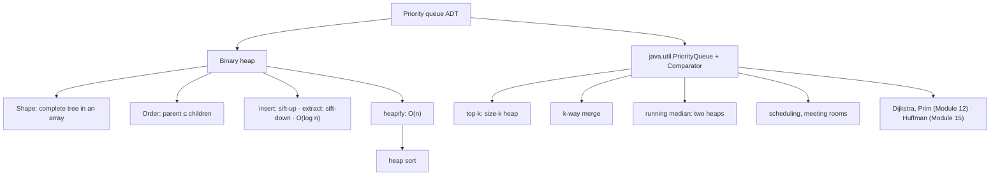

# Module 11 · Heaps and Priority Queues

Prepared by **Hamna Zahid Khan**, Junior Lecturer

[🏠 Course home](../README.md)

> ⏱ 6 contact hours · 2 sessions · 🟡 Core

A priority queue always serves the most important element next. This module builds a binary heap in an array (sift-up, sift-down, O(n) heapify), then uses `java.util.PriorityQueue` for top-k, k-way merge, running medians and scheduling, the patterns behind Dijkstra, Prim and Huffman later in the course.

## 🎯 Module objectives

- Compare priority-queue implementations and justify the binary heap.
- Implement a heap with index arithmetic, sift-up, sift-down and bottom-up heapify.
- Prove that heapify is O(n).
- Apply `PriorityQueue` with comparators to top-k, merging, medians, rooms and scheduling.

## 📚 Sessions

| # | Session | Key ideas | Code |
|---|---|---|---|
| 1 | [Binary Heaps](session-01-binary-heaps.md) | complete tree in an array, sift-up/down, heapify O(n), heap sort | [`BinaryHeap.java`](src/BinaryHeap.java) |
| 2 | [Priority Queue Applications](session-02-priority-queue-applications.md) | comparators, top-k, k-way merge, two-heap median, scheduling | [`PriorityQueueApps.java`](src/PriorityQueueApps.java) |
| ✍️ | [Practice test](practice-test.md) | 20 MCQs + 3 coding scenarios | [`Labs11.java`](src/Labs11.java), [`SelfCheck.java`](src/SelfCheck.java) |

## 🗺️ Concept map



## 📄 One-page cheat sheet

| Operation | Binary heap | `PriorityQueue` method |
|---|---|---|
| insert | O(log n) | `offer` |
| peek | O(1) | `peek` |
| extract | O(log n) | `poll` |
| build from n items | O(n) | `new PriorityQueue<>(collection)` |
| remove / contains arbitrary | O(n) | `remove(o)`, `contains(o)` |

**Index formulas (0-based):** parent (i − 1)/2 · left 2i + 1 · right 2i + 2 · last internal n/2 − 1.

**Comparators**

```java
new PriorityQueue<Integer>(Comparator.reverseOrder());                     // max-heap
new PriorityQueue<int[]>(Comparator.comparingInt((int[] a) -> a[1]));      // by field
new PriorityQueue<Job>(Comparator.comparingInt(Job::priority)
                                 .thenComparingInt(Job::arrival));         // tie-break
```

**Patterns:** top-k largest → min-heap size k · k smallest → max-heap size k · median → max-heap low + min-heap high · rooms → min-heap of end times · merge → heap of cursors.

## ▶️ Run the code

```bash
cd 11-heaps-and-priority-queues/src
javac -d out *.java
java -ea -cp out SelfCheck
java -cp out PriorityQueueApps
java -cp out Labs11 1          # Session 1 lab solutions (2 for Session 2)
```

See [`src/README.md`](src/README.md) for every file.
