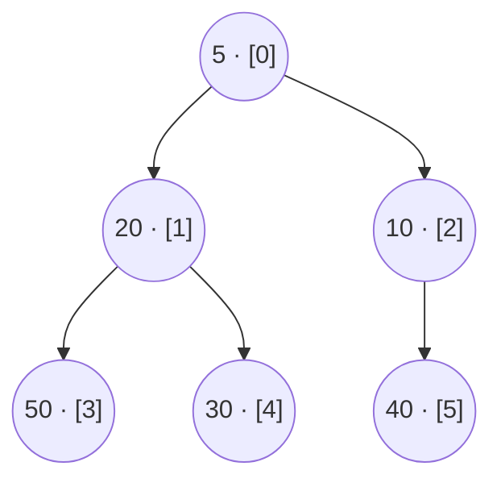
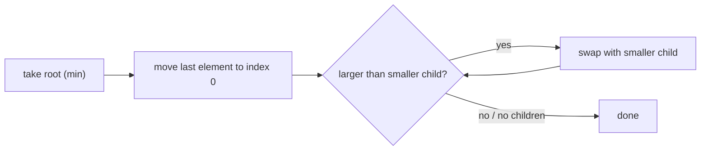

# Session 1 · Binary Heaps

Prepared by **Hamna Zahid Khan**, Junior Lecturer

[🏠 Course home](../README.md) · [📘 Module overview](./README.md) · [⬅ Module overview](./README.md) · [Next ➡](./session-02-priority-queue-applications.md)

> **Module 11 · Heaps and Priority Queues** · ⏱ 3 hours (90 min lecture + 90 min lab)

## 🎯 Learning objectives

1. Define the **priority queue ADT** and compare implementations.
2. State the two heap properties: **complete shape** and **heap order**.
3. Store a complete binary tree in an **array** using index arithmetic.
4. Implement `insert` (sift-up), `extractMin` (sift-down) and `peek` in O(log n) / O(1).
5. Build a heap in **O(n)** with Floyd's bottom-up heapify and explain why it beats n inserts.

---

## 1. The priority queue ADT

A queue serves in **arrival** order; a **priority queue** always serves the element with the **highest priority** (smallest key in a min-PQ) next.

> 🏥 **Analogy: the emergency room triage desk.** Patients do not see the doctor in arrival order. A nurse assigns each one a priority, and whenever a doctor becomes free, the most urgent waiting patient goes in. New patients arrive all the time and the "most urgent" can change at any moment.

| Operation | Meaning |
|---|---|
| `insert(x)` | add an element with its priority |
| `peek()` | look at the highest-priority element |
| `extract()` | remove and return it |
| `size()`, `isEmpty()` | queries |

| Implementation | insert | extract-min | peek |
|---|---|---|---|
| Unsorted array | O(1) | O(n) | O(n) |
| Sorted array | O(n) | O(1) (from the end) | O(1) |
| Balanced BST (Module 10) | O(log n) | O(log n) | O(log n) |
| **Binary heap** | **O(log n)** | **O(log n)** | **O(1)** |

A binary heap matches a BST's bounds with a far simpler structure: **one plain array**, no pointers.

## 2. The two heap properties

1. **Shape:** the tree is **complete**: every level is full except possibly the last, which is filled from the left.
2. **Order (min-heap):** every node is ≤ its children. So the **minimum is at the root**. (Max-heap: ≥.)

A heap is **not** sorted: siblings and cousins can be in any order. It is just "sorted enough" to find the minimum instantly.



Array: `[5, 20, 10, 50, 30, 40]`

## 3. Array representation

Because the tree is complete, storing it level by level leaves **no gaps**:

| Relation | Formula (0-based) | Example (i = 1, value 20) |
|---|---|---|
| parent(i) | (i − 1) / 2 | 0 |
| left(i) | 2i + 1 | 3 (value 50) |
| right(i) | 2i + 2 | 4 (value 30) |
| last internal node | n/2 − 1 | for n = 6: index 2 |

Height = ⌊log₂ n⌋, which bounds the work of sift-up and sift-down.

## 4. Insert: add at the end, sift up

Put the new element in the next free array slot (keeps the shape), then **swap it with its parent while it is smaller**.

**Dry run: insert 50, 30, 40, 10, 20, 5**

| Insert | Placed at | Sift-up swaps | Array after |
|---|---|---|---|
| 50 | 0 | – | [50] |
| 30 | 1 | 30 < 50 ⇒ swap | [30, 50] |
| 40 | 2 | 40 > 30 ⇒ stop | [30, 50, 40] |
| 10 | 3 | 10 < 50 (i 1), 10 < 30 (i 0) | [10, 30, 40, 50] |
| 20 | 4 | 20 < 30 (i 1), 20 > 10 stop | [10, 20, 40, 50, 30] |
| 5 | 5 | 5 < 40 (i 2), 5 < 10 (i 0) | [5, 20, 10, 50, 30, 40] |

## 5. Extract-min: move last to root, sift down

The root is the answer. Move the **last** element to the root (keeps the shape), then **swap it with its smaller child while it is larger**.



**Dry run: extract from [5, 20, 10, 50, 30, 40]**

| Step | Array | Note |
|---|---|---|
| remove root 5, move 40 to root | [40, 20, 10, 50, 30] | |
| children of 0: 20, 10 ⇒ smaller is 10 | [10, 20, 40, 50, 30] | 40 > 10 ⇒ swap |
| children of 2: none | – | stop; returned **5** |

Why the **smaller** child? Swapping with the larger child would put the larger one above the smaller one and break heap order.

## 6. Building a heap in O(n)

**Option 1:** n inserts ⇒ O(n log n).

**Option 2: Floyd's bottom-up heapify.** Copy the array as-is, then call sift-down on every internal node from the **last internal node back to the root**. Leaves (half the array) need no work.

**Dry run: heapify [9, 4, 7, 1, 8, 2, 6, 3, 5]** (last internal node = index 3)

| i | value | children | action | array after |
|---|---|---|---|---|
| 3 | 1 | 3, 5 | already ≤ | [9, 4, 7, 1, 8, 2, 6, 3, 5] |
| 2 | 7 | 2, 6 | swap with 2 | [9, 4, 2, 1, 8, 7, 6, 3, 5] |
| 1 | 4 | 1, 8 | swap with 1, then with 3 | [9, 1, 2, 3, 8, 7, 6, 4, 5] |
| 0 | 9 | 1, 2 | swap with 1, then 3, then 4 | [1, 3, 2, 4, 8, 7, 6, 9, 5] |

**Why O(n)?** A node at height k sinks at most k levels, and only about n/2^(k+1) nodes have height k:

> Σₖ (n / 2^(k+1)) · k = n · Σₖ k / 2^(k+1) = n · 1 = O(n)

Most nodes are near the bottom and sink very little. The program measures **≈ 2n comparisons** for heapify against ≈ n log₂ n for repeated inserts.

## 7. Complexity table

| Operation | Time | Notes |
|---|---|---|
| peek | O(1) | root |
| insert | O(log n) | sift-up along one path; O(1) on average for random input |
| extract | O(log n) | sift-down along one path |
| build (heapify) | **O(n)** | bottom-up |
| heap sort | O(n log n) | heapify + n extracts (Module 04) |
| search for an arbitrary value | O(n) | heaps are not search trees |
| space | O(n) | one array, no pointers |

---

## 8. Complete program

📄 **[`src/BinaryHeap.java`](src/BinaryHeap.java)**

```java
import java.util.Arrays;
import java.util.Comparator;
import java.util.NoSuchElementException;

/**
 * Session 1 demo: an array-based binary heap (min-heap by default, any Comparator) with
 * insert/sift-up, extract/sift-down, O(n) bottom-up heapify, and a comparison of the
 * one-by-one and bottom-up build costs.
 *
 * Compile:  javac -d out BinaryHeap.java
 * Run:      java -cp out BinaryHeap
 *
 * Prepared by Hamna Zahid Khan, Junior Lecturer
 */
public class BinaryHeap<T> {
    private Object[] a;
    private int size;
    private final Comparator<? super T> cmp;
    long comparisons;                                   // for measuring build costs

    BinaryHeap(Comparator<? super T> cmp) { this.cmp = cmp; a = new Object[8]; }

    static <E extends Comparable<? super E>> BinaryHeap<E> minHeap() { return new BinaryHeap<E>(Comparator.naturalOrder()); }

    // index arithmetic for a complete tree stored level by level
    static int parent(int i) { return (i - 1) / 2; }
    static int left(int i) { return 2 * i + 1; }
    static int right(int i) { return 2 * i + 2; }

    @SuppressWarnings("unchecked")
    private T at(int i) { return (T) a[i]; }

    private boolean less(int i, int j) { comparisons++; return cmp.compare(at(i), at(j)) < 0; }

    private void swap(int i, int j) { Object t = a[i]; a[i] = a[j]; a[j] = t; }

    /** Add at the end (keeps the tree complete), then bubble up while smaller than the parent. */
    void insert(T x) {
        if (size == a.length) a = Arrays.copyOf(a, 2 * size);
        a[size] = x;
        siftUp(size++);
    }

    private void siftUp(int i) {
        while (i > 0 && less(i, parent(i))) {
            swap(i, parent(i));
            i = parent(i);
        }
    }

    T peek() {
        if (size == 0) throw new NoSuchElementException("heap is empty");
        return at(0);
    }

    /** Remove the root: move the last element to the root, then sink it down. */
    T extract() {
        T top = peek();
        a[0] = a[--size];
        a[size] = null;                     // let the GC reclaim it
        if (size > 0) siftDown(0);
        return top;
    }

    private void siftDown(int i) {
        while (left(i) < size) {
            int c = left(i);
            if (right(i) < size && less(right(i), c)) c = right(i);    // smaller child
            if (!less(c, i)) break;                                    // heap order restored
            swap(i, c);
            i = c;
        }
    }

    /** Floyd's bottom-up heapify: sift down every internal node from the last one to the root. O(n). */
    static <E> BinaryHeap<E> heapify(E[] items, Comparator<? super E> cmp) {
        BinaryHeap<E> h = new BinaryHeap<>(cmp);
        h.a = Arrays.copyOf(items, Math.max(8, items.length), Object[].class);
        h.size = items.length;
        for (int i = parent(h.size - 1); i >= 0; i--) h.siftDown(i);
        return h;
    }

    int size() { return size; }
    boolean isEmpty() { return size == 0; }

    boolean isHeap() {
        for (int i = 1; i < size; i++) if (cmp.compare(at(i), at(parent(i))) < 0) return false;
        return true;
    }

    String array() { return Arrays.toString(Arrays.copyOf(a, size)); }

    public static void main(String[] args) {
        System.out.println("== Insert 50 30 40 10 20 5 into a min-heap ==");
        BinaryHeap<Integer> h = minHeap();
        for (int x : new int[]{50, 30, 40, 10, 20, 5}) {
            h.insert(x);
            System.out.printf("insert %-2d -> %s%n", x, h.array());
        }
        System.out.println("parent(5) = " + parent(5) + ", children of 1 = " + left(1) + " and " + right(1));

        System.out.println("\n== Extract-min three times ==");
        for (int k = 0; k < 3; k++) {
            int m = h.extract();
            System.out.printf("extract %-2d -> %s%n", m, h.array());
        }

        System.out.println("\n== Max-heap with a reversed comparator ==");
        BinaryHeap<String> names = new BinaryHeap<>(Comparator.<String>reverseOrder());
        for (String s : new String[]{"Hira", "Ali", "Zoya", "Bilal", "Sana"}) names.insert(s);
        StringBuilder sb = new StringBuilder();
        while (!names.isEmpty()) sb.append(names.extract()).append(' ');
        System.out.println("extract order: " + sb.toString().trim());

        System.out.println("\n== Bottom-up heapify of [9, 4, 7, 1, 8, 2, 6, 3, 5] ==");
        Integer[] data = {9, 4, 7, 1, 8, 2, 6, 3, 5};
        BinaryHeap<Integer> b = heapify(data, Comparator.naturalOrder());
        System.out.println("heap array = " + b.array() + ", valid = " + b.isHeap());

        System.out.println("\n== Build cost: n inserts vs bottom-up heapify (comparisons) ==");
        System.out.println("        n   n inserts   heapify   heapify/n");
        for (int n : new int[]{1_000, 100_000, 1_000_000}) {
            Integer[] keys = new Integer[n];
            for (int i = 0; i < n; i++) keys[i] = n - i;                 // descending: worst case for inserts
            BinaryHeap<Integer> one = minHeap();
            for (Integer k : keys) one.insert(k);
            BinaryHeap<Integer> bu = heapify(keys, Comparator.naturalOrder());
            System.out.printf("%9d   %9d   %7d   %9.2f%n", n, one.comparisons, bu.comparisons, (double) bu.comparisons / n);
        }
    }
}
```

**Real output:**

```text
$ java -cp out BinaryHeap
== Insert 50 30 40 10 20 5 into a min-heap ==
insert 50 -> [50]
insert 30 -> [30, 50]
insert 40 -> [30, 50, 40]
insert 10 -> [10, 30, 40, 50]
insert 20 -> [10, 20, 40, 50, 30]
insert 5  -> [5, 20, 10, 50, 30, 40]
parent(5) = 2, children of 1 = 3 and 4

== Extract-min three times ==
extract 5  -> [10, 20, 40, 50, 30]
extract 10 -> [20, 30, 40, 50]
extract 20 -> [30, 50, 40]

== Max-heap with a reversed comparator ==
extract order: Zoya Sana Hira Bilal Ali

== Bottom-up heapify of [9, 4, 7, 1, 8, 2, 6, 3, 5] ==
heap array = [1, 3, 2, 4, 8, 7, 6, 9, 5], valid = true

== Build cost: n inserts vs bottom-up heapify (comparisons) ==
        n   n inserts   heapify   heapify/n
     1000        7987      1982        1.98
   100000     1468946    199978        2.00
  1000000    17951445   1999974        2.00
```

---

## 9. Worked examples (basic → advanced)

**Example 1 (basic): is this array a min-heap?** Check each element against its parent: O(n).

```java
/** Is the array a valid min-heap? Every element must be >= its parent. */
static boolean isMinHeap(int[] a) {
    for (int i = 1; i < a.length; i++) if (a[i] < a[(i - 1) / 2]) return false;
    return true;
}
```
<sub>Full, compiled version: [`src/Labs11.java`](src/Labs11.java)</sub>

**Example 2 (intermediate): k-th largest element.** Keep a **min**-heap of the k largest values seen; when it grows past k, drop its smallest. At the end the root is the k-th largest. O(n log k) time, O(k) space: ideal when n is huge (a stream) and k is small.

| x | heap (k = 2) after offer/poll |
|---|---|
| 3 | [3] |
| 2 | [2, 3] |
| 1 | [2, 3] (1 polled) |
| 5 | [3, 5] (2 polled) |
| 6 | [5, 6] (3 polled) |
| 4 | [5, 6] (4 polled) ⇒ answer **5** |

```java
/** k-th largest element in O(n log k): keep the k largest seen so far in a min-heap. */
static int kthLargest(int[] a, int k) {
    PriorityQueue<Integer> pq = new PriorityQueue<>();
    for (int x : a) {
        pq.offer(x);
        if (pq.size() > k) pq.poll();
    }
    return pq.peek();
}
```
<sub>Full, compiled version: [`src/Labs11.java`](src/Labs11.java)</sub>

**Example 3 (advanced): in-place heap sort.** Build a **max**-heap inside the array, then repeatedly swap the root to the end and shrink the heap. O(n log n) worst case with O(1) extra space (Module 04 introduced it; here you see why it works).

```java
/** In-place heap sort (ascending) with a max-heap inside the array itself. O(n log n), O(1) space. */
static void heapSort(int[] a) {
    int n = a.length;
    for (int i = n / 2 - 1; i >= 0; i--) sink(a, i, n);       // build max-heap bottom-up
    for (int end = n - 1; end > 0; end--) {
        int t = a[0]; a[0] = a[end]; a[end] = t;               // largest goes to its final place
        sink(a, 0, end);
    }
}

private static void sink(int[] a, int i, int n) {
    while (2 * i + 1 < n) {
        int c = 2 * i + 1;
        if (c + 1 < n && a[c + 1] > a[c]) c++;
        if (a[i] >= a[c]) break;
        int t = a[i]; a[i] = a[c]; a[c] = t;
        i = c;
    }
}
```
<sub>Full, compiled version: [`src/Labs11.java`](src/Labs11.java)</sub>

## 10. Real-life problem: the hospital triage board

**Problem.** A clinic's display must always show the most urgent waiting patient. Patients arrive continuously with a triage level (1 = critical … 5 = minor); among equal levels, whoever arrived first goes first. Doctors call "next" many times an hour.

**Solution.** A min-heap ordered by (level, arrival number). Arrival: `insert` in O(log n). "Next": `extract` in O(log n). The display shows `peek()` in O(1). A sorted list would need O(n) per arrival; scanning an unsorted list would need O(n) per call. The **arrival number** as a tie-breaker makes the order fair and deterministic, since heaps are not stable on their own.

```java
record Patient(String name, int level, long arrival) { }
Comparator<Patient> triage = Comparator.comparingInt(Patient::level)
                                       .thenComparingLong(Patient::arrival);
```

## 11. Common mistakes

| Mistake | Fix |
|---|---|
| Sifting down by swapping with the **left** child always | swap with the **smaller** child |
| Using 1-based formulas on a 0-based array | parent = (i − 1)/2, children 2i + 1, 2i + 2 |
| Heapifying from the root downwards | go from the last internal node **back** to the root |
| Assuming the heap array is sorted | only the root is guaranteed; extract repeatedly for sorted order |
| Forgetting a tie-breaker when fairness matters | add an arrival counter to the comparator |
| Forgetting to null the removed slot in a generic heap | `a[size] = null` avoids memory leaks |

## 12. Best practices

- Use `java.util.PriorityQueue` in applications (Session 2); write your own to understand it.
- Use **min-heap of size k** for "top k largest" and **max-heap of size k** for "k smallest".
- When you have all the data up front, **heapify** (O(n)) instead of n inserts.
- Keep the comparator consistent and immutable keys inside the heap (changing a key in place breaks heap order).

---

## 13. Lab tasks

**Lab 1.1: Validate a heap.** Write `isMinHeap(int[] a)`.

<details>
<summary>✅ Solution</summary>

See Example 1.

</details>

**Lab 1.2: k-th largest** element in O(n log k).

<details>
<summary>✅ Solution</summary>

See Example 2.

</details>

**Lab 1.3: Last stone weight.** Repeatedly smash the two heaviest stones x ≤ y: if equal both vanish, otherwise a stone of weight y − x remains. Return the last weight (or 0). Try `[2, 7, 4, 1, 8, 1]`.

<details>
<summary>💡 Hint</summary>

A max-heap gives the two heaviest in O(log n) each: `new PriorityQueue<>(Comparator.reverseOrder())`.

</details>

<details>
<summary>✅ Solution</summary>

```java
/** Smash the two heaviest stones repeatedly; return the last stone's weight (0 if none). Max-heap. */
static int lastStone(int[] stones) {
    PriorityQueue<Integer> pq = new PriorityQueue<>(Comparator.reverseOrder());
    for (int s : stones) pq.offer(s);
    while (pq.size() > 1) {
        int y = pq.poll(), x = pq.poll();
        if (y != x) pq.offer(y - x);
    }
    return pq.isEmpty() ? 0 : pq.peek();
}
```
<sub>Full, compiled version: [`src/Labs11.java`](src/Labs11.java)</sub>

8 and 7 → 1; 4 and 2 → 2; 2 and 1 → 1; 1 and 1 → 0; one stone of weight **1** remains.

</details>

**Lab 1.4: Heap sort** an int array in place.

<details>
<summary>✅ Solution</summary>

See Example 3.

</details>

**Real output of the Session 1 lab solutions:**

```text
$ java -cp out Labs11 1
-- Session 1 labs --
isMinHeap([1, 3, 2, 7, 4]) = true, isMinHeap([1, 3, 2, 0]) = false
kthLargest([3, 2, 1, 5, 6, 4], k=2) = 5
lastStone([2, 7, 4, 1, 8, 1]) = 1
heapSort([9, 4, 7, 1, 8, 2, 6, 3, 5]) = [1, 2, 3, 4, 5, 6, 7, 8, 9]
```

---

## 14. Quiz

**Q1.** In a min-heap, the smallest element is:

- **A.** at the last index
- **B.** at the root (index 0)
- **C.** in the leftmost leaf
- **D.** anywhere

**Q2.** For 0-based array storage, the parent of index 9 is:

- **A.** 3
- **B.** 4
- **C.** 5
- **D.** 8

**Q3.** After inserting at the end, the new element:

- **A.** sifts down
- **B.** sifts up while smaller than its parent
- **C.** is swapped with the root
- **D.** stays in place

**Q4.** Building a heap with Floyd's bottom-up method takes:

- **A.** O(log n)
- **B.** O(n)
- **C.** O(n log n)
- **D.** O(n²)

**Q5.** Which operation is NOT efficient on a binary heap?

- **A.** peek at the minimum
- **B.** insert
- **C.** extract the minimum
- **D.** search for an arbitrary value

<details>
<summary><b>Show answers</b></summary>

1. **B**: Heap order puts the minimum at the root.
2. **B**: (9 − 1) / 2 = 4.
3. **B**: Restores heap order along one path.
4. **B**: Most nodes are near the bottom and sink little.
5. **D**: There is no ordering between siblings: O(n).

</details>

---

## 15. Summary

- A priority queue serves the highest-priority element next.
- A binary heap = **complete tree** + **heap order**, stored in an array with parent (i − 1)/2 and children 2i + 1, 2i + 2.
- Insert = add at end + sift-up; extract = move last to root + sift-down: O(log n). Peek is O(1).
- Bottom-up heapify builds a heap in O(n).

## 16. Viva / interview questions

1. Why must a heap be a complete tree, and what does that buy us?
2. Prove that bottom-up heapify is O(n).
3. Why is a heap not suitable for searching?
4. How would you implement `decreaseKey` efficiently? What extra structure do you need?
5. What are d-ary heaps and when do they help?
6. Why is heap sort not stable?

---

[⬅ Module overview](./README.md) · [📘 Module overview](./README.md) · [Next ➡](./session-02-priority-queue-applications.md)
