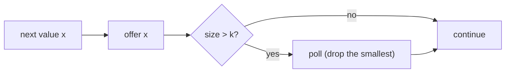
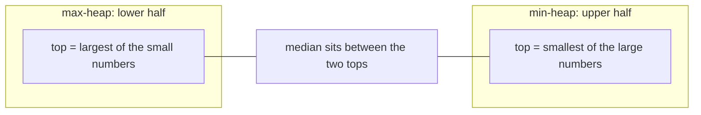

# Session 2 · Priority Queue Applications

Prepared by **Hamna Zahid Khan**, Junior Lecturer

[🏠 Course home](../README.md) · [📘 Module overview](./README.md) · [⬅ Previous](./session-01-binary-heaps.md) · [Practice test ➡](./practice-test.md)

> **Module 11 · Heaps and Priority Queues** · ⏱ 3 hours (90 min lecture + 90 min lab)

## 🎯 Learning objectives

1. Use `java.util.PriorityQueue` with **comparators** (min, max, multi-key, records).
2. Solve **top-k** problems in O(n log k) with a bounded heap.
3. **Merge k sorted lists** in O(N log k).
4. Maintain a **running median** with two heaps.
5. Simulate a **priority scheduler** and recognise heaps inside graph algorithms (Dijkstra, Prim) and greedy algorithms (Huffman).

---

## 1. `java.util.PriorityQueue`

| Method | Meaning | Cost |
|---|---|---|
| `offer(e)` / `add(e)` | insert | O(log n) |
| `poll()` | remove and return the head (`null` if empty) | O(log n) |
| `peek()` | head without removing | O(1) |
| `remove(o)` | remove an arbitrary element | **O(n)** |
| `contains(o)` | search | **O(n)** |
| `new PriorityQueue<>(collection)` | heapify | O(n) |

It is a **min-heap** by natural order. Supply a `Comparator` for anything else:

```java
PriorityQueue<Integer> max = new PriorityQueue<>(Comparator.reverseOrder());
PriorityQueue<Job> jobs = new PriorityQueue<>(
        Comparator.comparingInt(Job::priority).thenComparingInt(Job::arrival));
```

> 🎟️ **Analogy: the visa-counter token machine with categories.** Tokens are printed as people arrive, but the display calls "senior citizens" before "general" and, within a category, the lower token number first. The machine is a priority queue with a **two-key comparator**.

⚠️ Printing a `PriorityQueue` or iterating over it shows the **internal heap array**, not sorted order. Only repeated `poll()` gives sorted order.

## 2. Pattern 1: top-k with a bounded heap

To keep the **k largest** of a stream, use a **min-heap of size k**: the root is the weakest member of the current top k, so a new value only needs to beat the root.



| Approach | Time | Space |
|---|---|---|
| sort everything | O(n log n) | O(n) |
| max-heap of all n, poll k times | O(n + k log n) | O(n) |
| **min-heap of size k** | **O(n log k)** | **O(k)**: works on endless streams |

## 3. Pattern 2: k-way merge

Each of k sorted lists has a "cursor". The heap holds one cursor per list ordered by its current value; poll the smallest, output it, advance that cursor and push it back.

**Dry run: lists A = [1, 4, 9], B = [2, 3, 10, 11], C = [5, 6]**

| Poll | Output | Push | Heap (values) |
|---|---|---|---|
| start | – | A1, B2, C5 | 1, 2, 5 |
| A:1 | 1 | A4 | 2, 4, 5 |
| B:2 | 2 | B3 | 3, 4, 5 |
| B:3 | 3 | B10 | 4, 5, 10 |
| A:4 | 4 | A9 | 5, 9, 10 |
| C:5 | 5 | C6 | 6, 9, 10 |
| C:6 | 6 | – (C done) | 9, 10 |
| … | 9, 10, 11 | | |

Total O(N log k) for N elements: each element enters and leaves a heap of size ≤ k once. This is the core of **external sorting** (merging sorted runs of a file too large for memory) and of merging search-engine posting lists.

## 4. Pattern 3: two heaps for the running median

Split the numbers seen so far into a **lower half** (max-heap) and an **upper half** (min-heap), keeping their sizes equal or the lower half one larger. The median is then `low.peek()` or the average of both tops.



Insertion trick that always works: push to `low`, move `low`'s top to `high`, and if `high` became bigger, move its top back.

| Add | low (max-heap) | high (min-heap) | median |
|---|---|---|---|
| 5 | {5} | {} | 5 |
| 15 | {5} | {15} | 10.0 |
| 1 | {1, 5} | {15} | 5 |
| 3 | {1, 3} | {5, 15} | 4.0 |
| 8 | {1, 3, 5} | {8, 15} | 5 |

Each add is O(log n); each median query O(1).

## 5. Pattern 4: event and job scheduling

Operating systems, print servers and game engines repeatedly ask "which job runs next?". A **non-preemptive priority scheduler** moves every job that has arrived into a priority queue and runs the best one to completion. The program simulates exactly this; note how `email` (priority 2) waits behind two priority-1 jobs that arrived after it: that is **starvation** risk, which real schedulers counter by **ageing** (gradually raising the priority of waiting jobs).

## 6. Heaps inside other algorithms

| Algorithm | What the heap holds | Module |
|---|---|---|
| Dijkstra's shortest paths | vertices by tentative distance | 12 |
| Prim's minimum spanning tree | crossing edges by weight | 12 |
| Huffman coding | subtrees by frequency | 15 |
| A* search (games, maps) | states by cost + heuristic | – |
| Discrete-event simulation | events by timestamp | – |

## 7. Complexity table

| Task | With a heap | Without |
|---|---|---|
| top-k of n | O(n log k) | O(n log n) sort |
| merge k sorted lists (N total) | O(N log k) | O(N k) scanning heads |
| running median, n adds | O(n log n) total, O(1) query | O(n²) re-sorting |
| schedule n jobs | O(n log n) | O(n²) scanning |
| min meeting rooms | O(n log n) | O(n²) |

---

## 8. Complete program

📄 **[`src/PriorityQueueApps.java`](src/PriorityQueueApps.java)**

```java
import java.util.ArrayList;
import java.util.Comparator;
import java.util.List;
import java.util.PriorityQueue;

/**
 * Session 2 demo: java.util.PriorityQueue with comparators, top-k selection, merging k sorted
 * lists, a running median with two heaps, and a priority-based job scheduler simulation.
 *
 * Compile:  javac -d out PriorityQueueApps.java
 * Run:      java -cp out PriorityQueueApps
 *
 * Prepared by Hamna Zahid Khan, Junior Lecturer
 */
public class PriorityQueueApps {

    /** k largest values using a MIN-heap of size k: the root is the weakest of the current top k. */
    static List<Integer> topK(int[] a, int k) {
        PriorityQueue<Integer> pq = new PriorityQueue<>();
        for (int x : a) {
            pq.offer(x);
            if (pq.size() > k) pq.poll();               // throw away the smallest
        }
        List<Integer> out = new ArrayList<>(pq);
        out.sort(Comparator.reverseOrder());
        return out;
    }

    /** Merge k sorted lists: the heap holds one "cursor" per list, ordered by its current value. */
    static List<Integer> mergeK(List<List<Integer>> lists) {
        PriorityQueue<int[]> pq = new PriorityQueue<>(Comparator.comparingInt((int[] c) -> lists.get(c[0]).get(c[1])));
        for (int i = 0; i < lists.size(); i++) if (!lists.get(i).isEmpty()) pq.offer(new int[]{i, 0});
        List<Integer> out = new ArrayList<>();
        while (!pq.isEmpty()) {
            int[] c = pq.poll();                        // c = {list index, position}
            out.add(lists.get(c[0]).get(c[1]));
            if (c[1] + 1 < lists.get(c[0]).size()) pq.offer(new int[]{c[0], c[1] + 1});
        }
        return out;
    }

    /** Running median: max-heap for the lower half, min-heap for the upper half. */
    static final class MedianFinder {
        private final PriorityQueue<Integer> low = new PriorityQueue<>(Comparator.reverseOrder());
        private final PriorityQueue<Integer> high = new PriorityQueue<>();

        void add(int x) {
            low.offer(x);
            high.offer(low.poll());                     // largest of the low half moves up
            if (high.size() > low.size()) low.offer(high.poll());   // keep |low| = |high| or |high| + 1
        }

        double median() {
            return low.size() > high.size() ? low.peek() : (low.peek() + high.peek()) / 2.0;
        }
    }

    /** A print/compute job: lower priority number = more urgent; ties broken by arrival order. */
    record Job(String name, int priority, int arrival, int duration) { }

    static List<String> schedule(List<Job> jobs) {
        List<Job> byArrival = new ArrayList<>(jobs);
        byArrival.sort(Comparator.comparingInt(Job::arrival));
        PriorityQueue<Job> ready = new PriorityQueue<>(
                Comparator.comparingInt(Job::priority).thenComparingInt(Job::arrival));
        List<String> log = new ArrayList<>();
        int time = 0, next = 0;
        while (next < byArrival.size() || !ready.isEmpty()) {
            while (next < byArrival.size() && byArrival.get(next).arrival() <= time) ready.offer(byArrival.get(next++));
            if (ready.isEmpty()) { time = byArrival.get(next).arrival(); continue; }   // CPU idle
            Job j = ready.poll();
            log.add(String.format("t=%2d..%2d  %-8s (priority %d, arrived %d, waited %d)",
                    time, time + j.duration(), j.name(), j.priority(), j.arrival(), time - j.arrival()));
            time += j.duration();
        }
        return log;
    }

    public static void main(String[] args) {
        System.out.println("== PriorityQueue basics ==");
        PriorityQueue<Integer> pq = new PriorityQueue<>(List.of(42, 7, 19, 3, 25));
        System.out.println("internal array order (NOT sorted): " + pq);
        StringBuilder sb = new StringBuilder();
        while (!pq.isEmpty()) sb.append(pq.poll()).append(' ');
        System.out.println("poll order (sorted): " + sb.toString().trim());

        System.out.println("\n== Top-3 marks with a size-3 min-heap ==");
        System.out.println(topK(new int[]{67, 88, 45, 92, 71, 88, 59, 95}, 3));

        System.out.println("\n== Merge 3 sorted lists ==");
        System.out.println(mergeK(List.of(List.of(1, 4, 9), List.of(2, 3, 10, 11), List.of(5, 6))));

        System.out.println("\n== Running median ==");
        MedianFinder mf = new MedianFinder();
        sb = new StringBuilder();
        for (int x : new int[]{5, 15, 1, 3, 8, 7, 9, 10}) {
            mf.add(x);
            sb.append(x).append("->").append(mf.median()).append("  ");
        }
        System.out.println(sb.toString().trim());

        System.out.println("\n== Priority job scheduler (non-preemptive) ==");
        List<Job> jobs = List.of(
                new Job("backup", 3, 0, 4), new Job("grades", 1, 1, 3), new Job("email", 2, 2, 1),
                new Job("report", 1, 3, 2), new Job("logs", 3, 12, 2));
        for (String line : schedule(jobs)) System.out.println(line);
    }
}
```

**Real output:**

```text
$ java -cp out PriorityQueueApps
== PriorityQueue basics ==
internal array order (NOT sorted): [3, 7, 19, 42, 25]
poll order (sorted): 3 7 19 25 42

== Top-3 marks with a size-3 min-heap ==
[95, 92, 88]

== Merge 3 sorted lists ==
[1, 2, 3, 4, 5, 6, 9, 10, 11]

== Running median ==
5->5.0  15->10.0  1->5.0  3->4.0  8->5.0  7->6.0  9->7.0  10->7.5

== Priority job scheduler (non-preemptive) ==
t= 0.. 4  backup   (priority 3, arrived 0, waited 0)
t= 4.. 7  grades   (priority 1, arrived 1, waited 3)
t= 7.. 9  report   (priority 1, arrived 3, waited 4)
t= 9..10  email    (priority 2, arrived 2, waited 7)
t=12..14  logs     (priority 3, arrived 12, waited 0)
```

---

## 9. Worked examples (basic → advanced)

**Example 1 (basic): top-k frequent words.** Count with a `HashMap` (Module 08), then select with a size-k heap whose comparator puts the **worst** candidate on top (lowest count; for equal counts the alphabetically larger word).

```java
/** The k most frequent words (ties: alphabetical). Count with a map, select with a size-k heap. */
static List<String> topKFrequent(String[] words, int k) {
    Map<String, Integer> count = new HashMap<>();
    for (String w : words) count.merge(w, 1, Integer::sum);
    Comparator<String> worseFirst = Comparator.<String>comparingInt(count::get)
            .thenComparing(Comparator.<String>reverseOrder());
    PriorityQueue<String> pq = new PriorityQueue<>(worseFirst);
    for (String w : count.keySet()) {
        pq.offer(w);
        if (pq.size() > k) pq.poll();
    }
    String[] out = new String[pq.size()];
    for (int i = out.length - 1; i >= 0; i--) out[i] = pq.poll();
    return Arrays.asList(out);
}
```
<sub>Full, compiled version: [`src/Labs11.java`](src/Labs11.java)</sub>

**Example 2 (intermediate): minimum number of lab rooms.** Sort lectures by start time. A min-heap holds the **end times** of rooms in use; if the earliest-ending room is free by the next start, reuse it (poll), then push the new end. The heap's final size is the answer.

| Lecture (sorted) | heap of end times before | free room? | heap after |
|---|---|---|---|
| [9, 10) | {} | – | {10} |
| [9, 11) | {10} | 10 > 9 no | {10, 11} |
| [10, 12) | {10, 11} | 10 ≤ 10 yes | {11, 12} |
| [11, 13) | {11, 12} | 11 ≤ 11 yes | {12, 13} |
| [12, 14) | {12, 13} | 12 ≤ 12 yes | {13, 14} ⇒ **2 rooms** |

```java
/** Minimum lab rooms for lectures [start, end): sort by start, min-heap of end times of busy rooms. */
static int minRooms(int[][] lectures) {
    int[][] s = lectures.clone();
    Arrays.sort(s, Comparator.comparingInt((int[] x) -> x[0]));
    PriorityQueue<Integer> ends = new PriorityQueue<>();
    for (int[] l : s) {
        if (!ends.isEmpty() && ends.peek() <= l[0]) ends.poll();    // reuse the room that frees first
        ends.offer(l[1]);
    }
    return ends.size();
}
```
<sub>Full, compiled version: [`src/Labs11.java`](src/Labs11.java)</sub>

**Example 3 (advanced): cheapest way to connect ropes.** Joining ropes of lengths a and b costs a + b. Always joining the two **shortest** ropes is optimal (the same exchange argument as Huffman coding, Module 15). For [4, 3, 2, 6]: 2+3 = 5, 4+5 = 9, 6+9 = 15 ⇒ total **29**.

```java
/** Join ropes; joining lengths a and b costs a + b. Always join the two shortest (greedy, Module 15). */
static long connectRopes(int[] ropes) {
    PriorityQueue<Long> pq = new PriorityQueue<>();
    for (int r : ropes) pq.offer((long) r);
    long cost = 0;
    while (pq.size() > 1) {
        long joined = pq.poll() + pq.poll();
        cost += joined;
        pq.offer(joined);
    }
    return cost;
}
```
<sub>Full, compiled version: [`src/Labs11.java`](src/Labs11.java)</sub>

## 10. Real-life problem: ranking the top 10 products by live sales

**Problem.** A campus bookshop's dashboard must show the **10 best-selling titles today**, updated as each sale arrives. There are 50,000 titles, and sales arrive every second.

**Solution.** Keep `sales: HashMap<title, count>`. Every few seconds (or on demand), run a **size-10 min-heap** over the counts: O(T log 10) ≈ O(T) for T titles, with only 10 elements in memory beyond the map. For truly enormous streams where even the map is too large, approximate structures (Count-Min Sketch plus a heap) are used by analytics systems; the heap part is exactly what you wrote here.

## 11. Common mistakes

| Mistake | Fix |
|---|---|
| Printing a `PriorityQueue` and expecting sorted output | poll repeatedly, or copy and sort |
| Using a **max**-heap for "top k largest" | use a **min**-heap of size k |
| Comparator `(a, b) -> a - b` with large or negative ints | overflow; use `Integer.compare` or `Comparator.comparingInt` |
| Changing an object's priority while it is inside the queue | remove it, update, re-insert (or insert a new entry and skip stale ones) |
| Calling `pq.remove(x)` in a loop | O(n) each; use lazy deletion |
| Unbalanced two-heap median (sizes differ by 2) | rebalance after every insertion |

## 12. Best practices

- Write comparators with `Comparator.comparingInt(...).thenComparing(...)`: readable and overflow-safe.
- Use **records** as heap entries (e.g. `record Event(long time, int id)`), which are immutable.
- For graph algorithms, use **lazy deletion**: push a new (vertex, distance) pair and ignore outdated ones when polled.
- Size-bound your heaps whenever the question only needs k items.

---

## 13. Lab tasks

**Lab 2.1: Top-k frequent words.** Return the 2 most frequent words of `dsa ai dsa oop ai dsa db oop ai` (ties alphabetical).

<details>
<summary>✅ Solution</summary>

See Example 1. Both `ai` and `dsa` appear 3 times ⇒ `[ai, dsa]`.

</details>

**Lab 2.2: Minimum lab rooms** for `[[9,11],[10,12],[11,13],[9,10],[12,14]]`.

<details>
<summary>✅ Solution</summary>

See Example 2: **2** rooms.

</details>

**Lab 2.3: Connect ropes** with minimum cost.

<details>
<summary>✅ Solution</summary>

See Example 3.

</details>

**Lab 2.4: Ageing scheduler.** Modify `schedule` so that every time a job is dispatched, each waiting job's priority improves by 1 (lower number) after waiting 5 time units. Which data-structure operation becomes expensive, and how could you avoid it?

<details>
<summary>✅ Solution</summary>

Changing priorities of jobs already inside a `PriorityQueue` requires removing and re-inserting them (O(n) for `remove`). Two practical fixes: (1) compute an **effective priority** from (priority, arrival) that does not change over time, e.g. `priority * W + arrival` so older jobs naturally rise; or (2) rebuild the heap with heapify (O(n)) only at ageing intervals instead of on every dispatch.

</details>

**Real output of the Session 2 lab solutions:**

```text
$ java -cp out Labs11 2
-- Session 2 labs --
topKFrequent(k=2) = [ai, dsa]
minRooms([[9,11],[10,12],[11,13],[9,10],[12,14]]) = 2
connectRopes([4, 3, 2, 6]) = 29
```

---

## 14. Quiz

**Q1.** `new PriorityQueue<Integer>()` polls elements in:

- **A.** insertion order
- **B.** ascending order
- **C.** descending order
- **D.** random order

**Q2.** To keep the k LARGEST elements of a stream you use:

- **A.** a max-heap of size k
- **B.** a min-heap of size k
- **C.** a sorted array of size n
- **D.** a stack

**Q3.** Merging k sorted lists with N elements in total using a heap takes:

- **A.** O(N k)
- **B.** O(N log k)
- **C.** O(N log N) always
- **D.** O(k log N)

**Q4.** In the two-heap median, the lower half is stored in a:

- **A.** min-heap
- **B.** max-heap
- **C.** queue
- **D.** hash set

**Q5.** `priorityQueue.remove(someObject)` costs:

- **A.** O(1)
- **B.** O(log n)
- **C.** O(n)
- **D.** O(n log n)

<details>
<summary><b>Show answers</b></summary>

1. **B**: Natural-order min-heap.
2. **B**: The root is the weakest of the current top k.
3. **B**: The heap never holds more than k cursors.
4. **B**: Its top must be the largest of the small numbers.
5. **C**: It must search the array first.

</details>

---

## 15. Summary

- `PriorityQueue` is a binary min-heap; comparators make it a max-heap or a multi-key heap.
- **Top-k:** min-heap of size k, O(n log k). **k-way merge:** O(N log k).
- **Running median:** max-heap (lower half) + min-heap (upper half).
- Heaps drive schedulers, simulations, Dijkstra, Prim and Huffman.

## 16. Viva / interview questions

1. Why is a min-heap (not a max-heap) used for the top-k largest?
2. Explain external merge sort and where the heap appears.
3. How do you support deleting the median, not just reading it?
4. What is starvation in priority scheduling and how does ageing solve it?
5. How does lazy deletion work in Dijkstra's algorithm with `PriorityQueue`?
6. Find the k-th smallest element in an n × n matrix whose rows and columns are sorted.

---

[⬅ Previous](./session-01-binary-heaps.md) · [📘 Module overview](./README.md) · [Practice test ➡](./practice-test.md)
