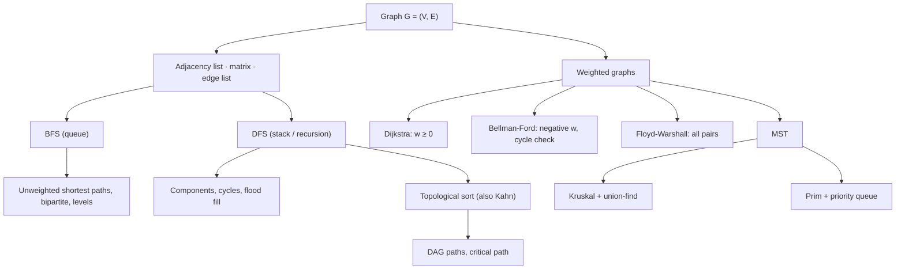

# Module 12 · Graphs

Prepared by **Hamna Zahid Khan**, Junior Lecturer

[🏠 Course home](../README.md)

> ⏱ 12 contact hours · 4 sessions · 🔴 Advanced

Graphs model anything with connections: roads, networks, prerequisites, friendships. This module builds adjacency lists, BFS and DFS, then the classic algorithms on top of them: topological sort and cycle detection, Dijkstra / Bellman-Ford / Floyd-Warshall shortest paths, and Kruskal / Prim minimum spanning trees with union-find.

## 🎯 Module objectives

- Represent graphs with adjacency lists, matrices and edge lists, and pick the right one.
- Implement BFS and DFS and apply them to components, cycles, grids and bipartite checks.
- Topologically sort DAGs (Kahn and DFS) and detect directed cycles.
- Compute shortest paths with Dijkstra, Bellman-Ford and Floyd-Warshall, and know when each applies.
- Build MSTs with Kruskal and Prim; implement union-find with path compression and union by rank.

## 📚 Sessions

| # | Session | Key ideas | Code |
|---|---|---|---|
| 1 | [Representation, BFS and DFS](session-01-graph-representation-bfs-dfs.md) | adjacency list/matrix, BFS distances, DFS, components, cycles | [`GraphBasics.java`](src/GraphBasics.java) |
| 2 | [Topological Sort](session-02-topological-sort.md) | DAGs, Kahn, DFS finishing order, three colours, critical path | [`TopologicalSort.java`](src/TopologicalSort.java) |
| 3 | [Shortest Paths](session-03-shortest-paths.md) | relaxation, Dijkstra, Bellman-Ford, negative cycles, Floyd-Warshall | [`ShortestPaths.java`](src/ShortestPaths.java) |
| 4 | [MSTs and Union-Find](session-04-minimum-spanning-trees-and-union-find.md) | cut property, union-find, Kruskal, Prim | [`MstUnionFind.java`](src/MstUnionFind.java) |
| ✍️ | [Practice test](practice-test.md) | 20 MCQs + 3 coding scenarios | [`Labs12.java`](src/Labs12.java), [`SelfCheck.java`](src/SelfCheck.java) |

## 🗺️ Concept map



## 📄 One-page cheat sheet

| Problem | Algorithm | Time |
|---|---|---|
| Traverse / reachability | BFS or DFS | O(V + E) |
| Shortest path, unweighted | BFS | O(V + E) |
| Shortest path, 0/1 weights | 0-1 BFS (deque) | O(V + E) |
| Shortest path in a DAG | topological order + relax | O(V + E) |
| Shortest path, w ≥ 0 | Dijkstra + heap | O((V + E) log V) |
| Shortest path, negative w | Bellman-Ford | O(VE) |
| All pairs | Floyd-Warshall | O(V³) |
| Order with dependencies | Kahn / DFS topo sort | O(V + E) |
| Directed cycle | three-colour DFS | O(V + E) |
| MST | Kruskal / Prim | O(E log E) |
| Dynamic connectivity (add only) | union-find | O(α(n)) per op |

**Templates**

```java
// BFS
dist[s] = 0; q.offer(s);
while (!q.isEmpty()) { int u = q.poll();
    for (int v : adj.get(u)) if (dist[v] == -1) { dist[v] = dist[u] + 1; q.offer(v); } }

// Dijkstra (lazy)
pq.offer(new long[]{0, s});
while (!pq.isEmpty()) { long[] t = pq.poll(); int u = (int) t[1]; if (done[u]) continue; done[u] = true;
    for (Edge e : adj.get(u)) if (dist[u] + e.w() < dist[e.to()]) { dist[e.to()] = dist[u] + e.w(); pq.offer(new long[]{dist[e.to()], e.to()}); } }

// Union-find
int find(int x) { return parent[x] == x ? x : (parent[x] = find(parent[x])); }
```

## ▶️ Run the code

```bash
cd 12-graphs/src
javac -d out *.java
java -ea -cp out SelfCheck
java -cp out ShortestPaths
java -cp out Labs12 3          # Session 3 lab solutions (1-4)
```

See [`src/README.md`](src/README.md) for every file.
