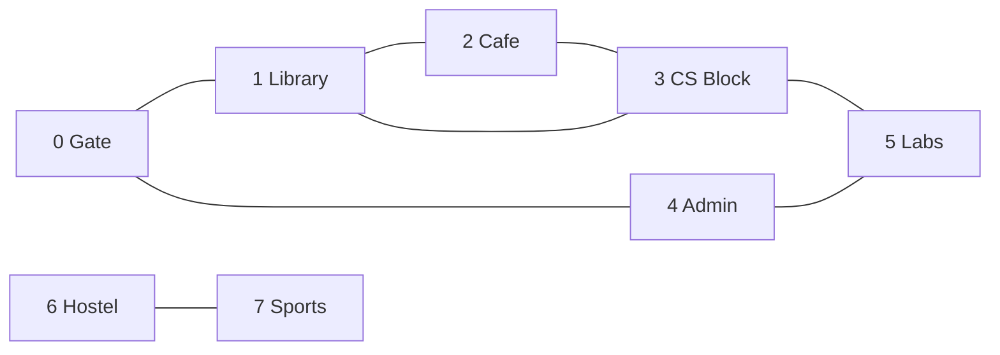
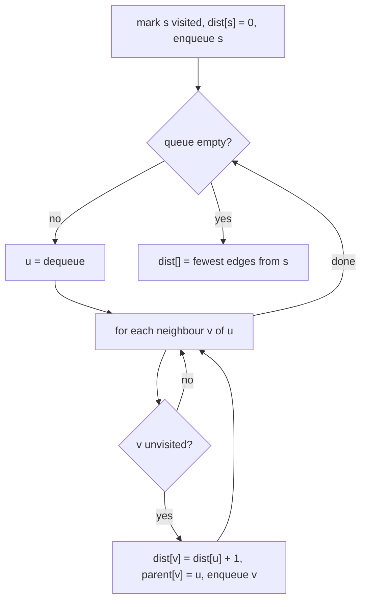

# Session 1 · Graph Representation, BFS and DFS

Prepared by **Hamna Zahid Khan**, Junior Lecturer

[🏠 Course home](../README.md) · [📘 Module overview](./README.md) · [⬅ Module overview](./README.md) · [Next ➡](./session-02-topological-sort.md)

> **Module 12 · Graphs** · ⏱ 3 hours (90 min lecture + 90 min lab)

## 🎯 Learning objectives

1. Define graphs precisely: vertices, edges, directed/undirected, weighted, degree, path, cycle, connected.
2. Choose between an **adjacency matrix**, an **adjacency list** and an **edge list**.
3. Implement **breadth-first search** with distances and path reconstruction.
4. Implement **depth-first search** recursively and with an explicit stack.
5. Use BFS/DFS for connected components, cycle detection, flood fill and bipartite checks.

---

## 1. What is a graph?

A **graph** G = (V, E) is a set of **vertices** (nodes) and a set of **edges** connecting pairs of them. Trees (Module 09) are a special case: connected graphs without cycles.

> 🗺️ **Analogy: the campus map.** Buildings are vertices; walkways are edges. "Can I walk from the Hostel to the Library?" is a **connectivity** question. "What is the route with the fewest walkways?" is a **shortest-path** question. A one-way service road is a **directed** edge; a walkway's length in metres is a **weight**.

| Term | Meaning |
|---|---|
| Undirected edge {u, v} | can be travelled both ways (friendship, walkway) |
| Directed edge (u → v) | one way (follows on social media, prerequisite, web link) |
| Weighted edge | carries a cost: distance, time, price |
| Degree | number of edges at a vertex (in-degree / out-degree when directed) |
| Path | sequence of vertices joined by edges |
| Cycle | path that returns to its start without repeating an edge |
| Connected | every vertex is reachable from every other (undirected) |
| Component | maximal connected piece |
| Sparse / dense | E ≈ V versus E ≈ V² |

Graphs model road and rail networks, social networks, the web, computer networks, course prerequisites, dependency managers (Maven, npm), circuit layouts and recommendation systems.



This campus graph (used all session) has 8 vertices, 8 edges, two components, and cycles such as Library-Cafe-CS Block.

## 2. Representations

| Representation | Storage | Edge (u, v)? | Iterate neighbours of u | Best for |
|---|---|---|---|---|
| **Adjacency matrix** `boolean[V][V]` | O(V²) | **O(1)** | O(V) | dense graphs, Floyd-Warshall |
| **Adjacency list** `List<List<Integer>>` | **O(V + E)** | O(deg u) | **O(deg u)** | almost everything (sparse graphs) |
| **Edge list** `List<Edge>` | O(E) | O(E) | O(E) | Kruskal, Bellman-Ford |

A road network with a million junctions has only a few million roads: a matrix would need 10¹² cells; an adjacency list needs a few million entries. **Default to adjacency lists.**

For an undirected graph, each edge appears **twice** in the adjacency list (u in v's list and v in u's), so the lists hold 2E entries in total (the handshake lemma: Σ degree = 2E).

## 3. Breadth-first search (BFS)

BFS explores the graph in **rings**: first all vertices 1 edge away, then 2 edges, and so on. It uses a **queue** (Module 07).



**Key property:** in an unweighted graph, the first time BFS reaches a vertex is along a **shortest path** (fewest edges). Mark vertices when they are **enqueued**, not when dequeued, so nothing is enqueued twice.

### Dry run: BFS from Gate (0)

| Dequeue | Neighbours | Newly discovered (dist, parent) | Queue after |
|---|---|---|---|
| – | – | 0 (0, –) | [0] |
| 0 | 1, 4 | 1 (1, 0), 4 (1, 0) | [1, 4] |
| 1 | 0, 2, 3 | 2 (2, 1), 3 (2, 1) | [4, 2, 3] |
| 4 | 0, 5 | 5 (2, 4) | [2, 3, 5] |
| 2 | 1, 3 | – | [3, 5] |
| 3 | 1, 2, 5 | – | [5] |
| 5 | 3, 4 | – | [] |

Hostel (6) and Sports (7) stay at −1: unreachable. Following parents from Labs: 5 ← 4 ← 0, so the shortest walk is **Gate → Admin → Labs**.

## 4. Depth-first search (DFS)

DFS goes **as deep as possible** before backtracking, like exploring a maze by always taking the first unexplored corridor. It uses recursion (the call stack) or an explicit **stack**.

```java
static void dfs(Graph g, int u, boolean[] seen, List<Integer> order) {
    seen[u] = true;
    order.add(u);
    for (int v : g.neighbours(u)) if (!seen[v]) dfs(g, v, seen, order);
}
```

### Dry run: DFS from Gate (0)

| Call stack (deepest at right) | Visit | Reason |
|---|---|---|
| 0 | 0 | start |
| 0 → 1 | 1 | first neighbour of 0 |
| 0 → 1 → 2 | 2 | first unvisited neighbour of 1 |
| 0 → 1 → 2 → 3 | 3 | 2's neighbour 1 visited, 3 is not |
| 0 → 1 → 2 → 3 → 5 | 5 | 3's unvisited neighbour |
| 0 → 1 → 2 → 3 → 5 → 4 | 4 | 5's unvisited neighbour |
| backtrack to 0 | – | everything reachable is visited |

DFS order: **0 1 2 3 5 4**. BFS order: 0 1 4 2 3 5. Same vertices, different exploration shape.

## 5. BFS vs DFS

| | BFS | DFS |
|---|---|---|
| Structure | queue | stack / recursion |
| Explores | level by level | one branch to the end, then backtracks |
| Shortest path (unweighted) | ✅ yes | ❌ no |
| Memory | O(width) | O(depth) |
| Natural for | nearest, minimum steps, levels | cycles, topological sort, components, mazes, backtracking |
| Time | O(V + E) | O(V + E) |

## 6. Applications

| Problem | Technique |
|---|---|
| Connected components | run BFS/DFS from every unvisited vertex; each run labels one component |
| Cycle in an undirected graph | DFS: reaching a visited vertex that is not your parent |
| Flood fill / islands in a grid | each cell is a vertex with up to 4 neighbours |
| Bipartite (two-colourable)? | BFS colouring; an edge between equal colours ⇒ no |
| Fewest moves in a puzzle | BFS over states |

## 7. Complexity table

| Operation | Adjacency list | Adjacency matrix |
|---|---|---|
| BFS / DFS | **O(V + E)** | O(V²) |
| Components | O(V + E) | O(V²) |
| Edge lookup | O(deg) | O(1) |
| Space | O(V + E) | O(V²) |

---

## 8. Complete program

📄 **[`src/GraphBasics.java`](src/GraphBasics.java)**

```java
import java.util.ArrayDeque;
import java.util.ArrayList;
import java.util.Arrays;
import java.util.Collections;
import java.util.Deque;
import java.util.List;
import java.util.Queue;

/**
 * Session 1 demo: graph representations (adjacency matrix and adjacency list), breadth-first search
 * with distances and path reconstruction, depth-first search (recursive and iterative), connected
 * components and cycle detection in an undirected graph.
 *
 * Compile:  javac -d out GraphBasics.java
 * Run:      java -cp out GraphBasics
 *
 * Prepared by Hamna Zahid Khan, Junior Lecturer
 */
public class GraphBasics {

    /** Adjacency-list graph on vertices 0..n-1, directed or undirected. */
    static final class Graph {
        final int n;
        final boolean directed;
        final List<List<Integer>> adj = new ArrayList<>();
        int edges;

        Graph(int n, boolean directed) {
            this.n = n;
            this.directed = directed;
            for (int i = 0; i < n; i++) adj.add(new ArrayList<>());
        }

        void addEdge(int u, int v) {
            adj.get(u).add(v);
            if (!directed) adj.get(v).add(u);
            edges++;
        }

        List<Integer> neighbours(int u) { return adj.get(u); }
        int degree(int u) { return adj.get(u).size(); }

        boolean[][] toMatrix() {
            boolean[][] m = new boolean[n][n];
            for (int u = 0; u < n; u++) for (int v : adj.get(u)) m[u][v] = true;
            return m;
        }
    }

    /** BFS from s: dist[v] = fewest edges from s (-1 if unreachable), parent[] encodes the BFS tree. */
    static int[] bfs(Graph g, int s, int[] parent) {
        int[] dist = new int[g.n];
        Arrays.fill(dist, -1);
        Arrays.fill(parent, -1);
        Queue<Integer> q = new ArrayDeque<>();
        dist[s] = 0;
        q.offer(s);
        while (!q.isEmpty()) {
            int u = q.poll();
            for (int v : g.neighbours(u)) {
                if (dist[v] == -1) {            // first time seen = shortest distance
                    dist[v] = dist[u] + 1;
                    parent[v] = u;
                    q.offer(v);
                }
            }
        }
        return dist;
    }

    /** Walk parent links back from t to rebuild the path s -> t. */
    static List<Integer> path(int[] parent, int s, int t) {
        List<Integer> p = new ArrayList<>();
        for (int v = t; v != -1; v = parent[v]) p.add(v);
        Collections.reverse(p);
        return p.get(0) == s ? p : List.of();
    }

    /** Recursive DFS: records the visit (preorder) sequence. */
    static void dfs(Graph g, int u, boolean[] seen, List<Integer> order) {
        seen[u] = true;
        order.add(u);
        for (int v : g.neighbours(u)) if (!seen[v]) dfs(g, v, seen, order);
    }

    /** Iterative DFS with an explicit stack. Neighbours pushed in reverse so the order matches recursion. */
    static List<Integer> dfsIterative(Graph g, int s) {
        boolean[] seen = new boolean[g.n];
        List<Integer> order = new ArrayList<>();
        Deque<Integer> st = new ArrayDeque<>();
        st.push(s);
        while (!st.isEmpty()) {
            int u = st.pop();
            if (seen[u]) continue;
            seen[u] = true;
            order.add(u);
            List<Integer> nb = g.neighbours(u);
            for (int i = nb.size() - 1; i >= 0; i--) if (!seen[nb.get(i)]) st.push(nb.get(i));
        }
        return order;
    }

    /** Label every vertex with its component number; returns the number of components. */
    static int components(Graph g, int[] comp) {
        Arrays.fill(comp, -1);
        int c = 0;
        for (int s = 0; s < g.n; s++) {
            if (comp[s] != -1) continue;
            Deque<Integer> st = new ArrayDeque<>();
            st.push(s);
            comp[s] = c;
            while (!st.isEmpty()) {
                int u = st.pop();
                for (int v : g.neighbours(u)) if (comp[v] == -1) { comp[v] = c; st.push(v); }
            }
            c++;
        }
        return c;
    }

    /** Undirected cycle check: meeting an already-visited vertex that is not our parent closes a cycle. */
    static boolean hasCycleUndirected(Graph g) {
        boolean[] seen = new boolean[g.n];
        for (int s = 0; s < g.n; s++) if (!seen[s] && cycleFrom(g, s, -1, seen)) return true;
        return false;
    }

    private static boolean cycleFrom(Graph g, int u, int parent, boolean[] seen) {
        seen[u] = true;
        for (int v : g.neighbours(u)) {
            if (!seen[v]) { if (cycleFrom(g, v, u, seen)) return true; }
            else if (v != parent) return true;
        }
        return false;
    }

    static final String[] CAMPUS = {"Gate", "Library", "Cafe", "CS Block", "Admin", "Labs", "Hostel", "Sports"};

    /** The campus walkway graph used throughout the session. */
    static Graph campus() {
        Graph g = new Graph(8, false);
        int[][] e = {{0, 1}, {0, 4}, {1, 2}, {1, 3}, {2, 3}, {3, 5}, {4, 5}, {6, 7}};
        for (int[] x : e) g.addEdge(x[0], x[1]);
        return g;
    }

    public static void main(String[] args) {
        Graph g = campus();
        System.out.println("== Campus walkways: " + g.n + " places, " + g.edges + " walkways ==");
        for (int u = 0; u < g.n; u++) System.out.printf("%d %-8s -> %s (degree %d)%n", u, CAMPUS[u], g.neighbours(u), g.degree(u));

        System.out.println("\nAdjacency matrix (1 = walkway):");
        boolean[][] m = g.toMatrix();
        for (boolean[] row : m) {
            StringBuilder sb = new StringBuilder("  ");
            for (boolean b : row) sb.append(b ? "1 " : ". ");
            System.out.println(sb.toString().trim());
        }

        System.out.println("\n== BFS from Gate (0) ==");
        int[] parent = new int[g.n];
        int[] dist = bfs(g, 0, parent);
        System.out.println("dist   = " + Arrays.toString(dist));
        System.out.println("parent = " + Arrays.toString(parent));
        List<String> names = new ArrayList<>();
        for (int v : path(parent, 0, 5)) names.add(CAMPUS[v]);
        System.out.println("shortest walk Gate -> Labs: " + String.join(" -> ", names) + " (" + dist[5] + " walkways)");
        System.out.println("Hostel reachable from Gate? " + (dist[6] != -1));

        System.out.println("\n== DFS from Gate ==");
        List<Integer> order = new ArrayList<>();
        dfs(g, 0, new boolean[g.n], order);
        System.out.println("recursive DFS order = " + order);
        System.out.println("iterative DFS order = " + dfsIterative(g, 0));

        System.out.println("\n== Connected components ==");
        int[] comp = new int[g.n];
        System.out.println(components(g, comp) + " components, labels = " + Arrays.toString(comp));

        System.out.println("\n== Cycle detection ==");
        System.out.println("campus has a cycle? " + hasCycleUndirected(g) + "  (Library-Cafe-CS Block)");
        Graph tree = new Graph(4, false);
        tree.addEdge(0, 1); tree.addEdge(1, 2); tree.addEdge(1, 3);
        System.out.println("a tree has a cycle?  " + hasCycleUndirected(tree));
    }
}
```

**Real output:**

```text
$ java -cp out GraphBasics
== Campus walkways: 8 places, 8 walkways ==
0 Gate     -> [1, 4] (degree 2)
1 Library  -> [0, 2, 3] (degree 3)
2 Cafe     -> [1, 3] (degree 2)
3 CS Block -> [1, 2, 5] (degree 3)
4 Admin    -> [0, 5] (degree 2)
5 Labs     -> [3, 4] (degree 2)
6 Hostel   -> [7] (degree 1)
7 Sports   -> [6] (degree 1)

Adjacency matrix (1 = walkway):
. 1 . . 1 . . .
1 . 1 1 . . . .
. 1 . 1 . . . .
. 1 1 . . 1 . .
1 . . . . 1 . .
. . . 1 1 . . .
. . . . . . . 1
. . . . . . 1 .

== BFS from Gate (0) ==
dist   = [0, 1, 2, 2, 1, 2, -1, -1]
parent = [-1, 0, 1, 1, 0, 4, -1, -1]
shortest walk Gate -> Labs: Gate -> Admin -> Labs (2 walkways)
Hostel reachable from Gate? false

== DFS from Gate ==
recursive DFS order = [0, 1, 2, 3, 5, 4]
iterative DFS order = [0, 1, 2, 3, 5, 4]

== Connected components ==
2 components, labels = [0, 0, 0, 0, 0, 0, 1, 1]

== Cycle detection ==
campus has a cycle? true  (Library-Cafe-CS Block)
a tree has a cycle?  false
```

---

## 9. Worked examples (basic → advanced)

**Example 1 (basic): number of islands.** A grid of land ('1') and water ('0'); count groups of land cells connected horizontally or vertically. Each cell is a vertex; each DFS "sinks" one whole island.

```java
/** Count islands of '1' cells (4-directional). Each DFS sinks one whole island. O(R*C). */
static int numIslands(char[][] grid) {
    int count = 0;
    for (int r = 0; r < grid.length; r++)
        for (int c = 0; c < grid[0].length; c++)
            if (grid[r][c] == '1') { count++; sink(grid, r, c); }
    return count;
}

private static void sink(char[][] g, int r, int c) {
    if (r < 0 || c < 0 || r >= g.length || c >= g[0].length || g[r][c] != '1') return;
    g[r][c] = '0';                                   // mark visited by changing the cell
    sink(g, r + 1, c); sink(g, r - 1, c); sink(g, r, c + 1); sink(g, r, c - 1);
}
```
<sub>Full, compiled version: [`src/Labs12.java`](src/Labs12.java)</sub>

Grid `11000 / 11010 / 00100 / 00011` has **4** islands. O(R·C).

**Example 2 (intermediate): bipartite check.** Can students be split into two lab sections so that no two students who **clash** (an edge) share a section? BFS colours each vertex the opposite of its parent; a clash between equal colours means an **odd cycle**, which makes it impossible.

```java
/** Can the vertices be split into two groups with every edge going across? BFS 2-colouring. */
static boolean isBipartite(List<List<Integer>> adj) {
    int[] color = new int[adj.size()];               // 0 = uncoloured, 1 / -1 = the two sides
    for (int s = 0; s < adj.size(); s++) {
        if (color[s] != 0) continue;
        Queue<Integer> q = new ArrayDeque<>();
        q.offer(s);
        color[s] = 1;
        while (!q.isEmpty()) {
            int u = q.poll();
            for (int v : adj.get(u)) {
                if (color[v] == 0) { color[v] = -color[u]; q.offer(v); }
                else if (color[v] == color[u]) return false;   // edge inside one group
            }
        }
    }
    return true;
}
```
<sub>Full, compiled version: [`src/Labs12.java`](src/Labs12.java)</sub>

| Graph | Result | Why |
|---|---|---|
| square 0-1-2-3-0 | true | colours 1, −1, 1, −1 |
| triangle 0-1-2-0 | false | odd cycle |

**Example 3 (advanced): word ladder (BFS over implicit states).** Transform "cold" into "warm" changing one letter at a time, each step a dictionary word. Vertices are words, edges join words differing in one letter. BFS from "cold" finds the fewest steps (cold → cord → card → ward → warm). You never build the graph explicitly: generate neighbours on the fly. This "BFS over states" pattern also solves sliding puzzles, knight moves and lock combinations.

## 10. Real-life problem: degrees of separation in a student network

**Problem.** A university social app wants to show "**2nd-degree connection**" badges: people who are friends of your friends but not your friends. It has 20,000 users and 300,000 friendships.

**Solution.** Store friendships as an adjacency list (20,000 + 600,000 entries; a matrix would need 400 million cells). Run BFS from the viewer but stop after depth 2: vertices at distance 2 get the badge. BFS is the right tool because "degree" means **fewest edges**, exactly what BFS computes. Cost: only the viewer's 2-hop neighbourhood is explored, a few thousand vertices, not the whole graph.

## 11. Common mistakes

| Mistake | Fix |
|---|---|
| Marking visited when dequeuing in BFS | mark when **enqueuing**, or vertices are enqueued many times |
| Forgetting to add both directions for undirected edges | `adj[u].add(v); adj[v].add(u);` |
| Using DFS for "minimum number of steps" | use BFS (unweighted) or Dijkstra (weighted) |
| Running BFS/DFS only from vertex 0 | loop over all vertices to cover every component |
| Undirected cycle check treating the parent edge as a cycle | skip the vertex you came from |
| Deep recursion on a 10⁶-vertex path graph | iterative DFS with an explicit stack |

## 12. Best practices

- Number vertices 0..V−1 and map names to indices with a `HashMap` when needed.
- Use `List<List<Integer>>` (or `int[][]` built from it) for adjacency lists; `int[] dist` doubles as the visited array (−1 = unseen).
- Keep a `parent[]` array whenever you might need the actual path.
- Write BFS and DFS from memory: almost every graph algorithm is one of them with extra bookkeeping.

---

## 13. Lab tasks

**Lab 1.1: Number of islands.** Implement `numIslands(char[][] grid)`.

<details>
<summary>✅ Solution</summary>

See Example 1.

</details>

**Lab 1.2: Two lab sections.** Implement `isBipartite(adjacency list)`.

<details>
<summary>✅ Solution</summary>

See Example 2.

</details>

**Lab 1.3: Path reconstruction.** Using `bfs` and `parent[]`, print the shortest walk from Gate to every building, or "unreachable".

<details>
<summary>✅ Solution</summary>

Call `bfs(g, 0, parent)` once, then for each v with `dist[v] != -1` call `path(parent, 0, v)`. The program already prints Gate → Admin → Labs; Hostel and Sports are unreachable because they form a separate component.

</details>

**Lab 1.4: Matrix vs list.** Build a graph with V = 20,000 and E = 60,000 random edges. Estimate the memory of a `boolean[V][V]` matrix and of the adjacency list. Which is feasible?

<details>
<summary>✅ Solution</summary>

Matrix: 20,000² = 4×10⁸ booleans ≈ **400 MB** (one byte each). List: 2E = 120,000 `Integer` entries plus 20,000 lists, a few **MB**. Only the list is practical, and BFS on it costs O(V + E) instead of O(V²).

</details>

**Real output of the Session 1 lab solutions:**

```text
$ java -cp out Labs12 1
-- Session 1 labs --
numIslands = 4
isBipartite(square 0-1-2-3-0) = true, isBipartite(triangle) = false
```

---

## 14. Quiz

**Q1.** Which representation uses O(V + E) space?

- **A.** adjacency matrix
- **B.** adjacency list
- **C.** incidence matrix
- **D.** a 2-D array of weights

**Q2.** In an unweighted graph, BFS finds:

- **A.** the longest path
- **B.** the path with the fewest edges
- **C.** a minimum spanning tree
- **D.** a topological order

**Q3.** DFS is naturally implemented with:

- **A.** a queue
- **B.** a stack or recursion
- **C.** a priority queue
- **D.** a hash map only

**Q4.** An undirected graph has 10 edges. The sum of all vertex degrees is:

- **A.** 10
- **B.** 20
- **C.** 5
- **D.** depends on V

**Q5.** A graph is bipartite exactly when it has no:

- **A.** even cycle
- **B.** odd cycle
- **C.** vertex of degree 1
- **D.** self-loop or isolated vertex

<details>
<summary><b>Show answers</b></summary>

1. **B**: One entry per edge end plus one list per vertex.
2. **B**: It explores in rings of increasing distance.
3. **B**: Last discovered, first explored.
4. **B**: Each edge contributes 2 (handshake lemma).
5. **B**: Two-colouring fails on odd cycles.

</details>

---

## 15. Summary

- Graph = vertices + edges; directed/undirected, weighted/unweighted.
- Use **adjacency lists** (O(V + E)); matrices only for dense graphs or O(1) edge checks.
- **BFS** (queue) gives fewest-edge paths; **DFS** (stack/recursion) explores deeply. Both are O(V + E).
- Components, cycles, flood fill and bipartiteness are BFS/DFS with bookkeeping.

## 16. Viva / interview questions

1. Why does BFS give shortest paths in unweighted graphs but not in weighted ones?
2. Compare BFS and DFS memory on a very wide versus a very deep graph.
3. How would you detect a cycle in an undirected graph with union-find instead of DFS?
4. How do you find the shortest path in a grid where some cells cost 0 and others 1? (Hint: Module 07, 0-1 BFS.)
5. Prove that BFS visits each vertex and edge a constant number of times.
6. What is the difference between a tree, a forest and a connected graph?

---

[⬅ Module overview](./README.md) · [📘 Module overview](./README.md) · [Next ➡](./session-02-topological-sort.md)
