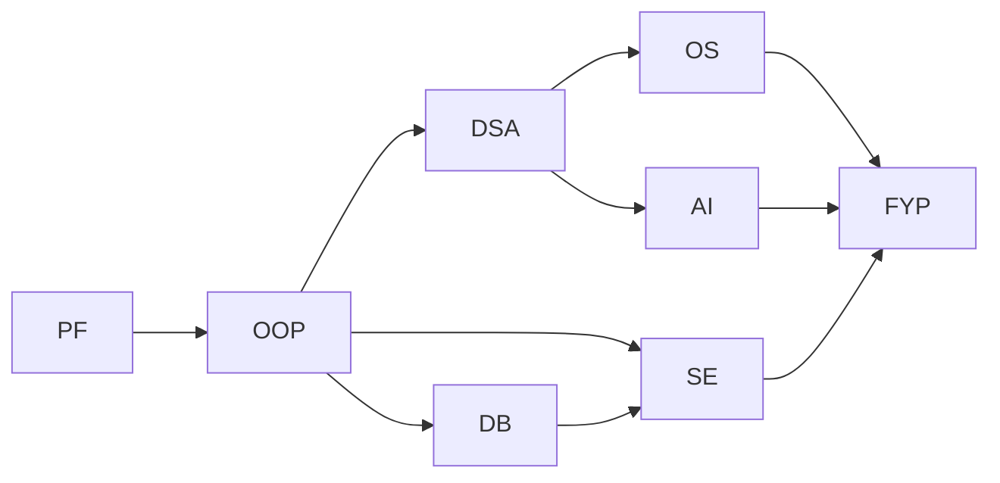
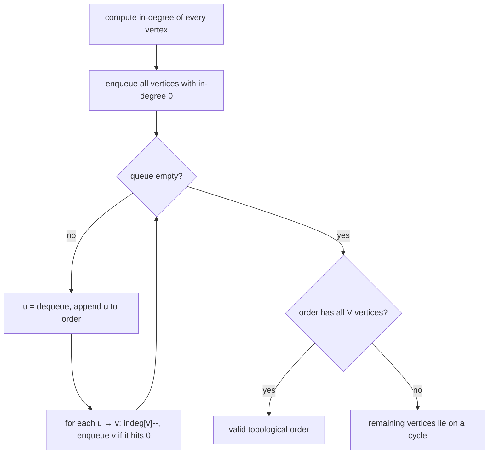

# Session 2 · Topological Sort and Directed Cycles

Prepared by **Hamna Zahid Khan**, Junior Lecturer

[🏠 Course home](../README.md) · [📘 Module overview](./README.md) · [⬅ Previous](./session-01-graph-representation-bfs-dfs.md) · [Next ➡](./session-03-shortest-paths.md)

> **Module 12 · Graphs** · ⏱ 3 hours (90 min lecture + 90 min lab)

## 🎯 Learning objectives

1. Recognise a **directed acyclic graph (DAG)** and explain why only DAGs have a topological order.
2. Implement **Kahn's algorithm** (in-degrees + queue).
3. Implement topological sort with **DFS finishing times**.
4. Detect directed cycles with **three-colour DFS** and report the cycle.
5. Apply topological order to scheduling: semesters, build systems, and longest paths in DAGs.

---

## 1. Dependencies form directed graphs

Many tasks can only start after others finish. Draw an edge **u → v** for "u must happen before v".

> 🎓 **Analogy: planning your degree.** You cannot take DSA before OOP, nor OOP before Programming Fundamentals. A valid study plan lists every course **after all of its prerequisites**. That list is a **topological order**.



**Definition.** A topological order of a directed graph lists all vertices so that for **every edge u → v, u comes before v**.

- It exists **if and only if** the graph has no directed cycle (a **DAG**). With a cycle A → B → A, neither can go first.
- It is usually **not unique**: DSA and DB can be taken in either order.

| Where topological order appears | Vertices | Edges |
|---|---|---|
| Course planning | courses | prerequisite → course |
| Build tools (Maven, Gradle, make) | modules / files | dependency → dependent |
| Spreadsheets | cells | referenced cell → formula cell |
| Package managers (npm, apt) | packages | dependency → package |
| Task scheduling / project management | tasks | must-finish-first → task |

## 2. Kahn's algorithm (BFS style)

Idea: a vertex with **in-degree 0** has no remaining prerequisites, so it can go next. Remove it, which lowers its successors' in-degrees, and repeat.



### Dry run on the curriculum

Initial in-degrees: PF 0, OOP 1, DSA 1, DB 1, OS 1, AI 1, SE 2, FYP 3.

| Dequeue | Decrement | Become 0 (enqueued) | Queue after | Order so far |
|---|---|---|---|---|
| – | – | PF | [PF] | |
| PF | OOP→0 | OOP | [OOP] | PF |
| OOP | DSA→0, DB→0, SE→1 | DSA, DB | [DSA, DB] | PF OOP |
| DSA | OS→0, AI→0 | OS, AI | [DB, OS, AI] | … DSA |
| DB | SE→0 | SE | [OS, AI, SE] | … DB |
| OS | FYP→2 | – | [AI, SE] | … OS |
| AI | FYP→1 | – | [SE] | … AI |
| SE | FYP→0 | FYP | [FYP] | … SE |
| FYP | – | – | [] | PF OOP DSA DB OS AI SE FYP ✔ |

**Cycle detection for free:** if the order ends with fewer than V vertices, the leftovers never reached in-degree 0 because they wait on each other: a cycle.

Replacing the queue by a **min-heap** gives the lexicographically smallest order (useful when ties must be broken predictably).

## 3. DFS-based topological sort

Run DFS; when a vertex **finishes** (all its descendants are done), append it to a list. The **reverse** of the finishing order is a topological order: a vertex always finishes after everything that depends on it.

| Event (DFS from PF) | Finished list |
|---|---|
| PF → OOP → DSA → OS → FYP: FYP finishes | FYP |
| OS finishes | FYP OS |
| DSA → AI (FYP done): AI finishes, then DSA | FYP OS AI DSA |
| OOP → DB → SE (FYP done): SE, then DB finish | … SE DB |
| OOP, then PF finish | … OOP PF |
| reversed | **PF OOP DB SE DSA AI OS FYP** ✔ |

## 4. Detecting directed cycles: three colours

In a **directed** graph, meeting a visited vertex does **not** necessarily mean a cycle (two paths can reach the same course). A cycle exists only if DFS meets a vertex that is **still on the current path**.

| Colour | Meaning |
|---|---|
| WHITE | not visited yet |
| GREY | on the current DFS path (started, not finished) |
| BLACK | finished: all descendants explored |

An edge to a **GREY** vertex is a **back edge** ⇒ cycle. Edges to BLACK vertices are harmless. Keeping `parent[]` lets us print the cycle itself, which is what a build tool shows as "circular dependency: A → B → C → A".

## 5. Longest path in a DAG: earliest semesters

Shortest/longest paths are easy in a DAG: process vertices in topological order and relax outgoing edges. If each course takes one semester, a course's earliest semester is 1 + the latest semester among its prerequisites:

> sem[v] = max(sem[v], sem[u] + 1) for each edge u → v, in topological order

The result is the **critical path**: the minimum number of semesters is the longest chain (PF → OOP → DSA → OS → FYP = 5). Project managers use the same computation (CPM) to find which tasks cannot be delayed.

## 6. Complexity table

| Algorithm | Time | Space |
|---|---|---|
| Kahn's algorithm | O(V + E) | O(V) in-degrees + queue |
| Kahn with a min-heap | O(V log V + E) | O(V) |
| DFS topological sort | O(V + E) | O(V) recursion |
| Three-colour cycle detection | O(V + E) | O(V) |
| Longest/shortest path in a DAG | O(V + E) | O(V) |

---

## 7. Complete program

📄 **[`src/TopologicalSort.java`](src/TopologicalSort.java)**

```java
import java.util.ArrayDeque;
import java.util.ArrayList;
import java.util.Collections;
import java.util.List;
import java.util.PriorityQueue;
import java.util.Queue;

/**
 * Session 2 demo: topological sorting of a directed acyclic graph (course prerequisites) with
 * Kahn's algorithm (in-degrees + queue) and with DFS finishing order, plus directed-cycle detection
 * using three colours and a semester planner (longest path in a DAG).
 *
 * Compile:  javac -d out GraphBasics.java TopologicalSort.java
 * Run:      java -cp out TopologicalSort
 *
 * Prepared by Hamna Zahid Khan, Junior Lecturer
 */
public class TopologicalSort {

    static final String[] COURSES = {"PF", "OOP", "DSA", "DB", "OS", "AI", "SE", "FYP"};

    /** Prerequisite graph: edge u -> v means "u must be passed before v". */
    static GraphBasics.Graph curriculum() {
        GraphBasics.Graph g = new GraphBasics.Graph(8, true);
        int[][] e = {{0, 1}, {1, 2}, {1, 3}, {2, 4}, {2, 5}, {3, 6}, {1, 6}, {5, 7}, {6, 7}, {4, 7}};
        for (int[] x : e) g.addEdge(x[0], x[1]);
        return g;
    }

    /** Kahn's algorithm. Returns a topological order, or an empty list if the graph has a cycle. */
    static List<Integer> kahn(GraphBasics.Graph g) {
        int[] indeg = new int[g.n];
        for (int u = 0; u < g.n; u++) for (int v : g.neighbours(u)) indeg[v]++;
        Queue<Integer> ready = new ArrayDeque<>();
        for (int v = 0; v < g.n; v++) if (indeg[v] == 0) ready.offer(v);       // no prerequisites
        List<Integer> order = new ArrayList<>();
        while (!ready.isEmpty()) {
            int u = ready.poll();
            order.add(u);
            for (int v : g.neighbours(u)) if (--indeg[v] == 0) ready.offer(v);  // last prerequisite done
        }
        return order.size() == g.n ? order : List.of();
    }

    /** Kahn with a min-heap instead of a queue: the lexicographically smallest topological order. */
    static List<Integer> kahnSmallestFirst(GraphBasics.Graph g) {
        int[] indeg = new int[g.n];
        for (int u = 0; u < g.n; u++) for (int v : g.neighbours(u)) indeg[v]++;
        PriorityQueue<Integer> ready = new PriorityQueue<>();
        for (int v = 0; v < g.n; v++) if (indeg[v] == 0) ready.offer(v);
        List<Integer> order = new ArrayList<>();
        while (!ready.isEmpty()) {
            int u = ready.poll();
            order.add(u);
            for (int v : g.neighbours(u)) if (--indeg[v] == 0) ready.offer(v);
        }
        return order;
    }

    /** DFS-based topological sort: reverse of the order in which vertices FINISH. */
    static List<Integer> dfsOrder(GraphBasics.Graph g) {
        boolean[] seen = new boolean[g.n];
        List<Integer> finished = new ArrayList<>();
        for (int s = 0; s < g.n; s++) if (!seen[s]) visit(g, s, seen, finished);
        Collections.reverse(finished);
        return finished;
    }

    private static void visit(GraphBasics.Graph g, int u, boolean[] seen, List<Integer> finished) {
        seen[u] = true;
        for (int v : g.neighbours(u)) if (!seen[v]) visit(g, v, seen, finished);
        finished.add(u);                         // all descendants are done
    }

    /** Directed cycle detection with colours: WHITE unvisited, GREY on the current path, BLACK finished. */
    static final int WHITE = 0, GREY = 1, BLACK = 2;

    static List<Integer> findCycle(GraphBasics.Graph g) {
        int[] color = new int[g.n], parent = new int[g.n];
        for (int s = 0; s < g.n; s++) {
            if (color[s] != WHITE) continue;
            List<Integer> c = cycleDfs(g, s, color, parent);
            if (!c.isEmpty()) return c;
        }
        return List.of();
    }

    private static List<Integer> cycleDfs(GraphBasics.Graph g, int u, int[] color, int[] parent) {
        color[u] = GREY;
        for (int v : g.neighbours(u)) {
            if (color[v] == GREY) {                 // back edge to an ancestor: cycle v -> ... -> u -> v
                List<Integer> cyc = new ArrayList<>();
                for (int x = u; x != v; x = parent[x]) cyc.add(x);
                cyc.add(v);
                Collections.reverse(cyc);
                cyc.add(v);
                return cyc;
            }
            if (color[v] == WHITE) {
                parent[v] = u;
                List<Integer> c = cycleDfs(g, v, color, parent);
                if (!c.isEmpty()) return c;
            }
        }
        color[u] = BLACK;
        return List.of();
    }

    /** Earliest semester for each course = 1 + max(semester of prerequisites): longest path in a DAG. */
    static int[] semesters(GraphBasics.Graph g) {
        int[] sem = new int[g.n];
        java.util.Arrays.fill(sem, 1);
        for (int u : kahn(g)) for (int v : g.neighbours(u)) sem[v] = Math.max(sem[v], sem[u] + 1);
        return sem;
    }

    static String names(List<Integer> ids) {
        List<String> s = new ArrayList<>();
        for (int i : ids) s.add(COURSES[i]);
        return String.join(" -> ", s);
    }

    public static void main(String[] args) {
        GraphBasics.Graph g = curriculum();
        System.out.println("== Prerequisites (u -> v: pass u before v) ==");
        for (int u = 0; u < g.n; u++) {
            List<String> to = new ArrayList<>();
            for (int v : g.neighbours(u)) to.add(COURSES[v]);
            System.out.printf("%-4s -> %s%n", COURSES[u], to);
        }

        System.out.println("\nKahn (queue)           : " + names(kahn(g)));
        System.out.println("Kahn (smallest id first): " + names(kahnSmallestFirst(g)));
        System.out.println("DFS finishing order rev : " + names(dfsOrder(g)));

        int[] sem = semesters(g);
        System.out.println("\n== Earliest semester for each course (one course per prerequisite chain per term) ==");
        for (int s = 1; s <= 5; s++) {
            List<String> in = new ArrayList<>();
            for (int v = 0; v < g.n; v++) if (sem[v] == s) in.add(COURSES[v]);
            if (!in.isEmpty()) System.out.println("semester " + s + ": " + in);
        }

        System.out.println("\n== A bad catalogue: OS also required before DSA ==");
        GraphBasics.Graph bad = curriculum();
        bad.addEdge(4, 2);
        System.out.println("Kahn result size = " + kahn(bad).size() + " of " + bad.n + "  -> not a DAG");
        System.out.println("cycle found: " + names(findCycle(bad)));
        System.out.println("original catalogue cycle: " + (findCycle(g).isEmpty() ? "none" : names(findCycle(g))));
    }
}
```

**Real output:**

```text
$ java -cp out TopologicalSort
== Prerequisites (u -> v: pass u before v) ==
PF   -> [OOP]
OOP  -> [DSA, DB, SE]
DSA  -> [OS, AI]
DB   -> [SE]
OS   -> [FYP]
AI   -> [FYP]
SE   -> [FYP]
FYP  -> []

Kahn (queue)           : PF -> OOP -> DSA -> DB -> OS -> AI -> SE -> FYP
Kahn (smallest id first): PF -> OOP -> DSA -> DB -> OS -> AI -> SE -> FYP
DFS finishing order rev : PF -> OOP -> DB -> SE -> DSA -> AI -> OS -> FYP

== Earliest semester for each course (one course per prerequisite chain per term) ==
semester 1: [PF]
semester 2: [OOP]
semester 3: [DSA, DB]
semester 4: [OS, AI, SE]
semester 5: [FYP]

== A bad catalogue: OS also required before DSA ==
Kahn result size = 0 of 8  -> not a DAG
cycle found: DSA -> OS -> DSA
original catalogue cycle: none
```

Notice that both orders are valid even though they differ, and that adding "OS before DSA" created the cycle DSA → OS → DSA, which both Kahn (incomplete order) and the colour DFS (explicit cycle) catch.

---

## 8. Worked examples (basic → advanced)

**Example 1 (basic): can all courses be finished?** Input pairs `[course, prerequisite]`. Run Kahn and compare the number of processed courses with n.

```java
/** Can all courses be finished? pre[i] = {course, prerequisite}. Kahn's algorithm counts processed courses. */
static boolean canFinish(int n, int[][] pre) {
    List<List<Integer>> adj = new ArrayList<>();
    for (int i = 0; i < n; i++) adj.add(new ArrayList<>());
    int[] indeg = new int[n];
    for (int[] p : pre) { adj.get(p[1]).add(p[0]); indeg[p[0]]++; }
    Queue<Integer> q = new ArrayDeque<>();
    for (int i = 0; i < n; i++) if (indeg[i] == 0) q.offer(i);
    int done = 0;
    while (!q.isEmpty()) {
        int u = q.poll();
        done++;
        for (int v : adj.get(u)) if (--indeg[v] == 0) q.offer(v);
    }
    return done == n;
}
```
<sub>Full, compiled version: [`src/Labs12.java`](src/Labs12.java)</sub>

**Example 2 (intermediate): parallel semesters.** Using `semesters()`, the curriculum needs 5 semesters, with DSA and DB in semester 3 and OS, AI and SE in semester 4. Adding an edge DB → DSA would push DSA to semester 4 and OS/AI to 5, and FYP to 6: the critical path grew by one.

**Example 3 (advanced): alien dictionary.** Words are sorted in an unknown alphabet: `wrt, wrf, er, ett, rftt`. The **first differing letter** of each adjacent pair gives an edge: t → f (wrt/wrf), w → e (wrf/er), r → t (er/ett), e → r (ett/rftt). A topological sort of the letters gives the alphabet: **w e r t f**. A prefix conflict ("abc" before "ab") or a cycle means no valid alphabet.

```java
/** Letter order of an unknown alphabet from a sorted word list ("" if impossible). */
static String alienOrder(String[] words) {
    Map<Character, List<Character>> adj = new TreeMap<>();
    Map<Character, Integer> indeg = new HashMap<>();
    for (String w : words) for (char c : w.toCharArray()) { adj.putIfAbsent(c, new ArrayList<>()); indeg.putIfAbsent(c, 0); }
    for (int i = 0; i + 1 < words.length; i++) {
        String a = words[i], b = words[i + 1];
        int j = 0;
        while (j < a.length() && j < b.length() && a.charAt(j) == b.charAt(j)) j++;
        if (j == Math.min(a.length(), b.length())) {
            if (a.length() > b.length()) return "";   // "abc" before "ab" is invalid
            continue;
        }
        adj.get(a.charAt(j)).add(b.charAt(j));        // first difference: a[j] comes before b[j]
        indeg.merge(b.charAt(j), 1, Integer::sum);
    }
    PriorityQueue<Character> q = new PriorityQueue<>();
    for (char c : adj.keySet()) if (indeg.get(c) == 0) q.offer(c);
    StringBuilder sb = new StringBuilder();
    while (!q.isEmpty()) {
        char c = q.poll();
        sb.append(c);
        for (char d : adj.get(c)) if (indeg.merge(d, -1, Integer::sum) == 0) q.offer(d);
    }
    return sb.length() == adj.size() ? sb.toString() : "";
}
```
<sub>Full, compiled version: [`src/Labs12.java`](src/Labs12.java)</sub>

## 9. Real-life problem: build order for a Java project

**Problem.** A project has modules `util`, `model` (needs util), `db` (needs model, util), `api` (needs model, db) and `web` (needs api). The build server must compile each module after its dependencies and should report circular dependencies clearly.

**Solution.** Vertices are modules, edges dependency → dependent. Kahn's algorithm yields `util, model, db, api, web`. All modules with in-degree 0 at the same moment are independent and can be **compiled in parallel** (Gradle's parallel builds work this way). If someone adds "util needs web", the order comes out incomplete and three-colour DFS reports `util → model → db → api → web → util`.

## 10. Common mistakes

| Mistake | Fix |
|---|---|
| Reversing the edge direction (prerequisite ← course) | choose "before → after" and stick to it |
| Using undirected cycle detection on a directed graph | use GREY/BLACK colours; a visited BLACK vertex is not a cycle |
| Forgetting to reverse the DFS finishing order | topological order = **reverse** postorder |
| Not checking `order.size() == V` in Kahn | otherwise a cyclic input silently gives a partial order |
| Starting DFS from one vertex only | loop over all vertices (the DAG may be disconnected) |
| Expecting a unique answer | many orders can be valid; tests should check edges, not one exact list |

## 11. Best practices

- Prefer Kahn's algorithm when you also need **levels** (parallel batches) or a cycle check without recursion.
- Prefer DFS when you already have a DFS framework or need finishing times (e.g. strongly connected components).
- Validate a topological order by checking `pos[u] < pos[v]` for every edge (see `SelfCheck`).
- For huge DAGs, use iterative DFS or Kahn to avoid stack overflow.

---

## 12. Lab tasks

**Lab 2.1: Course schedule.** Implement `canFinish(n, prerequisites)`.

<details>
<summary>✅ Solution</summary>

See Example 1.

</details>

**Lab 2.2: Show the order.** Modify `canFinish` to return one valid order (or an empty array) for `n = 4`, `[[1,0],[2,0],[3,1],[3,2]]`.

<details>
<summary>✅ Solution</summary>

Append each dequeued vertex to an `int[] order` and return it if `done == n`. One valid answer is `[0, 1, 2, 3]` (also `[0, 2, 1, 3]`).

</details>

**Lab 2.3: Alien dictionary.** Implement `alienOrder(words)`.

<details>
<summary>✅ Solution</summary>

See Example 3.

</details>

**Lab 2.4: Print the cycle.** Use `findCycle` on the curriculum after adding FYP → PF. Which cycle is printed?

<details>
<summary>✅ Solution</summary>

DFS from PF follows PF → OOP → DSA → OS → FYP, and FYP's edge to the GREY vertex PF closes the cycle: **PF → OOP → DSA → OS → FYP → PF** (`SelfCheck` asserts a cycle is found for this edge).

</details>

**Real output of the Session 2 lab solutions:**

```text
$ java -cp out Labs12 2
-- Session 2 labs --
canFinish(4, [[1,0],[2,1],[3,2]]) = true, canFinish(2, [[1,0],[0,1]]) = false
alienOrder([wrt, wrf, er, ett, rftt]) = wertf
```

---

## 13. Quiz

**Q1.** A topological order exists exactly when the directed graph:

- **A.** is connected
- **B.** has no directed cycle
- **C.** has no vertex of in-degree 0
- **D.** is a tree

**Q2.** Kahn's algorithm starts with the vertices whose:

- **A.** out-degree is 0
- **B.** in-degree is 0
- **C.** degree is maximum
- **D.** label is smallest

**Q3.** In DFS-based topological sort, the order is:

- **A.** the DFS visit order
- **B.** the reverse of the finishing order
- **C.** the finishing order
- **D.** sorted by vertex number

**Q4.** During three-colour DFS, an edge to a GREY vertex means:

- **A.** a cross edge
- **B.** a cycle (back edge)
- **C.** the vertex is finished
- **D.** nothing

**Q5.** Kahn's algorithm processes only 6 of 8 vertices. This means:

- **A.** the graph is disconnected
- **B.** the graph has a directed cycle
- **C.** the order is still valid
- **D.** two vertices are isolated

<details>
<summary><b>Show answers</b></summary>

1. **B**: Only DAGs can be ordered.
2. **B**: They have no prerequisites.
3. **B**: A vertex finishes after all its descendants.
4. **B**: GREY vertices are on the current path.
5. **B**: Vertices on a cycle never reach in-degree 0.

</details>

---

## 14. Summary

- A **topological order** lists every vertex before its successors; it exists iff the graph is a **DAG**.
- **Kahn:** repeatedly remove in-degree-0 vertices (queue); incomplete result ⇒ cycle.
- **DFS:** reverse finishing order. **Three colours** detect and extract directed cycles.
- Processing in topological order solves DAG path problems (critical path, earliest start) in O(V + E).

## 15. Viva / interview questions

1. Prove that every DAG has at least one vertex with in-degree 0.
2. Why does reversed DFS finishing order respect every edge?
3. How do you count the number of different topological orders of a small DAG?
4. How would you compute the minimum number of semesters if at most 2 courses can be taken per semester? (Harder: this is NP-hard in general.)
5. Why is a visited (BLACK) vertex not a cycle in a directed graph?
6. What are strongly connected components and how are they related to DFS finishing times?

---

[⬅ Previous](./session-01-graph-representation-bfs-dfs.md) · [📘 Module overview](./README.md) · [Next ➡](./session-03-shortest-paths.md)
