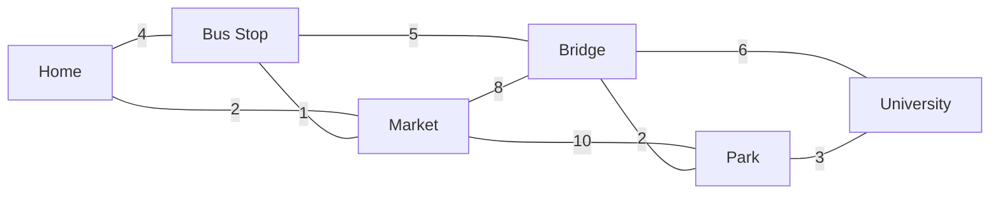
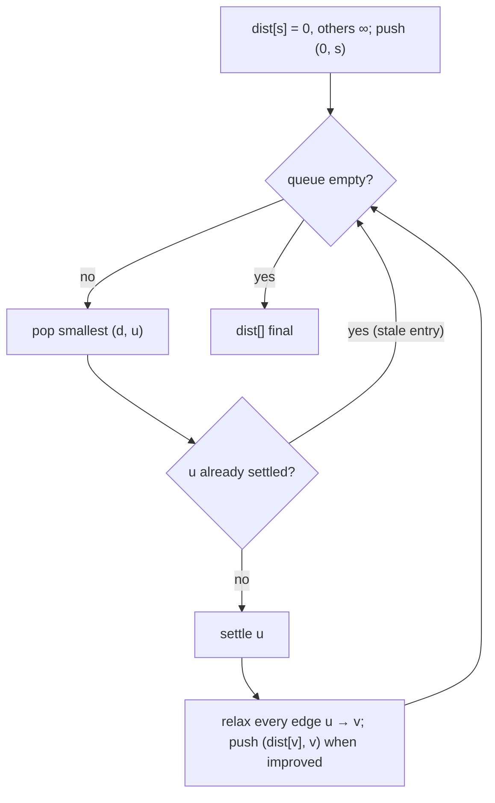

# Session 3 · Shortest Paths in Weighted Graphs

Prepared by **Hamna Zahid Khan**, Junior Lecturer

[🏠 Course home](../README.md) · [📘 Module overview](./README.md) · [⬅ Previous](./session-02-topological-sort.md) · [Next ➡](./session-04-minimum-spanning-trees-and-union-find.md)

> **Module 12 · Graphs** · ⏱ 3 hours (90 min lecture + 90 min lab)

## 🎯 Learning objectives

1. Explain **relaxation**, the single step behind every shortest-path algorithm.
2. Implement **Dijkstra's algorithm** with a priority queue and reconstruct paths.
3. Explain why Dijkstra fails with negative edges and use **Bellman-Ford** instead, including negative-cycle detection.
4. Compute **all-pairs** shortest paths with **Floyd-Warshall**.
5. Choose the right algorithm for a given graph: BFS, 0-1 BFS, DAG relaxation, Dijkstra, Bellman-Ford or Floyd-Warshall.

---

## 1. From fewest edges to least cost

BFS (Session 1) minimises the **number** of edges. Real networks have **weights**: minutes, kilometres, rupees, milliseconds. A route with more roads can be faster.

> 🚌 **Analogy: getting to the university by the quickest route.** The direct road from Home to Market and on to the Bridge looks short on the map, but a detour through the Bus Stop and the Bridge-Park road is faster. A navigation app weighs every road segment by travel time and finds the cheapest total, not the fewest turns.



## 2. Relaxation

Every algorithm keeps `dist[v]`, the best cost found so far (∞ initially, 0 for the source), and repeatedly tries to improve it through an edge u → v with weight w:

```java
if (dist[u] + w < dist[v]) { dist[v] = dist[u] + w; parent[v] = u; }
```

The algorithms differ only in **which edges they relax, and in what order**.

## 3. Dijkstra's algorithm

**Greedy idea:** the unsettled vertex with the smallest tentative distance can never be improved later (all weights are ≥ 0, so any other route only adds cost). Settle it, relax its edges, repeat. A min-priority queue (Module 11) finds that vertex quickly.



### Dry run from Home

| Settle | dist: Home, Bus, Market, Bridge, Park, Univ | Relaxations that improved |
|---|---|---|
| Home (0) | 0, **4**, **2**, ∞, ∞, ∞ | Bus 4, Market 2 |
| Market (2) | 0, **3**, 2, **10**, **12**, ∞ | Bus 2+1 = 3, Bridge 2+8, Park 2+10 |
| Bus Stop (3) | 0, 3, 2, **8**, 12, ∞ | Bridge 3+5 = 8 |
| Bridge (8) | 0, 3, 2, 8, **10**, **14** | Park 8+2, Univ 8+6 |
| Park (10) | 0, 3, 2, 8, 10, **13** | Univ 10+3 |
| University (13) | final | – |

Path to the University via parents: Home → Market → Bus Stop → Bridge → Park → University, **13 minutes**, even though it uses 5 roads.

**Lazy deletion.** Java's `PriorityQueue` has no efficient decrease-key, so we push a new (distance, vertex) pair whenever a distance improves and skip outdated pairs when they are popped (`if (done[u]) continue`).

## 4. Why negative edges break Dijkstra

Edges 0→1 (2), 0→2 (4), 2→1 (−3), 1→3 (2). Dijkstra settles vertex 1 at distance 2 **before** discovering the cheaper route 0→2→1 = 1, and 3 is settled at 4 instead of 3. Settled vertices are never revisited, so the error is permanent. (Negative weights appear with refunds, cashback, energy recovered going downhill, or log-transformed exchange rates.)

## 5. Bellman-Ford

Relax **every edge**, V − 1 times. After round k, every shortest path that uses at most k edges is correct; a shortest path never needs more than V − 1 edges.

| Round | dist after relaxing all edges (example above, order 0→1, 0→2, 2→1, 1→3) |
|---|---|
| start | 0, ∞, ∞, ∞ |
| 1 | 0, **1**, 4, **3** (0→1 gives 2, then 0→2 gives 4, then 2→1 gives 1, then 1→3 gives 3) |
| 2 | no change ⇒ stop early |

**Negative cycles.** If a V-th round still improves something, there is a cycle whose total weight is negative: you could loop forever and make the cost −∞. Bellman-Ford reports it (currency-arbitrage detectors use exactly this).

## 6. Floyd-Warshall: all pairs

`d[i][j]` = best cost from i to j using only intermediate vertices from {0, …, k}. Adding vertex k as a possible stop:

> d[i][j] = min(d[i][j], d[i][k] + d[k][j])

Three nested loops, k **outermost**: O(V³) time, O(V²) space. Ideal for small dense graphs (V ≤ ~400), distance tables between all campus buildings, or transitive closure ("can i reach j?").

## 7. Choosing an algorithm

| Graph | Algorithm | Time |
|---|---|---|
| Unweighted | BFS | O(V + E) |
| Weights 0 or 1 | 0-1 BFS with a deque (Module 07) | O(V + E) |
| DAG (any weights) | relax in topological order (Session 2) | O(V + E) |
| Non-negative weights | **Dijkstra** with a binary heap | O((V + E) log V) |
| Negative weights, no negative cycle | **Bellman-Ford** | O(V · E) |
| All pairs, small V | **Floyd-Warshall** | O(V³) |

---

## 8. Complete program

📄 **[`src/ShortestPaths.java`](src/ShortestPaths.java)**

```java
import java.util.ArrayList;
import java.util.Arrays;
import java.util.Collections;
import java.util.List;
import java.util.PriorityQueue;

/**
 * Session 3 demo: single-source shortest paths in weighted graphs. Dijkstra's algorithm with a
 * priority queue (lazy deletion) and path reconstruction, Bellman-Ford with negative-cycle detection,
 * Floyd-Warshall for all pairs, and a demonstration of why Dijkstra fails with negative edges.
 *
 * Compile:  javac -d out ShortestPaths.java
 * Run:      java -cp out ShortestPaths
 *
 * Prepared by Hamna Zahid Khan, Junior Lecturer
 */
public class ShortestPaths {
    static final long INF = Long.MAX_VALUE / 4;           // large but safe to add to

    record Edge(int from, int to, int w) { }

    /** Weighted adjacency list. */
    static final class WGraph {
        final int n;
        final List<List<Edge>> adj = new ArrayList<>();
        final List<Edge> edges = new ArrayList<>();
        WGraph(int n) { this.n = n; for (int i = 0; i < n; i++) adj.add(new ArrayList<>()); }
        void add(int u, int v, int w) { Edge e = new Edge(u, v, w); adj.get(u).add(e); edges.add(e); }
        void addBoth(int u, int v, int w) { add(u, v, w); add(v, u, w); }
    }

    /** Dijkstra: repeatedly settle the closest unsettled vertex. Non-negative weights only. */
    static long[] dijkstra(WGraph g, int s, int[] parent, List<String> trace) {
        long[] dist = new long[g.n];
        Arrays.fill(dist, INF);
        Arrays.fill(parent, -1);
        dist[s] = 0;
        PriorityQueue<long[]> pq = new PriorityQueue<>((a, b) -> Long.compare(a[0], b[0]));  // {dist, vertex}
        pq.offer(new long[]{0, s});
        boolean[] done = new boolean[g.n];
        while (!pq.isEmpty()) {
            long[] top = pq.poll();
            int u = (int) top[1];
            if (done[u]) continue;                 // stale entry (lazy deletion)
            done[u] = true;
            if (trace != null) trace.add("settle " + u + " at " + dist[u]);
            for (Edge e : g.adj.get(u)) {
                if (!done[e.to()] && dist[u] + e.w() < dist[e.to()]) {   // relaxation
                    dist[e.to()] = dist[u] + e.w();
                    parent[e.to()] = u;
                    pq.offer(new long[]{dist[e.to()], e.to()});
                }
            }
        }
        return dist;
    }

    /** Bellman-Ford: relax every edge n-1 times. Returns null if a negative cycle is reachable. */
    static long[] bellmanFord(WGraph g, int s) {
        long[] dist = new long[g.n];
        Arrays.fill(dist, INF);
        dist[s] = 0;
        for (int round = 1; round < g.n; round++) {
            boolean changed = false;
            for (Edge e : g.edges)
                if (dist[e.from()] != INF && dist[e.from()] + e.w() < dist[e.to()]) {
                    dist[e.to()] = dist[e.from()] + e.w();
                    changed = true;
                }
            if (!changed) break;                   // early exit: already optimal
        }
        for (Edge e : g.edges)                     // one more round: any improvement = negative cycle
            if (dist[e.from()] != INF && dist[e.from()] + e.w() < dist[e.to()]) return null;
        return dist;
    }

    /** Floyd-Warshall: all-pairs shortest paths in O(n^3) by allowing intermediate vertices 0..k. */
    static long[][] floydWarshall(WGraph g) {
        long[][] d = new long[g.n][g.n];
        for (long[] row : d) Arrays.fill(row, INF);
        for (int i = 0; i < g.n; i++) d[i][i] = 0;
        for (Edge e : g.edges) d[e.from()][e.to()] = Math.min(d[e.from()][e.to()], e.w());
        for (int k = 0; k < g.n; k++)
            for (int i = 0; i < g.n; i++)
                for (int j = 0; j < g.n; j++)
                    if (d[i][k] + d[k][j] < d[i][j]) d[i][j] = d[i][k] + d[k][j];
        return d;
    }

    static List<Integer> path(int[] parent, int t) {
        List<Integer> p = new ArrayList<>();
        for (int v = t; v != -1; v = parent[v]) p.add(v);
        Collections.reverse(p);
        return p;
    }

    static final String[] PLACES = {"Home", "Bus Stop", "Market", "Bridge", "Park", "University"};

    /** Travel times in minutes between places (two-way roads). */
    static WGraph city() {
        WGraph g = new WGraph(6);
        g.addBoth(0, 1, 4);   // Home - Bus Stop
        g.addBoth(0, 2, 2);   // Home - Market
        g.addBoth(1, 2, 1);   // Bus Stop - Market
        g.addBoth(1, 3, 5);   // Bus Stop - Bridge
        g.addBoth(2, 3, 8);   // Market - Bridge
        g.addBoth(2, 4, 10);  // Market - Park
        g.addBoth(3, 4, 2);   // Bridge - Park
        g.addBoth(3, 5, 6);   // Bridge - University
        g.addBoth(4, 5, 3);   // Park - University
        return g;
    }

    static String fmt(long[] d) {
        StringBuilder sb = new StringBuilder("[");
        for (int i = 0; i < d.length; i++) sb.append(i > 0 ? ", " : "").append(d[i] >= INF / 2 ? "∞" : String.valueOf(d[i]));
        return sb.append("]").toString();
    }

    public static void main(String[] args) {
        WGraph g = city();
        int[] parent = new int[g.n];
        List<String> trace = new ArrayList<>();
        long[] d = dijkstra(g, 0, parent, trace);
        System.out.println("== Dijkstra from Home ==");
        System.out.println(String.join(" | ", trace));
        for (int v = 0; v < g.n; v++) {
            List<String> names = new ArrayList<>();
            for (int x : path(parent, v)) names.add(PLACES[x]);
            System.out.printf("%-10s %2d min via %s%n", PLACES[v], d[v], String.join(" -> ", names));
        }

        System.out.println("\n== Bellman-Ford gives the same distances: " + fmt(bellmanFord(g, 0)));

        System.out.println("\n== Negative edge: Dijkstra goes wrong, Bellman-Ford does not ==");
        WGraph neg = new WGraph(4);
        neg.add(0, 1, 2); neg.add(0, 2, 4); neg.add(2, 1, -3); neg.add(1, 3, 2);
        System.out.println("edges: 0->1 (2), 0->2 (4), 2->1 (-3), 1->3 (2)");
        System.out.println("Dijkstra     : " + fmt(dijkstra(neg, 0, new int[4], null)) + "  <- wrong for 1 and 3");
        System.out.println("Bellman-Ford : " + fmt(bellmanFord(neg, 0)));

        System.out.println("\n== Negative cycle ==");
        WGraph cyc = new WGraph(3);
        cyc.add(0, 1, 1); cyc.add(1, 2, -2); cyc.add(2, 1, 1);
        System.out.println("edges: 0->1 (1), 1->2 (-2), 2->1 (1): cycle 1->2->1 has weight -1");
        System.out.println("Bellman-Ford returns " + (bellmanFord(cyc, 0) == null ? "null: negative cycle detected" : "distances"));

        System.out.println("\n== Floyd-Warshall: all-pairs travel times ==");
        long[][] all = floydWarshall(g);
        System.out.print("            ");
        for (int j = 0; j < g.n; j++) System.out.printf("%4d", j);
        System.out.println();
        for (int i = 0; i < g.n; i++) {
            System.out.printf("%d %-10s", i, PLACES[i]);
            for (int j = 0; j < g.n; j++) System.out.printf("%4d", all[i][j]);
            System.out.println();
        }
    }
}
```

**Real output:**

```text
$ java -cp out ShortestPaths
== Dijkstra from Home ==
settle 0 at 0 | settle 2 at 2 | settle 1 at 3 | settle 3 at 8 | settle 4 at 10 | settle 5 at 13
Home        0 min via Home
Bus Stop    3 min via Home -> Market -> Bus Stop
Market      2 min via Home -> Market
Bridge      8 min via Home -> Market -> Bus Stop -> Bridge
Park       10 min via Home -> Market -> Bus Stop -> Bridge -> Park
University 13 min via Home -> Market -> Bus Stop -> Bridge -> Park -> University

== Bellman-Ford gives the same distances: [0, 3, 2, 8, 10, 13]

== Negative edge: Dijkstra goes wrong, Bellman-Ford does not ==
edges: 0->1 (2), 0->2 (4), 2->1 (-3), 1->3 (2)
Dijkstra     : [0, 2, 4, 4]  <- wrong for 1 and 3
Bellman-Ford : [0, 1, 4, 3]

== Negative cycle ==
edges: 0->1 (1), 1->2 (-2), 2->1 (1): cycle 1->2->1 has weight -1
Bellman-Ford returns null: negative cycle detected

== Floyd-Warshall: all-pairs travel times ==
               0   1   2   3   4   5
0 Home         0   3   2   8  10  13
1 Bus Stop     3   0   1   5   7  10
2 Market       2   1   0   6   8  11
3 Bridge       8   5   6   0   2   5
4 Park        10   7   8   2   0   3
5 University  13  10  11   5   3   0
```

The Floyd-Warshall table's row 0 equals Dijkstra's answer from Home, and the table is symmetric because every road is two-way.

---

## 9. Worked examples (basic → advanced)

**Example 1 (basic): network delay time.** A signal starts at node k; edge (u, v, w) means it takes w ms to go from u to v. How long until **all** nodes have it? Run Dijkstra and take the **maximum** distance (−1 if any node is unreachable).

```java
/** Time for a signal from k to reach all n nodes (1-based), or -1. times[i] = {u, v, w}. Dijkstra. */
static int networkDelay(int[][] times, int n, int k) {
    ShortestPaths.WGraph g = new ShortestPaths.WGraph(n + 1);
    for (int[] t : times) g.add(t[0], t[1], t[2]);
    long[] d = ShortestPaths.dijkstra(g, k, new int[n + 1], null);
    long worst = 0;
    for (int v = 1; v <= n; v++) worst = Math.max(worst, d[v]);
    return worst >= ShortestPaths.INF / 2 ? -1 : (int) worst;
}
```
<sub>Full, compiled version: [`src/Labs12.java`](src/Labs12.java)</sub>

For edges 2→1 (1), 2→3 (1), 3→4 (1) starting at 2: distances 1, 0, 1, 2 ⇒ **2 ms**.

**Example 2 (intermediate): cheapest flight with at most k stops.** Dijkstra ignores the number of edges, but Bellman-Ford's rounds count them exactly: k stops = at most k + 1 edges = k + 1 rounds. Each round must read the **previous** round's array (`clone`), or one round could chain several edges.

```java
/** Cheapest fare from src to dst using at most k stops: Bellman-Ford limited to k + 1 rounds. */
static int cheapestWithinK(int n, int[][] flights, int src, int dst, int k) {
    long[] cost = new long[n];
    Arrays.fill(cost, Long.MAX_VALUE / 4);
    cost[src] = 0;
    for (int round = 0; round <= k; round++) {
        long[] next = cost.clone();                  // use LAST round's values: at most one more edge
        for (int[] f : flights)
            if (cost[f[0]] + f[2] < next[f[1]]) next[f[1]] = cost[f[0]] + f[2];
        cost = next;
    }
    return cost[dst] >= Long.MAX_VALUE / 8 ? -1 : (int) cost[dst];
}
```
<sub>Full, compiled version: [`src/Labs12.java`](src/Labs12.java)</sub>

| Flights | ≤ 1 stop | ≤ 2 stops |
|---|---|---|
| 0→1 100, 1→2 100, 2→3 100, 0→2 500, 1→3 600 | 0→2→3 = **600** | 0→1→2→3 = **300** |

**Example 3 (advanced): detecting currency arbitrage.** With exchange rates r(u, v), a profitable loop has a product of rates > 1. Taking w = −log r(u, v) turns "product > 1" into "sum < 0", so a **negative cycle** in Bellman-Ford is an arbitrage opportunity. The program's negative-cycle demo shows the detection step.

## 10. Real-life problem: ambulance dispatch

**Problem.** A city's emergency service must send the **nearest** ambulance (by driving time) to each incident. Travel times on roads change with traffic but are never negative. There are 3 ambulance stations and thousands of junctions.

**Solution.** Add a virtual source connected to all stations with weight 0 and run **one Dijkstra** from it (multi-source Dijkstra). Each junction's distance is the time from its nearest station, and following `parent` back to the source tells which station that is. Rerun when traffic data updates; O((V + E) log V) handles city-sized graphs in milliseconds. Navigation apps add heuristics (A*) and precomputation, but Dijkstra is the core.

## 11. Common mistakes

| Mistake | Fix |
|---|---|
| Using Dijkstra with negative weights | Bellman-Ford (or reweighting) |
| `Integer.MAX_VALUE` as ∞, then adding a weight | overflow; use `Long.MAX_VALUE / 4` or check for ∞ first |
| Processing a stale queue entry | `if (done[u]) continue;` (lazy deletion) |
| Floyd-Warshall with k as the **inner** loop | k must be the outermost loop |
| Bellman-Ford with k stops updating in place | read last round's array (`clone`) |
| Comparator `(a, b) -> (int) (a[0] - b[0])` on longs | `Long.compare(a[0], b[0])` |

## 12. Best practices

- Store `parent[]` and rebuild paths; users want the route, not just its cost.
- Stop Dijkstra early when the target is settled if you need only one destination.
- Use `long` distances for large weights or long paths.
- For many queries on a static small graph, precompute Floyd-Warshall once.

---

## 13. Lab tasks

**Lab 3.1: Network delay time.** Implement `networkDelay(times, n, k)`.

<details>
<summary>✅ Solution</summary>

See Example 1.

</details>

**Lab 3.2: Cheapest flight within k stops.**

<details>
<summary>✅ Solution</summary>

See Example 2.

</details>

**Lab 3.3: Trace Dijkstra by hand** on the city graph from the Bus Stop. Fill in the settle order and final distances, then check them against column 1 of the Floyd-Warshall table.

<details>
<summary>✅ Solution</summary>

Settle order: Bus Stop 0, Market 1, Home 3, Bridge 5, Park 7, University 10. These match row/column 1 of the printed table: 3, 0, 1, 5, 7, 10.

</details>

**Lab 3.4: Reachability matrix.** Modify Floyd-Warshall to compute `boolean reach[i][j]` (transitive closure) for the directed curriculum graph. Can AI reach SE?

<details>
<summary>✅ Solution</summary>

Initialise `reach[i][j] = (i == j) || edge(i, j)` and use `reach[i][j] |= reach[i][k] && reach[k][j]` with k outermost. AI → FYP only, so AI **cannot** reach SE; OOP reaches every course except PF.

</details>

**Real output of the Session 3 lab solutions:**

```text
$ java -cp out Labs12 3
-- Session 3 labs --
networkDelay = 2
cheapest 0->3 with <=1 stop = 600, with <=2 stops = 300
```

---

## 14. Quiz

**Q1.** Relaxing edge u → v (weight w) means:

- **A.** deleting it if w is large
- **B.** setting dist[v] = min(dist[v], dist[u] + w)
- **C.** reversing it
- **D.** adding it to the MST

**Q2.** Dijkstra's algorithm requires:

- **A.** a DAG
- **B.** non-negative edge weights
- **C.** unit weights
- **D.** an undirected graph

**Q3.** Bellman-Ford relaxes all edges how many times (without early exit)?

- **A.** once
- **B.** log V
- **C.** V − 1
- **D.** E

**Q4.** An improvement in Bellman-Ford's V-th round indicates:

- **A.** a disconnected graph
- **B.** a negative cycle
- **C.** a zero-weight edge
- **D.** an error in the input order

**Q5.** Floyd-Warshall runs in:

- **A.** O(V + E)
- **B.** O(E log V)
- **C.** O(V³)
- **D.** O(V · E)

<details>
<summary><b>Show answers</b></summary>

1. **B**: Try to improve v's distance through u.
2. **B**: Settled vertices must never improve later.
3. **C**: Shortest paths use at most V − 1 edges.
4. **B**: Costs could decrease forever.
5. **C**: Three nested loops over vertices.

</details>

---

## 15. Summary

- All shortest-path algorithms are organised **relaxation**.
- **Dijkstra** (non-negative weights): greedy with a priority queue, O((V + E) log V).
- **Bellman-Ford**: V − 1 rounds over all edges, handles negative weights and detects negative cycles, O(VE).
- **Floyd-Warshall**: all pairs in O(V³), k outermost.
- Pick by graph type: BFS / 0-1 BFS / DAG order / Dijkstra / Bellman-Ford / Floyd-Warshall.

## 16. Viva / interview questions

1. Prove that when Dijkstra settles a vertex its distance is final (non-negative weights).
2. Why can't you fix negative weights by adding a constant to every edge?
3. How does A* improve on Dijkstra for a single target?
4. Why must k be the outer loop in Floyd-Warshall?
5. How would you find the shortest path that visits a required checkpoint?
6. What is the time complexity of Dijkstra with an array instead of a heap, and when is that better?

---

[⬅ Previous](./session-02-topological-sort.md) · [📘 Module overview](./README.md) · [Next ➡](./session-04-minimum-spanning-trees-and-union-find.md)
