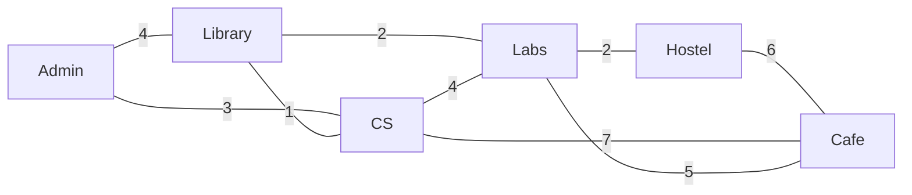
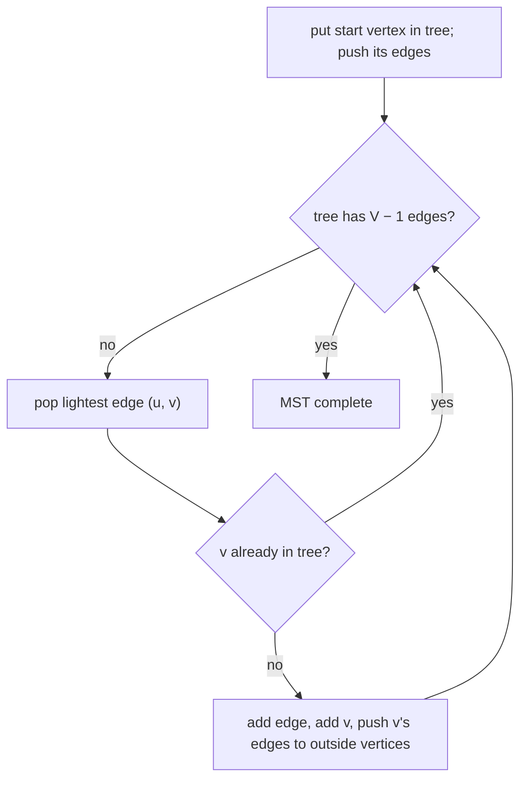

# Session 4 · Minimum Spanning Trees and Union-Find

Prepared by **Hamna Zahid Khan**, Junior Lecturer

[🏠 Course home](../README.md) · [📘 Module overview](./README.md) · [⬅ Previous](./session-03-shortest-paths.md) · [Practice test ➡](./practice-test.md)

> **Module 12 · Graphs** · ⏱ 3 hours (90 min lecture + 90 min lab)

## 🎯 Learning objectives

1. Define a **spanning tree** and a **minimum spanning tree (MST)** and state the **cut property**.
2. Implement the **union-find** (disjoint-set) structure with **path compression** and **union by rank**.
3. Implement **Kruskal's algorithm** with union-find.
4. Implement **Prim's algorithm** with a priority queue (and the O(V²) array version for dense graphs).
5. Apply union-find and MSTs to connectivity, clustering and network-design problems.

---

## 1. Spanning trees

A **spanning tree** of a connected undirected graph is a subset of edges that connects **all** V vertices with **no cycle**. It always has exactly **V − 1** edges. A **minimum spanning tree** is a spanning tree with the smallest total weight.

> 🔌 **Analogy: laying fibre-optic cable across campus.** Every building must be connected to the network (directly or through others), digging is expensive, and a loop would be wasted cable. The cheapest set of cable routes that connects everything is the MST.



MST vs shortest paths: an MST minimises the **total** cable; it does **not** give the shortest route between two buildings (Session 3 does that).

## 2. The cut property (why greedy works)

Split the vertices into any two groups (a **cut**). The **lightest edge crossing the cut** belongs to some MST. Proof sketch: if an MST avoided it, adding it creates a cycle that crosses the cut a second time through a heavier (or equal) edge; swapping them gives a spanning tree that is no heavier.

Both MST algorithms are greedy applications of this property:

| Algorithm | Greedy choice | Needs |
|---|---|---|
| **Kruskal** | globally lightest edge that does not form a cycle | sorting + **union-find** |
| **Prim** | lightest edge leaving the tree grown so far | **priority queue** |

## 3. Union-find (disjoint-set union)

Kruskal must answer "are u and v already connected?" thousands of times while components merge. Union-find does this in nearly O(1).

Each set is a tree stored in a `parent[]` array; the root is the set's **representative**.

| Operation | Meaning |
|---|---|
| `find(x)` | follow parents to the root |
| `union(a, b)` | link the root of one tree under the root of the other |
| `connected(a, b)` | `find(a) == find(b)` |

Two optimisations make trees almost flat:

| Optimisation | Idea | Effect |
|---|---|---|
| **Union by rank** | hang the shorter tree under the taller one | height O(log n) |
| **Path compression** | in `find`, point every visited node directly to the root | later finds are ~1 step |
| **Both together** | | amortised **O(α(n))** per operation; α ≤ 4 for any realistic n |

```java
int find(int x) {
    if (parent[x] != x) parent[x] = find(parent[x]);   // compress
    return parent[x];
}
```

### Dry run (10 students forming study groups)

| Operation | Result | Sets |
|---|---|---|
| union(0, 1) | join | 9 |
| union(2, 3) | join | 8 |
| union(1, 3) | join {0, 1} with {2, 3} | 7 |
| union(5, 6), union(7, 8), union(8, 9) | join | 4 |
| union(3, 0) | **false**: same set already | 4 |

The four sets are {0, 1, 2, 3}, {4}, {5, 6}, {7, 8, 9}.

## 4. Kruskal's algorithm

1. Sort edges by weight.
2. For each edge (u, v): if `find(u) != find(v)`, take it and `union(u, v)`; otherwise skip it (it would close a cycle).
3. Stop after V − 1 edges.

### Dry run on the campus graph

| Edge (sorted) | find differs? | Action | Components |
|---|---|---|---|
| Library-CS (1) | yes | **take** | {L, CS} |
| Library-Labs (2) | yes | **take** | {L, CS, Labs} |
| Labs-Hostel (2) | yes | **take** | {L, CS, Labs, Hostel} |
| Admin-CS (3) | yes | **take** | {Admin, L, CS, Labs, Hostel} |
| Admin-Library (4) | no | skip: cycle | |
| CS-Labs (4) | no | skip: cycle | |
| Labs-Cafe (5) | yes | **take** ⇒ 5 = V − 1 edges, stop | all six |

Total = 1 + 2 + 2 + 3 + 5 = **13**, versus 34 to cable every route.

## 5. Prim's algorithm

Grow a single tree from any start vertex. Keep all edges leaving the tree in a min-priority queue; repeatedly take the lightest edge whose far end is **outside** the tree.



From Admin: Admin-CS (3), CS-Library (1), Library-Labs (2), Labs-Hostel (2), Labs-Cafe (5): the same total 13. (When weights tie, different algorithms may pick different but equally cheap trees.)

**Dense graphs:** with V² edges (e.g. "connect all points"), the array version of Prim (scan for the closest outside vertex) runs in O(V²) without any heap, which beats O(E log V).

## 6. Complexity table

| Algorithm / structure | Time | Space |
|---|---|---|
| union-find, both optimisations | O(α(n)) amortised per op | O(n) |
| Kruskal | O(E log E) (sorting dominates) | O(V + E) |
| Prim with binary heap (lazy) | O(E log E) | O(E) |
| Prim with array | O(V²) | O(V) |

---

## 7. Complete program

📄 **[`src/MstUnionFind.java`](src/MstUnionFind.java)**

```java
import java.util.ArrayList;
import java.util.Comparator;
import java.util.List;
import java.util.PriorityQueue;

/**
 * Session 4 demo: the disjoint-set union (union-find) structure with path compression and union by
 * rank, Kruskal's and Prim's minimum-spanning-tree algorithms on a campus fibre-cabling problem, and a
 * measurement of how flat path compression keeps the union-find trees.
 *
 * Compile:  javac -d out ShortestPaths.java MstUnionFind.java
 * Run:      java -cp out MstUnionFind
 *
 * Prepared by Hamna Zahid Khan, Junior Lecturer
 */
public class MstUnionFind {

    /** Disjoint-set union: each set is a tree; the root is the set's representative. */
    static final class UnionFind {
        private final int[] parent, rank;
        private int sets;

        UnionFind(int n) {
            parent = new int[n];
            rank = new int[n];
            sets = n;
            for (int i = 0; i < n; i++) parent[i] = i;      // everyone starts alone
        }

        /** Representative of x's set, flattening the path on the way (path compression). */
        int find(int x) {
            if (parent[x] != x) parent[x] = find(parent[x]);
            return parent[x];
        }

        /** Merge the sets of a and b; returns false if they were already together. Union by rank. */
        boolean union(int a, int b) {
            int ra = find(a), rb = find(b);
            if (ra == rb) return false;
            if (rank[ra] < rank[rb]) { int t = ra; ra = rb; rb = t; }
            parent[rb] = ra;                                   // shorter tree hangs under the taller
            if (rank[ra] == rank[rb]) rank[ra]++;
            sets--;
            return true;
        }

        boolean connected(int a, int b) { return find(a) == find(b); }
        int sets() { return sets; }

        int depth(int x) { int d = 0; while (parent[x] != x) { x = parent[x]; d++; } return d; }
    }

    /** Kruskal: sort edges by weight, add each edge that does not close a cycle. O(E log E). */
    static List<ShortestPaths.Edge> kruskal(int n, List<ShortestPaths.Edge> edges, List<String> trace) {
        List<ShortestPaths.Edge> sorted = new ArrayList<>(edges);
        sorted.sort(Comparator.comparingInt(ShortestPaths.Edge::w));
        UnionFind uf = new UnionFind(n);
        List<ShortestPaths.Edge> mst = new ArrayList<>();
        for (ShortestPaths.Edge e : sorted) {
            boolean taken = uf.union(e.from(), e.to());
            if (trace != null) trace.add(String.format("%s-%s (%d) %s", B[e.from()], B[e.to()], e.w(), taken ? "take" : "skip: cycle"));
            if (taken) mst.add(e);
            if (mst.size() == n - 1) break;
        }
        return mst;
    }

    /** Prim (lazy): grow one tree from vertex 0, always adding the cheapest edge leaving it. O(E log E). */
    static List<ShortestPaths.Edge> prim(ShortestPaths.WGraph g) {
        boolean[] in = new boolean[g.n];
        PriorityQueue<ShortestPaths.Edge> pq = new PriorityQueue<>(Comparator.comparingInt(ShortestPaths.Edge::w));
        List<ShortestPaths.Edge> mst = new ArrayList<>();
        in[0] = true;
        pq.addAll(g.adj.get(0));
        while (!pq.isEmpty() && mst.size() < g.n - 1) {
            ShortestPaths.Edge e = pq.poll();
            if (in[e.to()]) continue;                          // both ends already in the tree
            in[e.to()] = true;
            mst.add(e);
            for (ShortestPaths.Edge f : g.adj.get(e.to())) if (!in[f.to()]) pq.offer(f);
        }
        return mst;
    }

    static int total(List<ShortestPaths.Edge> es) { int s = 0; for (ShortestPaths.Edge e : es) s += e.w(); return s; }

    static final String[] B = {"Admin", "Library", "CS", "Labs", "Hostel", "Cafe"};

    /** Possible fibre routes between campus buildings, cost in hundreds of metres of cable. */
    static ShortestPaths.WGraph campusCabling() {
        ShortestPaths.WGraph g = new ShortestPaths.WGraph(6);
        int[][] e = {{0, 1, 4}, {0, 2, 3}, {1, 2, 1}, {1, 3, 2}, {2, 3, 4}, {3, 4, 2}, {4, 5, 6}, {2, 5, 7}, {3, 5, 5}};
        for (int[] x : e) g.addBoth(x[0], x[1], x[2]);
        return g;
    }

    static String show(List<ShortestPaths.Edge> es) {
        List<String> s = new ArrayList<>();
        for (ShortestPaths.Edge e : es) s.add(B[e.from()] + "-" + B[e.to()] + "(" + e.w() + ")");
        return String.join(", ", s);
    }

    public static void main(String[] args) {
        System.out.println("== Union-find basics (10 students, study groups) ==");
        UnionFind uf = new UnionFind(10);
        int[][] pairs = {{0, 1}, {2, 3}, {1, 3}, {5, 6}, {7, 8}, {8, 9}, {3, 0}};
        for (int[] p : pairs)
            System.out.printf("union(%d, %d) -> %-5s groups now %d%n", p[0], p[1], uf.union(p[0], p[1]), uf.sets());
        System.out.println("connected(0, 2) = " + uf.connected(0, 2) + ", connected(4, 5) = " + uf.connected(4, 5));

        ShortestPaths.WGraph g = campusCabling();
        List<ShortestPaths.Edge> undirected = new ArrayList<>();
        for (ShortestPaths.Edge e : g.edges) if (e.from() < e.to()) undirected.add(e);

        System.out.println("\n== Kruskal on the campus cabling graph ==");
        List<String> trace = new ArrayList<>();
        List<ShortestPaths.Edge> k = kruskal(g.n, undirected, trace);
        for (String line : trace) System.out.println("  " + line);
        System.out.println("MST: " + show(k) + "  total = " + total(k));

        System.out.println("\n== Prim from Admin ==");
        List<ShortestPaths.Edge> p = prim(g);
        System.out.println("MST: " + show(p) + "  total = " + total(p));
        int all = 0;
        for (ShortestPaths.Edge e : undirected) all += e.w();
        System.out.println("cabling every route would cost " + all + "; the MST saves " + (all - total(p)));

        System.out.println("\n== Path compression keeps trees flat ==");
        int n = 1_000_000;
        UnionFind big = new UnionFind(n);
        java.util.Random r = new java.util.Random(12);
        for (int i = 0; i < n; i++) big.union(r.nextInt(n), r.nextInt(n));
        for (int i = 0; i < n; i++) big.find(i);
        int max = 0;
        for (int i = 0; i < n; i++) max = Math.max(max, big.depth(i));
        System.out.println(n + " random unions, then find on all: max depth = " + max + ", sets = " + big.sets());
    }
}
```

**Real output:**

```text
$ java -cp out MstUnionFind
== Union-find basics (10 students, study groups) ==
union(0, 1) -> true  groups now 9
union(2, 3) -> true  groups now 8
union(1, 3) -> true  groups now 7
union(5, 6) -> true  groups now 6
union(7, 8) -> true  groups now 5
union(8, 9) -> true  groups now 4
union(3, 0) -> false groups now 4
connected(0, 2) = true, connected(4, 5) = false

== Kruskal on the campus cabling graph ==
  Library-CS (1) take
  Library-Labs (2) take
  Labs-Hostel (2) take
  Admin-CS (3) take
  Admin-Library (4) skip: cycle
  CS-Labs (4) skip: cycle
  Labs-Cafe (5) take
MST: Library-CS(1), Library-Labs(2), Labs-Hostel(2), Admin-CS(3), Labs-Cafe(5)  total = 13

== Prim from Admin ==
MST: Admin-CS(3), CS-Library(1), Library-Labs(2), Labs-Hostel(2), Labs-Cafe(5)  total = 13
cabling every route would cost 34; the MST saves 21

== Path compression keeps trees flat ==
1000000 random unions, then find on all: max depth = 1, sets = 162013
```

With one million random unions, every element ends up at most one link from its root after path compression: that is what "almost O(1)" looks like.

---

## 8. Worked examples (basic → advanced)

**Example 1 (basic): redundant connection.** A network of n computers was a tree until one extra cable was added. Find it: process cables in order; the first one whose ends are already connected closes the cycle.

```java
/** The edge that, added last, creates a cycle in an otherwise-tree network. Union-find. */
static int[] redundantConnection(int[][] edges) {
    MstUnionFind.UnionFind uf = new MstUnionFind.UnionFind(edges.length + 1);
    for (int[] e : edges) if (!uf.union(e[0], e[1])) return e;
    return new int[0];
}
```
<sub>Full, compiled version: [`src/Labs12.java`](src/Labs12.java)</sub>

For `[[1,2],[1,3],[2,3]]`, the cable **[2, 3]** is redundant.

**Example 2 (intermediate): connect all points.** Points on a grid must be connected with minimum total Manhattan distance. Every pair is a potential edge (dense graph), so array-based Prim in O(n²) is best.

```java
/** Connect all points with minimum total Manhattan length: Prim's O(n^2) for a dense graph. */
static int minCostConnectPoints(int[][] p) {
    int n = p.length, total = 0;
    int[] best = new int[n];
    boolean[] in = new boolean[n];
    Arrays.fill(best, Integer.MAX_VALUE);
    best[0] = 0;
    for (int step = 0; step < n; step++) {
        int u = -1;
        for (int v = 0; v < n; v++) if (!in[v] && (u == -1 || best[v] < best[u])) u = v;
        in[u] = true;
        total += best[u];
        for (int v = 0; v < n; v++) {
            int d = Math.abs(p[u][0] - p[v][0]) + Math.abs(p[u][1] - p[v][1]);
            if (!in[v] && d < best[v]) best[v] = d;
        }
    }
    return total;
}
```
<sub>Full, compiled version: [`src/Labs12.java`](src/Labs12.java)</sub>

For `(0,0), (2,2), (3,10), (5,2), (7,0)` the minimum total is **20**.

**Example 3 (advanced): clustering students into k groups.** Run Kruskal but **stop when k components remain**. The edges not yet added are the "long" ones, so each group contains students who are close to each other (similar marks, nearby homes). This is **single-linkage clustering**, used in data mining and image segmentation.

## 9. Real-life problem: connecting villages to a power grid

**Problem.** A provincial energy department must connect 120 villages to the grid. Surveyors estimated the cost of a line for 900 feasible village pairs. Funding allows only the **minimum total** cost, and every village must be connected.

**Solution.** Vertices are villages, edges feasible lines with their costs. Kruskal sorts 900 edges and uses union-find to skip lines that would duplicate a connection; it produces 119 lines with the minimum total cost. If a budget forces building in phases, the sorted order gives a natural plan, and union-find answers "is village X connected yet?" instantly. Telecom backbones, water pipelines and road planning use the same model.

## 10. Common mistakes

| Mistake | Fix |
|---|---|
| Expecting the MST to give shortest routes | MST minimises total weight; use Dijkstra for routes |
| Kruskal without a cycle check | union-find `find(u) != find(v)` |
| Union without find (linking non-roots) | always link `find(a)` and `find(b)` |
| Prim adding an edge whose end is already in the tree | skip when `in[v]` is true |
| Running MST on a disconnected graph and expecting V − 1 edges | you get a minimum spanning **forest** |
| Deep recursion in `find` on huge chains before compression | union by rank keeps depth O(log n), or write `find` iteratively |

## 11. Best practices

- Implement union-find once (with both optimisations) and reuse it: Kruskal, cycle detection, connectivity queries, grouping duplicates.
- Choose Kruskal for sparse graphs given as an **edge list**; Prim for adjacency lists or dense graphs.
- Count successful unions: when it reaches V − 1, the MST is complete and you can stop.
- Use `long` for total weights.

---

## 12. Lab tasks

**Lab 4.1: Redundant connection** with union-find.

<details>
<summary>✅ Solution</summary>

See Example 1.

</details>

**Lab 4.2: Min cost to connect all points.**

<details>
<summary>✅ Solution</summary>

See Example 2.

</details>

**Lab 4.3: Number of friend groups.** Given n students and friendship pairs, return the number of groups using union-find. Test with n = 10 and the pairs from the program.

<details>
<summary>✅ Solution</summary>

Create `new UnionFind(n)`, call `union` for every pair, return `sets()`. The program prints **4** groups after the seven unions.

</details>

**Lab 4.4: Second-best plan.** The campus committee wants a backup plan in case one MST cable route is rejected. For each MST edge, remove it, rerun Kruskal, and report the cheapest replacement total. What is the second-best total?

<details>
<summary>✅ Solution</summary>

Remove one MST edge at a time and rerun Kruskal on the remaining edges (O(V · E log E) overall, fine for small graphs). Removing Library-CS (1) lets Admin-Library (4) or CS-Labs (4) reconnect: total 13 − 1 + 4 = **16**; removing Labs-Cafe (5) gives 13 − 5 + 6 = 14 via Hostel-Cafe; removing Admin-CS (3) gives 13 − 3 + 4 = 14 via Admin-Library. The second-best spanning tree costs **14**.

</details>

**Real output of the Session 4 lab solutions:**

```text
$ java -cp out Labs12 4
-- Session 4 labs --
redundantConnection([[1,2],[1,3],[2,3]]) = [2, 3]
minCostConnectPoints([[0,0],[2,2],[3,10],[5,2],[7,0]]) = 20
```

---

## 13. Quiz

**Q1.** A spanning tree of a connected graph with V vertices has how many edges?

- **A.** V
- **B.** V − 1
- **C.** E
- **D.** 2V

**Q2.** Kruskal's algorithm processes edges in:

- **A.** BFS order
- **B.** increasing weight order
- **C.** decreasing weight order
- **D.** random order

**Q3.** In Kruskal, union-find is used to:

- **A.** sort the edges
- **B.** check whether an edge would form a cycle
- **C.** compute shortest paths
- **D.** store the priority queue

**Q4.** With path compression and union by rank, union-find operations cost amortised:

- **A.** O(n)
- **B.** O(log n)
- **C.** O(α(n)), practically constant
- **D.** O(n log n)

**Q5.** Prim's algorithm grows the MST by repeatedly adding:

- **A.** the globally lightest edge anywhere
- **B.** the lightest edge leaving the current tree
- **C.** the heaviest edge
- **D.** an edge chosen by DFS order

<details>
<summary><b>Show answers</b></summary>

1. **B**: A tree on V vertices.
2. **B**: Globally lightest safe edge first.
3. **B**: Same component ⇒ cycle.
4. **C**: α is the inverse Ackermann function.
5. **B**: Cut property applied to the tree vs the rest.

</details>

---

## 14. Summary

- An MST connects all vertices with minimum total weight using V − 1 edges.
- The **cut property** justifies greedy algorithms.
- **Union-find** with path compression and union by rank: nearly O(1) per operation.
- **Kruskal:** sort edges + union-find. **Prim:** grow a tree with a priority queue (or O(V²) array for dense graphs).

## 15. Viva / interview questions

1. State and prove the cut property.
2. Why does union by rank alone give O(log n) height?
3. When is the MST unique?
4. How would you find the maximum spanning tree?
5. How can union-find answer "are these two computers connected?" while cables are only ever added?
6. Compare Kruskal and Prim on a complete graph with 10,000 vertices.

---

[⬅ Previous](./session-03-shortest-paths.md) · [📘 Module overview](./README.md) · [Practice test ➡](./practice-test.md)
