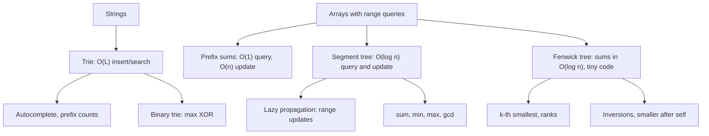

# Module 13 · Tries and Advanced Structures

Prepared by **Hamna Zahid Khan**, Junior Lecturer

[🏠 Course home](../README.md)

> ⏱ 9 contact hours · 3 sessions · 🔴 Advanced

Some problems need more than lists, trees and hash tables. Tries answer prefix questions in time proportional to the key length; segment trees and Fenwick trees answer range questions on arrays that keep changing. These structures power autocomplete, analytics dashboards, leaderboards and competitive programming.

## 🎯 Module objectives

- Implement a trie with insert, search, prefix counting, autocomplete and deletion.
- Use binary tries for XOR maximisation.
- Build segment trees for sum/min queries with point updates and lazy range updates.
- Build Fenwick trees for prefix sums, range updates, order statistics and inversion counting.
- Choose between prefix sums, segment trees and Fenwick trees.

## 📚 Sessions

| # | Session | Key ideas | Code |
|---|---|---|---|
| 1 | [Tries](session-01-tries.md) | prefix sharing, autocomplete, pruning delete, binary trie | [`Trie.java`](src/Trie.java) |
| 2 | [Segment Trees](session-02-segment-trees.md) | overlap cases, point update, lazy propagation | [`SegmentTree.java`](src/SegmentTree.java) |
| 3 | [Fenwick Trees](session-03-fenwick-trees.md) | lowbit, prefix sums, k-th element, inversions | [`FenwickTree.java`](src/FenwickTree.java) |
| ✍️ | [Practice test](practice-test.md) | 20 MCQs + 3 coding scenarios | [`Labs13.java`](src/Labs13.java), [`SelfCheck.java`](src/SelfCheck.java) |

## 🗺️ Concept map



## 📄 One-page cheat sheet

| Structure | Build | Query | Update | Space | Best for |
|---|---|---|---|---|---|
| Trie | O(total chars) | O(L) | O(L) | O(total chars) | prefixes, autocomplete |
| Prefix sums | O(n) | O(1) | O(n) | O(n) | static arrays |
| Segment tree | O(n) | O(log n) | O(log n) | 4n | any associative op |
| + lazy | O(n) | O(log n) | range O(log n) | 8n | range add/assign |
| Fenwick tree | O(n) | O(log n) | O(log n) | n + 1 | sums, counts, ranks |

**Segment tree query:** no overlap → identity · total overlap → stored value · partial → both children.

**Fenwick loops**

```java
void add(int i, long d) { for (; i <= n; i += i & -i) tree[i] += d; }
long prefix(int i)     { long s = 0; for (; i > 0; i -= i & -i) s += tree[i]; return s; }
```

## ▶️ Run the code

```bash
cd 13-tries-and-advanced-structures/src
javac -d out *.java
java -ea -cp out SelfCheck
java -cp out FenwickTree
java -cp out Labs13 2          # Session 2 lab solutions (1-3)
```

See [`src/README.md`](src/README.md) for every file.
