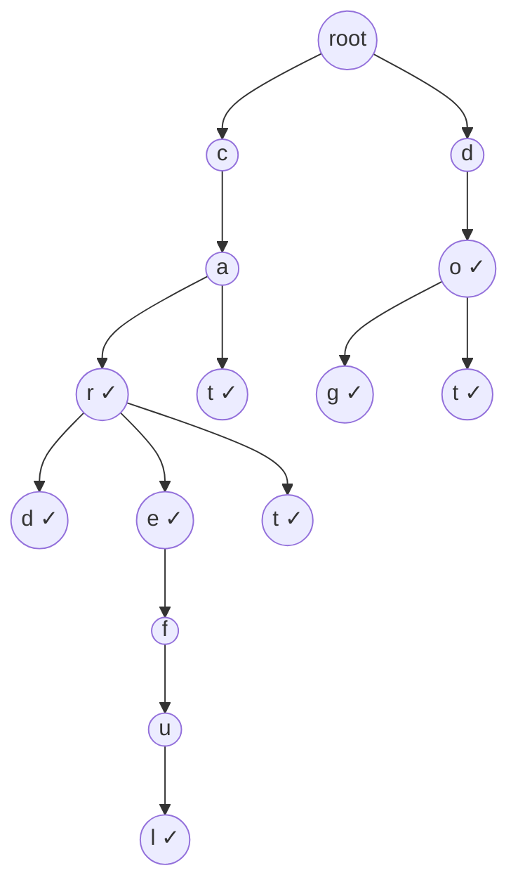

# Session 1 · Tries (Prefix Trees)

Prepared by **Hamna Zahid Khan**, Junior Lecturer

[🏠 Course home](../README.md) · [📘 Module overview](./README.md) · [⬅ Module overview](./README.md) · [Next ➡](./session-02-segment-trees.md)

> **Module 13 · Tries and Advanced Structures** · ⏱ 3 hours (90 min lecture + 90 min lab)

## 🎯 Learning objectives

1. Explain how a **trie** stores strings by sharing common prefixes.
2. Implement `insert`, `contains`, `startsWith` and prefix counting in O(L) for a key of length L.
3. Build **autocomplete** with a DFS that returns results in alphabetical order.
4. Delete words and prune unused branches.
5. Use tries for word replacement, longest common prefix and the **binary trie** maximum-XOR trick.

---

## 1. Why another structure for strings?

A `HashSet<String>` answers "is *care* a word?" in O(L) expected time, but it cannot answer "which words **start with** *car*?" without scanning everything. A sorted array can (binary search for the range), but insertion is O(n).

A **trie** (from re*trie*val) stores strings character by character along root-to-node paths, so every prefix is a node.

> 📖 **Analogy: the thumb index of a printed dictionary.** You open the C section, then the CA pages, then CAR. Every word starting with "car" lives under that one tab, and once you have found the tab you never look at words beginning with D.



✓ marks nodes where a word **ends** (`isWord = true`). "ca" is a path but not a word.

## 2. The node

```java
static final class Node {
    final Node[] next = new Node[26];   // child for each letter, null if absent
    boolean isWord;                     // a word ends here
    int pass;                           // number of words passing through (prefix count)
}
```

| Child storage | Lookup | Memory | Use when |
|---|---|---|---|
| `Node[26]` array | O(1) | 26 references per node | small fixed alphabet (lowercase) |
| `HashMap<Character, Node>` | O(1) expected | only existing children | Unicode, large alphabets |
| `TreeMap<Character, Node>` | O(log σ) | only existing children | need sorted children |

## 3. Operations

| Operation | How | Time |
|---|---|---|
| `insert(w)` | walk from the root, creating missing children; mark the last node | O(L) |
| `contains(w)` | walk; true if the path exists **and** ends at an `isWord` node | O(L) |
| `startsWith(p)` | walk; true if the path exists | O(L) |
| `countPrefix(p)` | walk, return `pass` of the last node | O(L) |
| `autocomplete(p, k)` | walk to p's node, DFS children a..z, collect up to k words | O(L + output size) |
| `delete(w)` | decrement `pass` along the path; unlink a child whose `pass` hits 0 | O(L) |

All costs depend on the **length of the key**, not on how many words are stored.

### Dry run: insert "cart" into a trie already holding car, card, care

| Char | Node exists? | Action | pass after |
|---|---|---|---|
| c | yes | move | 4 |
| a | yes | move | 4 |
| r | yes | move | 4 |
| t | **no** | create node, move | 1 |
| end | – | `isWord = true` | – |

### Dry run: `autocomplete("car", 3)`

| Step | Path | Collected |
|---|---|---|
| walk to "car" | c → a → r | |
| r is a word | "car" | [car] |
| child d (first letter in a..z order) | "card" | [car, card] |
| child e | "care" | [car, card, care] ⇒ limit reached, stop |

Because children are visited in alphabetical order, results come out sorted for free.

### Deletion and pruning

Deleting "careful" decrements `pass` along c-a-r-e-f-u-l. At **f** the count drops to 0 (no other word uses it), so the whole f-u-l branch is unlinked. Deleting "car" only clears `isWord` at r, because card, care and cart still pass through it.

## 4. Complexity table

| Structure | insert | exact search | prefix query (k results) | sorted output |
|---|---|---|---|---|
| `HashSet<String>` | O(L) exp. | O(L) exp. | O(n · L) scan | no |
| Sorted array | O(n) | O(L log n) | O(L log n + k) | yes |
| `TreeSet<String>` | O(L log n) | O(L log n) | O(L log n + k) | yes |
| **Trie** | **O(L)** | **O(L)** | **O(L + output)** | **yes** |

Space: O(total characters) nodes in the worst case, less when prefixes are shared (9 words with 33 letters needed only 15 nodes in the program). With 26-slot arrays each node is about 130 bytes, which is the price of O(1) child lookup.

---

## 5. Complete program

📄 **[`src/Trie.java`](src/Trie.java)**

```java
import java.util.ArrayList;
import java.util.List;

/**
 * Session 1 demo: a trie (prefix tree) over lowercase words with insert, search, startsWith,
 * prefix counting, autocomplete (sorted, limited), and deletion that prunes unused nodes.
 *
 * Compile:  javac -d out Trie.java
 * Run:      java -cp out Trie
 *
 * Prepared by Hamna Zahid Khan, Junior Lecturer
 */
public class Trie {

    static final class Node {
        final Node[] next = new Node[26];     // one slot per letter a..z
        boolean isWord;                       // a word ends exactly here
        int pass;                             // how many stored words pass through this node
    }

    private final Node root = new Node();
    private int words, nodes = 1;

    /** Insert a word: walk/create one node per character. O(L). */
    void insert(String w) {
        if (contains(w)) return;
        Node n = root;
        n.pass++;
        for (char ch : w.toCharArray()) {
            int i = ch - 'a';
            if (n.next[i] == null) { n.next[i] = new Node(); nodes++; }
            n = n.next[i];
            n.pass++;
        }
        n.isWord = true;
        words++;
    }

    private Node walk(String s) {
        Node n = root;
        for (char ch : s.toCharArray()) {
            n = n.next[ch - 'a'];
            if (n == null) return null;
        }
        return n;
    }

    boolean contains(String w) { Node n = walk(w); return n != null && n.isWord; }
    boolean startsWith(String p) { return walk(p) != null; }
    int countPrefix(String p) { Node n = walk(p); return n == null ? 0 : n.pass; }

    /** Up to 'limit' words starting with p, in alphabetical order (DFS visits letters a..z). */
    List<String> autocomplete(String p, int limit) {
        List<String> out = new ArrayList<>();
        Node n = walk(p);
        if (n != null) collect(n, new StringBuilder(p), out, limit);
        return out;
    }

    private void collect(Node n, StringBuilder sb, List<String> out, int limit) {
        if (out.size() >= limit) return;
        if (n.isWord) out.add(sb.toString());
        for (int i = 0; i < 26; i++) {
            if (n.next[i] == null) continue;
            sb.append((char) ('a' + i));
            collect(n.next[i], sb, out, limit);
            sb.deleteCharAt(sb.length() - 1);           // backtrack
        }
    }

    /** Delete a word; nodes whose pass count drops to 0 are unlinked (pruned). */
    boolean delete(String w) {
        if (!contains(w)) return false;
        Node n = root;
        n.pass--;
        for (char ch : w.toCharArray()) {
            int i = ch - 'a';
            if (--n.next[i].pass == 0) {               // nobody else uses this branch
                nodes -= countNodes(n.next[i]);
                n.next[i] = null;
                words--;
                return true;
            }
            n = n.next[i];
        }
        n.isWord = false;
        words--;
        return true;
    }

    private int countNodes(Node n) {
        int c = 1;
        for (Node x : n.next) if (x != null) c += countNodes(x);
        return c;
    }

    /** Longest common prefix of all stored words: follow the single-child chain from the root. */
    String longestCommonPrefix() {
        StringBuilder sb = new StringBuilder();
        Node n = root;
        while (!n.isWord) {
            int only = -1, kids = 0;
            for (int i = 0; i < 26; i++) if (n.next[i] != null) { only = i; kids++; }
            if (kids != 1) break;
            sb.append((char) ('a' + only));
            n = n.next[only];
        }
        return sb.toString();
    }

    int size() { return words; }
    int nodeCount() { return nodes; }

    public static void main(String[] args) {
        Trie t = new Trie();
        String[] dict = {"car", "card", "care", "careful", "cart", "cat", "dog", "do", "dot"};
        for (String w : dict) t.insert(w);
        System.out.println("inserted " + t.size() + " words using " + t.nodeCount() + " nodes"
                + " (total letters = " + String.join("", dict).length() + ")");

        System.out.println("\ncontains(car) = " + t.contains("car") + ", contains(ca) = " + t.contains("ca")
                + ", contains(cars) = " + t.contains("cars"));
        System.out.println("startsWith(ca) = " + t.startsWith("ca") + ", startsWith(cow) = " + t.startsWith("cow"));
        System.out.println("countPrefix(car) = " + t.countPrefix("car") + ", countPrefix(do) = " + t.countPrefix("do")
                + ", countPrefix(\"\") = " + t.countPrefix(""));

        System.out.println("\nautocomplete(\"car\", 10) = " + t.autocomplete("car", 10));
        System.out.println("autocomplete(\"car\", 3)  = " + t.autocomplete("car", 3));
        System.out.println("autocomplete(\"d\", 10)   = " + t.autocomplete("d", 10));
        System.out.println("autocomplete(\"x\", 10)   = " + t.autocomplete("x", 10));

        System.out.println("\ndelete(careful) = " + t.delete("careful") + " -> nodes now " + t.nodeCount()
                + ", autocomplete(car) = " + t.autocomplete("car", 10));
        System.out.println("delete(car)     = " + t.delete("car") + " -> contains(car) = " + t.contains("car")
                + ", contains(card) = " + t.contains("card") + ", nodes now " + t.nodeCount());
        System.out.println("delete(zebra)   = " + t.delete("zebra"));

        Trie lcp = new Trie();
        for (String w : new String[]{"interview", "internet", "internal", "interval"}) lcp.insert(w);
        System.out.println("\nlongest common prefix of interview/internet/internal/interval = \"" + lcp.longestCommonPrefix() + "\"");
    }
}
```

**Real output:**

```text
$ java -cp out Trie
inserted 9 words using 15 nodes (total letters = 33)

contains(car) = true, contains(ca) = false, contains(cars) = false
startsWith(ca) = true, startsWith(cow) = false
countPrefix(car) = 5, countPrefix(do) = 3, countPrefix("") = 9

autocomplete("car", 10) = [car, card, care, careful, cart]
autocomplete("car", 3)  = [car, card, care]
autocomplete("d", 10)   = [do, dog, dot]
autocomplete("x", 10)   = []

delete(careful) = true -> nodes now 12, autocomplete(car) = [car, card, care, cart]
delete(car)     = true -> contains(car) = false, contains(card) = true, nodes now 12
delete(zebra)   = false

longest common prefix of interview/internet/internal/interval = "inter"
```

---

## 6. Worked examples (basic → advanced)

**Example 1 (basic): longest common prefix.** Insert all words; starting at the root, keep walking while the current node has exactly one child and is not the end of a word. For interview, internet, internal, interval the walk stops at "inter" (the next node has children v, n). See `longestCommonPrefix()` in the program.

**Example 2 (intermediate): replace words with their roots.** Given roots {cat, bat, rat, ca} and a sentence, replace every word by its **shortest** root prefix. Walk the trie along each word and stop at the first `isWord` node.

```java
/** Replace each word of a sentence by its shortest dictionary root ("cattle" -> "cat"). */
static String replaceWords(List<String> roots, String sentence) {
    Trie.Node root = new Trie.Node();
    for (String r : roots) {
        Trie.Node n = root;
        for (char c : r.toCharArray()) {
            if (n.next[c - 'a'] == null) n.next[c - 'a'] = new Trie.Node();
            n = n.next[c - 'a'];
        }
        n.isWord = true;
    }
    List<String> out = new ArrayList<>();
    for (String w : sentence.split(" ")) {
        Trie.Node n = root;
        String replacement = w;
        for (int i = 0; i < w.length() && n != null; i++) {
            n = n.next[w.charAt(i) - 'a'];
            if (n != null && n.isWord) { replacement = w.substring(0, i + 1); break; }   // shortest root
        }
        out.add(replacement);
    }
    return String.join(" ", out);
}
```
<sub>Full, compiled version: [`src/Labs13.java`](src/Labs13.java)</sub>

"the cattle was rattled by the battery" → **"the ca was rat by the bat"** ("ca" is shorter than "cat").

**Example 3 (advanced): maximum XOR of two numbers.** Store numbers as 31-bit strings in a **binary trie** (children 0 and 1). For each x, walk from the highest bit and greedily take the **opposite** bit when possible: that makes the XOR's high bits 1. O(31 · n) instead of O(n²).

| x | binary (5 bits) | best partner found | XOR |
|---|---|---|---|
| 5 | 00101 | 25 = 11001 | 11100 = **28** |

```java
/** Maximum a[i] XOR a[j] using a binary trie over 31 bits: at each bit, try to go the opposite way. */
static int maxXor(int[] a) {
    int[][] child = new int[a.length * 31 + 1][2];
    int nodes = 1, best = 0;
    for (int x : a) {
        int n = 0;
        for (int b = 30; b >= 0; b--) {                 // insert x
            int bit = (x >> b) & 1;
            if (child[n][bit] == 0) child[n][bit] = nodes++;
            n = child[n][bit];
        }
        n = 0;
        int cur = 0;
        for (int b = 30; b >= 0; b--) {                 // greedy query: prefer the opposite bit
            int want = ((x >> b) & 1) ^ 1;
            if (child[n][want] != 0) { cur |= 1 << b; n = child[n][want]; }
            else n = child[n][want ^ 1];
        }
        best = Math.max(best, cur);
    }
    return best;
}
```
<sub>Full, compiled version: [`src/Labs13.java`](src/Labs13.java)</sub>

## 7. Real-life problem: search-box suggestions for the library catalogue

**Problem.** The library's online catalogue has 150,000 titles. As a student types, the search box must show the first 8 matching titles alphabetically after **every keystroke**, within a few milliseconds.

**Solution.** Load lowercase titles into a trie once (or a trie of title words). Each keystroke extends the prefix by one character, so the walk costs O(1) more; `autocomplete(prefix, 8)` collects at most 8 titles by DFS in alphabetical order. A `HashSet` would scan all 150,000 titles per keystroke. Production systems add a **frequency** to each node to rank suggestions by popularity (keep the top-k per node, Module 11).

## 8. Common mistakes

| Mistake | Fix |
|---|---|
| Treating every path as a word | check `isWord` at the last node |
| `ch - 'a'` on uppercase letters or spaces | normalise input or use a `HashMap` of children |
| Deleting nodes that other words still use | keep a `pass` count, prune only when it reaches 0 |
| Inserting a duplicate twice and double-counting `pass` | check `contains` first (as the program does) |
| Recursion in autocomplete without a limit | stop when `k` results are collected |
| Building a trie for pure exact lookups | a `HashSet` is simpler and smaller |

## 9. Best practices

- Use a trie when the problem says **prefix**, **autocomplete**, **dictionary of words**, or **bitwise XOR maximisation**.
- Store extra information in nodes (`pass`, word count, top suggestions) to answer queries without extra traversal.
- Use `StringBuilder` with backtracking (append, recurse, delete) during DFS.
- For very large dictionaries, consider compressed tries (radix trees) that merge single-child chains.

---

## 10. Lab tasks

**Lab 1.1: Replace words.** Implement `replaceWords(roots, sentence)`.

<details>
<summary>✅ Solution</summary>

See Example 2.

</details>

**Lab 1.2: Maximum XOR pair** with a binary trie.

<details>
<summary>✅ Solution</summary>

See Example 3. For `[3, 10, 5, 25, 2, 8]` the answer is **28** (5 XOR 25).

</details>

**Lab 1.3: Count words with a prefix** and **count distinct prefixes**. Using the program's trie, how many words start with "car", and how many different non-empty prefixes exist?

<details>
<summary>✅ Solution</summary>

`countPrefix("car")` = 5 (car, card, care, careful, cart). Every node except the root is a distinct prefix: 15 − 1 = **14**.

</details>

**Lab 1.4: Case-insensitive trie.** Change `Node` to use `HashMap<Character, Node>` so it accepts any characters. What changes in the complexity table?

<details>
<summary>✅ Solution</summary>

Replace `next[c - 'a']` with `next.get(c)` / `computeIfAbsent(c, k -> new Node())` and lowercase input with `toLowerCase()`. Operations stay O(L) expected; memory drops for sparse nodes; autocomplete output is no longer sorted unless you use a `TreeMap` (O(log σ) per step).

</details>

**Real output of the Session 1 lab solutions:**

```text
$ java -cp out Labs13 1
-- Session 1 labs --
the ca was rat by the bat
maxXor([3, 10, 5, 25, 2, 8]) = 28
```

---

## 11. Quiz

**Q1.** The time to search a word of length L in a trie holding n words is:

- **A.** O(n)
- **B.** O(log n)
- **C.** O(L)
- **D.** O(n · L)

**Q2.** In a trie, "ca" is a path but contains("ca") returns false because:

- **A.** the node does not exist
- **B.** the node's isWord flag is false
- **C.** tries cannot store two-letter words
- **D.** the root has no children

**Q3.** Autocomplete results come out alphabetically because:

- **A.** the trie sorts after each insert
- **B.** DFS visits children in letter order a..z
- **C.** words are inserted alphabetically
- **D.** a TreeSet is used

**Q4.** Which problem is a classic use of a binary trie?

- **A.** shortest path
- **B.** maximum XOR of two numbers
- **C.** topological sort
- **D.** matrix multiplication

**Q5.** When deleting a word, a node can be removed when:

- **A.** it has no isWord flag
- **B.** its pass count (words using it) becomes 0
- **C.** it is a leaf at any time
- **D.** it has two children

<details>
<summary><b>Show answers</b></summary>

1. **C**: One step per character.
2. **B**: Paths are prefixes; only marked nodes are words.
3. **B**: Child array index = letter.
4. **B**: Greedy opposite-bit walk.
5. **B**: Otherwise other words still use it.

</details>

---

## 12. Summary

- A trie shares prefixes: each node is a prefix, `isWord` marks complete words.
- Insert, search and prefix queries are **O(L)**, independent of the number of words.
- DFS from a prefix node gives **sorted autocomplete**; `pass` counts give prefix counts and safe deletion.
- Binary tries turn bitwise maximisation (XOR) into an O(bits) greedy walk.

## 13. Viva / interview questions

1. Compare a trie with a `HashSet` and a `TreeSet` for a spelling checker with autocomplete.
2. What is the worst-case number of nodes for n words of length L?
3. How would you rank autocomplete suggestions by popularity efficiently?
4. Explain why the greedy opposite-bit walk gives the maximum XOR.
5. What is a radix (compressed) trie and when does it help?
6. Find all dictionary words in a grid of letters (Boggle) using a trie and backtracking.

---

[⬅ Module overview](./README.md) · [📘 Module overview](./README.md) · [Next ➡](./session-02-segment-trees.md)
