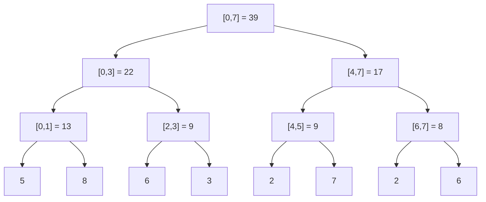
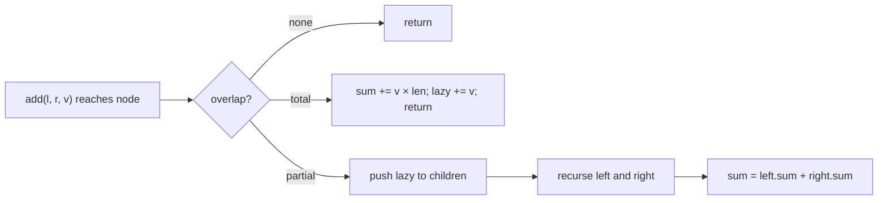

# Session 2 · Segment Trees

Prepared by **Hamna Zahid Khan**, Junior Lecturer

[🏠 Course home](../README.md) · [📘 Module overview](./README.md) · [⬅ Previous](./session-01-tries.md) · [Next ➡](./session-03-fenwick-trees.md)

> **Module 13 · Tries and Advanced Structures** · ⏱ 3 hours (90 min lecture + 90 min lab)

## 🎯 Learning objectives

1. Explain the trade-off between **range queries** and **updates** for arrays and prefix sums.
2. Build a **segment tree** for sum or minimum and store it in an array of size 4n.
3. Answer range queries in O(log n) using **no / partial / total overlap**.
4. Perform point updates in O(log n).
5. Support **range updates** with **lazy propagation**.

---

## 1. The range-query problem

An array of n values receives two kinds of requests, mixed together and many times:

- **query(l, r):** the sum (or min, max, gcd) of a[l..r]
- **update(i, v):** change one element (or add v to a whole range)

| Approach | query | point update |
|---|---|---|
| Plain array, loop over the range | O(n) | O(1) |
| Prefix-sum array (Module 02) | O(1) | O(n): every later prefix changes |
| **Segment tree** | **O(log n)** | **O(log n)** |
| Fenwick tree (Session 3) | O(log n) (sums) | O(log n) |

When both operations are frequent, only the logarithmic structures keep up: 10⁵ queries and 10⁵ updates on 10⁵ elements is 10¹⁰ steps with an array but about 3.4 × 10⁶ with a segment tree.

> 🏢 **Analogy: a company's reporting hierarchy.** Each branch manager knows the branch's total sales, each regional manager knows the sum of their branches, and the CEO knows the national total. To get the sales of "branches 3 to 6", you ask a few managers whose areas fit exactly inside the range instead of every branch. When one branch's figure changes, only its chain of managers up to the CEO updates their totals.

## 2. Structure

Each node covers a segment [lo, hi] and stores the answer for it. The root covers the whole array; a node's children cover the left half [lo, mid] and right half [mid + 1, hi]; leaves cover single elements.



Array `[5, 8, 6, 3, 2, 7, 2, 6]` (canteen sales for 8 days). Stored like a heap (Module 11): node i has children 2i and 2i + 1 (1-based). An array of size **4n** is always enough.

| Property | Value |
|---|---|
| Height | ⌈log₂ n⌉ |
| Nodes | < 4n (2n − 1 for powers of two) |
| Build | O(n): each node computed once from its children |

## 3. Range query: three cases

At node [lo, hi] with query [l, r]:

| Case | Condition | Action |
|---|---|---|
| No overlap | r < lo or hi < l | return the identity (0 for sum, +∞ for min) |
| Total overlap | l ≤ lo and hi ≤ r | return the stored value: **stop** |
| Partial overlap | otherwise | ask both children and combine |

### Dry run: sum[2..6]

| Node | Overlap | Returns |
|---|---|---|
| [0,7] | partial | left + right |
| [0,3] | partial | left + right |
| [0,1] | none | 0 |
| [2,3] | **total** | 9 |
| [4,7] | partial | left + right |
| [4,5] | **total** | 9 |
| [6,7] | partial | left + right |
| [6,6] | **total** | 2 |
| [7,7] | none | 0 |

Total = 9 + 9 + 2 = **20** using 9 nodes. A query touches at most about 4 nodes per level ⇒ O(log n). The program measured at most 79 nodes for n = 1,000,000.

## 4. Point update

To set a[3] = 10: walk from the root to leaf 3 (choosing left or right by comparing with mid), set it, and **recompute every node on the way back up**: [2,3] = 16, [0,3] = 29, [0,7] = 46. Exactly one node per level ⇒ O(log n).

## 5. Other operations

Any **associative** combine function works with the right identity:

| Query | combine | identity |
|---|---|---|
| sum | a + b | 0 |
| minimum | min(a, b) | +∞ |
| maximum | max(a, b) | −∞ |
| gcd | gcd(a, b) | 0 |
| count of zeros | a + b (leaf = 1 if zero) | 0 |

## 6. Range updates with lazy propagation

"Add 10 to every day in [2, 5]" would touch every leaf in the range: O(n). **Lazy propagation** stops at total-overlap nodes, updates their stored sum (`sum += v × length`), and writes a **pending note** `lazy[i] += v` instead of visiting the children. The note is pushed down only when a later operation needs to go below that node.



Both range add and range sum become **O(log n)**. In the program, +10 on days 2..5 raises the total from 39 to 79, and day 5 reads 17.

## 7. Complexity table

| Operation | Segment tree | With lazy propagation |
|---|---|---|
| build | O(n) | O(n) |
| range query | O(log n) | O(log n) |
| point update | O(log n) | O(log n) |
| range update | O(n) | **O(log n)** |
| space | O(4n) | O(8n) (sum + lazy) |

---

## 8. Complete program

📄 **[`src/SegmentTree.java`](src/SegmentTree.java)**

```java
import java.util.Arrays;

/**
 * Session 2 demo: segment trees. A point-update / range-sum tree and a range-minimum tree built
 * recursively over an array, plus a lazy-propagation tree supporting "add v to every element in
 * [l, r]" and range-sum queries, each in O(log n).
 *
 * Compile:  javac -d out SegmentTree.java
 * Run:      java -cp out SegmentTree
 *
 * Prepared by Hamna Zahid Khan, Junior Lecturer
 */
public class SegmentTree {

    /** Range-sum (or range-min) segment tree with point updates. Node i covers [lo, hi]; children 2i, 2i+1. */
    static final class PointTree {
        final int n;
        final long[] t;
        final boolean isMin;
        int visited;                                   // nodes touched by the last query (for teaching)

        PointTree(long[] a, boolean isMin) {
            n = a.length;
            this.isMin = isMin;
            t = new long[4 * n];
            build(a, 1, 0, n - 1);
        }

        private long combine(long x, long y) { return isMin ? Math.min(x, y) : x + y; }
        private long identity() { return isMin ? Long.MAX_VALUE : 0; }

        private void build(long[] a, int i, int lo, int hi) {
            if (lo == hi) { t[i] = a[lo]; return; }
            int mid = (lo + hi) / 2;
            build(a, 2 * i, lo, mid);
            build(a, 2 * i + 1, mid + 1, hi);
            t[i] = combine(t[2 * i], t[2 * i + 1]);
        }

        long query(int l, int r) { visited = 0; return query(1, 0, n - 1, l, r); }

        private long query(int i, int lo, int hi, int l, int r) {
            visited++;
            if (r < lo || hi < l) return identity();               // no overlap
            if (l <= lo && hi <= r) return t[i];                    // total overlap
            int mid = (lo + hi) / 2;                                // partial overlap: ask both children
            return combine(query(2 * i, lo, mid, l, r), query(2 * i + 1, mid + 1, hi, l, r));
        }

        void set(int pos, long v) { set(1, 0, n - 1, pos, v); }

        private void set(int i, int lo, int hi, int pos, long v) {
            if (lo == hi) { t[i] = v; return; }
            int mid = (lo + hi) / 2;
            if (pos <= mid) set(2 * i, lo, mid, pos, v); else set(2 * i + 1, mid + 1, hi, pos, v);
            t[i] = combine(t[2 * i], t[2 * i + 1]);                // recompute on the way up
        }
    }

    /** Range add + range sum with lazy propagation: pending additions wait in lazy[] until needed. */
    static final class LazyTree {
        final int n;
        final long[] sum, lazy;

        LazyTree(int n) { this.n = n; sum = new long[4 * n]; lazy = new long[4 * n]; }

        private void apply(int i, int lo, int hi, long v) { sum[i] += v * (hi - lo + 1); lazy[i] += v; }

        private void push(int i, int lo, int hi) {                  // hand the pending add to the children
            if (lazy[i] == 0) return;
            int mid = (lo + hi) / 2;
            apply(2 * i, lo, mid, lazy[i]);
            apply(2 * i + 1, mid + 1, hi, lazy[i]);
            lazy[i] = 0;
        }

        void add(int l, int r, long v) { add(1, 0, n - 1, l, r, v); }

        private void add(int i, int lo, int hi, int l, int r, long v) {
            if (r < lo || hi < l) return;
            if (l <= lo && hi <= r) { apply(i, lo, hi, v); return; }   // stop here, remember lazily
            push(i, lo, hi);
            int mid = (lo + hi) / 2;
            add(2 * i, lo, mid, l, r, v);
            add(2 * i + 1, mid + 1, hi, l, r, v);
            sum[i] = sum[2 * i] + sum[2 * i + 1];
        }

        long sum(int l, int r) { return sum(1, 0, n - 1, l, r); }

        private long sum(int i, int lo, int hi, int l, int r) {
            if (r < lo || hi < l) return 0;
            if (l <= lo && hi <= r) return sum[i];
            push(i, lo, hi);
            int mid = (lo + hi) / 2;
            return sum(2 * i, lo, mid, l, r) + sum(2 * i + 1, mid + 1, hi, l, r);
        }
    }

    public static void main(String[] args) {
        long[] sales = {5, 8, 6, 3, 2, 7, 2, 6};      // daily sales of a canteen item, days 0..7
        System.out.println("array = " + Arrays.toString(sales));

        PointTree st = new PointTree(sales, false);
        System.out.println("\n== Range-sum tree ==");
        System.out.println("tree[1..15] = " + Arrays.toString(Arrays.copyOfRange(st.t, 1, 16)));
        System.out.println("sum[2..6] = " + st.query(2, 6) + "  (nodes visited: " + st.visited + ")");
        System.out.println("sum[0..7] = " + st.query(0, 7) + "  (nodes visited: " + st.visited + ")");
        st.set(3, 10);
        System.out.println("set day 3 to 10 -> sum[2..6] = " + st.query(2, 6) + ", sum[0..3] = " + st.query(0, 3));

        PointTree mn = new PointTree(sales, true);
        System.out.println("\n== Range-minimum tree ==");
        System.out.println("min[0..3] = " + mn.query(0, 3) + ", min[4..7] = " + mn.query(4, 7) + ", min[1..2] = " + mn.query(1, 2));

        System.out.println("\n== Lazy propagation: range add ==");
        LazyTree lz = new LazyTree(8);
        for (int i = 0; i < 8; i++) lz.add(i, i, sales[i]);
        lz.add(2, 5, 10);                                // promotion: +10 on days 2..5
        System.out.println("after +10 on [2..5]: sum[0..7] = " + lz.sum(0, 7) + ", sum[4..6] = " + lz.sum(4, 6)
                + ", day 5 = " + lz.sum(5, 5));
        lz.add(0, 7, -1);
        System.out.println("after -1 on all:     sum[0..7] = " + lz.sum(0, 7) + ", day 0 = " + lz.sum(0, 0));

        System.out.println("\n== Nodes visited per query, n = 1,000,000 ==");
        long[] big = new long[1_000_000];
        Arrays.fill(big, 1);
        PointTree bt = new PointTree(big, false);
        java.util.Random r = new java.util.Random(13);
        int worst = 0;
        for (int q = 0; q < 10_000; q++) {
            int a = r.nextInt(big.length), b = r.nextInt(big.length);
            bt.query(Math.min(a, b), Math.max(a, b));
            worst = Math.max(worst, bt.visited);
        }
        System.out.println("worst nodes visited over 10,000 random queries = " + worst + "  (4*log2 n ≈ 80)");
    }
}
```

**Real output:**

```text
$ java -cp out SegmentTree
array = [5, 8, 6, 3, 2, 7, 2, 6]

== Range-sum tree ==
tree[1..15] = [39, 22, 17, 13, 9, 9, 8, 5, 8, 6, 3, 2, 7, 2, 6]
sum[2..6] = 20  (nodes visited: 9)
sum[0..7] = 39  (nodes visited: 1)
set day 3 to 10 -> sum[2..6] = 27, sum[0..3] = 29

== Range-minimum tree ==
min[0..3] = 3, min[4..7] = 2, min[1..2] = 6

== Lazy propagation: range add ==
after +10 on [2..5]: sum[0..7] = 79, sum[4..6] = 31, day 5 = 17
after -1 on all:     sum[0..7] = 71, day 0 = 4

== Nodes visited per query, n = 1,000,000 ==
worst nodes visited over 10,000 random queries = 79  (4*log2 n ≈ 80)
```

---

## 9. Worked examples (basic → advanced)

**Example 1 (basic): range minimum.** Using the min-tree on the sales array: min[0..3] = 3, min[4..7] = 2. The code is identical to the sum tree except `combine` and `identity`.

**Example 2 (intermediate): biggest temperature swing in a period.** A weather station asks, for many periods [l, r], for max − min. Build a min-tree on the temperatures and a min-tree on the **negated** temperatures (whose minimum is −max).

```java
/** Largest temperature swing (max - min) in [l, r]: one min-tree and one max-tree (stored negated). */
static long[] swings(long[] temps, int[][] queries) {
    long[] neg = new long[temps.length];
    for (int i = 0; i < temps.length; i++) neg[i] = -temps[i];
    SegmentTree.PointTree mn = new SegmentTree.PointTree(temps, true);
    SegmentTree.PointTree mxNeg = new SegmentTree.PointTree(neg, true);
    long[] out = new long[queries.length];
    for (int q = 0; q < queries.length; q++) {
        int l = queries[q][0], r = queries[q][1];
        out[q] = -mxNeg.query(l, r) - mn.query(l, r);
    }
    return out;
}
```
<sub>Full, compiled version: [`src/Labs13.java`](src/Labs13.java)</sub>

For `[31, 35, 29, 40, 38, 27, 33]`: [0, 2] → 35 − 29 = **6**, [2, 5] → 40 − 27 = **13**.

**Example 3 (advanced): flight seat bookings.** Booking (first, last, seats) adds seats to every flight from first to last. With a lazy tree each booking is one O(log n) range add.

```java
/** Flight seat bookings: bookings[i] = {first, last, seats} adds seats to flights first..last. Lazy tree. */
static long[] seatTotals(int flights, int[][] bookings) {
    SegmentTree.LazyTree t = new SegmentTree.LazyTree(flights);
    for (int[] b : bookings) t.add(b[0] - 1, b[1] - 1, b[2]);
    long[] out = new long[flights];
    for (int i = 0; i < flights; i++) out[i] = t.sum(i, i);
    return out;
}
```
<sub>Full, compiled version: [`src/Labs13.java`](src/Labs13.java)</sub>

Bookings (1,2,10), (2,3,20), (2,5,25) on 5 flights give **[10, 55, 45, 25, 25]**.

## 10. Real-life problem: live dashboard for electricity readings

**Problem.** A smart-meter system records hourly consumption for 50,000 homes over a year (one array per home). Analysts query "total consumption between hour l and r" and "peak hour in a range" thousands of times per minute, while late readings correct individual hours.

**Solution.** One segment tree per home storing (sum, max) pairs in each node; `combine` adds the sums and takes the larger max. Queries and corrections are both O(log 8760) ≈ 14 levels. A tariff change that adds a surcharge to a block of hours becomes a lazy range update. Prefix sums would make every correction rewrite thousands of entries.

## 11. Common mistakes

| Mistake | Fix |
|---|---|
| Array of size 2n | use 4n (non-power-of-two sizes need more) |
| Wrong identity (0 for a min-tree) | +∞ for min, −∞ for max |
| Forgetting to recompute parents after an update | `t[i] = combine(t[2i], t[2i+1])` after recursion |
| Lazy tree: not pushing before descending | call `push` in every partial-overlap branch of update **and** query |
| Lazy sum: adding v instead of v × length | the node covers hi − lo + 1 elements |
| `int` overflow for large sums | use `long` |

## 12. Best practices

- Write the three-case query from memory: no overlap / total overlap / partial overlap.
- Keep `combine` and `identity` as separate methods so one class serves sum, min, max and gcd.
- Test against a brute-force loop on random data (see `SelfCheck`).
- If you only need prefix sums with point updates, a Fenwick tree (Session 3) is shorter and faster.

---

## 13. Lab tasks

**Lab 2.1: Temperature swing.** Implement `swings(temps, queries)`.

<details>
<summary>✅ Solution</summary>

See Example 2.

</details>

**Lab 2.2: Flight seat bookings** with a lazy segment tree.

<details>
<summary>✅ Solution</summary>

See Example 3.

</details>

**Lab 2.3: Trace a query.** List the nodes visited by sum[1..4] on the sales array and the value each returns.

<details>
<summary>✅ Solution</summary>

[0,7] partial → [0,3] partial → [0,1] partial → [0,0] none (0), [1,1] total (8); [2,3] total (9); [4,7] partial → [4,5] partial → [4,4] total (2), [5,5] none (0); [6,7] none (0). Sum = 8 + 9 + 2 = **19** (8 + 6 + 3 + 2 ✔).

</details>

**Lab 2.4: Count zeros.** Build a tree whose leaves are 1 when a[i] = 0, so that query(l, r) counts zeros. Which part of `PointTree` changes?

<details>
<summary>✅ Solution</summary>

Only `build` and `set`: store `a[i] == 0 ? 1 : 0` at leaves and use `combine = +`, identity 0. Querying is unchanged. (A further extension finds the k-th zero by descending: go left if the left child's count ≥ k.)

</details>

**Real output of the Session 2 lab solutions:**

```text
$ java -cp out Labs13 2
-- Session 2 labs --
swings for [0,2], [2,5], [0,6] = [6, 13, 13]
seat totals = [10, 55, 45, 25, 25]
```

---

## 14. Quiz

**Q1.** A segment tree answers a range-sum query in:

- **A.** O(1)
- **B.** O(log n)
- **C.** O(√n)
- **D.** O(n)

**Q2.** When the query range completely covers a node's segment, the algorithm:

- **A.** visits both children
- **B.** returns the node's stored value
- **C.** returns 0
- **D.** rebuilds the node

**Q3.** The identity value for a range-minimum tree is:

- **A.** 0
- **B.** −∞
- **C.** +∞
- **D.** 1

**Q4.** A point update changes how many stored values?

- **A.** 1
- **B.** O(log n): one per level on the root-leaf path
- **C.** O(n)
- **D.** all leaves

**Q5.** Lazy propagation makes which operation O(log n)?

- **A.** point query
- **B.** range update
- **C.** build
- **D.** deleting the tree

<details>
<summary><b>Show answers</b></summary>

1. **B**: A bounded number of nodes per level.
2. **B**: Total overlap stops the recursion.
3. **C**: min(x, +∞) = x.
4. **B**: Each ancestor's value is recomputed.
5. **B**: Pending updates wait at covering nodes.

</details>

---

## 15. Summary

- Segment trees store an answer per segment; the root covers the whole array.
- Queries use three cases and run in O(log n); point updates recompute one path.
- Any associative operation works (sum, min, max, gcd) with the right identity.
- Lazy propagation postpones range updates, keeping them O(log n).

## 16. Viva / interview questions

1. Why is 4n enough space for the array representation?
2. Prove that a range query visits at most four nodes per level.
3. How would you store both sum and maximum in one tree?
4. Explain lazy propagation for "assign value v to [l, r]" (not add). What changes?
5. When is a sparse table (O(1) min queries, no updates) better than a segment tree?
6. Find the maximum subarray sum within [l, r] with a segment tree: what must each node store?

---

[⬅ Previous](./session-01-tries.md) · [📘 Module overview](./README.md) · [Next ➡](./session-03-fenwick-trees.md)
