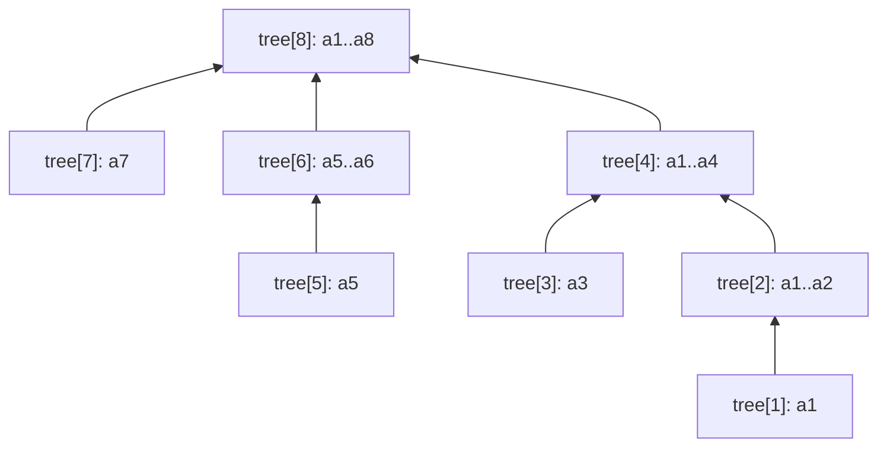

# Session 3 · Fenwick Trees (Binary Indexed Trees)

Prepared by **Hamna Zahid Khan**, Junior Lecturer

[🏠 Course home](../README.md) · [📘 Module overview](./README.md) · [⬅ Previous](./session-02-segment-trees.md) · [Practice test ➡](./practice-test.md)

> **Module 13 · Tries and Advanced Structures** · ⏱ 3 hours (90 min lecture + 90 min lab)

## 🎯 Learning objectives

1. Explain how a **Fenwick tree** stores partial sums indexed by the **lowest set bit**.
2. Implement `add(i, delta)` and `prefix(i)` in O(log n) and build the tree in O(n).
3. Compute range sums and use the **range-update / point-query** variant.
4. Find the **k-th smallest** element with binary lifting.
5. Count **inversions** and "smaller elements after self" with coordinate compression.

---

## 1. The idea

A segment tree (Session 2) is general but needs 4n nodes and recursive code. When the operation is a **sum** (or anything invertible like XOR) and updates are point updates, a **Fenwick tree** does the same job with **n + 1 array cells and two 3-line loops**.

> 🧾 **Analogy: monthly, quarterly and yearly ledgers.** An accountant keeps a ledger for each month, but some ledgers summarise more: the April ledger also covers January to March; the August ledger covers the whole first two-thirds of the year. To total January-July you add the July, June-ish and April summaries instead of seven monthly sheets. Which months a ledger covers is decided by the binary form of its number.

## 2. Lowest set bit

`lowbit(i) = i & -i` is the value of the lowest 1 bit of i (two's complement makes this work).

| i | binary | lowbit(i) | tree[i] stores the sum of |
|---|---|---|---|
| 1 | 0001 | 1 | a[1] |
| 2 | 0010 | 2 | a[1..2] |
| 3 | 0011 | 1 | a[3] |
| 4 | 0100 | 4 | a[1..4] |
| 5 | 0101 | 1 | a[5] |
| 6 | 0110 | 2 | a[5..6] |
| 7 | 0111 | 1 | a[7] |
| 8 | 1000 | 8 | a[1..8] |

**Indices are 1-based.** tree[i] covers the **lowbit(i)** elements ending at i.



(Arrows point from a node to the node that also includes it: i → i + lowbit(i).)

## 3. The two loops

```java
void add(int i, long delta) {            // a[i] += delta
    for (; i <= n; i += i & -i) tree[i] += delta;
}

long prefix(int i) {                     // a[1] + ... + a[i]
    long s = 0;
    for (; i > 0; i -= i & -i) s += tree[i];
    return s;
}
```

- `prefix` **removes** the lowest bit each step: 7 (0111) → 6 (0110) → 4 (0100) → 0. At most log₂ n steps.
- `add` **adds** the lowest bit each step: 4 (0100) → 8 (1000) → 16 … , visiting every node whose range contains i.
- `rangeSum(l, r) = prefix(r) − prefix(l − 1)`.

### Dry run on a = [5, 8, 6, 3, 2, 7, 2, 6]

| Call | Indices visited | Values | Result |
|---|---|---|---|
| prefix(7) | 7, 6, 4 | 2 + 9 + 22 | **33** |
| prefix(2) | 2 | 13 | 13 |
| rangeSum(3, 7) | prefix(7) − prefix(2) | 33 − 13 | **20** |
| add(4, +7) | 4, 8 | tree[4] 22 → 29, tree[8] 39 → 46 | |
| rangeSum(3, 7) after | | 40 − 13 | **27** |

### O(n) construction

Instead of n calls to `add` (O(n log n)), copy each a[i] into tree[i] and push each node's total once to its parent i + lowbit(i), in increasing i.

## 4. Variants

| Variant | Store | Operation | Query |
|---|---|---|---|
| Point update, range sum | a | `add(i, d)` | `prefix(r) − prefix(l−1)` |
| **Range update, point query** | difference array d | `add(l, v); add(r+1, −v)` | a[i] = `prefix(i)` |
| Counting / order statistics | count of each value | `add(value, 1)` | how many ≤ x = `prefix(x)`; k-th smallest by binary lifting |
| 2-D Fenwick | grid | nested loops | rectangle sums in O(log² n) |

**k-th smallest (binary lifting).** Walk down powers of two from the highest bit of n: if `tree[pos + step] < k`, the answer lies further right, so skip that block (`pos += step; k -= tree[pos]`). The answer is `pos + 1`. O(log n), no binary search over `prefix` needed.

## 5. Counting inversions

An **inversion** is a pair i < j with a[i] > a[j]; it measures how unsorted an array is (e.g. how differently two judges ranked contestants). Scan **right to left**; for each value x, the number of already-seen values smaller than x is `prefix(x − 1)`; then `add(x, 1)`.

| x (from the right) | seen values | smaller seen | running total |
|---|---|---|---|
| 2 | {} | 0 | 0 |
| 5 | {2} | 1 | 1 |
| 4 | {2, 5} | 1 | 2 |
| 1 | {2, 4, 5} | 0 | 2 |
| 3 | {1, 2, 4, 5} | 2 | **4** |

For `[3, 1, 4, 5, 2]` there are **4** inversions: (3,1), (3,2), (4,2), (5,2). If values are large or negative, **coordinate-compress** them to ranks 1..m first.

## 6. Fenwick vs segment tree

| | Fenwick tree | Segment tree |
|---|---|---|
| Code size | ~10 lines | ~40 lines (+ lazy) |
| Memory | n + 1 | 4n (8n with lazy) |
| Operations | sum-like (needs an inverse for ranges) | any associative op (min, max, gcd) |
| Range update + range query | possible with two trees | lazy propagation |
| Speed | faster constants | slower constants |

## 7. Complexity table

| Operation | Time | Space |
|---|---|---|
| build | O(n) | O(n) |
| add / prefix / rangeSum | O(log n) | – |
| k-th smallest | O(log n) | – |
| inversions of n values (m distinct) | O(n log m) | O(m) |

---

## 8. Complete program

📄 **[`src/FenwickTree.java`](src/FenwickTree.java)**

```java
import java.util.Arrays;

/**
 * Session 3 demo: the Fenwick tree (binary indexed tree). Point update and prefix sum in O(log n)
 * using the lowest set bit, O(n) construction, range sums, the "range update / point query"
 * variant, finding the k-th element by prefix count, and counting inversions.
 *
 * Compile:  javac -d out FenwickTree.java
 * Run:      java -cp out FenwickTree
 *
 * Prepared by Hamna Zahid Khan, Junior Lecturer
 */
public class FenwickTree {
    private final long[] tree;      // 1-based: tree[i] stores the sum of a(i - lowbit(i), i]
    private final int n;

    FenwickTree(int n) { this.n = n; tree = new long[n + 1]; }

    /** O(n) build: each node pushes its total to its parent i + lowbit(i). */
    FenwickTree(long[] a) {
        this(a.length);
        for (int i = 1; i <= n; i++) {
            tree[i] += a[i - 1];
            int parent = i + (i & -i);
            if (parent <= n) tree[parent] += tree[i];
        }
    }

    static int lowbit(int i) { return i & -i; }       // value of the lowest set bit: 12 (1100) -> 4

    /** a[i] += delta (1-based). Climb: i += lowbit(i). */
    void add(int i, long delta) {
        for (; i <= n; i += lowbit(i)) tree[i] += delta;
    }

    /** a[1] + ... + a[i]. Descend: i -= lowbit(i). */
    long prefix(int i) {
        long s = 0;
        for (; i > 0; i -= lowbit(i)) s += tree[i];
        return s;
    }

    long rangeSum(int l, int r) { return prefix(r) - prefix(l - 1); }

    /** Smallest index i with prefix(i) >= k (all values non-negative). Binary lifting, O(log n). */
    int lowerBound(long k) {
        int pos = 0;
        for (int step = Integer.highestOneBit(n); step > 0; step >>= 1) {
            if (pos + step <= n && tree[pos + step] < k) {
                pos += step;
                k -= tree[pos];
            }
        }
        return pos + 1;
    }

    /** Number of pairs i < j with a[i] > a[j]: scan right to left, count smaller values seen. O(n log M). */
    static long inversions(int[] a) {
        int max = Arrays.stream(a).max().orElse(0);
        FenwickTree seen = new FenwickTree(max);
        long inv = 0;
        for (int i = a.length - 1; i >= 0; i--) {
            inv += seen.prefix(a[i] - 1);          // values smaller than a[i] already to its right
            seen.add(a[i], 1);
        }
        return inv;
    }

    /** Range update, point query: store differences; a[i] = prefix(i) of the difference array. */
    static final class RangeAdd {
        private final FenwickTree diff;
        RangeAdd(int n) { diff = new FenwickTree(n + 1); }
        void add(int l, int r, long v) { diff.add(l, v); diff.add(r + 1, -v); }
        long get(int i) { return diff.prefix(i); }
    }

    static String bits(int i) { return String.format("%5s", Integer.toBinaryString(i)).replace(' ', '0'); }

    public static void main(String[] args) {
        long[] a = {5, 8, 6, 3, 2, 7, 2, 6};                // same canteen data as Session 2
        FenwickTree f = new FenwickTree(a);
        System.out.println("a (1-based)  = " + Arrays.toString(a));
        System.out.println("tree[1..8]   = " + Arrays.toString(Arrays.copyOfRange(f.tree, 1, 9)));
        System.out.println("\n i  binary  lowbit  tree[i] covers a(i-lowbit, i]");
        for (int i = 1; i <= 8; i++)
            System.out.printf("%2d   %s   %4d   %7d   a[%d..%d]%n", i, bits(i), lowbit(i), f.tree[i], i - lowbit(i) + 1, i);

        System.out.println("\nprefix(7) visits 7 -> 6 -> 4: " + f.tree[7] + " + " + f.tree[6] + " + " + f.tree[4] + " = " + f.prefix(7));
        System.out.println("rangeSum(3, 7) = " + f.rangeSum(3, 7));
        f.add(4, 7);                                         // day 4 goes from 3 to 10
        System.out.println("add(4, +7) updates 4 -> 8; rangeSum(3, 7) = " + f.rangeSum(3, 7) + ", total = " + f.prefix(8));

        System.out.println("\n== k-th element via prefix counts ==");
        FenwickTree marks = new FenwickTree(100);           // count of students per mark 1..100
        for (int m : new int[]{55, 72, 72, 88, 91, 40, 67}) marks.add(m, 1);
        System.out.println("sorted marks: 40 55 67 72 72 88 91");
        System.out.println("1st smallest = " + marks.lowerBound(1) + ", 4th = " + marks.lowerBound(4)
                + ", 5th = " + marks.lowerBound(5) + ", median (4th of 7) = " + marks.lowerBound(4));
        System.out.println("students with marks <= 70: " + marks.prefix(70));

        System.out.println("\n== Inversions ==");
        int[] ranks = {3, 1, 4, 5, 2};
        System.out.println("inversions of " + Arrays.toString(ranks) + " = " + inversions(ranks));
        System.out.println("inversions of [1, 2, 3, 4, 5] = " + inversions(new int[]{1, 2, 3, 4, 5})
                + ", of [5, 4, 3, 2, 1] = " + inversions(new int[]{5, 4, 3, 2, 1}));

        System.out.println("\n== Range add, point query ==");
        RangeAdd ra = new RangeAdd(8);
        ra.add(2, 5, 10);
        ra.add(4, 8, 3);
        StringBuilder sb = new StringBuilder();
        for (int i = 1; i <= 8; i++) sb.append(ra.get(i)).append(i < 8 ? ", " : "");
        System.out.println("after +10 on [2..5] and +3 on [4..8]: [" + sb + "]");
    }
}
```

**Real output:**

```text
$ java -cp out FenwickTree
a (1-based)  = [5, 8, 6, 3, 2, 7, 2, 6]
tree[1..8]   = [5, 13, 6, 22, 2, 9, 2, 39]

 i  binary  lowbit  tree[i] covers a(i-lowbit, i]
 1   00001      1         5   a[1..1]
 2   00010      2        13   a[1..2]
 3   00011      1         6   a[3..3]
 4   00100      4        22   a[1..4]
 5   00101      1         2   a[5..5]
 6   00110      2         9   a[5..6]
 7   00111      1         2   a[7..7]
 8   01000      8        39   a[1..8]

prefix(7) visits 7 -> 6 -> 4: 2 + 9 + 22 = 33
rangeSum(3, 7) = 20
add(4, +7) updates 4 -> 8; rangeSum(3, 7) = 27, total = 46

== k-th element via prefix counts ==
sorted marks: 40 55 67 72 72 88 91
1st smallest = 40, 4th = 72, 5th = 72, median (4th of 7) = 72
students with marks <= 70: 3

== Inversions ==
inversions of [3, 1, 4, 5, 2] = 4
inversions of [1, 2, 3, 4, 5] = 0, of [5, 4, 3, 2, 1] = 10

== Range add, point query ==
after +10 on [2..5] and +3 on [4..8]: [0, 10, 10, 13, 13, 3, 3, 3]
```

---

## 9. Worked examples (basic → advanced)

**Example 1 (basic): range sums with updates.** Shown in the dry run: rangeSum(3, 7) = 20, and after add(4, +7) it is 27.

**Example 2 (intermediate): count of smaller numbers after self.** For each position, count later elements that are smaller. Compress values to ranks, scan from the right, query `prefix(rank − 1)`, then `add(rank, 1)`.

```java
/** For each position, how many later elements are smaller? Coordinate-compress, then BIT from the right. */
static int[] countSmaller(int[] a) {
    int[] sorted = Arrays.stream(a).distinct().sorted().toArray();
    FenwickTree f = new FenwickTree(sorted.length);
    int[] out = new int[a.length];
    for (int i = a.length - 1; i >= 0; i--) {
        int rank = Arrays.binarySearch(sorted, a[i]) + 1;      // 1-based rank
        out[i] = (int) f.prefix(rank - 1);
        f.add(rank, 1);
    }
    return out;
}
```
<sub>Full, compiled version: [`src/Labs13.java`](src/Labs13.java)</sub>

`[5, 2, 6, 1]` → **[2, 1, 1, 0]**.

**Example 3 (advanced): live rank in a quiz.** Scores 0-100 arrive one at a time; for each new score, report how many earlier scores were strictly higher. Earlier count minus `prefix(score)` gives it in O(log 101).

```java
/** Scores 0..100 arrive one by one; after each, report how many earlier scores were strictly higher. */
static int[] liveRank(int[] scores) {
    FenwickTree f = new FenwickTree(101);                         // index = score + 1
    int[] out = new int[scores.length];
    for (int i = 0; i < scores.length; i++) {
        out[i] = (int) (i - f.prefix(scores[i] + 1));             // earlier scores minus those <= mine
        f.add(scores[i] + 1, 1);
    }
    return out;
}
```
<sub>Full, compiled version: [`src/Labs13.java`](src/Labs13.java)</sub>

`[70, 85, 60, 85, 90]` → **[0, 0, 2, 0, 0]** (60 is beaten by 70 and 85; the second 85 ties, which does not count).

## 10. Real-life problem: online exam leaderboard

**Problem.** During a national online quiz, 200,000 students submit answers; each submission changes a student's score. At any moment a student can ask "what is my rank?" and organisers ask "how many students scored between 60 and 80?".

**Solution.** Scores are integers 0..1000, so keep a Fenwick tree of **counts per score**. A score change is two updates (`add(old, −1)`, `add(new, +1)`), a rank is `total − prefix(myScore) + 1`, and a band count is `rangeSum(60, 80)`: all O(log 1000) ≈ 10 steps. Sorting 200,000 scores per request would be hopeless at this scale.

## 11. Common mistakes

| Mistake | Fix |
|---|---|
| Using index 0 | Fenwick trees are 1-based: `i & -i` is 0 for i = 0 and the loop never ends |
| `rangeSum(l, r) = prefix(r) − prefix(l)` | subtract `prefix(l − 1)` |
| Using a Fenwick tree for range **minimum** with updates | min has no inverse; use a segment tree |
| Values too large for the array (e.g. up to 10⁹) | coordinate-compress to ranks |
| Range-update variant: forgetting `add(r + 1, −v)` | the update would leak to the end of the array |
| Building with n `add` calls when speed matters | O(n) construction |

## 12. Best practices

- Keep the two loops in your head: **add climbs** (`i += i & -i`), **prefix descends** (`i -= i & -i`).
- Prefer a Fenwick tree for counting, ranking and prefix sums; use a segment tree for min/max or complex merges.
- Compress coordinates with a sorted distinct array and `Arrays.binarySearch`.
- Test against brute force on random data (see `SelfCheck`).

---

## 13. Lab tasks

**Lab 3.1: Count smaller after self.**

<details>
<summary>✅ Solution</summary>

See Example 2.

</details>

**Lab 3.2: Live rank.**

<details>
<summary>✅ Solution</summary>

See Example 3.

</details>

**Lab 3.3: Range add, point query.** Using `RangeAdd`, apply +10 on [2..5] and +3 on [4..8] to an all-zero array of 8 and print every element.

<details>
<summary>✅ Solution</summary>

`RangeAdd` stores a difference array in a Fenwick tree. The program prints **[0, 10, 10, 13, 13, 3, 3, 3]**.

</details>

**Lab 3.4: Median of marks.** Insert the marks 55, 72, 72, 88, 91, 40, 67 into a counting Fenwick tree over 1..100 and use `lowerBound` to find the median.

<details>
<summary>✅ Solution</summary>

There are 7 marks, so the median is the 4th smallest: `lowerBound(4)` = **72** (sorted: 40 55 67 **72** 72 88 91).

</details>

**Real output of the Session 3 lab solutions:**

```text
$ java -cp out Labs13 3
-- Session 3 labs --
countSmaller([5, 2, 6, 1]) = [2, 1, 1, 0]
liveRank([70, 85, 60, 85, 90]) = [0, 0, 2, 0, 0]
```

---

## 14. Quiz

**Q1.** `12 & -12` equals:

- **A.** 1
- **B.** 2
- **C.** 4
- **D.** 12

**Q2.** `prefix(i)` moves from i to:

- **A.** i + lowbit(i)
- **B.** i − lowbit(i)
- **C.** i / 2
- **D.** i − 1

**Q3.** In a Fenwick tree, tree[6] stores the sum of:

- **A.** a[6]
- **B.** a[5..6]
- **C.** a[1..6]
- **D.** a[4..6]

**Q4.** The range sum a[l..r] is computed as:

- **A.** prefix(r) − prefix(l)
- **B.** prefix(r) − prefix(l − 1)
- **C.** prefix(r) + prefix(l)
- **D.** prefix(r − l)

**Q5.** Which query is NOT directly supported by a Fenwick tree with point updates?

- **A.** prefix sum
- **B.** range sum
- **C.** range minimum
- **D.** count of values ≤ x

<details>
<summary><b>Show answers</b></summary>

1. **C**: 12 = 1100₂; the lowest set bit is 4.
2. **B**: It strips the lowest set bit.
3. **B**: lowbit(6) = 2 elements ending at 6.
4. **B**: Remove everything before l.
5. **C**: Minimum has no inverse operation.

</details>

---

## 15. Summary

- A Fenwick tree stores in tree[i] the sum of the lowbit(i) elements ending at i (1-based).
- `add` climbs with `i += i & -i`, `prefix` descends with `i -= i & -i`: both O(log n).
- Variants: range update / point query, counting and k-th smallest, inversions.
- Choose it for sum-like problems; choose a segment tree for min/max or lazy range assignments.

## 16. Viva / interview questions

1. Why does `i & -i` isolate the lowest set bit?
2. Prove that `prefix(i)` visits at most log₂ n + 1 cells.
3. How do you support range update **and** range query with two Fenwick trees?
4. Explain coordinate compression and why it preserves the answer to inversion counting.
5. How does a 2-D Fenwick tree answer rectangle sums?
6. Count the pairs i < j with a[i] + a[j] ≤ k using sorting and a Fenwick tree.

---

[⬅ Previous](./session-02-segment-trees.md) · [📘 Module overview](./README.md) · [Practice test ➡](./practice-test.md)
