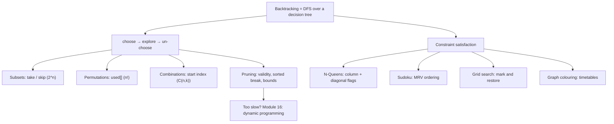

# Module 14 · Recursion and Backtracking

Prepared by **Hamna Zahid Khan**, Junior Lecturer

[🏠 Course home](../README.md)

> ⏱ 6 contact hours · 2 sessions · 🔴 Advanced

Backtracking systematically explores every possible choice, abandoning a path the moment it cannot succeed. This module turns that idea into one reusable template (choose, explore, un-choose), applies it to subsets, permutations and combinations, and then to constraint problems: N-Queens, Sudoku, word search and exam timetabling.

## 🎯 Module objectives

- Model problems as decision trees and estimate their size (2ⁿ, n!, C(n, k)).
- Apply the choose / explore / un-choose template correctly, including copying results.
- Prune with validity checks, sorting and bounds; measure the effect.
- Solve constraint satisfaction problems with incremental checks and the MRV heuristic.

## 📚 Sessions

| # | Session | Key ideas | Code |
|---|---|---|---|
| 1 | [The Backtracking Framework](session-01-backtracking-framework.md) | template, subsets, permutations, combinations, pruning | [`BacktrackingBasics.java`](src/BacktrackingBasics.java) |
| 2 | [Constraint Problems](session-02-constraint-problems.md) | CSPs, N-Queens, Sudoku with MRV, grid search, colouring | [`ConstraintProblems.java`](src/ConstraintProblems.java) |
| ✍️ | [Practice test](practice-test.md) | 20 MCQs + 3 coding scenarios | [`Labs14.java`](src/Labs14.java), [`SelfCheck.java`](src/SelfCheck.java) |

## 🗺️ Concept map



## 📄 One-page cheat sheet

| Pattern | Recursive call | Leaves |
|---|---|---|
| Subsets | skip, then take `a[i]`, recurse `i + 1` | 2ⁿ |
| Permutations | any `i` with `!used[i]` | n! |
| Combinations | `x` from `start`, recurse `x + 1` | C(n, k) |
| Combination sum (reuse) | `i` from `start`, recurse `i` | varies |
| Skip duplicates | sort; `if (i > start && a[i] == a[i−1]) continue;` | – |

**Template**

```java
void bt(List<Integer> cur, ...) {
    if (done) { out.add(new ArrayList<>(cur)); return; }
    for (choice : choices) {
        if (!valid) continue;           // or break if sorted
        cur.add(choice);                // choose
        bt(cur, ...);                   // explore
        cur.remove(cur.size() - 1);     // un-choose
    }
}
```

**N-Queens flags:** `col[c]`, `diag[r − c + n]`, `anti[r + c]`. **Sudoku box:** start `(3*(r/3), 3*(c/3))`.

## ▶️ Run the code

```bash
cd 14-recursion-backtracking/src
javac -d out *.java
java -ea -cp out SelfCheck
java -cp out ConstraintProblems
java -cp out Labs14 1          # Session 1 lab solutions (2 for Session 2)
```

See [`src/README.md`](src/README.md) for every file.
