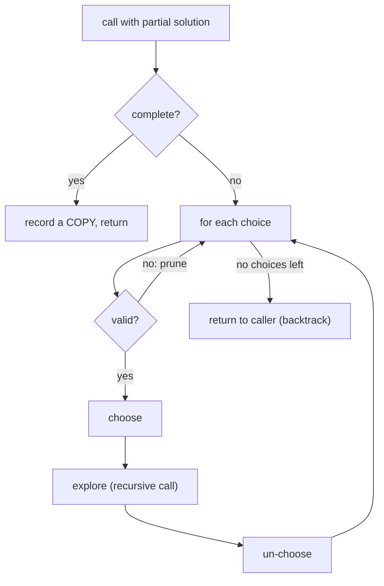
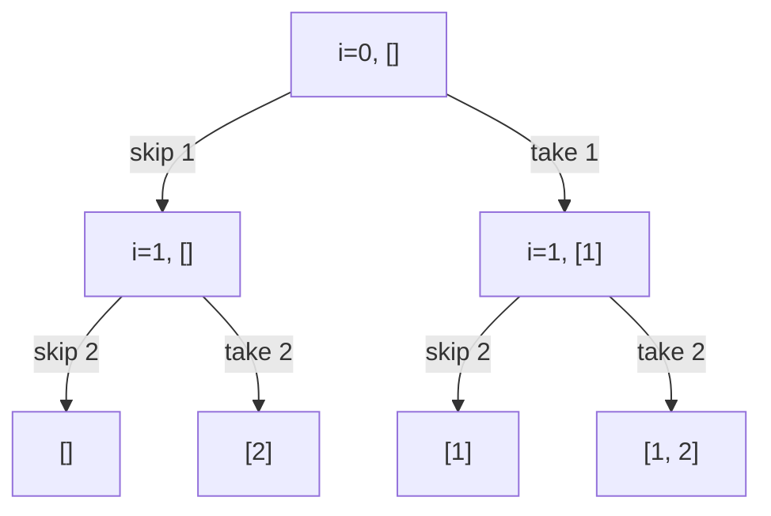

# Session 1 · The Backtracking Framework

Prepared by **Hamna Zahid Khan**, Junior Lecturer

[🏠 Course home](../README.md) · [📘 Module overview](./README.md) · [⬅ Module overview](./README.md) · [Next ➡](./session-02-constraint-problems.md)

> **Module 14 · Recursion and Backtracking** · ⏱ 3 hours (90 min lecture + 90 min lab)

## 🎯 Learning objectives

1. Describe backtracking as a depth-first search of a **decision (state-space) tree**.
2. Apply the template **choose → explore → un-choose** with a base case that records a solution.
3. Generate **subsets**, **permutations**, **combinations** and **combination sums**.
4. Use **pruning** to cut branches that cannot lead to a solution, and measure its effect.
5. Estimate the size of a search space (2ⁿ, n!, C(n, k)) before writing code.

---

## 1. What is backtracking?

Many problems ask for **all** (or any) arrangements that satisfy some rules: every team of 3 from 10 students, every timetable without clashes, every way to make change. Backtracking builds a candidate **one decision at a time**; after exploring everything that follows a decision, it **undoes** it and tries the next option.

> 🧭 **Analogy: exploring a maze with a ball of thread.** At each junction you pick a corridor and unroll thread behind you. At a dead end you walk back along the thread to the last junction (that is the *backtrack*) and try the next corridor. The thread is the current partial solution; rolling it back is the "un-choose" step.

Backtracking is recursion (Module 01) plus a **shared, mutable partial solution** that is restored after every recursive call.

## 2. The template

```java
void backtrack(State partial, Choices remaining) {
    if (isComplete(partial)) { record(copyOf(partial)); return; }      // base case
    for (Choice c : remaining) {
        if (!isValid(partial, c)) continue;                            // prune
        apply(c, partial);                                             // 1. choose
        backtrack(partial, remaining after c);                         // 2. explore
        undo(c, partial);                                              // 3. un-choose
    }
}
```



**Why copy when recording?** The partial list keeps changing after you record it; storing the same object would leave you with n references to one (eventually empty) list.

## 3. Pattern 1: subsets (include / exclude)

For each element decide **skip** or **take**. The decision tree for [1, 2]:



n elements ⇒ 2ⁿ leaves, 2ⁿ⁺¹ − 1 calls, O(n · 2ⁿ) time including copying.

## 4. Pattern 2: permutations (used[] array)

At each level choose **any unused** element. Level 1 has n choices, level 2 has n − 1, … ⇒ **n!** leaves.

### Dry run: permutations of [1, 2, 3]

| Path | used after choose | Action |
|---|---|---|
| [1] | {1} | explore |
| [1, 2] | {1, 2} | explore |
| [1, 2, 3] | {1, 2, 3} | **record**, un-choose 3 |
| [1, 3] | {1, 3} | un-choose 2, choose 3 |
| [1, 3, 2] | all | **record** |
| back to [] | {} | un-choose 1, choose 2 … |

Results: 123, 132, 213, 231, 312, 321.

## 5. Pattern 3: combinations (start index)

To choose k of n **without** caring about order, only pick numbers **larger** than the last one: pass a `start` index. This removes duplicates like [2, 1] vs [1, 2] by construction.

**Pruning:** if fewer numbers remain than you still need, stop. With `size` numbers chosen, the next number can be at most `n − (k − size) + 1`.

| C(5, 3) | calls |
|---|---|
| without pruning | 26 |
| with pruning | 20 |

The saving grows quickly for larger n and k.

## 6. Pattern 4: combination sum (reuse + sorted pruning)

Find all multisets of candidates summing to a target, each candidate usable many times. Recurse with `i` (not `i + 1`) to allow reuse. **Sort first**: as soon as a candidate exceeds the remaining sum, every later one does too, so `break`.

### Dry run: candidates [2, 3, 6, 7], target 7

| Path | Remaining | Action |
|---|---|---|
| [2] | 5 | explore 2, 3, … |
| [2, 2] | 3 | explore |
| [2, 2, 2] | 1 | 2 > 1 ⇒ break |
| [2, 2, 3] | 0 | **record** |
| [2, 3] | 2 | 3 > 2 ⇒ break |
| [3] | 4 | [3, 3] leaves 1 ⇒ dead; 6 > 4 break |
| [6] | 1 | 6 > 1, break |
| [7] | 0 | **record** |

Answer: [[2, 2, 3], [7]] in only 10 calls.

## 7. Complexity table

| Problem | Number of solutions | Time |
|---|---|---|
| Subsets of n | 2ⁿ | O(n · 2ⁿ) |
| Permutations of n | n! | O(n · n!) |
| Combinations C(n, k) | n! / (k!(n − k)!) | O(k · C(n, k)) |
| Balanced parentheses, n pairs | Catalan(n) | O(n · Catalan(n)) |
| Space (any of these) | – | O(n) recursion depth + output |

Rules of thumb: 2ⁿ is fine up to n ≈ 20-25; n! only up to n ≈ 10-11. Beyond that you need pruning, dynamic programming (Module 16) or a different idea.

---

## 8. Complete program

📄 **[`src/BacktrackingBasics.java`](src/BacktrackingBasics.java)**

```java
import java.util.ArrayList;
import java.util.Arrays;
import java.util.List;

/**
 * Session 1 demo: the backtracking template ("choose, explore, un-choose") applied to subsets,
 * permutations, combinations and combination sum, with call counters that show how pruning
 * shrinks the search tree.
 *
 * Compile:  javac -d out BacktrackingBasics.java
 * Run:      java -cp out BacktrackingBasics
 *
 * Prepared by Hamna Zahid Khan, Junior Lecturer
 */
public class BacktrackingBasics {
    static long calls;                       // recursive calls made by the last search

    /** All subsets: at each index decide "skip" or "take". 2^n leaves. */
    static List<List<Integer>> subsets(int[] a) {
        List<List<Integer>> out = new ArrayList<>();
        calls = 0;
        subsets(a, 0, new ArrayList<>(), out);
        return out;
    }

    private static void subsets(int[] a, int i, List<Integer> cur, List<List<Integer>> out) {
        calls++;
        if (i == a.length) { out.add(new ArrayList<>(cur)); return; }   // copy: cur keeps changing
        subsets(a, i + 1, cur, out);                 // choice 1: skip a[i]
        cur.add(a[i]);                               // choose
        subsets(a, i + 1, cur, out);                 // explore
        cur.remove(cur.size() - 1);                  // un-choose (backtrack)
    }

    /** All permutations with a used[] array. n! leaves. */
    static List<List<Integer>> permutations(int[] a) {
        List<List<Integer>> out = new ArrayList<>();
        calls = 0;
        permute(a, new boolean[a.length], new ArrayList<>(), out);
        return out;
    }

    private static void permute(int[] a, boolean[] used, List<Integer> cur, List<List<Integer>> out) {
        calls++;
        if (cur.size() == a.length) { out.add(new ArrayList<>(cur)); return; }
        for (int i = 0; i < a.length; i++) {
            if (used[i]) continue;
            used[i] = true; cur.add(a[i]);           // choose
            permute(a, used, cur, out);              // explore
            used[i] = false; cur.remove(cur.size() - 1);   // un-choose
        }
    }

    /** Combinations of k numbers from 1..n, with pruning: stop when too few numbers remain. */
    static List<List<Integer>> combinations(int n, int k, boolean prune) {
        List<List<Integer>> out = new ArrayList<>();
        calls = 0;
        combine(1, n, k, prune, new ArrayList<>(), out);
        return out;
    }

    private static void combine(int start, int n, int k, boolean prune, List<Integer> cur, List<List<Integer>> out) {
        calls++;
        if (cur.size() == k) { out.add(new ArrayList<>(cur)); return; }
        int last = prune ? n - (k - cur.size()) + 1 : n;     // need k - size more numbers after this one
        for (int x = start; x <= last; x++) {
            cur.add(x);
            combine(x + 1, n, k, prune, cur, out);
            cur.remove(cur.size() - 1);
        }
    }

    /** Combination sum: numbers may be reused; candidates sorted so we can stop early (prune). */
    static List<List<Integer>> combinationSum(int[] cand, int target) {
        int[] c = cand.clone();
        Arrays.sort(c);
        List<List<Integer>> out = new ArrayList<>();
        calls = 0;
        sum(c, 0, target, new ArrayList<>(), out);
        return out;
    }

    private static void sum(int[] c, int start, int remain, List<Integer> cur, List<List<Integer>> out) {
        calls++;
        if (remain == 0) { out.add(new ArrayList<>(cur)); return; }
        for (int i = start; i < c.length; i++) {
            if (c[i] > remain) break;                // sorted: every later candidate is too big too
            cur.add(c[i]);
            sum(c, i, remain - c[i], cur, out);      // i, not i + 1: reuse allowed
            cur.remove(cur.size() - 1);
        }
    }

    /** Indented trace of the subset recursion tree for a small input. */
    static void traceSubsets(int[] a, int i, List<Integer> cur, String indent) {
        if (i == a.length) { System.out.println(indent + "leaf " + cur); return; }
        System.out.println(indent + "i=" + i + " cur=" + cur + "  skip " + a[i] + " / take " + a[i]);
        traceSubsets(a, i + 1, cur, indent + "  ");
        cur.add(a[i]);
        traceSubsets(a, i + 1, cur, indent + "  ");
        cur.remove(cur.size() - 1);
    }

    public static void main(String[] args) {
        System.out.println("== Recursion tree of subsets([1, 2]) ==");
        traceSubsets(new int[]{1, 2}, 0, new ArrayList<>(), "");

        System.out.println("\n== Subsets of [1, 2, 3] ==");
        System.out.println(subsets(new int[]{1, 2, 3}) + "  calls=" + calls);

        System.out.println("\n== Permutations of [1, 2, 3] ==");
        System.out.println(permutations(new int[]{1, 2, 3}) + "  calls=" + calls);

        System.out.println("\n== Combinations C(5, 3) ==");
        List<List<Integer>> c = combinations(5, 3, false);
        long noPrune = calls;
        System.out.println(c);
        combinations(5, 3, true);
        System.out.println(c.size() + " combinations; calls without pruning = " + noPrune + ", with pruning = " + calls);

        System.out.println("\n== Combination sum: candidates [2, 3, 6, 7], target 7 ==");
        System.out.println(combinationSum(new int[]{2, 3, 6, 7}, 7) + "  calls=" + calls);

        System.out.println("\n== Growth of the search space ==");
        System.out.println(" n   subsets 2^n   permutations n!   calls(subsets)   calls(perms)");
        for (int n : new int[]{4, 8, 10}) {
            int[] a = new int[n];
            for (int i = 0; i < n; i++) a[i] = i;
            subsets(a);
            long cs = calls;
            permutations(a);
            System.out.printf("%2d   %11d   %15d   %14d   %12d%n", n, 1L << n, factorial(n), cs, calls);
        }
    }

    static long factorial(int n) { long f = 1; for (int i = 2; i <= n; i++) f *= i; return f; }
}
```

**Real output:**

```text
$ java -cp out BacktrackingBasics
== Recursion tree of subsets([1, 2]) ==
i=0 cur=[]  skip 1 / take 1
  i=1 cur=[]  skip 2 / take 2
    leaf []
    leaf [2]
  i=1 cur=[1]  skip 2 / take 2
    leaf [1]
    leaf [1, 2]

== Subsets of [1, 2, 3] ==
[[], [3], [2], [2, 3], [1], [1, 3], [1, 2], [1, 2, 3]]  calls=15

== Permutations of [1, 2, 3] ==
[[1, 2, 3], [1, 3, 2], [2, 1, 3], [2, 3, 1], [3, 1, 2], [3, 2, 1]]  calls=16

== Combinations C(5, 3) ==
[[1, 2, 3], [1, 2, 4], [1, 2, 5], [1, 3, 4], [1, 3, 5], [1, 4, 5], [2, 3, 4], [2, 3, 5], [2, 4, 5], [3, 4, 5]]
10 combinations; calls without pruning = 26, with pruning = 20

== Combination sum: candidates [2, 3, 6, 7], target 7 ==
[[2, 2, 3], [7]]  calls=10

== Growth of the search space ==
 n   subsets 2^n   permutations n!   calls(subsets)   calls(perms)
 4            16                24               31             65
 8           256             40320              511         109601
10          1024           3628800             2047        9864101
```

The last table is the point of this session: subsets of 10 elements need 2,047 calls, permutations of 10 need almost 10 million. Always estimate before you run.

---

## 9. Worked examples (basic → advanced)

**Example 1 (basic): letter combinations of a phone number.** Each digit offers 3-4 letters; one level of recursion per digit.

```java
/** Letter combinations of a phone number: one choice per digit (the keypad mapping). */
static final String[] KEYS = {"", "", "abc", "def", "ghi", "jkl", "mno", "pqrs", "tuv", "wxyz"};

static List<String> phoneLetters(String digits) {
    List<String> out = new ArrayList<>();
    if (!digits.isEmpty()) letters(digits, 0, new StringBuilder(), out);
    return out;
}

private static void letters(String d, int i, StringBuilder sb, List<String> out) {
    if (i == d.length()) { out.add(sb.toString()); return; }
    for (char c : KEYS[d.charAt(i) - '0'].toCharArray()) {
        sb.append(c);
        letters(d, i + 1, sb, out);
        sb.deleteCharAt(sb.length() - 1);
    }
}
```
<sub>Full, compiled version: [`src/Labs14.java`](src/Labs14.java)</sub>

"23" → ad, ae, af, bd, be, bf, cd, ce, cf (3 × 3 = 9).

**Example 2 (intermediate): generate balanced parentheses.** Add '(' if fewer than n are open; add ')' only if it closes an open one. These two rules **prune** every unbalanced prefix, so no invalid string is ever built.

```java
/** All balanced strings of n pairs: add '(' while opens remain, add ')' only if it stays balanced. */
static List<String> parentheses(int n) {
    List<String> out = new ArrayList<>();
    gen(n, 0, 0, new StringBuilder(), out);
    return out;
}

private static void gen(int n, int open, int close, StringBuilder sb, List<String> out) {
    if (sb.length() == 2 * n) { out.add(sb.toString()); return; }
    if (open < n) { sb.append('('); gen(n, open + 1, close, sb, out); sb.deleteCharAt(sb.length() - 1); }
    if (close < open) { sb.append(')'); gen(n, open, close + 1, sb, out); sb.deleteCharAt(sb.length() - 1); }
}
```
<sub>Full, compiled version: [`src/Labs14.java`](src/Labs14.java)</sub>

n = 3 gives 5 strings, the Catalan number C₃.

**Example 3 (advanced): subsets of a list with duplicates.** [1, 2, 2] must not produce [1, 2] twice. Sort, and at each level skip an element equal to the **previous sibling** (`i > start && s[i] == s[i − 1]`).

```java
/** Subsets without duplicate results when the input has repeats: sort, then skip equal siblings. */
static List<List<Integer>> subsetsWithDup(int[] a) {
    int[] s = a.clone();
    Arrays.sort(s);
    List<List<Integer>> out = new ArrayList<>();
    dup(s, 0, new ArrayList<>(), out);
    return out;
}

private static void dup(int[] s, int start, List<Integer> cur, List<List<Integer>> out) {
    out.add(new ArrayList<>(cur));
    for (int i = start; i < s.length; i++) {
        if (i > start && s[i] == s[i - 1]) continue;     // same value already tried at this level
        cur.add(s[i]);
        dup(s, i + 1, cur, out);
        cur.remove(cur.size() - 1);
    }
}
```
<sub>Full, compiled version: [`src/Labs14.java`](src/Labs14.java)</sub>

Result: [], [1], [1, 2], [1, 2, 2], [2], [2, 2] (6 instead of 8).

## 10. Real-life problem: choosing a project team

**Problem.** A lecturer must form a 4-person project team from 12 students so that the team includes at least one strong programmer and at least one strong writer, and the total of their weekly free hours is at least 40. She wants **every** valid team to discuss options with the class.

**Solution.** Generate combinations C(12, 4) = 495 with a `start` index and prune early: if the hours chosen so far plus the best possible hours of the remaining slots cannot reach 40, stop exploring that branch. Check the skills condition at the leaf. 495 candidates is tiny, so even without pruning this runs instantly; with 30 students and teams of 6 (593,775 candidates) the pruning starts to matter.

## 11. Common mistakes

| Mistake | Fix |
|---|---|
| Recording `cur` instead of `new ArrayList<>(cur)` | always copy at the leaf |
| Forgetting to un-choose | every `add`/`used[i] = true` needs a matching undo after the call |
| Using `i + 1` vs `i` incorrectly | `i + 1` = each item once; `i` = reuse allowed |
| Duplicates in results with repeated input | sort and skip equal siblings |
| Pruning with `continue` when `break` is valid (sorted input) | `break` saves the rest of the loop |
| Running n! search for n = 15 | estimate first; use DP or a smarter model |

## 12. Best practices

- Draw the first two levels of the decision tree before coding.
- Keep the partial solution in **one** mutable structure (list, array, `StringBuilder`) and undo changes; copying at every level is slow.
- Put the cheapest, most powerful pruning test first.
- Count calls (as the program does) to see whether pruning helps.

---

## 13. Lab tasks

**Lab 1.1: Phone letters.** Implement `phoneLetters(digits)`.

<details>
<summary>✅ Solution</summary>

See Example 1.

</details>

**Lab 1.2: Balanced parentheses.** Implement `parentheses(n)` and verify that n = 4 gives 14 strings.

<details>
<summary>✅ Solution</summary>

See Example 2. `SelfCheck` asserts 14 for n = 4 (Catalan numbers 1, 1, 2, 5, 14, 42, …).

</details>

**Lab 1.3: Subsets with duplicates.**

<details>
<summary>✅ Solution</summary>

See Example 3.

</details>

**Lab 1.4: Permutations in lexicographic order without `used[]`.** Generate permutations of "abc" by swapping a[i] with each a[j] (j ≥ i) and swapping back. Is the output in lexicographic order?

<details>
<summary>💡 Hint</summary>

Swap, recurse on i + 1, swap back.

</details>

<details>
<summary>✅ Solution</summary>

```java
static void permute(char[] a, int i, List<String> out) {
    if (i == a.length) { out.add(new String(a)); return; }
    for (int j = i; j < a.length; j++) {
        char t = a[i]; a[i] = a[j]; a[j] = t;      // choose a[j] for position i
        permute(a, i + 1, out);
        t = a[i]; a[i] = a[j]; a[j] = t;           // un-choose
    }
}
```

Output: abc, acb, bac, bca, **cba, cab**: not lexicographic, because the swap disturbs the order of the remaining letters. The `used[]` version (or sorting + next-permutation) keeps lexicographic order.

</details>

**Real output of the Session 1 lab solutions:**

```text
$ java -cp out Labs14 1
-- Session 1 labs --
parentheses(3) = [((())), (()()), (())(), ()(()), ()()()]
phoneLetters("23") = [ad, ae, af, bd, be, bf, cd, ce, cf]
subsetsWithDup([1, 2, 2]) = [[], [1], [1, 2], [1, 2, 2], [2], [2, 2]]
```

---

## 14. Quiz

**Q1.** The three steps inside a backtracking loop are:

- **A.** sort, search, return
- **B.** choose, explore, un-choose
- **C.** push, pop, peek
- **D.** divide, conquer, combine

**Q2.** How many subsets does a set of 5 elements have?

- **A.** 5
- **B.** 10
- **C.** 25
- **D.** 32

**Q3.** Why record `new ArrayList<>(cur)` instead of `cur`?

- **A.** it is faster
- **B.** cur keeps changing after recording; a copy freezes the solution
- **C.** Java forbids adding lists to lists
- **D.** to remove duplicates

**Q4.** In combinations, passing a start index guarantees:

- **A.** every order is generated
- **B.** each set is generated once, in increasing order
- **C.** the algorithm is O(n)
- **D.** duplicates in the input are removed

**Q5.** Sorting candidates in combination sum lets you:

- **A.** use binary search for the answer
- **B.** break out of the loop as soon as a candidate exceeds the remainder
- **C.** avoid recursion
- **D.** reuse numbers

<details>
<summary><b>Show answers</b></summary>

1. **B**: Undoing the choice restores the state for the next option.
2. **D**: 2⁵.
3. **B**: Otherwise every stored result is the same mutable list.
4. **B**: [2, 1] is never built after [1, 2].
5. **B**: All later candidates are larger.

</details>

---

## 15. Summary

- Backtracking = DFS over a decision tree with **choose / explore / un-choose**.
- Subsets: include/exclude (2ⁿ). Permutations: `used[]` (n!). Combinations: `start` index (C(n, k)).
- Copy the partial solution when recording it.
- **Pruning** removes branches that cannot succeed; measure it with call counters.
- Estimate the search space first; exponential growth is the enemy.

## 16. Viva / interview questions

1. What is the difference between recursion and backtracking?
2. Derive the number of calls made by the subsets recursion.
3. How do you generate permutations of a string with repeated letters without duplicates?
4. Why is combination sum's recursion `i` and not `i + 1`? What changes for "each number once"?
5. What is the maximum recursion depth of these algorithms, and why does it matter in Java?
6. Generate all k-digit numbers whose digits strictly increase.

---

[⬅ Module overview](./README.md) · [📘 Module overview](./README.md) · [Next ➡](./session-02-constraint-problems.md)
