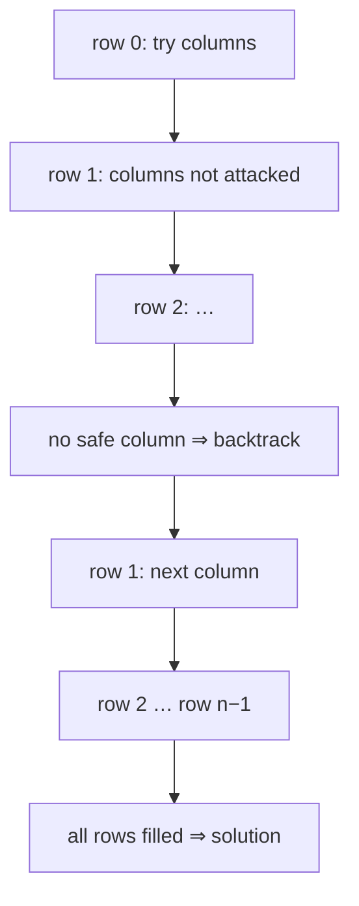

# Session 2 · Constraint Problems: N-Queens, Sudoku and Friends

Prepared by **Hamna Zahid Khan**, Junior Lecturer

[🏠 Course home](../README.md) · [📘 Module overview](./README.md) · [⬅ Previous](./session-01-backtracking-framework.md) · [Practice test ➡](./practice-test.md)

> **Module 14 · Recursion and Backtracking** · ⏱ 3 hours (90 min lecture + 90 min lab)

## 🎯 Learning objectives

1. Model a puzzle as a **constraint satisfaction problem**: variables, domains, constraints.
2. Solve **N-Queens** with O(1) conflict checks using column and diagonal flags.
3. Solve **Sudoku** by backtracking and speed it up with the **most-constrained-variable** heuristic.
4. Backtrack on grids (**word search**) by marking and restoring cells.
5. Apply the same model to exam-timetable colouring and string partitioning.

---

## 1. Constraint satisfaction problems (CSPs)

| Part | N-Queens | Sudoku | Exam timetable |
|---|---|---|---|
| Variables | the queen's column in each row | each empty cell | each exam |
| Domain | columns 0..n−1 | digits 1-9 | time slots 1..m |
| Constraints | no shared column or diagonal | row, column and box all different | clashing exams in different slots |

Backtracking assigns variables one at a time and **checks constraints immediately**, abandoning a partial assignment the moment it breaks a rule. That early rejection is what makes it vastly faster than generating every complete assignment.

> 🪑 **Analogy: seating guests at a wedding.** You seat guests one by one. The moment two relatives who are not on speaking terms end up at the same table, you move the last guest, without bothering to seat the remaining 150 people first. Checking early is the whole trick.

## 2. N-Queens

Place n queens on an n × n board so that none attacks another (same row, column or diagonal).

**Model:** put exactly one queen per row (rows are never shared by construction); choose its column.

**O(1) safety checks.** Squares on the same "\" diagonal share `r − c`; squares on the same "/" anti-diagonal share `r + c`. Keep three boolean arrays:

| Array | Index | Size |
|---|---|---|
| `col[c]` | column | n |
| `diag[r − c + n]` | "\" diagonal (shifted to be ≥ 0) | 2n |
| `anti[r + c]` | "/" diagonal | 2n |



### Dry run: 4-Queens

| Row | Try column | Result |
|---|---|---|
| 0 | 0 | place |
| 1 | 0 ✗ col, 1 ✗ diag, 2 | place |
| 2 | 0 ✗, 1 ✗, 2 ✗, 3 ✗ | **dead end** ⇒ back to row 1 |
| 1 | 3 | place |
| 2 | 0 ✗, 1 | place |
| 3 | 0 ✗, 1 ✗, 2 ✗, 3 ✗ | dead end ⇒ back … row 0 col 0 fails entirely |
| 0 | 1 | place |
| 1 | 3 | place |
| 2 | 0 | place |
| 3 | 2 | **solution** [1, 3, 0, 2] |

Brute force would examine nⁿ column assignments (10¹⁰ for n = 10); backtracking places only about 35,000 queens for n = 10 (see the program).

## 3. Sudoku

Variables are the empty cells; a digit is legal if it is not already in the cell's row, column or 3 × 3 box. The box of cell (r, c) starts at (3·⌊r/3⌋, 3·⌊c/3⌋).

**Variable ordering matters.** Filling cells in reading order works but explores many dead ends. The **minimum remaining values (MRV)** heuristic picks the empty cell with the **fewest** legal digits:

- a cell with 0 legal digits ⇒ fail immediately (a dead end found early);
- a cell with 1 legal digit ⇒ forced, no branching;
- otherwise, the smallest branching factor.

| Order | Digits placed for the sample puzzle |
|---|---|
| first empty cell | 4,208 |
| most constrained cell (MRV) | 51 |

Same answer, 80 times less work. MRV is the standard first improvement for any CSP solver.

## 4. Backtracking on grids

Grid searches (word search, rat in a maze, Boggle) mark the current cell as **in use** before exploring neighbours and **restore** it afterwards, so the same cell is not reused on one path but is available to other paths.

```java
char saved = g[r][c];
g[r][c] = '#';                     // choose: mark visited on this path
boolean ok = find(... r + 1, c) || find(... r - 1, c) || find(... r, c + 1) || find(... r, c - 1);
g[r][c] = saved;                   // un-choose: restore
```

## 5. Complexity table

| Problem | Worst-case search space | In practice |
|---|---|---|
| N-Queens | n! (one queen per row and column) | far less with diagonal pruning |
| Sudoku | 9^(empty cells) | tens to thousands of placements with MRV |
| Word search (R × C grid, word length L) | R · C · 4 · 3^(L−1) | stops at first mismatch |
| Graph m-colouring (V vertices) | m^V | prunes on the first clash |
| Space | O(depth) recursion + the board | |

These problems are NP-hard in general (Sudoku of size n², graph colouring), so no known algorithm is polynomial; good pruning and ordering make real instances fast.

---

## 6. Complete program

📄 **[`src/ConstraintProblems.java`](src/ConstraintProblems.java)**

```java
/**
 * Session 2 demo: constraint-satisfaction with backtracking. N-Queens (one board and solution
 * counts, with O(1) conflict checks using column and diagonal flags) and a Sudoku solver that tries
 * the most constrained empty cell first, with counters showing how much each technique prunes.
 *
 * Compile:  javac -d out ConstraintProblems.java
 * Run:      java -cp out ConstraintProblems
 *
 * Prepared by Hamna Zahid Khan, Junior Lecturer
 */
public class ConstraintProblems {
    static long nodes;                                     // placements tried in the last search

    // ---------------- N-Queens ----------------
    /** Count all solutions; cols/diag/anti flags make each safety check O(1). */
    static int countQueens(int n) {
        nodes = 0;
        return place(0, n, new boolean[n], new boolean[2 * n], new boolean[2 * n], null);
    }

    /** Find the first solution; queenCol[r] = column of the queen in row r. */
    static int[] firstQueens(int n) {
        int[] q = new int[n];
        java.util.Arrays.fill(q, -1);
        nodes = 0;
        return place(0, n, new boolean[n], new boolean[2 * n], new boolean[2 * n], q) > 0 ? q : null;
    }

    private static int place(int r, int n, boolean[] col, boolean[] diag, boolean[] anti, int[] q) {
        if (r == n) return 1;
        int found = 0;
        for (int c = 0; c < n; c++) {
            if (col[c] || diag[r - c + n] || anti[r + c]) continue;   // attacked: prune this branch
            nodes++;
            col[c] = diag[r - c + n] = anti[r + c] = true;           // choose
            if (q != null) q[r] = c;
            found += place(r + 1, n, col, diag, anti, q);            // explore
            if (q != null && found > 0) return found;                // first solution is enough
            col[c] = diag[r - c + n] = anti[r + c] = false;          // un-choose
        }
        return found;
    }

    static void printBoard(int[] q) {
        for (int r = 0; r < q.length; r++) {
            StringBuilder sb = new StringBuilder("  ");
            for (int c = 0; c < q.length; c++) sb.append(q[r] == c ? "Q " : ". ");
            System.out.println(sb.toString().trim());
        }
    }

    // ---------------- Sudoku ----------------
    static boolean canPlace(int[][] g, int r, int c, int d) {
        for (int i = 0; i < 9; i++) {
            if (g[r][i] == d || g[i][c] == d) return false;
            if (g[3 * (r / 3) + i / 3][3 * (c / 3) + i % 3] == d) return false;
        }
        return true;
    }

    /** Backtracking solver. If mrv is true, always fill the empty cell with the fewest legal digits. */
    static boolean solve(int[][] g, boolean mrv) {
        int br = -1, bc = -1, bestCount = 10;
        for (int r = 0; r < 9 && bestCount > 1; r++)
            for (int c = 0; c < 9; c++) {
                if (g[r][c] != 0) continue;
                if (!mrv) { br = r; bc = c; bestCount = 0; break; }
                int cnt = 0;
                for (int d = 1; d <= 9; d++) if (canPlace(g, r, c, d)) cnt++;
                if (cnt < bestCount) { bestCount = cnt; br = r; bc = c; }
                if (cnt == 0) return false;                         // dead end: no digit fits
            }
        if (br == -1) return true;                                  // no empty cell: solved
        for (int d = 1; d <= 9; d++) {
            if (!canPlace(g, br, bc, d)) continue;
            nodes++;
            g[br][bc] = d;
            if (solve(g, mrv)) return true;
            g[br][bc] = 0;                                          // backtrack
        }
        return false;
    }

    static int[][] parse(String[] rows) {
        int[][] g = new int[9][9];
        for (int r = 0; r < 9; r++) for (int c = 0; c < 9; c++) {
            char ch = rows[r].charAt(c);
            g[r][c] = ch == '.' ? 0 : ch - '0';
        }
        return g;
    }

    static void printGrid(int[][] g) {
        for (int r = 0; r < 9; r++) {
            StringBuilder sb = new StringBuilder("  ");
            for (int c = 0; c < 9; c++) sb.append(g[r][c] == 0 ? "." : String.valueOf(g[r][c])).append(c % 3 == 2 && c < 8 ? " | " : " ");
            System.out.println(sb.toString().trim());
            if (r % 3 == 2 && r < 8) System.out.println("  ------+-------+------");
        }
    }

    public static void main(String[] args) {
        System.out.println("== 6-Queens: first solution ==");
        int[] q = firstQueens(6);
        printBoard(q);
        System.out.println("queen column per row = " + java.util.Arrays.toString(q) + ", placements tried = " + nodes);

        System.out.println("\n== Number of N-Queens solutions ==");
        System.out.println(" n   solutions   placements tried   n^n (brute force)");
        for (int n = 4; n <= 10; n++) {
            int s = countQueens(n);
            System.out.printf("%2d   %9d   %16d   %17d%n", n, s, nodes, (long) Math.pow(n, n));
        }

        String[] puzzle = {
            "53..7....", "6..195...", ".98....6.",
            "8...6...3", "4..8.3..1", "7...2...6",
            ".6....28.", "...419..5", "....8..79"};
        System.out.println("\n== Sudoku puzzle ==");
        printGrid(parse(puzzle));
        int[][] g1 = parse(puzzle);
        nodes = 0;
        boolean ok = solve(g1, false);
        long plain = nodes;
        int[][] g2 = parse(puzzle);
        nodes = 0;
        solve(g2, true);
        System.out.println("\n== Solved (" + ok + ") ==");
        printGrid(g2);
        System.out.println("digits placed: first-empty-cell order = " + plain + ", most-constrained-cell order = " + nodes);
        System.out.println("both solutions identical: " + java.util.Arrays.deepEquals(g1, g2));
    }
}
```

**Real output:**

```text
$ java -cp out ConstraintProblems
== 6-Queens: first solution ==
. Q . . . .
. . . Q . .
. . . . . Q
Q . . . . .
. . Q . . .
. . . . Q .
queen column per row = [1, 3, 5, 0, 2, 4], placements tried = 31

== Number of N-Queens solutions ==
 n   solutions   placements tried   n^n (brute force)
 4           2                 16                 256
 5          10                 53                3125
 6           4                152               46656
 7          40                551              823543
 8          92               2056            16777216
 9         352               8393           387420489
10         724              35538         10000000000

== Sudoku puzzle ==
5 3 . | . 7 . | . . .
6 . . | 1 9 5 | . . .
. 9 8 | . . . | . 6 .
  ------+-------+------
8 . . | . 6 . | . . 3
4 . . | 8 . 3 | . . 1
7 . . | . 2 . | . . 6
  ------+-------+------
. 6 . | . . . | 2 8 .
. . . | 4 1 9 | . . 5
. . . | . 8 . | . 7 9

== Solved (true) ==
5 3 4 | 6 7 8 | 9 1 2
6 7 2 | 1 9 5 | 3 4 8
1 9 8 | 3 4 2 | 5 6 7
  ------+-------+------
8 5 9 | 7 6 1 | 4 2 3
4 2 6 | 8 5 3 | 7 9 1
7 1 3 | 9 2 4 | 8 5 6
  ------+-------+------
9 6 1 | 5 3 7 | 2 8 4
2 8 7 | 4 1 9 | 6 3 5
3 4 5 | 2 8 6 | 1 7 9
digits placed: first-empty-cell order = 4208, most-constrained-cell order = 51
both solutions identical: true
```

---

## 7. Worked examples (basic → advanced)

**Example 1 (basic): word search.** Does "ABCCED" appear in the grid ABCE / SFCS / ADEE by moving up, down, left or right without reusing a cell?

```java
/** Does the word appear in the grid along adjacent (up/down/left/right) cells, each used once? */
static boolean wordSearch(char[][] g, String w) {
    for (int r = 0; r < g.length; r++)
        for (int c = 0; c < g[0].length; c++)
            if (find(g, w, 0, r, c)) return true;
    return false;
}

private static boolean find(char[][] g, String w, int k, int r, int c) {
    if (k == w.length()) return true;
    if (r < 0 || c < 0 || r >= g.length || c >= g[0].length || g[r][c] != w.charAt(k)) return false;
    char saved = g[r][c];
    g[r][c] = '#';                                   // mark as used on this path
    boolean ok = find(g, w, k + 1, r + 1, c) || find(g, w, k + 1, r - 1, c)
            || find(g, w, k + 1, r, c + 1) || find(g, w, k + 1, r, c - 1);
    g[r][c] = saved;                                 // restore (backtrack)
    return ok;
}
```
<sub>Full, compiled version: [`src/Labs14.java`](src/Labs14.java)</sub>

ABCCED → true, SEE → true, ABCB → false (it would need to reuse the B).

**Example 2 (intermediate): palindrome partitioning.** Cut a string into pieces that are all palindromes. Choose the end of the first piece; prune immediately if that piece is not a palindrome.

```java
/** All ways to cut a string into palindromic pieces. */
static List<List<String>> palindromePartition(String s) {
    List<List<String>> out = new ArrayList<>();
    part(s, 0, new ArrayList<>(), out);
    return out;
}

private static void part(String s, int start, List<String> cur, List<List<String>> out) {
    if (start == s.length()) { out.add(new ArrayList<>(cur)); return; }
    for (int end = start + 1; end <= s.length(); end++) {
        if (!isPal(s, start, end - 1)) continue;     // prune: this cut cannot lead to a solution
        cur.add(s.substring(start, end));
        part(s, end, cur, out);
        cur.remove(cur.size() - 1);
    }
}

static boolean isPal(String s, int i, int j) {
    while (i < j) if (s.charAt(i++) != s.charAt(j--)) return false;
    return true;
}
```
<sub>Full, compiled version: [`src/Labs14.java`](src/Labs14.java)</sub>

"aab" → [a, a, b] and [aa, b].

**Example 3 (advanced): exam timetabling as graph colouring.** Exams are vertices; an edge joins two exams that share a student. Assign each exam one of m slots so that adjacent exams differ.

```java
/** Assign each exam one of m time slots so that clashing exams differ (graph m-colouring). */
static int[] colour(boolean[][] clash, int m) {
    int[] slot = new int[clash.length];
    return assign(clash, m, 0, slot) ? slot : null;
}

private static boolean assign(boolean[][] clash, int m, int v, int[] slot) {
    if (v == clash.length) return true;
    for (int s = 1; s <= m; s++) {
        boolean ok = true;
        for (int u = 0; u < v && ok; u++) if (clash[v][u] && slot[u] == s) ok = false;
        if (!ok) continue;
        slot[v] = s;
        if (assign(clash, m, v + 1, slot)) return true;
        slot[v] = 0;
    }
    return false;
}
```
<sub>Full, compiled version: [`src/Labs14.java`](src/Labs14.java)</sub>

DSA, OOP and AI all clash with each other (a triangle), so **2 slots are impossible**; with 3 slots the solver returns DSA 1, OOP 2, AI 3, DB 1, Math 2.

## 8. Real-life problem: final-exam timetable for a department

**Problem.** A department schedules 25 final exams in a one-week window with 10 slots. Two exams cannot share a slot if any student takes both; some lecturers are unavailable in certain slots, and no student should sit three exams in one day.

**Solution.** Model a CSP: variables = exams, domains = allowed slots (lecturer availability removes values up front), constraints = clash edges and the per-day limit. Backtrack exam by exam with **MRV** (schedule the exam with the fewest remaining legal slots first, typically large core courses) and check constraints on every assignment. Real timetabling tools add *forward checking* (removing a value from neighbours' domains as soon as it is used) and local search for very large instances, but they are built on this core.

## 9. Common mistakes

| Mistake | Fix |
|---|---|
| Checking safety by scanning the whole board each time (O(n²)) | O(1) flags for columns and diagonals |
| Negative array index for `r − c` | shift by n: `diag[r − c + n]` |
| Forgetting to clear flags on backtrack | undo exactly what you set |
| Grid search: not restoring the marked cell | other paths need it |
| Continuing the search after the first solution when one is enough | return `true` up the call chain |
| Choosing variables in a fixed order on hard CSPs | MRV: most constrained first |

## 10. Best practices

- Model first: write down variables, domains and constraints before coding.
- Check constraints **incrementally** (only what the last assignment could break).
- Order variables by MRV and try the least constraining values first.
- Return a boolean for "find one", an int for "count all", and a list for "list all".

---

## 11. Lab tasks

**Lab 2.1: Word search.**

<details>
<summary>✅ Solution</summary>

See Example 1.

</details>

**Lab 2.2: Palindrome partitioning.**

<details>
<summary>✅ Solution</summary>

See Example 2.

</details>

**Lab 2.3: Exam colouring.** Implement `colour(clash, m)` and find the minimum number of slots for the five exams.

<details>
<summary>✅ Solution</summary>

See Example 3. Try m = 1, 2, 3, …; the first m that succeeds is **3** (the chromatic number), because of the DSA-OOP-AI triangle.

</details>

**Lab 2.4: All 8-Queens solutions.** Modify `place` to collect every board for n = 8. How many are there, and how many are fundamentally different if rotations and reflections are treated as the same?

<details>
<summary>✅ Solution</summary>

Remove the early return and add a copy of `q` to a list at `r == n`. There are **92** solutions; grouping boards that are rotations or mirror images of each other leaves **12** fundamental solutions.

</details>

**Real output of the Session 2 lab solutions:**

```text
$ java -cp out Labs14 2
-- Session 2 labs --
wordSearch ABCCED = true, SEE = true, ABCB = false
palindromePartition("aab") = [[a, a, b], [aa, b]]
2 slots possible? false; 3 slots: [1, 2, 3, 1, 2] for [DSA, OOP, AI, DB, Math]
```

---

## 12. Quiz

**Q1.** In N-Queens, two squares (r1, c1) and (r2, c2) are on the same "\" diagonal when:

- **A.** r1 + c1 = r2 + c2
- **B.** r1 − c1 = r2 − c2
- **C.** r1 = r2
- **D.** c1 · r1 = c2 · r2

**Q2.** Placing one queen per row guarantees that:

- **A.** no two queens share a row
- **B.** no two queens share a diagonal
- **C.** a solution exists for every n
- **D.** the search is polynomial

**Q3.** The MRV heuristic chooses next the variable with:

- **A.** the most legal values
- **B.** the fewest legal values
- **C.** the smallest index
- **D.** a random index

**Q4.** In grid word search, a cell is marked with '#' and later restored so that:

- **A.** it cannot be used again by any path
- **B.** it is not reused on the current path but stays available to other paths
- **C.** the grid is printed correctly
- **D.** the algorithm runs in O(1)

**Q5.** Exam timetabling with clashes is an example of:

- **A.** shortest path
- **B.** graph colouring
- **C.** sorting
- **D.** hashing

<details>
<summary><b>Show answers</b></summary>

1. **B**: The difference is constant along a "\" diagonal.
2. **A**: Rows are handled by construction.
3. **B**: It fails fast and branches least.
4. **B**: Choose, explore, un-choose.
5. **B**: Clashing exams are adjacent vertices.

</details>

---

## 13. Summary

- A CSP has variables, domains and constraints; backtracking assigns and checks incrementally.
- N-Queens: one queen per row, O(1) checks with column and two diagonal arrays.
- Sudoku: legal-digit check for row, column and box; MRV ordering cuts the search dramatically.
- Grid problems mark and restore cells; colouring models timetables and register allocation.

## 14. Viva / interview questions

1. Why is `r − c` constant along one diagonal and `r + c` along the other?
2. What is forward checking, and how does it differ from plain backtracking?
3. Why are N-Queens solutions symmetric, and how can symmetry halve the search?
4. Explain why graph colouring is hard in general but easy for trees (2 colours).
5. How would you solve Sudoku with bitmasks to make the legality check O(1)?
6. Design a backtracking solver for a crossword fill-in puzzle.

---

[⬅ Previous](./session-01-backtracking-framework.md) · [📘 Module overview](./README.md) · [Practice test ➡](./practice-test.md)
